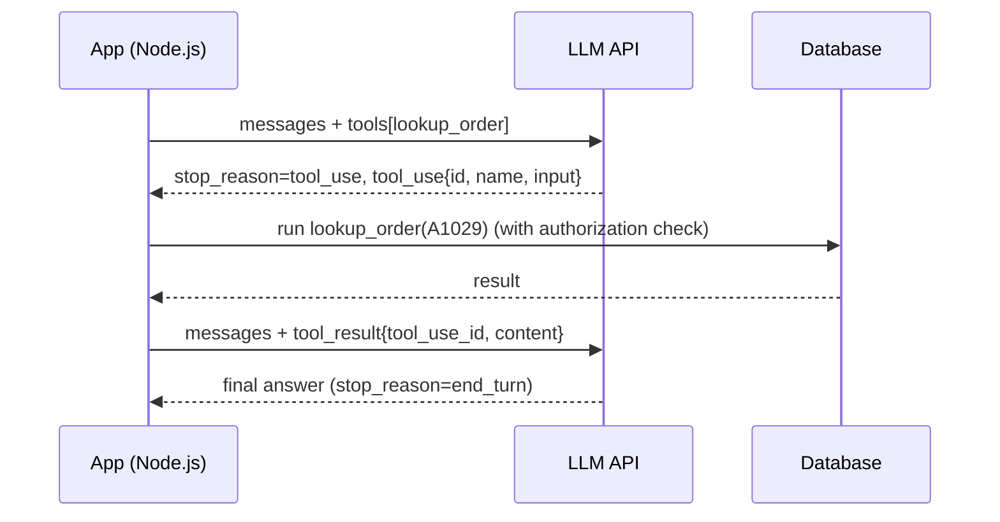

# Chương 4. Tool calling, agent loop và MCP

## 1. Tình huống

Nhân viên CSKH hỏi ShopAssist: "Đơn A1029 của khách Lan đang ở đâu?" Model không có dữ liệu đơn hàng, và nếu bạn không đưa gì, nó sẽ bịa một trạng thái nghe rất hợp lý. Cách đúng là cho model **gọi hàm** của bạn để lấy dữ kiện thật. Đó là tool calling. Khi model được phép gọi nhiều hàm liên tiếp để hoàn thành một mục tiêu, ta có **agent**. Còn MCP là chuẩn để các ứng dụng AI khác nhau cắm vào cùng một bộ tool mà không viết adapter riêng.

## 2. Tool calling

### 2.1 Cơ chế

Model **không chạy code**. Nó chỉ sinh ra một "yêu cầu gọi hàm" có cấu trúc, ứng dụng của bạn chạy hàm, rồi gửi kết quả lại.



Theo docs Anthropic (tra 07/11/2026): bạn khai báo tool bằng `name`, `description`, `input_schema` (JSON Schema). Khi model muốn gọi, response có `stop_reason: "tool_use"` và một hay nhiều block `tool_use` gồm `id`, `name`, `input`. Bạn trả lại bằng block `tool_result` có `tool_use_id` tương ứng. Có thể đặt `strict: true` để bảo đảm lời gọi khớp schema. `tool_choice` điều khiển việc gọi: `auto` (mặc định), `none`, và `disable_parallel_tool_use: true` để mỗi lượt chỉ một lời gọi. Cẩn thận: các giá trị forced tool use (`{"type":"any"}`, `{"type":"tool","name":...}`) **bị từ chối với lỗi 400** trên Claude Opus 5.5, Sonnet 5.5, Fable 5.1 (trang Errors của docs Anthropic, tra lại ngày 08/11/2026: trang liệt kê đúng Opus 5.5, Sonnet 5.5, Fable 5.1 và Mythos 5.1, không liệt kê Haiku 5.5); với các model này hãy dùng `auto` cùng `strict: true` hoặc structured output nếu cần output đúng dạng. Ví dụ điển hình của việc "mã cũ chạy trên model cũ nhưng gãy khi đổi model", nên mới cần eval khi đổi model (chương 8).

Phía OpenAI (Responses API, docs 07/11/2026): tool có `type: "function"`, `name`, `description`, `parameters`, `strict`. Model trả item `function_call` có `call_id`, `name`, `arguments` (chuỗi JSON). Bạn gửi lại item `function_call_output` với cùng `call_id`; hoặc dùng `previous_response_id` để khỏi gửi lại toàn bộ.

Hai nhà cung cấp cùng một ý tưởng nhưng khác tên trường. Nếu hỗ trợ cả hai, hãy bọc sau một interface chung.

### 2.2 Viết tool tốt

Mô tả tool là một phần của prompt. Model chọn tool và điền tham số dựa vào đó.
- `description` nói **tool làm gì, khi nào dùng, khi nào KHÔNG dùng, định dạng tham số** (ví dụ "mã đơn dạng A + 4 chữ số").
- Ít tool, mỗi tool một việc rõ ràng. Quá nhiều tool làm model chọn sai.
- Tham số dùng `enum` khi tập giá trị hữu hạn.
- Kết quả trả về ngắn gọn, chỉ trường cần thiết. Trả lỗi dễ hiểu để model tự sửa ("Không tìm thấy đơn A9999") thay vì stack trace.
- **Kiểm tra authorization trong code của tool**, không tin rằng model chỉ truyền ID hợp lệ (chương 9).

Ví dụ tool của ShopAssist:

```json
{
  "name": "lookup_order",
  "description": "Tra trạng thái một đơn hàng theo mã đơn (dạng A1029). Chỉ dùng khi người hỏi nêu rõ mã đơn. Không dùng để tìm đơn theo tên khách.",
  "input_schema": {
    "type": "object",
    "properties": { "order_id": { "type": "string", "description": "Mã đơn, ví dụ A1029" } },
    "required": ["order_id"],
    "additionalProperties": false
  }
}
```

## 3. Agent loop

Agent là vòng lặp: gọi model, nếu model yêu cầu tool thì chạy tool, đưa kết quả lại, lặp đến khi model dừng. Đoạn mã dưới viết bằng TypeScript với SDK chính thức `@anthropic-ai/sdk` (1.6.0, tra 08/11/2026), file nguồn `lab/ts/src/agentLoop.ts`. **Cần API key để chạy thật**; logic vòng lặp (gọi tool, `is_error`, `maxSteps`) đã được kiểm bằng client giả trong `lab/ts/src/demoAgentLoop.ts`, còn lời gọi API thật chưa chạy.

```ts
// Chương 4. Vòng lặp agent bằng @anthropic-ai/sdk. Cần API key để chạy thật (client đọc ANTHROPIC_API_KEY).
import Anthropic from "@anthropic-ai/sdk";
import type { ToolHandler } from "./lookupOrderHandler.ts";

export const lookupOrderTool: Anthropic.Tool = {
  name: "lookup_order",
  description:
    "Tra trạng thái một đơn hàng theo mã đơn (dạng A1029). Chỉ dùng khi người hỏi nêu rõ mã đơn. Không dùng để tìm đơn theo tên khách.",
  input_schema: {
    type: "object",
    properties: { order_id: { type: "string", description: "Mã đơn, ví dụ A1029" } },
    required: ["order_id"],
    additionalProperties: false,
  },
};

export interface AgentLoopOptions {
  tools: Anthropic.Tool[];
  handlers: Record<string, ToolHandler>;
  model?: string;
  maxSteps?: number; // chặn infinite loop
  // SDK đã tự retry lỗi tạm thời (mặc định 2 lần); timeout tính bằng ms.
  client?: Pick<Anthropic, "messages">;
}

export class AgentLoop {
  private readonly client: Pick<Anthropic, "messages">;
  private readonly model: string;
  private readonly maxSteps: number;

  private readonly opts: AgentLoopOptions;

  constructor(opts: AgentLoopOptions) {
    this.opts = opts;
    this.client = opts.client ?? new Anthropic({ timeout: 60_000, maxRetries: 2 });
    this.model = opts.model ?? "claude-sonnet-5-5";
    this.maxSteps = opts.maxSteps ?? 6;
  }

  async run(system: string, history: Anthropic.MessageParam[]): Promise<string> {
    const messages = [...history];
    for (let step = 0; step < this.maxSteps; step++) {
      const res = await this.client.messages.create({
        model: this.model,
        max_tokens: 1024,
        system,
        tools: this.opts.tools,
        messages,
      });

      // Lưu nguyên content block (kể cả thinking nếu có) trước khi trả tool_result.
      messages.push({ role: "assistant", content: res.content });

      if (res.stop_reason !== "tool_use") {
        return res.content
          .filter((b): b is Anthropic.TextBlock => b.type === "text")
          .map((b) => b.text)
          .join("\n");
      }

      const results: Anthropic.ToolResultBlockParam[] = [];
      for (const block of res.content) {
        if (block.type !== "tool_use") continue;
        const handler = this.opts.handlers[block.name];
        try {
          const out = handler
            ? await handler(block.input as Record<string, unknown>)
            : "Tool không tồn tại.";
          results.push({ type: "tool_result", tool_use_id: block.id, content: out, is_error: !handler });
        } catch (e) {
          results.push({
            type: "tool_result",
            tool_use_id: block.id,
            content: "Lỗi khi chạy tool: " + (e instanceof Error ? e.message : String(e)),
            is_error: true,
          });
        }
      }
      messages.push({ role: "user", content: results });
    }
    return "Không hoàn thành trong số bước cho phép.";
  }
}
```

Điểm thiết kế quan trọng: `maxSteps` giới hạn số vòng; `timeout` (mili giây) và `maxRetries` đặt ngay ở constructor của client (SDK tự retry lỗi tạm thời); lỗi tool trả về thành `tool_result` với `is_error` để model tự sửa; và lượt `assistant` được lưu **nguyên `content` block** trước khi trả `tool_result` (docs yêu cầu khớp `tool_use_id`).

SDK cũng có helper chạy vòng lặp giúp bạn: `client.beta.messages.toolRunner(...)` kết hợp `betaZodTool` (từ `@anthropic-ai/sdk/helpers/beta/zod`), đang ở trạng thái beta theo docs SDK. Sách giữ vòng lặp thủ công để thấy rõ từng bước và vì nó không phụ thuộc beta; helper này tôi chưa chạy thử.

Theo trang "Handle tool calls" (tra 07/11/2026): `is_error: true` trong `tool_result` báo execution error, và nên viết thông báo lỗi có hướng dẫn ("Rate limit exceeded. Retry after 60 seconds.") thay vì "failed". Hai quy tắc định dạng dễ vấp: block `tool_result` phải nằm ngay sau lượt `tool_use` và phải đứng **trước** mọi block text trong message của user. Docs cũng dặn: nội dung tool trả về (web, email, file upload) là dữ liệu không tin cậy, hãy giữ nó bên trong `tool_result`, không nhét vào system prompt.

### Khi nào dùng agent, khi nào không

Agent mạnh khi các bước **không biết trước** (tìm kiếm, debugging, điều tra). Với quy trình cố định ("lấy đơn, kiểm tra, trả lời") hãy viết workflow bằng code và chỉ gọi model ở các bước mơ hồ: rẻ hơn, nhanh hơn, dễ test. Mỗi vòng agent là một lần gọi model với context ngày càng dài, nên chi phí và latency cộng dồn.

## 4. MCP (Model Context Protocol)

### 4.1 Vấn đề MCP giải quyết

Nếu bạn có N ứng dụng AI và M hệ thống nội bộ, không có chuẩn thì cần N×M adapter. MCP là giao thức mở để một **server** công bố tool, resource và prompt, còn bất kỳ **host** nào hỗ trợ MCP cũng dùng được. Đây là phép so sánh mà chính docs dùng: MCP lấy cảm hứng từ Language Server Protocol.

### 4.2 Phiên bản spec hiện tại

Trang `modelcontextprotocol.io/specification/latest` (tra 07/11/2026) trỏ tới bản **2026-07-28**. Spec dựa trên JSON-RPC 2.0 và schema TypeScript.

Những điểm đáng chú ý trong bản này (theo trang architecture và tools của chính spec):
- **Stateless protocol** (giao thức không trạng thái): mỗi request tự chứa phiên bản giao thức và capabilities của client (trong `_meta`), không có session ở protocol layer. Nếu tool cần giữ trạng thái (giỏ hàng, transaction), spec khuyên trả về một **handle** tường minh từ tool tạo và nhận handle ở các lời gọi sau, và phải kiểm tra authorization theo handle ở mỗi lần gọi.
- Server công bố capabilities qua `server/discover`.
- Vai trò: **host** (ứng dụng chứa LLM, điều phối nhiều client, thực thi chính sách security và user consent), **client** (mỗi client nói chuyện đúng một server), **server** (cung cấp context và khả năng).
- Primitives phía server: **Resources** (dữ liệu), **Prompts** (mẫu), **Tools** (hàm cho model gọi). Phía client: **Elicitation** (server xin thêm thông tin từ người dùng).
- Extensions tùy chọn: Tasks (tác vụ dài, async), Skills over MCP, MCP Apps (UI nhúng).
- Có cơ chế "input required" (nhiều vòng yêu cầu) để server xin thêm input giữa chừng.

Các bản trước (ví dụ 2025) có bước `initialize` và session; nếu bạn đọc tutorial cũ, hãy đối chiếu với spec hiện tại vì khác biệt này lớn. Tôi không liệt kê chi tiết các bản cũ vì chưa tra từng bản.

### 4.3 Message cơ bản

Liệt kê tool và gọi tool (đúng như ví dụ trong spec; đã lược `_meta` bắt buộc mà spec nói mọi request phải có):

```json
{"jsonrpc":"2.0","id":1,"method":"tools/list","params":{}}
{"jsonrpc":"2.0","id":2,"method":"tools/call",
 "params":{"name":"lookup_order","arguments":{"order_id":"A1029"}}}
```

Kết quả tool có `content` (text, image, audio, resource link, embedded resource), tùy chọn `structuredContent` khớp `outputSchema`, và `isError: true` cho execution error để model tự sửa. Protocol error (tool không tồn tại, request sai) trả về dạng JSON-RPC error. Tên tool nên 1 đến 128 ký tự, chỉ gồm chữ, số, `_`, `-`, `.`.

### 4.3b Ví dụ: MCP server bằng TypeScript SDK

SDK TypeScript của MCP hiện có hai dòng (tra npm và README 08/11/2026): `@modelcontextprotocol/sdk` 1.32.2 là dòng maintenance, chỉ hỗ trợ spec tới 2025-11-25; dòng v2 (2.4.0) tách thành `@modelcontextprotocol/server` và `@modelcontextprotocol/client`, là bản stable hiện tại và hiện thực spec 2026-07-28. Vì sách bám spec 2026-07-28 nên ví dụ dùng v2. Server dưới đây công bố đúng tool `lookup_order` của ShopAssist qua stdio (file `lab/ts/src/mcpServer.ts`). Server stdio không có login session, nên `tenant` lấy từ cấu hình tiến trình chứ không từ tham số model truyền.

```ts
// Chương 4: MCP server (SDK TypeScript v2, spec 2026-07-28) công bố tool lookup_order qua stdio.
// Server stdio không có login session, nên tenant lấy từ cấu hình tiến trình (biến môi trường), không từ model.
import { McpServer } from "@modelcontextprotocol/server";
import { serveStdio } from "@modelcontextprotocol/server/stdio";
import { z } from "zod";
import type { Db, User } from "./db.ts";
import { lookupOrderHandler } from "./lookupOrderHandler.ts";

export function createLookupServer(db: Db, user: User): McpServer {
  const server = new McpServer({ name: "shopassist-orders", version: "1.0.0" });
  const lookup = lookupOrderHandler(db, user);

  server.registerTool(
    "lookup_order",
    {
      description:
        "Tra trạng thái một đơn hàng theo mã đơn (dạng A1029). Chỉ dùng khi người hỏi nêu rõ mã đơn. Không dùng để tìm đơn theo tên khách.",
      inputSchema: z.object({ order_id: z.string().describe("Mã đơn, ví dụ A1029") }),
    },
    async ({ order_id }) => {
      const text = await lookup({ order_id });
      // Lỗi nghiệp vụ trả về dạng kết quả để model tự sửa; không ném exception.
      const isError = text.startsWith("Mã đơn không hợp lệ") || text.startsWith("Không tìm thấy");
      return { content: [{ type: "text", text }], isError };
    },
  );
  return server;
}

export function serveOrdersOverStdio(db: Db, user: User): void {
  serveStdio(() => createLookupServer(db, user));
}
```

Client test dùng cùng SDK, khởi chạy server như một tiến trình con qua stdio (file `lab/ts/src/demoMcpClient.ts`; server demo `demoMcpServer.ts` dùng dữ liệu đơn hàng giả). Phần này **không cần API key** và đã chạy thật trong Docker: liệt kê đúng một tool, đơn A1029 trả `isError: false`, đơn của tenant khác và mã sai trả `isError: true`.

```ts
// Client test cho MCP server qua stdio: liệt kê tool, gọi đúng đơn, đơn của tenant khác, mã sai. Không cần API key.
import { Client } from "@modelcontextprotocol/client";
import { StdioClientTransport } from "@modelcontextprotocol/client/stdio";
import assert from "node:assert/strict";

const client = new Client({ name: "demo-client", version: "1.0.0" });
await client.connect(
  new StdioClientTransport({
    command: process.execPath,
    args: ["src/demoMcpServer.ts"],
    env: { ...process.env, SHOPASSIST_TENANT_ID: "1" } as Record<string, string>,
  }),
);

const tools = await client.listTools();
console.log("tools:", tools.tools.map((t) => t.name));
assert.deepEqual(tools.tools.map((t) => t.name), ["lookup_order"]);

const call = async (order_id: string) =>
  client.callTool({ name: "lookup_order", arguments: { order_id } });

const ok = await call("A1029");
console.log("A1029 ->", JSON.stringify(ok));
assert.ok(!ok.isError);

const other = await call("A2000"); // đơn của tenant 2
console.log("A2000 ->", JSON.stringify(other));
assert.ok(other.isError);

const bad = await call("xyz");
console.log("xyz ->", JSON.stringify(bad));
assert.ok(bad.isError);

await client.close();
console.log("MCP stdio test: OK");
```

### 4.4 Security theo chính spec

Spec nhấn mạnh: luôn có human in the loop có thể từ chối lời gọi tool; coi **annotations** của tool là không đáng tin trừ khi server đáng tin; server phải kiểm tra input, access control, rate limiting, sanitize output; client nên hiện input cho người dùng trước khi gọi, kiểm tra kết quả trước khi đưa cho LLM, đặt timeout và ghi log. Phần này nối thẳng sang chương 9.

### 4.5 Khi nào dùng MCP

- Dùng khi nhiều ứng dụng AI (IDE, chatbot, agent) cần cùng một bộ năng lực, hoặc khi muốn dùng server do bên thứ ba cung cấp.
- Không cần khi chỉ có một ứng dụng Node.js gọi vài hàm nội bộ: khai báo tool trực tiếp trong code (như mục 3) đơn giản và ít attack surface hơn.
- Mỗi MCP server bên thứ ba bạn cắm vào là một nguồn mã và dữ liệu không tin cậy: mô tả tool của họ đi vào prompt của bạn.

## 5. Cạm bẫy

- Không giới hạn số bước agent hoặc ngân sách token: một lỗi lặp có thể đốt tiền.
- Mô tả tool mơ hồ làm model chọn sai hoặc bịa tham số.
- Tool nhận `user_id` từ tham số model truyền thay vì từ login session.
- Tool có quyền ghi mà không cần xác nhận của người dùng.
- Nhồi hàng chục tool vào mọi request: tốn token và giảm độ chính xác chọn tool.
- Trả toàn bộ dòng database cho model, kể cả cột nhạy cảm.

## 6. Tóm tắt

1. Tool calling: model chỉ yêu cầu gọi hàm, code của bạn thực thi và gửi `tool_result`; hai nhà cung cấp khác tên trường nhưng cùng ý.
2. Agent là vòng lặp model-tool; luôn có giới hạn bước, timeout và xử lý lỗi.
3. Workflow cố định bằng code thường tốt hơn agent tự do; dùng agent khi bước không biết trước.
4. MCP chuẩn hóa cách công bố tool/resource/prompt; spec hiện tại (2026-07-28) là stateless, mỗi request tự chứa phiên bản và capabilities.
5. Authorization kiểm trong code của tool; có người xác nhận cho thao tác nhạy cảm.

## 7. Câu hỏi tự kiểm tra

1. Ai thực sự chạy hàm khi model "gọi tool"?
2. Vì sao nên đặt `maxSteps` trong agent loop?
3. Tool `lookup_order` nhận `order_id` từ model. Cần kiểm gì trước khi trả dữ liệu?
4. Nêu hai khác biệt của MCP bản 2026-07-28 so với tutorial cũ có `initialize` và session.
5. Khi nào không cần MCP?

<details><summary>Đáp án</summary>

1. Ứng dụng của bạn. Model chỉ sinh yêu cầu có cấu trúc (block `tool_use` hoặc `function_call`).
2. Để chặn vòng lặp vô hạn hoặc quá dài khiến tốn tiền và latency; hết số bước thì trả thông báo hoặc chuyển cho người.
3. Đơn có thuộc quyền người dùng hiện tại (tenant/khách) không. ID do model sinh ra không đáng tin; quyền lấy từ login session.
4. Stateless: mỗi request mang phiên bản và capabilities; khám phá qua `server/discover`; trạng thái tool dùng handle tường minh thay vì session ngầm.
5. Khi chỉ có một ứng dụng và vài hàm nội bộ: khai báo tool trực tiếp đơn giản hơn.

</details>
