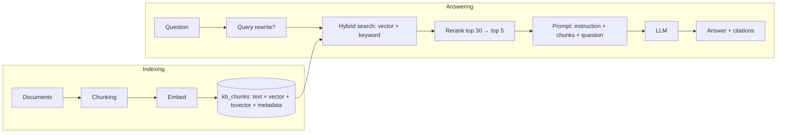

# Chương 7. RAG: chunking, hybrid search, reranking, citation

## 1. Tình huống

Model không biết chính sách đổi trả của ShopAssist (dữ liệu riêng, và thay đổi hằng tuần). Nhồi toàn bộ 400 trang chính sách vào mỗi prompt thì đắt, chậm, loãng. **RAG (Retrieval-Augmented Generation)** là: trước khi hỏi model, **retrieval** (truy xuất) vài chunk tài liệu liên quan từ kho của bạn, đưa vào prompt, và yêu cầu model trả lời dựa trên đó. Đây là kỹ thuật phổ biến nhất để giảm hallucination về dữ liệu riêng và cập nhật kiến thức mà không phải retrain.

## 2. Kiến trúc



Mỗi mũi tên là một điểm có thể sai. Phần lớn lỗi RAG là lỗi retrieval, không phải lỗi model: nếu chunk đúng không nằm trong top-k thì model giỏi đến đâu cũng không cứu được.

## 3. Chunking

Chunking là cắt tài liệu thành các chunk để embed và retrieve.

- **Quá nhỏ** (một câu): mất ngữ cảnh ("Điều này áp dụng trong 7 ngày": điều gì?).
- **Quá lớn** (cả chương): vector là "trung bình" của nhiều ý, retrieval mờ; prompt tốn token.
- Điểm khởi đầu thường dùng: vài trăm token mỗi chunk, **overlap** 10 đến 20% giữa các chunk liền kề. Đây là điểm khởi đầu để tinh chỉnh bằng eval (chương 8), không phải chân lý.
- **Cắt theo cấu trúc** tốt hơn cắt theo số ký tự: theo tiêu đề, mục, đoạn văn, điều khoản; không cắt giữa bảng hay code block.
- **Gắn ngữ cảnh vào mỗi chunk**: prefix tiêu đề tài liệu và mục ("Chính sách đổi trả > Điều kiện") trước khi embed. Rất rẻ và hiệu quả.
- Lưu metadata: `doc_id`, `tenant_id`, `chunk_no`, URL gốc, ngày cập nhật, quyền truy cập. Metadata phục vụ citation và authorization.
- Với tiếng Việt, kiểm tra tách câu và dấu: normalize Unicode về một dạng (NFC) trước khi embed và trước khi index keyword.

## 4. Hybrid search

Vector giỏi ý nghĩa, kém mã và tên riêng; keyword search giỏi khớp chính xác, kém đồng nghĩa. Kết hợp cả hai (**hybrid search**) là mặc định tốt.

Về "BM25": BM25 là thuật toán keyword ranking kinh điển. **Full-text search tích hợp của PostgreSQL** (`tsvector`, `ts_rank`) là cơ chế tương tự về mục đích nhưng **không phải BM25**: `ts_rank` không dùng length normalization và inverse document frequency theo công thức BM25. Muốn BM25 thật cần extension hoặc công cụ tìm kiếm riêng (Elasticsearch/OpenSearch, v.v.); tôi chưa kiểm tra extension Postgres cụ thể nào trong cuốn này nên không khuyến nghị tên nào. Với đa số ứng dụng quy mô vừa, `tsvector` + vector trong cùng một database là điểm khởi đầu đơn giản.

### Hợp nhất kết quả bằng RRF

Score của vector và của keyword khác thang đo, không cộng trực tiếp được. **Reciprocal Rank Fusion (RRF)** chỉ dùng **rank**:

```
score(d) = Σ  1 / (k + rank_i(d))        k thường là 60
```

Tài liệu nằm cao ở danh sách nào cũng được cộng score. Không cần normalize score, rất dễ cài. SQL mẫu (đã chạy thử trong lab, xem `lab/sql/04-hybrid-demo.sql`):

```sql
WITH vec AS (
  SELECT id, row_number() OVER (ORDER BY embedding <=> $1) AS rnk
  FROM kb_chunks WHERE tenant_id = $3
  ORDER BY embedding <=> $1 LIMIT 30
), kw AS (
  SELECT id, row_number() OVER (ORDER BY ts_rank(content_tsv, q) DESC) AS rnk
  FROM kb_chunks, websearch_to_tsquery('simple', $2) q
  WHERE tenant_id = $3 AND content_tsv @@ q
  ORDER BY ts_rank(content_tsv, q) DESC LIMIT 30
)
SELECT c.id, c.content,
       coalesce(1.0/(60 + vec.rnk), 0) + coalesce(1.0/(60 + kw.rnk), 0) AS rrf
FROM kb_chunks c
LEFT JOIN vec ON vec.id = c.id
LEFT JOIN kw  ON kw.id  = c.id
WHERE vec.id IS NOT NULL OR kw.id IS NOT NULL
ORDER BY rrf DESC
LIMIT 10;
```

Kết quả thật trên 5 đoạn demo (vector 3 chiều viết tay, `lab/results-demo.txt`): với query mã đơn `A1029`, vector không bắt được mã (chunk chứa mã chỉ đứng thứ 3 theo vector) nhưng keyword xếp nó thứ 1, và RRF đưa nó lên đầu (score 0,03227 so với 0,01639 của chunk kế tiếp); chunk của tenant khác (id 5) không xuất hiện vì bị filter `tenant_id` ở cả hai nhánh. Với query "hoan tien", cả hai nhánh cùng xếp chunk 1 và 2 lên đầu nên score RRF cao nhất (0,03279).

Cột `content_tsv` là `tsvector` sinh từ `content`, kèm index GIN. Cấu hình ngôn ngữ `'simple'` không bỏ dấu hay stemming nên phù hợp làm điểm khởi đầu cho tiếng Việt vì PostgreSQL không có cấu hình tiếng Việt tích hợp sẵn (nếu cần bỏ dấu, dùng extension `unaccent`).

## 5. Reranking

Retrieval ban đầu (bi-encoder: embed query và chunk riêng) nhanh nhưng thô. **Reranker** (cross-encoder, hoặc dùng chính LLM) đọc **cặp (query, chunk)** cùng lúc nên chấm relevance chính xác hơn nhưng chậm và đắt. Mô hình hai stage:

1. Retrieval rộng: lấy 30 đến 50 candidate (nhanh, rẻ, ưu tiên recall).
2. Rerank: chấm lại, giữ 3 đến 8 chunk (ưu tiên precision).

Số 30 và 5 chỉ là ví dụ; chọn bằng eval. Reranking thêm latency và chi phí: đo xem nó có cải thiện chỉ số trên bộ test của bạn không. Nếu hybrid search đã cho top 5 tốt thì bỏ qua.

## 6. Prompt và citation

Đưa mỗi chunk kèm ID và yêu cầu model trích đúng ID:

```text
<tai_lieu>
<doc id="12#3" title="Chính sách đổi trả">Khách được đổi trả trong 7 ngày kể từ ngày nhận hàng...</doc>
<doc id="12#4" title="Chính sách đổi trả">Sản phẩm giảm giá trên 50% không được đổi trả...</doc>
</tai_lieu>
Câu hỏi: Khách mua hàng giảm 60% có đổi trả được không?
Trả lời ngắn gọn, mỗi ý kèm [doc:ID]. Nếu tài liệu không đủ, nói "Tài liệu không có thông tin này".
```

Sau khi nhận câu trả lời, **kiểm tra bằng code**: mọi `[doc:ID]` phải nằm trong tập chunk đã đưa vào; ID bịa thì loại hoặc gọi lại. Lưu danh sách chunk đã dùng cùng câu trả lời để audit. Một số nhà cung cấp có tính năng citation gốc (ví dụ docs Anthropic có loại nội dung `search_result` dùng trong `tool_result`, tra 07/11/2026); đọc docs hiện hành thay vì tự chế định dạng nếu cần citation chính xác tới câu.

Citation không chứng minh câu trả lời đúng: model có thể trích đúng chunk nhưng diễn giải sai. Vì thế eval (chương 8) phải kiểm cả "có căn cứ vào chunk" (grounding) lẫn "đúng".

## 7. Các lỗi RAG thường gặp

| Triệu chứng | Nguyên nhân thường gặp | Cách xử lý |
|---|---|---|
| Trả lời "không biết" dù tài liệu có | Chunk đúng không vào top-k (chunking, embedding yếu tiếng Việt, thiếu hybrid) | Đo recall của retrieval riêng; thêm keyword search; chỉnh chunk |
| Trả lời sai nhưng tự tin | Chunk lạc đề lọt vào top; model "bù" bằng kiến thức riêng | Rerank, giảm k, ép "chỉ dùng tài liệu", cho phép nói không biết |
| Chunk đúng bị cắt đôi | Chunk cắt giữa ý | Cắt theo cấu trúc, overlap, prefix ngữ cảnh |
| Thông tin cũ | Kho không cập nhật | Pipeline cập nhật theo sự kiện, lưu ngày, xóa chunk cũ |
| Data leakage giữa tenant | Thiếu filter authorization ở retrieval | Filter `tenant_id` trong SQL bằng giá trị lấy từ login session (chương 9) |
| Mâu thuẫn giữa các chunk | Nhiều phiên bản chính sách cùng tồn tại | Filter theo hiệu lực, ưu tiên bản mới, hiển thị ngày |
| Câu hỏi nhiều bước ("so sánh A và B") | Một lần retrieval không đủ | Tách query, hoặc dùng agent với tool tìm kiếm (chương 4) |
| Hỏi tiếp nối ("còn cái kia thì sao?") | Query không tự đứng được | Query rewrite thành câu độc lập dựa trên history |

## 8. Trade-off

- **RAG hay context dài?** Corpus nhỏ, ít đổi, query ít: nhồi thẳng vào prompt (kết hợp prompt caching) có thể đơn giản và đủ tốt. Corpus lớn, đổi liên tục, cần authorization theo người dùng, cần citation: RAG.
- **RAG hay fine-tune?** Fine-tune dạy phong cách và định dạng, không phải cách đáng tin để nhồi dữ kiện thay đổi; dữ kiện nên nằm trong kho retrieval.
- **Nhiều chunk hay ít chunk?** Nhiều: recall cao hơn nhưng tốn token và dễ noise. Bắt đầu nhỏ và đo.
- **Thêm reranker hay không:** thêm khi chất lượng top-k là bottleneck và bạn chịu được latency.

## 9. Cạm bẫy

- Chỉ nhìn câu trả lời cuối, không log và không đo riêng bước retrieval.
- Dùng cùng một threshold cosine cho mọi loại câu hỏi.
- Đưa cả tài liệu chứa instruction độc hại vào prompt như thể là chỉ thị (indirect prompt injection, chương 9).
- Không có quy trình cập nhật và xóa: tài liệu đã gỡ vẫn được trả về.
- Tối ưu prompt trong khi vấn đề nằm ở chunking.

## 10. Tóm tắt

1. RAG = retrieve chunk liên quan rồi bắt model trả lời dựa trên đó; lỗi chính thường ở retrieval.
2. Chunk theo cấu trúc, có overlap và prefix ngữ cảnh; kích thước là tham số cần đo.
3. Hybrid (vector + keyword) hợp nhất bằng RRF theo rank; `ts_rank` của Postgres không phải BM25.
4. Rerank hai stage: rộng rồi hẹp, chỉ khi đo thấy có lợi.
5. Citation bằng ID và kiểm tra bằng code; filter authorization ngay trong query SQL.

## 11. Câu hỏi tự kiểm tra

1. Vì sao RRF dùng rank thay vì cộng score của vector và của keyword?
2. Nêu ba triệu chứng RAG và nguyên nhân tương ứng.
3. Khi nào nên nhồi cả tài liệu vào prompt thay vì RAG?
4. Vì sao phải kiểm tra `[doc:ID]` bằng code?

<details><summary>Đáp án</summary>

1. Hai loại score khác thang đo và distribution nên cộng trực tiếp không có nghĩa; rank thì so sánh được, không cần normalize.
2. Ví dụ: trả "không biết" dù có tài liệu (chunk đúng không vào top-k); trả lời sai tự tin (chunk lạc đề lọt top, model bù bằng kiến thức riêng); data leakage giữa tenant (thiếu filter authorization ở retrieval).
3. Corpus nhỏ, ít đổi, không cần authorization theo người, lưu lượng thấp hoặc đã dùng prompt caching hiệu quả.
4. Model có thể bịa ID hoặc trích chunk không được đưa vào; kiểm tra bằng code đảm bảo ID thuộc tập chunk đã cung cấp.

</details>
