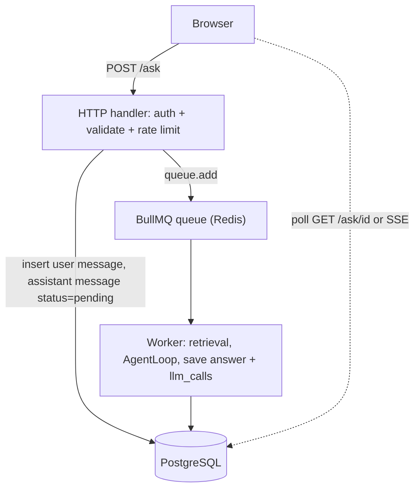

# Chương 11. Tích hợp vào ứng dụng Node.js/TypeScript

## 1. Tình huống

Bạn đã có mọi mảnh: prompt (chương 3), tool (chương 4), RAG (chương 5 đến 7), eval (8), security (9), vận hành (10). Giờ nối vào ứng dụng Node.js/TypeScript của ShopAssist: một endpoint hỏi đáp, lưu conversation history, chạy tác vụ dài ngoài request, và không giữ request HTTP mở hàng chục giây.

Toàn bộ mã của chương nằm trong `lab/ts/` (Node.js LTS, TypeScript 7.0.2, kiểm bằng `tsc --noEmit`). Mỗi đoạn mã bên dưới là nguyên văn một file trong `lab/ts/src/`, có ghi tên file. Phần nào cần API key hoặc Redis thì ghi rõ ở từng mục; mục 8 tổng hợp cái gì đã chạy thật và cái gì chưa.

## 2. Chọn cách gọi: SDK hay HTTP client

| Cách | Khi nào | Lưu ý |
|---|---|---|
| **SDK của nhà cung cấp**: `@anthropic-ai/sdk` 1.6.0 (npm, tra 08/11/2026) | muốn typed data, retry và timeout mặc định, streaming, cập nhật theo API | thêm dependency |
| **SDK đa nhà cung cấp** (ví dụ Vercel AI SDK, package `ai`) | muốn một API thống nhất cho nhiều nhà cung cấp | chưa xác minh trong lần tra này; đọc docs trước khi dựa vào |
| **`fetch` của Node.js** | cần kiểm soát từng byte, ít dependency, học cơ chế | tự xử lý retry, streaming, lỗi, cập nhật API |

Nếu cần so sánh hoặc làm fallback sang nhà cung cấp khác (chương 2), package chính thức của OpenAI là `openai` (7.53.0, npm, tra 08/11/2026). Sách không có mã gọi OpenAI chạy được, nên không có ví dụ cho nó.

Gợi ý thực tế: học bằng `fetch` hoặc đọc kỹ SDK để hiểu hình dạng request, rồi dùng SDK chính thức cho code production. Dù chọn gì, **bọc sau một interface của bạn** (ở đây là `Runnable` trong `askService.ts` và `Embedder`) để test được bằng fake và đổi nhà cung cấp được. Mã trong chương này đã làm đúng như vậy: `AgentLoop` nhận client qua constructor, nên `demoAgentLoop.ts` thay được bằng client giả.

## 3. Kiến trúc cho ShopAssist



Vì sao dùng queue: một lượt có thể 5 đến 60 giây (nhiều vòng tool, reasoning model). Giữ nó trong request web chiếm một kết nối và dễ bị timeout của proxy ngắt giữa chừng. Queue cho phép retry có kiểm soát, giới hạn concurrency và tách tải. Node.js không bị giới hạn bởi số worker process như mô hình process-per-request, nên lý do chính ở đây là timeout của proxy, retry và kiểm soát tải, chứ không phải cạn worker.

Về thư viện hàng đợi: BullMQ (6.7.2, npm, tra 08/11/2026, đang được cập nhật; cần Redis) là lựa chọn phổ biến cho Node.js nên sách dùng nó. Có thể thay bằng `pg-boss` (hàng đợi trên chính PostgreSQL, đỡ thêm Redis) hoặc dịch vụ queue của cloud; hai lựa chọn này tôi chưa tra phiên bản và chưa thử.

## 4. Lưu conversation history

Schema (file `lab/ts/sql/schema.sql`, đã chạy thật trên PostgreSQL 18 với pgvector 0.8.7; phần đầu gồm `orders` và `kb_chunks` cho demo):

```sql
CREATE TABLE conversations (
  id         bigserial PRIMARY KEY,
  tenant_id  bigint NOT NULL,
  user_id    bigint NOT NULL,
  summary    text,                       -- tóm tắt phần cũ để cắt context
  created_at timestamptz NOT NULL DEFAULT now(),
  updated_at timestamptz NOT NULL DEFAULT now()
);
CREATE INDEX ON conversations (tenant_id);
CREATE INDEX ON conversations (user_id);

CREATE TABLE conversation_messages (
  id              bigserial PRIMARY KEY,
  conversation_id bigint NOT NULL REFERENCES conversations(id) ON DELETE CASCADE,
  role            text NOT NULL,                       -- user | assistant
  content         jsonb NOT NULL,                      -- nguyên content block (gồm tool_use/tool_result)
  status          text NOT NULL DEFAULT 'done',        -- pending | done | failed
  meta            jsonb,                               -- model, prompt_version, usage, context_ids, request_id
  created_at      timestamptz NOT NULL DEFAULT now()
);
CREATE INDEX ON conversation_messages (conversation_id, id);
```

Quyết định thiết kế:
- Lưu **nguyên `content` block** của lượt assistant (kể cả `tool_use`) và `tool_result`, vì API yêu cầu gửi lại đúng chuỗi này để tiếp tục. Docs Anthropic cũng nói thinking block phải được gửi lại nguyên vẹn nếu có; đừng lọc hoặc sửa block nào trước khi gửi lại (lỗi 400 nếu sửa). `AgentLoop` ở chương 4 đã đẩy nguyên `res.content` vào `messages`.
- **Giới hạn history gửi đi**: lấy N lượt gần nhất (`AskService` lấy 8 message `done` gần nhất), và `summary` cho phần cũ. Tóm tắt do model sinh cũng là dữ liệu cần kiểm (có thể sai).
- Lưu `meta` (model, phiên bản prompt, ID chunk đã retrieve, `request_id`) để audit và đưa lượt tệ vào bộ eval.
- **Authorization**: mọi query hội thoại filter theo `user_id`/`tenant_id` của người đăng nhập (xem handler bên dưới); không bao giờ tin `conversation_id` từ request.
- **Privacy**: chính sách xóa/anonymize, che dữ liệu cá nhân trước khi lưu log dài hạn.

Truy vấn từ Node.js dùng `pg` (8.23.1) và, khi cần đọc cột `vector` ra thành `number[]`, package `pgvector` (0.3.1) với `pgvector.registerTypes(client)`. Khi ghi hoặc truy vấn, `pgvector.toSql(vec)` đổi mảng số thành chuỗi `'[...]'` để truyền như tham số, như `retrieveChunks` ở mục 6.

## 5. HTTP handler và job

Handler dùng `node:http` và Zod (4.6.7) để validate, để không kéo thêm framework; trong dự án thật bạn thay bằng framework đang dùng (Express, Fastify, Hono...) và đặt xác thực, rate limit ở middleware (ví dụ 20 request/phút mỗi người dùng). File `lab/ts/src/askController.ts`:

```ts
// Chương 11. POST /ask bằng node:http. Xác thực và rate limit (ví dụ 20 request/phút) đặt ở middleware hoặc reverse proxy.
import { createServer, type IncomingMessage, type Server } from "node:http";
import { z } from "zod";
import type { Db, User } from "./db.ts";

export interface AskQueue {
  add(name: "ask", data: { conversationId: number; pendingMessageId: number }): Promise<unknown>;
}
export interface ControllerDeps {
  db: Db;
  queue: AskQueue;
  authenticate: (req: IncomingMessage) => Promise<User | null>; // quyền lấy từ session, không từ body
}

const Body = z.object({
  question: z.string().min(1).max(4000), // input length cap
  conversation_id: z.number().int().optional(),
});

async function readJson(req: IncomingMessage, limit = 16_384): Promise<unknown> {
  let size = 0;
  const chunks: Buffer[] = [];
  for await (const c of req) {
    size += (c as Buffer).length;
    if (size > limit) throw new Error("body quá lớn");
    chunks.push(c as Buffer);
  }
  return JSON.parse(Buffer.concat(chunks).toString("utf8"));
}

export function createAskServer({ db, queue, authenticate }: ControllerDeps): Server {
  return createServer(async (req, res) => {
    const send = (status: number, body: unknown) => {
      res.writeHead(status, { "content-type": "application/json" }).end(JSON.stringify(body));
    };
    try {
      if (req.method !== "POST" || req.url !== "/ask") return send(404, { error: "not found" });
      const user = await authenticate(req);
      if (!user) return send(401, { error: "unauthenticated" });
      const parsed = Body.safeParse(await readJson(req));
      if (!parsed.success) return send(422, { error: parsed.error.issues });
      const { question, conversation_id } = parsed.data;

      let convId: number;
      if (conversation_id !== undefined) {
        // Filter theo user_id: không dùng conversation_id của người khác.
        const r = await db.query<{ id: string }>("SELECT id FROM conversations WHERE id = $1 AND user_id = $2", [
          conversation_id,
          user.id,
        ]);
        if (!r.rows[0]) return send(404, { error: "not found" });
        convId = conversation_id;
      } else {
        const r = await db.query<{ id: string }>(
          "INSERT INTO conversations (tenant_id, user_id) VALUES ($1, $2) RETURNING id",
          [user.tenantId, user.id],
        );
        convId = Number(r.rows[0]!.id);
      }

      await db.query("INSERT INTO conversation_messages (conversation_id, role, content) VALUES ($1, 'user', $2)", [
        convId,
        JSON.stringify([{ type: "text", text: question }]),
      ]);
      const pending = await db.query<{ id: string }>(
        "INSERT INTO conversation_messages (conversation_id, role, content, status) VALUES ($1, 'assistant', '[]', 'pending') RETURNING id",
        [convId],
      );
      const messageId = Number(pending.rows[0]!.id);

      await queue.add("ask", { conversationId: convId, pendingMessageId: messageId });
      return send(202, { message_id: messageId });
    } catch (e) {
      console.error(e);
      return send(500, { error: "internal" });
    }
  });
}
```

Job chạy bằng BullMQ. File `lab/ts/src/askJob.ts`:

```ts
// Chương 11. Hàng đợi bằng BullMQ (cần Redis hoặc Valkey). Producer: queue.add(...); consumer: Worker bên dưới.
import { Queue, Worker, type ConnectionOptions } from "bullmq";
import type { Db } from "./db.ts";
import type { AskService } from "./askService.ts";

export interface AskJobData {
  conversationId: number;
  pendingMessageId: number;
}
const QUEUE = "ask";
const BACKOFF_MS = [5_000, 30_000, 120_000];
const JOB_TIMEOUT_MS = 120_000; // lớn hơn timeout HTTP tới nhà cung cấp

export function createAskQueue(connection: ConnectionOptions): Queue<AskJobData> {
  return new Queue<AskJobData>(QUEUE, {
    connection,
    defaultJobOptions: {
      attempts: 3,
      backoff: { type: "custom" },
      removeOnComplete: 1000,
      removeOnFail: 5000,
    },
  });
}

export function createAskWorker(connection: ConnectionOptions, db: Db, ask: AskService): Worker<AskJobData> {
  const worker = new Worker<AskJobData>(
    QUEUE,
    async (job) => {
      // BullMQ không có timeout riêng cho từng job: tự đặt bằng AbortSignal.timeout.
      const signal = AbortSignal.timeout(JOB_TIMEOUT_MS);
      const timeout = new Promise<never>((_, reject) =>
        signal.addEventListener("abort", () => reject(new Error("job timeout")), { once: true }),
      );
      const result = await Promise.race([ask.answer(job.data.conversationId), timeout]);
      await db.query("UPDATE conversation_messages SET content = $2, meta = $3, status = 'done' WHERE id = $1", [
        job.data.pendingMessageId,
        JSON.stringify(result.content),
        JSON.stringify(result.meta),
      ]);
    },
    {
      connection,
      concurrency: 4, // giới hạn concurrency để không tự gây 429
      lockDuration: JOB_TIMEOUT_MS + 30_000, // lớn hơn thời gian chạy job để không bị coi là stalled rồi chạy chồng
      settings: { backoffStrategy: (attemptsMade) => BACKOFF_MS[Math.min(attemptsMade, BACKOFF_MS.length) - 1]! },
    },
  );

  // Hết số lần retry thì đánh dấu failed.
  worker.on("failed", async (job) => {
    if (job && job.attemptsMade >= (job.opts.attempts ?? 1)) {
      await db.query("UPDATE conversation_messages SET status = 'failed' WHERE id = $1", [job.data.pendingMessageId]);
    }
  });
  return worker;
}
```

Điểm cần chú ý:
- BullMQ không có timeout riêng cho từng job, nên mã tự đặt `AbortSignal.timeout` quanh lời gọi; timeout của job (120 giây) phải lớn hơn timeout HTTP tới nhà cung cấp (client của chương 4 đặt 60 giây).
- `lockDuration` phải lớn hơn thời gian chạy tối đa của job. Nếu worker không giữ được lock (ví dụ event loop bị chặn lâu), BullMQ coi job là stalled và giao lại cho worker khác; hậu quả giống `retry_after` quá nhỏ trong các hệ queue khác: gọi model hai lần, tốn tiền, có thể lặp tác dụng phụ của tool.
- Backoff 5, 30, 120 giây đặt bằng `backoffStrategy` tùy biến; hết `attempts` thì `failed` handler đánh dấu message `failed` để UI báo lỗi.
- Handler trả 202 và để client poll hoặc nhận qua SSE/pub-sub; filter `user_id` khi tìm hội thoại; đặt `max` độ dài câu hỏi.
- API BullMQ ở đây đã qua `tsc --noEmit`, nhưng **chưa chạy với Redis**: chưa kiểm thực tế hành vi retry, stalled và `lockDuration`.

## 6. `AskService`: ráp các chương lại

File `lab/ts/src/askService.ts`. Hàm `retrieveChunks` (truy vấn pgvector với filter tenant) đã chạy thật; toàn bộ `AskService.answer` cần API key (qua `AgentLoop`) nên chưa chạy end-to-end:

```ts
// Chương 11: ráp truy xuất + prompt + AgentLoop + kiểm tra trích nguồn.
import type Anthropic from "@anthropic-ai/sdk";
import pgvector from "pgvector";
import type { Db, User } from "./db.ts";

export interface Embedder {
  embed(text: string): Promise<number[]>;
}
export interface Runnable {
  run(system: string, messages: Anthropic.MessageParam[]): Promise<string>;
}
export interface AskDeps {
  db: Db;
  embedder: Embedder;
  loopForUser: (user: User) => Runnable;
  systemPrompt: string;
}
export interface Chunk {
  id: string;
  doc_id: number;
  content: string;
}
export interface AskOutput {
  content: Anthropic.TextBlockParam[];
  meta: { context_ids: string[]; citations_valid: boolean };
}

/** Escape để chunk không đóng được thẻ </doc> giả mạo (một lớp phòng thủ nhỏ). */
export const escapeHtml = (s: string): string =>
  s.replace(/&/g, "&amp;").replace(/</g, "&lt;").replace(/>/g, "&gt;").replace(/"/g, "&quot;");

/** Retrieval: tenant lấy từ DB/session, không phải từ model. */
export async function retrieveChunks(
  db: Db,
  embedder: Embedder,
  tenantId: number,
  question: string,
  k = 5,
): Promise<Chunk[]> {
  const vec = await embedder.embed(question);
  const { rows } = await db.query<Chunk>(
    "SELECT id::text AS id, doc_id, content FROM kb_chunks WHERE tenant_id = $1 ORDER BY embedding <=> $2::vector LIMIT $3",
    [tenantId, pgvector.toSql(vec), k],
  );
  return rows;
}

export class AskService {
  private readonly deps: AskDeps;

  constructor(deps: AskDeps) {
    this.deps = deps;
  }

  async answer(conversationId: number): Promise<AskOutput> {
    const { db } = this.deps;
    const conv = (
      await db.query<{ id: string; tenant_id: string; user_id: string }>(
        "SELECT id, tenant_id, user_id FROM conversations WHERE id = $1",
        [conversationId],
      )
    ).rows[0];
    if (!conv) throw new Error(`Không có conversation ${conversationId}`);
    const user: User = { id: Number(conv.user_id), tenantId: Number(conv.tenant_id) };

    // Lịch sử: 8 message done gần nhất, theo thứ tự cũ -> mới.
    const history = (
      await db.query<{ role: "user" | "assistant"; content: Anthropic.TextBlockParam[] }>(
        `SELECT role, content FROM (
           SELECT id, role, content FROM conversation_messages
           WHERE conversation_id = $1 AND status = 'done' ORDER BY id DESC LIMIT 8
         ) t ORDER BY id`,
        [conversationId],
      )
    ).rows;
    const last = history.at(-1);
    const question = (last?.content ?? []).map((b) => (b.type === "text" ? b.text : "")).join("");

    // 1. Retrieval (chương 5-7)
    const chunks = await retrieveChunks(db, this.deps.embedder, user.tenantId, question);

    // 2. Prompt (chương 3): phần ổn định ở system, retrieved chunks ở user
    const docs = chunks.map((c) => `<doc id="${c.id}">${escapeHtml(c.content)}</doc>`).join("\n");
    const messages: Anthropic.MessageParam[] = [
      ...history.slice(0, -1),
      { role: "user", content: `<tai_lieu>\n${docs}\n</tai_lieu>\nCâu hỏi: ${question}` },
    ];

    // 3. Gọi agent (chương 4): tool lookup_order gắn với user hiện tại (chương 9)
    const text = await this.deps.loopForUser(user).run(this.deps.systemPrompt, messages);

    // 4. Kiểm tra citation (chương 7)
    const ids = chunks.map((c) => c.id);
    const cited = [...text.matchAll(/\[doc:(\d+)\]/g)].map((m) => m[1]!);
    return {
      content: [{ type: "text", text }],
      meta: { context_ids: ids, citations_valid: cited.every((c) => ids.includes(c)) },
    };
  }
}
```

Lưu ý: `escapeHtml` escape nội dung chunk retrieved để không đóng thẻ `</doc>` giả mạo (một defense layer nhỏ, không thay thế least privilege). `tenant_id` luôn lấy từ bảng `conversations`, rồi truyền vào cả SQL vector lẫn tool `lookup_order`.

## 7. Streaming về trình duyệt

Hai hướng: (a) worker publish từng đoạn text qua pub/sub (Redis pub/sub, hoặc `LISTEN/NOTIFY` của PostgreSQL) cho tiến trình web đẩy xuống trình duyệt qua SSE hoặc WebSocket; (b) SSE trực tiếp từ handler, hợp khi không cần queue, nhưng giữ socket mở suốt thời gian sinh. Chọn (a) cho tải lớn. Mã gọi stream từ SDK nằm ở chương 10 (`streamAnswer.ts`); chi tiết proxy và lỗi giữa stream cũng ở chương 10.

## 8. Test

- **Fake client**: nhờ `AgentLoop` nhận client qua constructor, `demoAgentLoop.ts` chạy vòng lặp với client giả theo kịch bản: kiểm `tool_result` đúng `tool_use_id`, `is_error` khi tool ném lỗi, và dừng ở `maxSteps`.
- Test authorization bằng cách thử truy cập hội thoại và đơn hàng của người khác (phải 404). `demoPg.ts` làm đúng việc này với PostgreSQL thật: người dùng khác dùng `conversation_id` của người kia nhận 404, đơn của tenant khác không tra được, chunk của tenant khác không bao giờ xuất hiện trong kết quả vector.
- Chạy eval (chương 8) như một script riêng, không nằm trong `node --test` mặc định vì tốn tiền và không deterministic.
- Ghi (record/replay) response thật để test nhanh và ổn định, với dữ liệu đã che.

Kết quả chạy thật (`lab/run-ts.sh`, Docker, image `node:lts-alpine` là Node.js v26.13.0 và `pgvector/pgvector:0.8.7-pg18-trixie`, lần chạy 08/11/2026):

| Phần | Cách kiểm | Kết quả |
|---|---|---|
| Tất cả file TypeScript | `tsc --noEmit` (TypeScript 7.0.2) | đạt |
| `EvalRunner` | chạy với hàm `ask` giả | đạt: `pass_rate` 1, 0,67, 1 |
| `AgentLoop` | chạy với client giả | đạt |
| MCP server stdio + client test | chạy thật, không cần API key | đạt: 1 tool, đơn đúng `isError: false`, đơn tenant khác và mã sai `isError: true` |
| Truy vấn pgvector, `lookup_order`, `POST /ask` | chạy thật trên PostgreSQL 18 + pgvector 0.8.7, queue giả | đạt |
| Gọi API Claude thật (`AgentLoop`, `AskService.answer`, streaming, structured output, prompt caching) | **cần API key** | chưa chạy, chỉ `tsc --noEmit` |
| BullMQ worker và retry | **cần Redis** | chưa chạy, chỉ `tsc --noEmit` |

## 9. Trade-off

- SDK chính thức cho bạn retry, timeout, streaming và type, nhưng gắn code với một nhà cung cấp; bọc sau interface để giảm rủi ro. Tính năng beta (như `toolRunner`) có thể đổi.
- Queue thêm độ phức tạp (poll hoặc pub/sub, thêm Redis) nhưng đáng với tác vụ trên vài giây.
- Lưu `content` nguyên block tốn dung lượng JSON nhưng tránh lỗi khi tiếp tục hội thoại.

## 10. Cạm bẫy

- Gọi LLM synchronous trong request web (timeout của proxy, giữ socket).
- `lockDuration` của worker nhỏ hơn thời gian job, dẫn tới job bị coi là stalled, chạy trùng và tính tiền hai lần.
- Render câu trả lời của model bằng `innerHTML` (chương 9).
- Lấy `conversation_id` từ request mà không filter theo `user_id`.
- Đưa `tenant_id` hay `user_id` cho model điền.
- Lưu API key trong code; dùng biến môi trường (`ANTHROPIC_API_KEY`, SDK tự đọc) hoặc secret manager, và không log header.
- Không đặt `max` cho độ dài câu hỏi nên một lần dán file lớn gây hóa đơn lớn.
- `await` thiếu trong handler async: lỗi thành unhandled rejection và request treo. Luôn bọc `try/catch` ở handler như mã trên.

## 11. Tóm tắt

1. Bọc nhà cung cấp sau interface của bạn; SDK chính thức cho code production.
2. Tác vụ LLM chạy trong queue; trả 202; timeout job > timeout HTTP; `lockDuration` > timeout job.
3. Lưu nguyên `content` block cùng `meta`; cắt hoặc tóm tắt history gửi đi.
4. Mọi query hội thoại và dữ liệu filter theo người dùng/tenant từ login session.
5. Có fake client để test, và script eval riêng.

## 12. Câu hỏi tự kiểm tra

1. Vì sao nên đưa vào queue và trả 202 thay vì chờ model trong handler?
2. `lockDuration` nhỏ hơn thời gian chạy job gây hậu quả gì với LLM?
3. Vì sao phải lưu nguyên `content` block của lượt assistant?
4. Vì sao `AgentLoop` nhận client qua constructor thay vì tự `new Anthropic()` bên trong?

<details><summary>Đáp án</summary>

1. Lượt có thể kéo dài nhiều giây, dễ bị timeout ở proxy; queue cho retry, giới hạn concurrency, tách tải.
2. Queue coi job là treo và giao lại cho worker khác trong khi job đầu còn chạy: gọi model hai lần, tốn tiền và có thể lặp tác dụng phụ của tool.
3. API cần nhận lại đúng chuỗi `tool_use`/`tool_result` (và thinking block nếu có) để tiếp tục; lọc hay sửa gây lỗi 400.
4. Để thay bằng client giả trong test (không tốn tiền, deterministic) và đổi nhà cung cấp mà không sửa vòng lặp.

</details>
