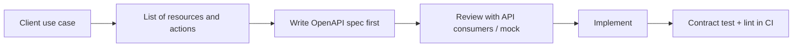

# Chương 1. Nguyên tắc thiết kế API

## 1. Vấn đề

Bạn viết một endpoint `POST /createNewOrderForCustomer` cho đội mobile. Ba tháng sau đội đối tác cần thêm endpoint `GET /getOrders`, đội khác thêm `GET /order/list_all`. Mỗi endpoint trả lỗi một kiểu: chỗ thì `{"error": "x"}`, chỗ thì `{"success": false, "msg": "x"}`, chỗ thì HTTP 200 kèm `"code": 5`. Người dùng API (developer khác, thường không ngồi cạnh bạn) phải đọc code hoặc hỏi bạn cho mỗi lần tích hợp.

API là **giao diện công khai có vòng đời dài**. Code nội bộ refactor được; API đã có client dùng thì rất khó rút lại. Vì vậy thiết kế API là thiết kế *contract*, không phải chỉ viết controller.

Xuyên suốt cuốn này dùng một ví dụ: **API đặt hàng** (`orders`). Lab ở thư mục `lab/` cài đặt đúng những gì các chương mô tả.

## 2. Nguyên tắc cốt lõi

### 2.1 Thiết kế cho người dùng API, không cho database

Hỏi: "người gọi muốn đạt điều gì?" chứ không phải "bảng nào cần CRUD?". Ví dụ, client cần "hủy đơn" chứ không cần "sửa cột `status` thành 4". Nếu để client tự `PATCH status`, mọi business rule (đơn đã giao thì không hủy được) bị rò ra phía client.

### 2.2 Nhất quán quan trọng hơn hoàn hảo

Một quy ước tạm ổn nhưng dùng khắp nơi tốt hơn mười quy ước "tối ưu" lẫn lộn. Chọn một lần và ghi thành guideline nội bộ:

| Chủ đề | Quy ước ví dụ (dùng trong cuốn này) |
|---|---|
| Tên field JSON | `snake_case` (`created_at`, `unit_price`) |
| Tên collection | danh từ số nhiều: `/orders` |
| Thời gian | RFC 3339 UTC: `2026-11-08T03:00:00+00:00` |
| Tiền | số nguyên theo đơn vị nhỏ nhất (VND không có phần lẻ), kèm mã tiền tệ khi cần |
| Error | `application/problem+json` (RFC 9457, chương 5) |
| List | `{"data": [...], "next_cursor": "..."}` |
| ID | opaque string có tiền tố: `ord_0001` |

Không có quy ước đúng tuyệt đối (Google dùng camelCase, Zalando dùng snake_case); chỉ có quy ước nhất quán.

### 2.3 Đặt tên resource

- Dùng **danh từ**, không dùng động từ: `/orders`, không `/getOrders`.
- Số nhiều cho collection, `/{id}` cho phần tử: `/orders/ord_0001`.
- Chữ thường, gạch ngang trong path (`/order-items`); path phân biệt hoa thường theo RFC 3986 nên đừng trộn.
- Không lộ chi tiết cài đặt: `/orders.js`, `/v1/OrderController/index`.
- Opaque ID (ID mờ): đừng để client suy diễn cấu trúc ID, bạn sẽ không đổi được nó nữa.

### 2.4 Nguyên tắc ít gây bất ngờ

Client đoán đúng hành vi mà không đọc docs là dấu hiệu thiết kế tốt. `GET` không có side effect; `DELETE` xóa; `201` kèm `Location`; field vắng mặt nghĩa là "không biết/không áp dụng" chứ không phải lỗi. Chương 2 trình bày ngữ nghĩa chuẩn.

### 2.5 API là sản phẩm: tài liệu, ví dụ, thông báo thay đổi

Spec máy đọc được (OpenAPI, chương 10), error message tự giải thích, changelog và chính sách deprecation (chương 7) là một phần của thiết kế.

## 3. Quy trình thiết kế gợi ý

Viết ví dụ request/response trước khi viết code. Nếu ví dụ đọc gượng, API gượng.

## 4. Trade-off: khi nào KHÔNG cần "REST thuần"

"REST" trong ngành thường chỉ là *HTTP + JSON + resource*. Hypermedia đầy đủ (HATEOAS) hiếm khi đáng giá với API nội bộ. Nếu hệ thống toàn bộ là RPC nội bộ giữa service, gRPC có thể hợp hơn (chương 11). Đừng cố nhồi mọi thứ vào CRUD khi hành động mới là trung tâm (chương 3 nói về cách xử lý).

## 5. Cạm bẫy

- Lộ cấu trúc database ra API (tên cột, auto-increment key).
- Trả `200 OK` cho mọi thứ kể cả lỗi, bắt client parse body để biết thành bại.
- Đổi tên field "cho đẹp" khi đã có client (breaking change, chương 7).
- Thiết kế theo màn hình hiện tại của app, thành endpoint "chatty" hoặc "mega" khó dùng lại.
- Không có người review API ngoài tác giả.

## 6. Tóm tắt

- API là contract công khai, dài hạn; thiết kế cho người gọi.
- Chọn quy ước một lần (tên, thời gian, lỗi, danh sách) và áp dụng nhất quán.
- Resource là danh từ số nhiều; opaque ID.
- Viết ví dụ/spec trước, code sau.

## 7. Câu hỏi tự kiểm tra

1. Vì sao `GET /getOrders` là tên kém?
2. Kể 3 quy ước cần thống nhất trước khi có endpoint thứ hai.
3. Vì sao không nên để client `PATCH` trực tiếp cột `status`?
4. Khi nào gRPC hợp hơn REST/JSON?

Đáp án

1. Động từ lặp lại method HTTP (`GET` đã là "lấy"); resource nên là danh từ: `GET /orders`.
2. Ví dụ: kiểu đặt tên field, error format, pagination/thời gian/tiền format.
3. Business rule về state transition bị đẩy sang client; nên có hành động rõ ràng như `POST /orders/{id}/cancel`.
4. Giao tiếp service-to-service nội bộ cần hiệu năng, schema chặt, bidirectional streaming (xem chương 11).

