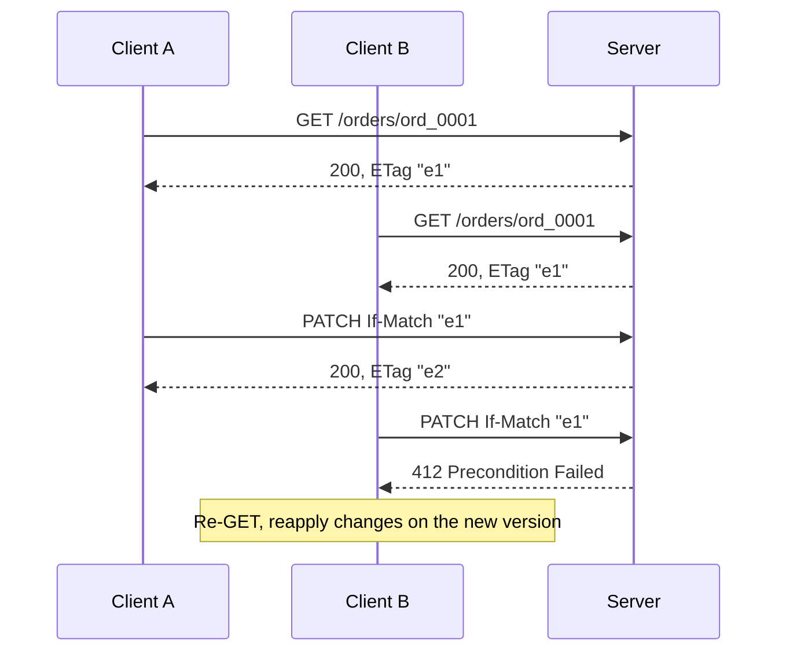

# Chương 2. HTTP semantics (RFC 9110)

## 1. Vấn đề

Hai client cùng đọc order `ord_0001`, mỗi bên sửa ghi chú rồi `PUT` lại. Bên nào gửi sau thắng và âm thầm xóa thay đổi của bên kia (*lost update*). Ở tầng khác, mạng chập chờn khiến client gọi lại `POST` và tạo hai đơn. Cả hai vấn đề có lời giải ngay trong chuẩn HTTP, nếu bạn dùng đúng semantics.

Chuẩn hiện hành: **RFC 9110 "HTTP Semantics"** (2022, thay RFC 7231 và các RFC cũ), cùng **RFC 9111** (HTTP Caching). Mọi thứ trong chương này bám theo hai RFC đó.

## 2. Method: safe và idempotent

- **Safe**: không có ý định thay đổi state của server (đọc thuần). Client có thể gọi mà không lo hậu quả; crawler, prefetch dựa vào đây.
- **Idempotent**: gọi N lần cho kết quả *state của server* giống gọi 1 lần (response có thể khác).

| Method | Safe | Idempotent | Dùng cho | Ghi chú |
|---|---|---|---|---|
| GET | có | có | đọc resource | không body có nghĩa |
| HEAD | có | có | như GET, không body | |
| OPTIONS | có | có | khả năng của server, CORS preflight | |
| PUT | không | có | thay thế toàn bộ resource | |
| DELETE | không | có | xóa | gọi lần 2 có thể 404, nhưng state cuối giống nhau |
| POST | không | **không** | tạo resource, hành động, mọi thứ còn lại | cần Idempotency-Key (chương 6) |
| PATCH | không | không (mặc định) | sửa một phần (RFC 5789) | có thể làm idempotent bằng điều kiện `If-Match` |
| QUERY | có | có | truy vấn có body (RFC 10008, Proposed Standard) | mới, hỗ trợ client/proxy còn chưa đồng đều |

Idempotent cho phép **retry tự động an toàn**: client/proxy được phép gọi lại `PUT`/`DELETE` khi mất kết nối. `POST` thì không, nên cần cơ chế bổ sung.

## 3. Status code: bảng dùng nhanh

Nhóm: 2xx thành công, 3xx redirect/conditional, 4xx lỗi do client (đừng retry nguyên văn), 5xx lỗi do server (có thể retry).

| Code | Tên | Dùng khi |
|---|---|---|
| 200 | OK | GET/PATCH/PUT thành công, có body |
| 201 | Created | POST tạo resource; kèm `Location` |
| 202 | Accepted | đã nhận, xử lý asynchronous; trả link theo dõi status |
| 204 | No Content | thành công, không body (DELETE) |
| 304 | Not Modified | trả lời `If-None-Match`/`If-Modified-Since`, không body |
| 400 | Bad Request | request sai cú pháp: JSON hỏng, parameter sai kiểu, thiếu header bắt buộc |
| 401 | Unauthorized | chưa authenticate / token sai; kèm `WWW-Authenticate` |
| 403 | Forbidden | đã authenticate nhưng không đủ permission |
| 404 | Not Found | resource không tồn tại (hoặc cố tình giấu sự tồn tại) |
| 405 | Method Not Allowed | kèm `Allow` |
| 409 | Conflict | xung đột state: hủy đơn đã giao, request trùng đang xử lý |
| 410 | Gone | resource đã bị gỡ vĩnh viễn (sau Sunset) |
| 412 | Precondition Failed | `If-Match` không khớp ETag hiện tại |
| 415 | Unsupported Media Type | `Content-Type` không hỗ trợ |
| 422 | Unprocessable Content | cú pháp đúng nhưng sai semantics/validation |
| 428 | Precondition Required (RFC 6585) | bắt buộc gửi điều kiện (`If-Match`) mà client không gửi |
| 429 | Too Many Requests (RFC 6585) | vượt rate limit; kèm `Retry-After` |
| 500 | Internal Server Error | lỗi không lường trước |
| 502/503/504 | Bad Gateway / Unavailable / Gateway Timeout | upstream hỏng / quá tải / timeout; `503` kèm `Retry-After` |

**400 hay 422?** RFC 9110 mô tả 422 là "request hiểu được và cú pháp đúng, nhưng không xử lý được các chỉ dẫn". Một quy ước phổ biến (dùng trong lab): 400 cho lỗi cấu trúc/protocol (JSON hỏng, thiếu header), 422 cho business error/validation error của body. Mỗi framework chọn mặc định riêng (Fastify trả 400 khi schema validation lỗi, một số framework khác trả 422), nên đừng dựa vào mặc định. Quan trọng là ghi vào guideline và nhất quán.

## 4. Header quan trọng

| Header | Chiều | Ý nghĩa |
|---|---|---|
| `Content-Type` / `Accept` | req/res | định dạng body / định dạng mong muốn |
| `Location` | res | URI resource vừa tạo (201) hoặc đích redirect |
| `ETag` | res | định danh phiên bản của representation |
| `If-Match` / `If-None-Match` | req | điều kiện theo ETag |
| `Retry-After` | res | giây hoặc ngày mà client nên chờ (429, 503) |
| `Allow` | res | method được phép (405) |
| `WWW-Authenticate` | res | cách authenticate (401) |
| `Link` | res | link quan hệ (RFC 8288), pagination, tài liệu error |

## 5. Conditional request: chống lost update

ETag là "dấu vân tay" của một phiên bản representation. Quy trình *optimistic concurrency*:

- `If-Match` dùng so sánh *strong* cho thao tác ghi: byte-by-byte tương đương. Weak ETag (`W/"..."`) không dùng được cho `If-Match`.
- Muốn **bắt buộc** client dùng điều kiện, trả `428` khi thiếu `If-Match` (lab làm đúng như vậy).
- `If-None-Match` trên GET cho phép trả `304` để tiết kiệm bandwidth (chương 9).
- `If-None-Match: *` trên `PUT` nghĩa là "chỉ tạo nếu chưa tồn tại".

Cách tạo ETag: hash nội dung representation (lab dùng 16 ký tự đầu của SHA-256), hoặc cột `version`/`updated_at`. Phải **đổi khi representation đổi**, và ETag nên gắn với *representation* (cùng resource nhưng JSON vs XML là ETag khác).

Trong Fastify: đọc bằng `req.headers["if-match"]`, đặt bằng `reply.header("etag", tag)`. Phần so khớp và 412 phải tự viết, xem `lab/api/index.ts` (route `PATCH /orders/:id`).

## 6. Ví dụ thật (lab)

Kết quả chạy lab (chi tiết ở chương 6 và `lab/`): `PATCH` thiếu `If-Match` trả `428`, `If-Match` cũ trả `412`, `If-Match` đúng trả `200` với ETag mới. Xem file `lab/transcript.md`.

## 7. Trade-off

- `PUT` dễ suy luận (idempotent) nhưng buộc gửi toàn bộ; `PATCH` linh hoạt nhưng cần định nghĩa định dạng patch (JSON Merge Patch RFC 7396 đơn giản; JSON Patch RFC 6902 mạnh hơn).
- Optimistic concurrency không phù hợp khi có rất nhiều conflict (hot row); cân nhắc queue/lock ở domain.
- ETag bằng hash tốn CPU nếu representation lớn; dùng cột version.

## 8. Cạm bẫy

- Dùng `GET` có side effect (link "kích hoạt tài khoản" bị scanner email bấm trước).
- `POST` cho mọi thứ, kể cả đọc.
- Trả `200` kèm `{"error":...}`.
- ETag sinh ngẫu nhiên mỗi request nên cache vô dụng và `If-Match` luôn lỗi.
- Quên `Vary` khi nội dung đổi theo `Accept`/`Authorization`.
- Coi `404` luôn là "không tồn tại": cân nhắc `404` thay `403` để không lộ resource của người khác.

## 9. Tóm tắt

- Safe = không đổi state; idempotent = lặp lại không đổi thêm. POST là method duy nhất mặc định không idempotent.
- Chọn status code theo bảng, dùng 4xx cho lỗi client và 5xx cho lỗi server.
- ETag + `If-Match` chống lost update; `428` bắt buộc, `412` khi lệch.
- Chuẩn gốc: RFC 9110 và RFC 9111.

## 10. Câu hỏi tự kiểm tra

1. DELETE lần hai trả 404; vậy DELETE có idempotent không?
2. Khi nào dùng 412, khi nào 428?
3. Vì sao weak ETag không dùng được với `If-Match`?
4. 401 khác 403 thế nào?

Đáp án

1. Có. Idempotent xét theo state của server (resource không còn), không theo response.
2. 428: client không gửi điều kiện dù server yêu cầu. 412: có gửi nhưng ETag không khớp.
3. `If-Match` yêu cầu so sánh strong; weak ETag chỉ đảm bảo tương đương về semantics, không đảm bảo byte giống nhau.
4. 401: chưa/không authenticate được identity. 403: biết bạn là ai nhưng không có permission.

