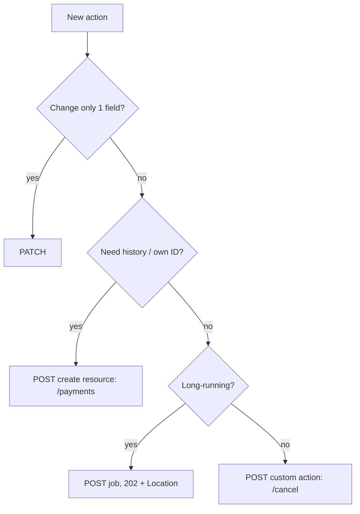

# Chapter 3. Designing resources, URLs, and non-CRUD actions

## 1. The problem

Với `orders`, CRUD là dễ. Rồi yêu cầu đến: "hủy đơn", "thanh toán", "gộp hai đơn", "xuất báo cáo doanh thu". Đội bạn đặt `POST /cancelOrder`, `PUT /orders/1?action=pay`, `GET /doReport`. Chương này đưa ra mẫu nhất quán.

## 2. The resource model

Một resource là một "thứ" có identity, state và lifecycle. Ví dụ:

```
/orders                      collection
/orders/{order_id}           item
/orders/{order_id}/items     sub-collection (owned by order)
/customers/{customer_id}/orders   filtered by relationship (or /orders?customer_id=)
```

### Relationships

- **Sở hữu chặt** (item không tồn tại ngoài order): nested URL, tối đa 1-2 cấp. `/orders/{id}/items/{item_id}`.
- **Tham chiếu** (order thuộc customer nhưng có đời riêng): URL phẳng, tham chiếu bằng ID: `{"customer_id": "cus_12"}`; lọc bằng query `GET /orders?customer_id=cus_12`.
- Nesting sâu (`/a/{id}/b/{id}/c/{id}/d`) khiến URL dài và khó đổi; Microsoft và Google guideline đều khuyên hạn chế.
- Cần dữ liệu liên quan trong một lần gọi: `?expand=customer` (nhúng) thay vì bắt client gọi nhiều lần. Khai báo rõ trong spec.

## 3. Non-CRUD actions

Bốn cách, từ ưu tiên cao đến thấp:

1. **Biến hành động thành state transition hợp lệ**: nếu "thanh toán" chỉ là đặt `paid_at`, `PATCH` có thể đủ. Dùng khi hành động không có business rule phức tạp.
2. **Tạo resource đại diện cho hành động**: `POST /orders/{id}/payments` tạo một *payment*. Ưu điểm: có lịch sử, có ID, truy vấn lại được, idempotency tự nhiên (một payment = một lần). Đây là lựa chọn mạnh nhất khi hành động để lại dấu vết.
3. **Custom action** dưới resource: `POST /orders/{id}/cancel` (lab dùng cách này). Google AIP-136 dùng cú pháp `POST /orders/{id}:cancel`. Chọn một kiểu và giữ nguyên. Luôn dùng `POST`.
4. **Resource tính toán/job**: `POST /reports` trả `202 Accepted` + `Location: /reports/rep_9`, client poll `GET /reports/rep_9`. Dùng cho tác vụ chậm.



### Actions should be idempotent where possible

Trong lab, `POST /orders/{id}/cancel` trên đơn đã `cancelled` trả lại `200` với state hiện tại thay vì lỗi; trên đơn không còn `pending` trả `409 invalid-state`. Gọi lại an toàn mà vẫn bảo vệ business rule.

### Asynchronous

```
POST /exports            -> 202 Accepted, Location: /exports/exp_7, Retry-After: 5
GET  /exports/exp_7      -> 200 {"status":"running"}
GET  /exports/exp_7      -> 200 {"status":"done","download_url":"..."}
```

Thay vì poll liên tục, cân nhắc webhook (chương 12).

## 4. Designing the body

- Resource trả về là *representation*, không phải row. Ví dụ lab:

```json
{
  "id": "ord_0001",
  "status": "pending",
  "note": null,
  "items": [{"sku": "BOOK-1", "quantity": 2, "unit_price": 150000}],
  "total": 300000,
  "version": 1,
  "created_at": "2026-11-08T03:00:00+00:00"
}
```

- Giá trị liệt kê (enum) dùng chuỗi có nghĩa (`"pending"`), không dùng magic number. Client phải chịu được giá trị enum mới (chương 7).
- Field `null` so với vắng mặt: chọn một quy ước. Với `PATCH` JSON Merge Patch (RFC 7396), `null` nghĩa là xóa field.
- Collection luôn bọc trong object (`{"data": [...]}`), không trả mảng trần: sau này mới thêm được `next_cursor` mà không vỡ.

## 5. Trade-offs

- Custom action nhanh nhưng dễ thành RPC trá hình: 30 action trên một resource là dấu hiệu cần tách resource.
- Nested URL dễ đọc nhưng cứng; URL phẳng linh hoạt nhưng cần authorization rule rõ.
- Nếu hầu hết endpoint là "hành động", cân nhắc gRPC (chương 11).

## 6. Pitfalls

- Động từ trong URL cho thao tác CRUD thông thường (`/orders/create`).
- Dùng `GET` cho hành động (`/orders/1/cancel` bằng GET).
- Lộ sequential ID: `ord_0001` trong lab chỉ để dễ đọc; production nên dùng ULID/UUID để tránh bị dò (IDOR vẫn phải chặn bằng authz, chương 8).
- Đổi cấu trúc nesting sau khi phát hành (breaking change).
- Trả mảng trần ở top level.

## 7. Summary

- Resource là danh từ; nest khi sở hữu chặt, phẳng khi chỉ tham chiếu.
- Hành động: ưu tiên PATCH/resource đại diện; custom action là `POST .../cancel`; việc chậm là job `202`.
- Hành động nên idempotent khi nghiệp vụ cho phép.
- Collection bọc trong object.

## 8. Self-check questions

1. Khi nào tạo resource `payments` thay vì `POST /orders/{id}/pay`?
2. Vì sao collection nên là object thay vì mảng?
3. Tác vụ chạy 10 phút nên thiết kế thế nào?
4. Vì sao nên hạn chế nested URL quá 2 cấp?

<details><summary>Answer</summary>

1. Khi cần lưu vết/ID/lịch sử, truy vấn lại, hoặc nhiều lần thanh toán một đơn.
2. Để về sau thêm metadata (`next_cursor`, `total`) mà không vỡ client.
3. `POST` tạo job, trả `202` + `Location`; client poll hoặc nhận webhook.
4. URL dài, khó đổi cấu trúc, ràng buộc cứng quan hệ; ID của resource con thường đủ duy nhất.
</details>
