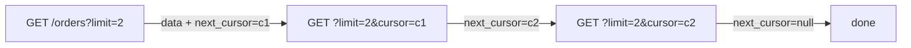

# Chapter 4. Pagination, filtering, sorting, field selection

## 1. The problem

`GET /orders` trả 2 triệu record và làm sập server. Bản vá đầu tiên: `?page=3&per_page=50`. Vài tháng sau trang 40.000 mất 8 giây, và user thấy trùng/mất đơn khi dữ liệu mới chèn vào trong lúc đang lật trang. Chương này giải thích vì sao và cách làm đúng.

## 2. The two main pagination styles

### Offset/limit (page/size)

```
GET /orders?limit=20&offset=40
```
SQL: `ORDER BY id LIMIT 20 OFFSET 40`.

- Ưu: đơn giản; nhảy tới trang bất kỳ; dễ hiển thị "trang 3/10".
- Nhược: (1) **chậm khi offset lớn**: DB vẫn phải scan và bỏ qua `offset` row; (2) **không ổn định**: chèn/xóa giữa các lần gọi làm trùng hoặc sót record.

### Cursor/keyset

```
GET /orders?limit=20&cursor=b3JkXzAwMjA
```
Cursor mã hóa "vị trí cuối cùng đã thấy". SQL (keyset): `WHERE id > :last_id ORDER BY id LIMIT 21` (lấy dư 1 để biết còn trang tiếp).

- Ưu: tốc độ gần như không đổi theo độ sâu (nhờ index); ổn định khi dữ liệu thay đổi.
- Nhược: không nhảy trang; sắp xếp nhiều cột phức tạp hơn; cần ràng buộc ordering **duy nhất** (thêm `id` làm tie-breaker).



| Tiêu chí | Offset | Cursor |
|---|---|---|
| Dataset lớn | chậm dần | ổn định |
| Dữ liệu thay đổi liên tục | trùng/sót | ổn định |
| Nhảy trang, tổng số trang | được | không |
| Độ phức tạp | thấp | trung bình |

Khuyến nghị: **mặc định cursor** cho API công khai; offset cho màn hình quản trị nhỏ cần nhảy trang.

## 3. Response contract

Lab cài đặt dạng:

```json
{
  "data": [ {"id": "ord_0001", "...": "..."}, {"id": "ord_0002", "...": "..."} ],
  "next_cursor": "b3JkXzAwMDI"
}
```

`next_cursor` là `null` khi hết dữ liệu. Có thể bổ sung `Link: <...>; rel="next"` (RFC 8288) cho client thích header.

### Cursors must be opaque

Client coi cursor là chuỗi bất kỳ, chỉ đưa lại nguyên vẹn. Lab chỉ base64url hóa `id` cho dễ thấy; production nên **sign hoặc encrypt** để (a) không bị sửa tay, (b) đổi được nội dung sau này. Cursor sai trả `400` với problem `invalid-cursor`.

### Total count

`COUNT(*)` trên bảng lớn rất đắt. Hoặc bỏ, hoặc trả xấp xỉ, hoặc chỉ trả khi client xin (`?include_total=true`).

## 4. Filtering

- Bằng query string, tên field thẳng: `GET /orders?status=pending&customer_id=cus_12`.
- Khoảng: `created_after=2026-11-01T00:00:00Z&created_before=...` (rõ ràng hơn `created_at[gte]`; chọn một kiểu).
- Lab hỗ trợ `status`. Hãy **liệt kê** filter parameter hợp lệ trong spec và từ chối parameter lạ bằng `400`, thay vì lờ đi; lờ đi khiến client gõ sai tên mà vẫn nhận dữ liệu sai.
- Filter phức tạp (nested and/or): cân nhắc `QUERY` với body (RFC 10008) khi hỗ trợ đủ, hoặc `POST /orders/search` như phương án thực dụng.

## 5. Sorting

```
GET /orders?sort=-created_at,id
```
`-` là descending. Quy tắc: danh sách field được phép sort là hữu hạn (có index), luôn thêm field duy nhất làm tie-breaker, cursor phải chứa giá trị của mọi cột sort.

Keyset hai cột (created_at giảm, id giảm):
```sql
WHERE (created_at, id) < (:c, :i) ORDER BY created_at DESC, id DESC LIMIT 21
```
(Row-value comparison có trong PostgreSQL và MySQL 8; cần composite index khớp thứ tự.)

## 6. Field selection and expand

- `?fields=id,status,total` giảm payload cho mobile. Dùng khi payload thực sự lớn; mỗi biến thể là một thứ cần test và cache riêng.
- `?expand=customer` nhúng resource liên quan.
- GraphQL (chương 11) giải bài toán này tận gốc nếu nhu cầu chọn field rất đa dạng.

## 7. In Fastify/Node.js

Fastify không có sẵn pagination, bạn tự viết keyset (xem `GET /orders` trong `lab/api/index.ts`): sắp theo `id` tăng dần, lọc `id > cursor`, lấy `limit + 1` dòng để biết còn trang sau hay không, rồi mã hóa `id` cuối trang thành opaque cursor bằng `Buffer.from(id).toString("base64url")`. Cursor chỉ là opaque với client; server phải validate khi giải mã (lab trả `400 invalid-cursor` khi sai định dạng). Nếu dùng ORM/query builder, kiểm tra xem nó hỗ trợ keyset hay chỉ `OFFSET`/`COUNT`; với dataset lớn đừng dùng offset.

## 8. Trade-offs

- Cursor làm mất "trang 5/20"; nếu UI cần nó, offset cho phạm vi nhỏ có thể chấp nhận.
- Giới hạn `limit` tối đa (lab: 100) để chống lạm dụng, và đặt mặc định hợp lý.

## 9. Pitfalls

- Không giới hạn `limit`.
- Sort theo cột không có index trên bảng lớn.
- Cursor theo cột không duy nhất, gây sót record trùng giá trị.
- Offset sâu trên bảng hàng triệu row.
- Cursor chứa dữ liệu nhạy cảm dạng thô.
- Lờ im filter parameter không hợp lệ.

## 10. Summary

- Offset đơn giản nhưng chậm/không ổn định; cursor/keyset ổn định và nhanh.
- Opaque cursor, `next_cursor = null` khi hết.
- Filter/sort theo allowlist, có tie-breaker duy nhất.
- Giới hạn `limit`; tránh `COUNT(*)` mặc định.

## 11. Self-check questions

1. Vì sao offset sâu chậm?
2. Vì sao cursor cần field duy nhất?
3. Vì sao lấy `limit + 1` record?
4. Khi nào vẫn chọn offset?

<details><summary>Answer</summary>

1. DB vẫn duyệt và loại `offset` row đầu trước khi trả.
2. Nếu nhiều row cùng giá trị sort, vị trí "sau cursor" không xác định và có thể sót/lặp.
3. Để biết còn trang sau mà không cần `COUNT`.
4. Dataset nhỏ, cần nhảy trang tùy ý (màn quản trị).
</details>
