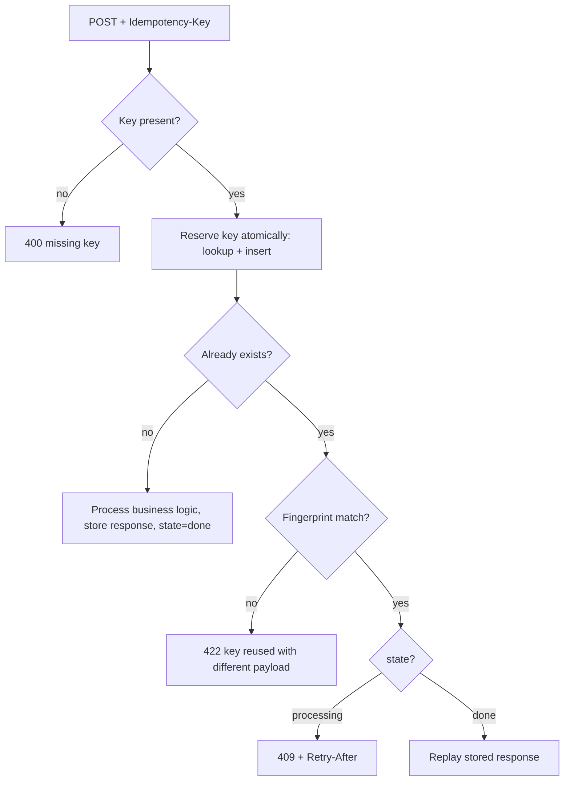

# Chương 6. Idempotency Key và retry an toàn

## 1. Vấn đề

Client gửi `POST /orders`, server tạo đơn rồi mạng đứt trước khi response về. Client không biết đơn đã tạo chưa. Retry thì có thể tạo đơn thứ hai (khách bị trừ tiền hai lần). Không retry thì có thể mất đơn. `POST` không idempotent nên proxy/SDK không tự retry được. Giải pháp: client sinh một **Idempotency-Key**, server nhớ kết quả theo key và trả lại đúng kết quả đó khi gặp lại.

## 2. Standardization status (kiểm tra 11/2026)

Header `Idempotency-Key` đang được chuẩn hóa trong **draft-ietf-httpapi-idempotency-key-header**. Phiên bản mới nhất khi viết: **-08 (22/10/2026)**, status *Active Internet-Draft*, Standards Track, hết hạn 25/4/2027. **Chưa là RFC**: nội dung có thể đổi; nhiều nhà cung cấp (Stripe và các PSP khác) đã dùng header cùng tên từ trước với biến thể riêng.

Điểm chính của draft (theo trang datatracker):
- `Idempotency-Key` là Structured Field Item kiểu String (nên bọc dấu ngoặc kép nếu theo đúng cú pháp Structured Fields, ví dụ `Idempotency-Key: "8e03978e-40d5-43e8-bc93-6894a57f9324"`). Khuyến nghị UUID. Lab dùng chuỗi tùy ý không bọc ngoặc cho đơn giản; nếu bám draft, hãy bọc.
- Một key **không được dùng lại với payload khác**.
- Thiếu key khi endpoint yêu cầu: `400`.
- Key dùng lại với payload khác: `422`.
- Request gốc còn đang xử lý: `409`; client có thể thử lại mà không cần sửa.
- Lỗi khác (401, 403, 5xx): theo tài liệu của resource.

Lab cài đúng bộ ba 400/422/409, nên chạy lại được khi draft thành RFC (cần rà lại chi tiết cú pháp).

## 3. Algorithm phía server



Điều cốt lõi:
1. **Atomic reservation** (unique constraint trong DB, hoặc `SET NX` trong Redis). Nếu kiểm tra rồi mới ghi (check-then-act) thì hai concurrent request cùng qua cổng.
2. **Fingerprint** payload (hash body đã canonicalize) để phát hiện dùng lại key sai.
3. Lưu **status + header + body** của response gốc để phát lại y hệt (lab thêm header `Idempotent-Replayed: true`).
4. Có **TTL** (thường 24 giờ đến vài ngày) và scope theo người dùng/tenant (`(tenant, key)` làm key) để key của người này không đụng người kia.
5. Lỗi validation (4xx do client): nhiều hệ thống *không lưu*, cho phép sửa và gửi lại cùng key; lỗi 5xx tùy chính sách. Lab nhả key khi validation lỗi.
6. Transaction: ghi business record và cập nhật idempotency record trong **cùng một transaction DB** nếu có thể; nếu có side effect ra ngoài (gọi payment gateway) thì cần truyền key đó xuống cho hệ thống ngoài.

## 4. Lab: chạy thật

Server `lab/api/index.ts` (Node.js 26.13.0, Fastify 5.12.8, một process) trong container `bookcheck-apits-server`, gọi bằng `curl` từ các container `curlimages/curl` dùng một lần, cùng network `bookcheck-apits-net`, không map port ra host. Kết quả đầy đủ trong `lab/transcript.md`. Đoạn chính (header do Node viết thường, đúng như output thật):

```
## 3. Tạo đơn lần đầu -> 201 + ETag + Location

$ curl -X POST http://bookcheck-apits-server:8080/orders -H Content-Type: application/json -H Idempotency-Key: key-0001 -d {"items":[{"sku":"BOOK-1","quantity":2,"unit_price":150000}],"note":"giao gio hanh chinh"}
HTTP/1.1 201 Created
location: /orders/ord_0001
etag: "055f116e02d2980e"
content-type: application/json; charset=utf-8
content-length: 193
Date: Sun, 08 Nov 2026 08:02:46 GMT
Connection: keep-alive
Keep-Alive: timeout=72

{"id":"ord_0001","status":"pending","note":"giao gio hanh chinh","items":[{"sku":"BOOK-1","quantity":2,"unit_price":150000}],"total":300000,"version":1,"created_at":"2026-11-08T08:02:46.502Z"}

## 4. Gửi lại cùng key + cùng body -> phát lại 201, không tạo đơn mới

$ curl -X POST http://bookcheck-apits-server:8080/orders -H Content-Type: application/json -H Idempotency-Key: key-0001 -d {"items":[{"sku":"BOOK-1","quantity":2,"unit_price":150000}],"note":"giao gio hanh chinh"}
HTTP/1.1 201 Created
location: /orders/ord_0001
etag: "055f116e02d2980e"
idempotent-replayed: true
content-type: application/json; charset=utf-8
content-length: 193
Date: Sun, 08 Nov 2026 08:02:53 GMT
Connection: keep-alive
Keep-Alive: timeout=72

{"id":"ord_0001","status":"pending","note":"giao gio hanh chinh","items":[{"sku":"BOOK-1","quantity":2,"unit_price":150000}],"total":300000,"version":1,"created_at":"2026-11-08T08:02:46.502Z"}

## 5. Cùng key, body khác -> 422

$ curl -X POST http://bookcheck-apits-server:8080/orders -H Content-Type: application/json -H Idempotency-Key: key-0001 -d {"items":[{"sku":"BOOK-9","quantity":1,"unit_price":1}]}
HTTP/1.1 422 Unprocessable Content
content-type: application/problem+json; charset=utf-8
content-length: 205
Date: Sun, 08 Nov 2026 08:02:59 GMT
Connection: keep-alive
Keep-Alive: timeout=72

{"type":"https://api.example.com/problems/idempotency-key-reused","title":"Idempotency-Key bị dùng lại","status":422,"detail":"Key này đã được dùng với payload khác.","instance":"/orders"}

## 6. Race: 2 request cùng key, request đầu bị giữ 2 giây -> request sau nhận 409

$ curl -X POST http://bookcheck-apits-server:8080/orders -H Content-Type: application/json -H Idempotency-Key: key-race -d {"items":[{"sku":"PEN-1","quantity":1,"unit_price":5000}]}
HTTP/1.1 409 Conflict
retry-after: 1
content-type: application/problem+json; charset=utf-8
content-length: 200
Date: Sun, 08 Nov 2026 08:03:07 GMT
Connection: keep-alive
Keep-Alive: timeout=72

{"type":"https://api.example.com/problems/request-in-progress","title":"Request đang xử lý","status":409,"detail":"Request gốc với key này chưa xong; thử lại sau.","instance":"/orders"}

(response của request đầu)

$ curl -X POST http://bookcheck-apits-server:8080/orders -H Content-Type: application/json -H Idempotency-Key: key-race -H X-Demo-Delay: 2 -d {"items":[{"sku":"PEN-1","quantity":1,"unit_price":5000}]}
HTTP/1.1 201 Created
location: /orders/ord_0002
etag: "5917862e52248863"
content-type: application/json; charset=utf-8
content-length: 171
Date: Sun, 08 Nov 2026 08:03:08 GMT
Connection: keep-alive
Keep-Alive: timeout=72

{"id":"ord_0002","status":"pending","note":null,"items":[{"sku":"PEN-1","quantity":1,"unit_price":5000}],"total":5000,"version":1,"created_at":"2026-11-08T08:03:08.906Z"}
```

Và phần ETag/If-Match (chương 2): thiếu `If-Match` ra `428`, đúng ra `200` với ETag mới, ETag cũ ra `412`. Toàn bộ nằm trong `lab/transcript.md`.

Lưu ý: khi gửi hai request đồng thời cùng key (request đầu có `X-Demo-Delay: 2` giữ ở state `processing`), request thứ hai nhận `409 request-in-progress`.

## 5. Retry an toàn phía client

- Sinh key **một lần cho mỗi thao tác logic** và dùng lại ở mọi lần retry; key mới = thao tác mới.
- Retry khi: lỗi mạng/timeout, `409` (sau `Retry-After`), `429`, `502/503/504`. Không retry nguyên văn với 4xx khác.
- **Exponential backoff + jitter**: `delay = random(0, min(cap, base * 2^n))` để tránh "thundering herd".
- Tôn trọng `Retry-After`.
- Có giới hạn số lần và tổng thời gian; sau đó báo lỗi rõ ràng.
- Với `PUT`/`DELETE` idempotent bản chất không cần key. Với `PATCH` dùng `If-Match` làm điều kiện (chương 2).

## 6. Trade-off

- Tốn storage và latency thêm một lần ghi; đổi lại an toàn thanh toán/tạo resource.
- Cách khác: natural key (unique `(customer_id, client_order_ref)`) hoặc `PUT /orders/{client_generated_id}` (client sinh ID) cho idempotency "miễn phí" không cần bảng key. Dùng khi nghiệp vụ cho phép.
- Không cần cho thao tác đã idempotent.

## 7. Cạm bẫy

- Check-then-act không atomic gây đơn trùng khi concurrent retry.
- Không so fingerprint: client lỡ dùng lại key cho đơn khác, nhận về đơn cũ trong im lặng.
- Key toàn cục không gắn tenant.
- TTL quá ngắn so với thời gian retry của client.
- Lưu response nhưng side effect (email, gọi PSP) đã chạy hai lần vì crash giữa chừng; cần cơ chế recovery hoặc truyền key xuống hệ thống ngoài.
- Dùng cùng key cho các endpoint khác nhau; scope nên gồm cả method + path.

## 8. Tóm tắt

- `Idempotency-Key` cho POST: server lưu kết quả theo key, phát lại khi trùng.
- Draft IETF -08 (10/2026) vẫn chưa là RFC; bộ mã 400 thiếu, 422 sai payload, 409 đang xử lý.
- Phần khó nhất: atomic reservation, fingerprint, TTL, tenant scope.
- Client retry cùng key, backoff có jitter, tôn trọng `Retry-After`.

## 9. Câu hỏi tự kiểm tra

1. Vì sao POST không tự retry được?
2. Hai concurrent request cùng key: server làm gì?
3. Key dùng lại với body khác trả mã gì và vì sao cần kiểm tra?
4. Có cách nào idempotent mà không cần bảng key?

<details><summary>Đáp án</summary>

1. POST không idempotent; retry có thể lặp side effect.
2. Request đầu reserve key atomically; request sau nhận 409 (đang xử lý) hoặc phát lại kết quả nếu xong.
3. 422; để không trả nhầm kết quả của thao tác khác.
4. Natural unique constraint, hoặc PUT với ID do client sinh.
</details>
