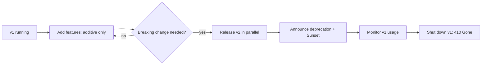

# Chapter 7. Versioning and API evolution

## 1. The problem

Bạn muốn đổi `total` từ số nguyên sang object `{"amount":..., "currency":"VND"}`. Có 400 client đang chạy, trong đó app mobile cũ mà người dùng không chịu cập nhật. Đổi là sẽ break client. Mục tiêu của API evolution: **thêm giá trị mới mà không break ai**, và khi buộc phải có breaking change thì có lộ trình rõ.

## 2. Breaking and non-breaking changes

| Thay đổi | Breaking? |
|---|---|
| Thêm field mới vào response | Không (nếu client bỏ qua field lạ, "tolerant reader") |
| Thêm endpoint / method mới | Không |
| Thêm parameter query/body **optional** | Không |
| Thêm giá trị enum mới vào response | **Có thể** breaking nếu client `switch` cứng; khai báo trong tài liệu từ đầu rằng enum có thể mở rộng |
| Xóa/đổi tên field | Có |
| Đổi kiểu hoặc ý nghĩa field (đơn vị, múi giờ) | Có |
| Thêm parameter **required** | Có |
| Siết validation (từ chối giá trị trước đây nhận) | Có |
| Đổi status code/error format | Có |
| Đổi default ordering, default page size | Có thể |
| Đổi URL, bỏ method | Có |

Quy tắc vàng: **Postel có điều kiện** - server nghiêm khắc với input, client dễ tính với output. Ghi "tolerant reader" thành yêu cầu trong tài liệu cho client.

## 3. Versioning strategies

| Chiến lược | Ví dụ | Ưu | Nhược |
|---|---|---|---|
| Trong URL | `/v1/orders` | rõ, dễ route, dễ cache | version cả API một lần; URL đổi |
| Header | `Api-Version: 2026-11-01` | URL sạch | khó thử bằng trình duyệt; dễ quên khi cache (`Vary`) |
| Media type | `Accept: application/vnd.example.v2+json` | đúng tinh thần HTTP | phức tạp cho nhiều dev |
| Query | `?version=2` | dễ | dễ nhầm với business parameter |
| Date-based (Stripe) | header ngày, pin theo account | thay đổi nhỏ, nâng dần | cần hạ tầng compatibility transform lớn |

Thực dụng: `/v1/` trong URL cho hầu hết API; chỉ tăng major khi buộc phải có breaking change. Trong 1 major, tiến hóa **chỉ cộng thêm**. Google AIP-185 và Microsoft/Zalando guideline đều khuyến nghị tránh breaking trong major và chỉ dùng major để đánh dấu breaking.



## 4. Deprecation and Sunset

Hai header HTTP chuẩn:

- **`Deprecation`** - **RFC 9745** (3/2025, Standards Track): cho biết resource đã/sẽ bị deprecated. Giá trị là ngày dạng Structured Field Date: `Deprecation: @1767225600` (số giây Unix, có ký tự `@`). Hai header dùng hai định dạng ngày khác nhau (Deprecation: Structured Field Date; Sunset: HTTP-date). Nên đối chiếu RFC 9745 trước khi cài đặt (chưa kiểm từng ký tự).
- **`Sunset`** - **RFC 8594**: thời điểm resource dự kiến ngừng phản hồi, dạng HTTP-date: `Sunset: Wed, 01 Jul 2027 00:00:00 GMT`. RFC 9745 quy định thời điểm Sunset không được sớm hơn Deprecation.
- Thêm `Link: <https://api.example.com/docs/migrate-v2>; rel="deprecation"; type="text/html"` trỏ tài liệu hướng dẫn, và `rel="sunset"` nếu cần.

Ví dụ:

```http
HTTP/1.1 200 OK
Deprecation: @1788220800
Sunset: Thu, 01 Jul 2027 00:00:00 GMT
Link: <https://api.example.com/docs/migrate-v2>; rel="deprecation"; type="text/html"
```

Sau Sunset: trả `410 Gone` kèm problem details (chương 5) trỏ tới migration guide.

### A good deprecation process

1. Đo usage theo client (API key/OAuth client) trước khi quyết định.
2. Thông báo sớm qua email/changelog/dashboard + header trên mọi response.
3. Cho thời gian đủ dài (thường 6-12 tháng với API công khai).
4. Gửi nhắc trực tiếp cho client còn dùng ở các mốc (90/30/7 ngày).
5. "Brownout": tắt tạm có kế hoạch vài giờ để client lười lộ diện.
6. Tắt hẳn bằng 410.

OpenAPI hỗ trợ `deprecated: true` ở operation/parameter/schema; linter có thể cảnh báo client dùng.

## 5. Techniques for evolving without breaking

- **Thêm thay vì sửa**: field mới song song (`total_money` cạnh `total`), giữ field cũ đến Sunset.
- **Feature flag theo client**/`Prefer` header cho hành vi mới tùy chọn.
- **Contract test**/consumer-driven (Pact) và so sánh spec để bắt breaking change trong CI: `oasdiff` hoặc `openapi-changes` (kiểm tra phiên bản hiện hành trước khi dùng).
- **Mở rộng enum an toàn**: tài liệu hóa "client phải xử lý giá trị không biết".
- **Default hợp lý** cho parameter mới thay vì required.

## 6. Trade-offs

- Nhiều version song song = chi phí bảo trì nhân đôi; hạn chế còn tối đa 2 major.
- URL versioning đơn giản nhưng ngầm khuyến khích "nhảy v2" thường xuyên; kỷ luật additive quan trọng hơn cách đặt version.
- API nội bộ, client cùng deploy: có thể không cần version, chỉ cần deploy phối hợp và contract test.

## 7. Pitfalls

- Coi "thêm field" là luôn an toàn khi client strict-deserialize (một số SDK sinh code fail với field lạ).
- Đổi ý nghĩa field mà giữ nguyên tên.
- Deprecate không có số liệu usage.
- Tắt version cũ không báo trước.
- Quên rằng validation chặt hơn cũng là breaking.
- Tin vào blog cũ về định dạng `Deprecation`; đọc RFC 9745.

## 8. Summary

- Chỉ additive trong một major; breaking change thì sang major mới.
- `/v1/` trong URL là mặc định thực dụng.
- `Deprecation` (RFC 9745) + `Sunset` (RFC 8594) + `Link` + changelog + đo usage.
- Tự động hóa phát hiện breaking change trong CI.

## 9. Self-check questions

1. Thêm giá trị enum mới có phải luôn non-breaking không?
2. `Deprecation` và `Sunset` khác nhau thế nào?
3. Vì sao siết validation là breaking?
4. Sau Sunset nên trả mã nào?

<details><summary>Answer</summary>

1. Không; client switch cứng có thể lỗi, nên cần quy ước từ đầu.
2. Deprecation: đã/sẽ lỗi thời (còn dùng được). Sunset: thời điểm ngừng phản hồi.
3. Request từng hợp lệ nay bị từ chối.
4. `410 Gone`.
</details>
