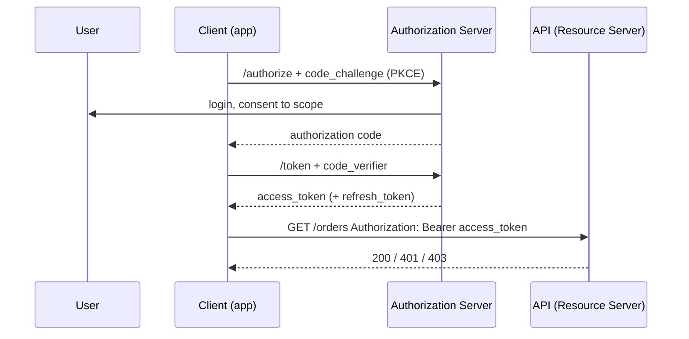

# Chapter 8. Authentication and authorization for APIs

## 1. The problem

API của bạn có ba loại caller: app mobile của khách hàng, hệ thống đối tác gọi server-to-server, và dashboard nội bộ. "Thêm JWT cho xong" giải quyết được phần nào? Chương này phân biệt **authentication** (bạn là ai), **authorization** (bạn được làm gì) và chọn cơ chế đúng cho từng loại caller.

## 2. Mechanisms

| Cơ chế | Dùng cho | Ghi chú |
|---|---|---|
| API key | server-to-server đơn giản, đối tác | định danh *ứng dụng*, không phải người dùng; static secret dài hạn |
| OAuth 2.0 | delegated authorization thay mặt người dùng; machine-to-machine | chuẩn công nghiệp |
| OpenID Connect (OIDC) | **login** (authenticate người dùng) lớp trên OAuth 2.0 | trả ID Token |
| mTLS / DPoP | bind token với client | chống replay token bị đánh cắp |
| Session cookie | web app first-party | cần chống CSRF |

### API key

Gửi trong header `Authorization: Bearer <key>` hoặc header riêng (`X-API-Key`), **không** trong URL (lọt log, referer). Lưu server **dạng hash** (SHA-256 đủ cho key ngẫu nhiên dài), hiển thị đúng một lần khi tạo, hỗ trợ nhiều key cho mỗi tài khoản để rotation, tiền tố dễ nhận diện (`sk_live_...`) để secret scanning phát hiện khi rò rỉ, gắn scope và có thể revoke.

### OAuth 2.0 in practice

Chuẩn nền: RFC 6749 (framework), RFC 6750 (Bearer), RFC 7636 (**PKCE**), và **RFC 9700** (*Best Current Practice for OAuth 2.0 Security*, 2025) tổng hợp các security practice hiện hành.

**OAuth 2.1**: là bản tổng hợp RFC 6749 + các BCP thành một spec gọn. Khi viết (11/2026) nó vẫn là **Internet-Draft: draft-ietf-oauth-v2-1-17 (31/10/2026)**, status "I-D Exists", mốc dự kiến gửi IESG là 12/2026 - **chưa phải RFC**. Hãy xem nó là "hướng đi", và áp dụng ngay các yêu cầu của nó vì chúng đã nằm trong RFC 9700:

- **Authorization Code + PKCE** cho mọi client có người dùng (kể cả confidential client). PKCE là bắt buộc trong 2.1.
- **Bỏ Implicit grant** và **Resource Owner Password Credentials grant**.
- Redirect URI phải exact match từng ký tự.
- Không gửi access token trong query string.
- Refresh token của public client phải bị ràng buộc với client (sender-constrained) hoặc rotation.

Grant theo caller:

| Caller | Grant |
|---|---|
| Mobile/SPA/web có đăng nhập người dùng | Authorization Code + PKCE |
| Service-to-service, không có người dùng | Client Credentials |
| Thiết bị không có trình duyệt (TV, CLI) | Device Authorization Grant (RFC 8628) |



Đừng tự viết authorization server. Dùng sản phẩm đã kiểm chứng (Keycloak, Ory Hydra, Auth0/Entra/Okta...). Trong Node.js, phía resource server có thể dùng `jose` để verify JWT/JWKS hoặc `@fastify/jwt`; còn nếu thật sự cần tự dựng authorization server thì chỉ nên cân nhắc thư viện đã được kiểm chứng, và ưu tiên sản phẩm có sẵn ở trên.

## 3. JWT and its pitfalls

JWT (RFC 7519) là định dạng token tự mô tả (header.payload.signature). **RFC 9068** định nghĩa profile JWT cho access token (`typ: at+jwt`, các claim `iss`, `aud`, `sub`, `exp`, `client_id`, `scope`...). **RFC 8725** là BCP về JWT.

Cạm bẫy phổ biến:

1. **`alg: none`** hoặc để token tự chọn algorithm: server phải cố định danh sách algorithm cho phép.
2. **Nhầm HS256/RS256** (dùng public key làm secret HMAC): chỉ chấp nhận algorithm mong đợi cho từng key.
3. **Không kiểm `iss`, `aud`, `exp`, `nbf`**: token của dịch vụ khác/hết hạn vẫn được nhận.
4. **Không revoke được**: JWT hợp lệ đến `exp`. Giữ `exp` ngắn (5-15 phút) + refresh token; hoặc introspection (RFC 7662) khi cần revoke tức thời.
5. **Nhét dữ liệu nhạy cảm vào payload**: payload chỉ base64url, ai cũng đọc được.
6. **Lưu token ở localStorage** cho SPA: bị XSS đọc được; cân nhắc BFF + cookie `HttpOnly`.
7. **`kid` injection / JWKS không kiểm soát**: lấy key từ JWKS URL cố định đã cấu hình, không từ giá trị trong token.
8. **Dùng ID Token làm access token**: ID Token dành cho client, không dành cho API.

Opaque token (chuỗi ngẫu nhiên + tra cứu/introspection) thường an toàn và dễ revoke hơn JWT, đổi lại cần một lần tra cứu mỗi request (cache được).

## 4. Authorization

- **Scope** (OAuth): coarse-grained permission gắn với token: `orders:read`, `orders:write`. Server kiểm scope **và** kiểm permission trên từng object.
- **Object-level authorization**: lỗi số 1 trong OWASP API Security Top 10 là *Broken Object Level Authorization* (BOLA/IDOR). Mỗi endpoint nhận ID phải xác nhận caller được truy cập object đó. Scope `orders:read` không có nghĩa đọc đơn của ai cũng được.
- Property-level authorization (BOPLA) và function-level authorization (admin vs thường).
- Trả `401` khi chưa authenticate (kèm `WWW-Authenticate: Bearer`), `403` khi thiếu permission, hoặc `404` để giấu sự tồn tại.
- Node.js/Fastify: kiểm tra quyền sở hữu object trong handler/service (không nên chỉ dựa vào middleware), dùng hook `preHandler` hoặc `@fastify/auth` để gom logic xác thực, và kiểm `scope` trong claim của token đã verify.

Ví dụ lỗi chuẩn:

```http
HTTP/1.1 401 Unauthorized
WWW-Authenticate: Bearer realm="api", error="invalid_token"
Content-Type: application/problem+json
```

## 5. Trade-offs

- API key đơn giản nhưng khó authorize theo người dùng; OAuth mạnh nhưng nặng.
- JWT tiện cho microservice (không cần tra cứu) nhưng khó revoke; opaque ngược lại.
- Token ngắn hạn an toàn hơn nhưng tăng refresh load.
- Session/cookie hoặc token cá nhân đơn giản hợp tác vụ first-party; cần bên thứ ba cấp quyền cho ứng dụng khác thì dùng OAuth đầy đủ.

## 6. Pitfalls

- Chỉ kiểm authn, quên kiểm object-level.
- Secret/API key commit vào git.
- Token trong URL.
- Error message của login tiết lộ account có tồn tại không.
- Không giới hạn rate cho endpoint đăng nhập/token (chương 9).
- CORS `*` kèm credential.

## 7. Summary

- API key = định danh ứng dụng; OAuth = delegated authorization; OIDC = login.
- Auth code + PKCE; client credentials cho M2M; bỏ implicit/password. OAuth 2.1 vẫn là draft (-17, 10/2026); RFC 9700 là BCP hiện hành.
- JWT: cố định algorithm, kiểm `iss/aud/exp`, token ngắn hạn.
- Luôn kiểm object-level permission, không chỉ scope.

## 8. Self-check questions

1. OAuth 2.1 đã là RFC chưa?
2. Vì sao Implicit grant bị bỏ?
3. Kể 3 cạm bẫy JWT.
4. BOLA là gì và chống thế nào?

<details><summary>Answer</summary>

1. Chưa; draft-ietf-oauth-v2-1-17 (31/10/2026), chưa gửi IESG.
2. Token lộ qua URL fragment/browser history; đã có Code + PKCE thay thế.
3. alg none/nhầm algorithm, không kiểm aud/iss/exp, payload nhạy cảm, không revoke được...
4. Truy cập object của người khác bằng cách đổi ID; kiểm permission trên từng object ở mỗi endpoint.
</details>
