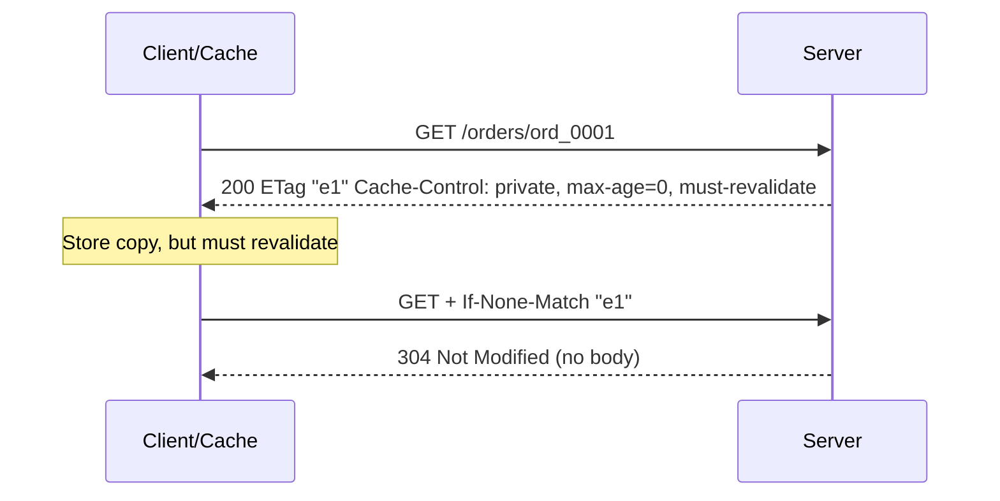

# Chương 9. Rate limiting, quota và caching HTTP

## 1. Vấn đề

Một client lỗi lặp vô hạn vòng `GET /orders` và làm chậm cả hệ thống; một đối tác khác cào dữ liệu. Ngược lại, hàng triệu lượt `GET` cùng một order do mobile app refresh liên tục tốn tiền bandwidth dù dữ liệu không đổi. Rate limiting bảo vệ server; caching giảm tải hợp pháp.

## 2. Rate limiting

### Algorithm phổ biến

| Algorithm | Ý tưởng | Đặc điểm |
|---|---|---|
| Fixed window | đếm theo window cố định (mỗi phút) | đơn giản; cho phép burst gấp đôi ở window boundary |
| Sliding window | window trượt | mượt hơn, tốn bộ nhớ hơn |
| Token bucket | bucket chứa token nạp đều, mỗi request lấy 1 | cho phép burst có kiểm soát; phổ biến nhất |
| Leaky bucket | queue, xử lý tốc độ cố định | smooth traffic |
| Concurrency limit | giới hạn số concurrent request | bảo vệ resource đắt |

Rate limit key: theo API key/OAuth client, theo người dùng, theo IP (yếu: NAT, proxy), theo endpoint (ghi đắt hơn đọc). **Rate limit** (tốc độ ngắn hạn, bảo vệ hạ tầng) khác **quota** (tổng lượng theo tháng, gắn với gói thương mại).

Khi vượt: `429 Too Many Requests` (RFC 6585) + problem details + `Retry-After` (số giây hoặc HTTP-date). Với quá tải toàn hệ thống: `503` + `Retry-After`.

### Header RateLimit: draft status

IETF đang chuẩn hóa trong **draft-ietf-httpapi-ratelimit-headers**. Phiên bản mới nhất khi viết: **-11 (23/5/2026)**, *Active Internet-Draft*, Standards Track, hết hạn 24/11/2026 - **chưa là RFC**, và **cú pháp đã đổi so với các draft cũ**.

Hai header theo draft hiện tại (ví dụ lấy từ trang datatracker):

```http
RateLimit-Policy: "burst";q=100;w=60,"daily";q=1000;w=86400
RateLimit: "default";r=50;t=30
```

- `RateLimit-Policy`: khai báo policy (`q` = quota, `w` = window tính bằng giây).
- `RateLimit`: state hiện tại (`r` = còn lại, `t` = giây đến khi reset).
- Các draft cũ dùng `RateLimit-Limit`, `RateLimit-Remaining`, `RateLimit-Reset` (và `X-RateLimit-*` tự phát của GitHub, Twitter...). Nhiều API vẫn dùng kiểu cũ. **Vì draft còn thay đổi, nếu cần ổn định hãy tài liệu hóa chính xác bạn gửi header gì**, có thể gửi cả hai cú pháp trong giai đoạn chuyển tiếp.
- Chi tiết cú pháp đầy đủ của `-11` chưa được kiểm chứng ngoài các ví dụ trên; đọc draft trước khi cài đặt.

### Implementation

- Redis + script Lua (atomic) cho token bucket/sliding window distributed.
- Gateway layer (nginx `limit_req`, Envoy, Kong, API Gateway của cloud) hợp cho giới hạn coarse-grained; application layer cho giới hạn theo nghiệp vụ.
- Node.js/Fastify: plugin `@fastify/rate-limit` (11.2.2, đang được maintain) cấu hình `max`, `timeWindow`, `keyGenerator` (theo user id hoặc IP) và trả `429` kèm `Retry-After`; dùng store Redis/Valkey khi chạy nhiều instance. Dùng `errorResponseBuilder` để trả problem details (chương 5).
- Client: coi 429 như tín hiệu backoff (chương 6).

## 3. Caching HTTP (RFC 9111)



### Cache-Control thường dùng

| Directive | Ý nghĩa |
|---|---|
| `max-age=N` | bản sao còn "fresh" N giây |
| `no-cache` | được lưu nhưng **phải revalidate** trước khi dùng |
| `no-store` | không được lưu (dữ liệu nhạy cảm) |
| `private` | chỉ private cache (trình duyệt), không shared cache (CDN) |
| `public` | shared cache được lưu |
| `must-revalidate` | khi hết hạn bắt buộc revalidate |
| `s-maxage=N` | thời gian cho shared cache |
| `stale-while-revalidate=N` (RFC 5861) | serve bản stale trong lúc revalidate ở background |

Nhầm lẫn kinh điển: `no-cache` **không** có nghĩa "đừng cache"; đó là `no-store`.

### Chiến lược cho API

- Dữ liệu cá nhân hóa: `Cache-Control: private` hoặc `no-store`; luôn xét `Vary: Authorization`/`Accept` nếu shared cache có thể chen vào.
- Resource đọc nhiều, ít đổi: `ETag` + `max-age` ngắn + `stale-while-revalidate`.
- Mọi GET resource có ETag: hỗ trợ `If-None-Match` trả `304`. Lab làm điều này cho `GET /orders/{id}`.
- Response của `POST` hầu như không được cache.
- `Vary`: liệt kê các header request làm thay đổi response (`Vary: Accept`, `Accept-Language`).

### ETag cho hai mục đích

Cùng ETag, hai việc: **đọc có điều kiện** (If-None-Match, tiết kiệm bandwidth, chương này) và **ghi có điều kiện** (If-Match, chống lost update, chương 2). Một thiết kế, hai lợi ích.

## 4. Trade-off

- Rate limit chặt bảo vệ hệ thống nhưng gây lỗi cho client hợp lệ burst; token bucket cho phép burst.
- Cache mạnh giảm tải nhưng có rủi ro stale data; revalidation bằng ETag là điểm giữa.
- Limit theo IP dễ nhưng sai với NAT/mobile carrier.

## 5. Cạm bẫy

- Rate limit chỉ ở một instance (không dùng store chung).
- Tin `X-Forwarded-For` do client tự gửi để xác định IP.
- Thiếu `Retry-After`, client retry dồn dập.
- Cache nhầm response cá nhân hóa ở CDN (thiếu `private`/`Vary`).
- Nhầm `no-cache` với `no-store`.
- ETag không đổi khi dữ liệu đổi (hoặc đổi mỗi request).
- Dựa vào header RateLimit của draft mà không ghi version đang dùng.

## 6. Tóm tắt

- Token bucket + key theo client; 429 + `Retry-After`; phân biệt rate limit và quota.
- Header `RateLimit`/`RateLimit-Policy` vẫn là draft -11 (5/2026), cú pháp mới khác cũ.
- `Cache-Control` + ETag + `304`; `private` cho dữ liệu cá nhân; `no-cache` không phải `no-store`.

## 7. Câu hỏi tự kiểm tra

1. Khác biệt rate limit và quota?
2. `no-cache` khác `no-store` thế nào?
3. Header RateLimit đã là RFC chưa?
4. Một ETag phục vụ hai cơ chế nào?

<details><summary>Đáp án</summary>

1. Rate limit: tốc độ ngắn hạn bảo vệ hạ tầng; quota: tổng lượng theo kỳ, gắn gói dịch vụ.
2. `no-cache`: được lưu nhưng phải revalidate; `no-store`: không được lưu.
3. Chưa; draft -11 (23/5/2026).
4. `If-None-Match` (đọc, 304) và `If-Match` (ghi, 412).
</details>
