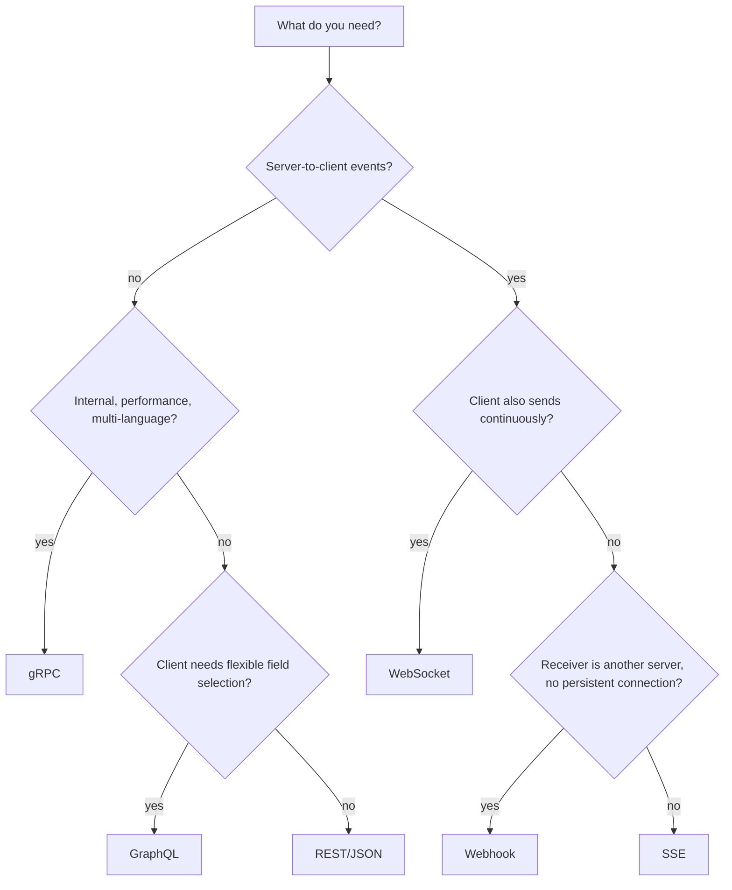

# Chapter 11. REST, gRPC, GraphQL, webhooks, SSE/WebSocket: what to choose when

## 1. The problem

"Mình dùng GraphQL vì hiện đại" hay "mọi thứ phải REST" đều là lập luận kém. Mỗi protocol giải một lớp bài toán khác. Chương này đưa tiêu chí.

## 2. Quick comparison

| | REST/JSON | gRPC | GraphQL | Webhook | SSE | WebSocket |
|---|---|---|---|---|---|---|
| Model | request/response trên resource | RPC, Protobuf, HTTP/2 | một endpoint, client chọn field | server gọi HTTP của bạn | one-way server push, HTTP | bidirectional, dedicated connection |
| Contract | OpenAPI | `.proto` | schema SDL | tài liệu/OpenAPI `webhooks` | event stream | custom |
| Cache HTTP | tốt | kém (POST/HTTP2 frames) | khó (thường POST) | N/A | không | không |
| Direct browser | có | cần gRPC-Web/proxy | có | không | có (`EventSource`) | có |
| Streaming | khó | có (4 kiểu) | subscription (thường WS/SSE) | không | có | có |
| Tooling | rất rộng | mạnh | mạnh | cần tự build | đơn giản | cần quản lý connection |

## 3. When to use which

### REST/JSON (the default)

API công khai, nhiều loại client, cần cache HTTP, dễ debug bằng curl. Đây là điểm xuất phát nếu không có lý do khác.

### gRPC

Service-to-service nội bộ, nhiều ngôn ngữ, cần hiệu năng, schema chặt, bidirectional streaming, deadline/cancellation tích hợp. Hạn chế: khó dùng trực tiếp từ browser, khó debug bằng curl, ít thân thiện với CDN/cache. Với Node.js: `@grpc/grpc-js` (1.14.7) hoặc Connect (`@connectrpc/connect` 2.3.0, nói được gRPC, gRPC-Web và HTTP/JSON, dùng được từ browser); cần cân nhắc chi phí vận hành so với REST nội bộ.

### GraphQL

Nhiều client (web, mobile, đối tác) với nhu cầu dữ liệu rất khác nhau, đồ thị dữ liệu sâu, muốn giảm over/under-fetching. Chi phí: cache HTTP khó, **N+1 query** ở resolver (cần DataLoader), kiểm soát query depth/complexity để chống lạm dụng, rate limit theo "cost" thay vì theo request, field-level authorization, lỗi theo kiểu `200 + errors[]`. Trong Node.js có GraphQL Yoga (6.0.1) hoặc Mercurius cho Fastify (16.12.1), và `dataloader` (2.2.3) để gom N+1. Phù hợp BFF cho frontend nhiều biến thể; thường không cần cho API tích hợp đơn giản.

### Webhook

Server báo cho client khi có event (đã thanh toán, đơn đã giao), thay vì để client poll. Cần bên nhận có endpoint công khai. Chi tiết chương 12.

### SSE (Server-Sent Events)

Đẩy event stream một chiều qua HTTP thường (`Content-Type: text/event-stream`), trình duyệt có `EventSource`, tự kết nối lại và hỗ trợ `Last-Event-ID`. Hợp: thông báo, tiến độ job, dashboard, luồng token từ LLM. Đơn giản hơn WebSocket nếu chỉ cần chiều server -> client. Lưu ý giới hạn số kết nối HTTP/1.1 mỗi domain (HTTP/2 giải quyết).

### WebSocket

Bidirectional, low latency: chat, game, cộng tác real-time. Chi phí: quản lý stateful connection (scale, sticky, heartbeat, reconnect), authentication khó hơn, không có semantics HTTP (cache, status code). Node.js vốn là long-running process nên làm tốt việc này: thư viện `ws` (8.22.1) hoặc `@fastify/websocket` (11.3.7); vẫn phải tính tới scale ngang (sticky session hoặc pub/sub qua Redis/Valkey).

## 4. Combining them

Thực tế phổ biến: REST công khai + webhook cho event + gRPC nội bộ; GraphQL làm BFF phía trước. Một số hệ thống còn cho phép gọi lại REST để lấy full state sau khi nhận webhook mỏng ("thin event").

## 5. General trade-offs

- Mỗi protocol thêm là thêm chi phí tooling, security, vận hành.
- Hiệu năng ít khi là lý do thực sự để rời REST; hãy đo trước.
- Chọn theo *đối tượng dùng* và *mẫu tương tác*, không theo xu hướng.

## 6. Pitfalls

- GraphQL không giới hạn query depth/cost.
- Dùng WebSocket cho thứ chỉ cần SSE hoặc poll thưa.
- gRPC ra thẳng ngoài Internet cho đối tác mà không cung cấp REST.
- Webhook không có retry/ký (chương 12).
- Polling mỗi giây thay vì webhook/SSE.
- Cho rằng GraphQL "không cần versioning": vẫn cần deprecation field.

## 7. Summary

- REST/JSON là mặc định; gRPC cho nội bộ; GraphQL cho nhu cầu dữ liệu đa dạng; webhook cho event giữa server; SSE cho đẩy một chiều; WebSocket khi bidirectional.
- Mỗi lựa chọn kéo theo chi phí vận hành riêng.

## 8. Self-check questions

1. Chọn gì cho thông báo tiến độ job tới trình duyệt?
2. Vì sao cache HTTP khó với GraphQL?
3. N+1 trong GraphQL là gì?
4. Khi nào gRPC không phù hợp?

Answer

1. SSE.
2. Thường là POST tới một endpoint duy nhất; query nằm trong body.
3. Mỗi phần tử danh sách kích hoạt một query phụ ở resolver; giải bằng batching/DataLoader.
4. API công khai cho browser/đối tác đa dạng, cần cache/CDN, debug đơn giản.

