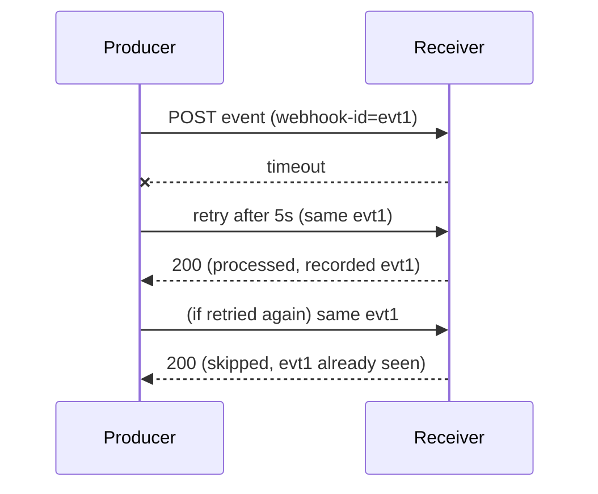

# Chương 12. Webhooks: signature, retry, idempotency, Standard Webhooks

## 1. Vấn đề

Khách thanh toán xong, hệ thống bạn muốn báo cho đối tác. Gọi HTTP tới URL của họ nghe đơn giản, nhưng: làm sao họ biết request là của bạn (kẻ xấu cũng POST được)? Họ down 10 phút thì sao? Retry sinh ra duplicate event thì sao? Kẻ tấn công ghi lại một request hợp lệ rồi replay thì sao?

## 2. Event design

```json
{
  "type": "order.cancelled",
  "id": "evt_01JC9X",
  "timestamp": "2026-11-08T03:10:00Z",
  "data": {"order_id": "ord_0001", "status": "cancelled"}
}
```

- `type` có namespace (`order.cancelled`), `id` duy nhất và **ổn định qua các lần retry**.
- Payload "mỏng" (chỉ ID + status) kèm khuyến nghị gọi lại `GET` để lấy bản mới nhất, hoặc payload "dày". Mỏng tránh lộ dữ liệu và event cũ ghi đè event mới; dày tiết kiệm một round trip. Event **không đảm bảo ordering**.
- Cho đăng ký endpoint, chọn event type, rotate secret, xem lịch sử gửi và resend thủ công.
- OpenAPI mô tả webhook ở key `webhooks` (chương 10).

## 3. HMAC signature

Mục tiêu: **source authentication** và **integrity**. Người gửi và người nhận chia sẻ secret; người gửi tính `HMAC-SHA256(secret, nội dung)`, gửi kèm; người nhận tính lại và so sánh.

Điểm quan trọng:
1. Ký trên **byte thô của body**, không phải JSON đã parse lại (khoảng trắng/thứ tự key thay đổi sẽ làm sai signature).
2. **Constant-time comparison** (Node.js: `crypto.timingSafeEqual`) để chống timing attack.
3. Ký kèm **timestamp** và từ chối nếu lệch quá window (ví dụ 5 phút) để chống replay.
4. Secret đủ dài, ngẫu nhiên, hỗ trợ **rotation** (nhiều signature cùng lúc).

## 4. Standard Webhooks

**Standard Webhooks** (standardwebhooks.com, repo `standard-webhooks/standard-webhooks`) là một đặc tả mở thống nhất cách ký/gửi webhook, có thư viện nhiều ngôn ngữ. Không phải chuẩn IETF/RFC. Theo spec trong repo (kiểm tra 11/2026):

| Header | Ý nghĩa |
|---|---|
| `webhook-id` | ID duy nhất của event, **giữ nguyên qua retry**; dùng làm key idempotency |
| `webhook-timestamp` | Unix timestamp (giây) của lần gửi |
| `webhook-signature` | một hay nhiều signature cách nhau dấu cách, dạng `v1,<base64>` |

Nội dung được ký: `{webhook-id}.{webhook-timestamp}.{body}` (nối bằng dấu chấm).

- **v1**: HMAC-SHA256 với secret chia sẻ. Secret dạng `whsec_` + base64 của 24-64 byte ngẫu nhiên.
- **v1a**: ed25519 asymmetric (`whsk_` private key, `whpk_` public key); chỉ người gửi giữ private key.
- Nhiều signature trong một header cho phép rotate secret không downtime.
- Người nhận phải từ chối timestamp ngoài window (spec không định giá trị cụ thể).

Code người nhận bằng TypeScript (Node.js, chỉ dùng `node:crypto`), rút gọn từ `lab/webhook/verify.ts` (khác duy nhất: kiểu header viết inline, bỏ comment). Secret thật là phần base64 sau `whsec_` đã giải mã:

```ts
import { createHmac, timingSafeEqual } from "node:crypto";

export function sign(secret: string, id: string, timestamp: number, raw: string | Buffer): string {
  const key = Buffer.from(secret.replace(/^whsec_/, ""), "base64");
  const mac = createHmac("sha256", key).update(`${id}.${timestamp}.`).update(raw).digest("base64");
  return `v1,${mac}`;
}

export function verify(secret: string, h: { id: string; timestamp: string; signature: string },
                       raw: string | Buffer, nowSec = Math.floor(Date.now() / 1000), toleranceSec = 300): boolean {
  const ts = Number(h.timestamp);
  if (!Number.isInteger(ts) || Math.abs(nowSec - ts) > toleranceSec) return false; // replay window
  const expected = Buffer.from(sign(secret, h.id, ts, raw).slice(3), "base64");
  let ok = false;
  for (const part of h.signature.split(" ")) { // several signatures allow secret rotation
    const [ver, b64] = part.split(",", 2);
    if (ver !== "v1" || b64 === undefined) continue;
    const got = Buffer.from(b64, "base64");
    // timingSafeEqual throws on different lengths, so compare lengths first
    if (got.length === expected.length && timingSafeEqual(got, expected)) ok = true;
  }
  return ok;
}
```

Hai chi tiết dễ sai: `timingSafeEqual` ném lỗi khi hai buffer khác độ dài (nên phải so độ dài trước, độ dài của signature không phải bí mật), và `raw` phải là byte thô của body (trong Fastify dùng `parseAs: "string"`/`"buffer"` trong content type parser như `lab/api/index.ts`; trong Express dùng `express.raw()`), không phải object đã `JSON.parse`.

Đã chạy thật: `lab/webhook/verify.test.ts` (8 test bằng `node:test`, Node 26.13.0 trong Docker) pass cả 8: chữ ký đúng; body bị sửa; sai secret; timestamp lệch quá 300 giây; timestamp trong window; rotation (chữ ký đúng nằm sau một chữ ký rác); signature khác độ dài không làm văng exception; version lạ bị bỏ qua. Test dùng chữ ký do chính `sign` tạo ra, **chưa đối chiếu với test vector của spec Standard Webhooks hay thư viện chính thức**. Khi deploy thật nên dùng thư viện chính thức của Standard Webhooks.

## 5. Retry

Spec đề xuất (đọc từ repo): coi mọi non-2xx (kể cả 3xx) là thất bại; retry **exponential backoff + jitter** trong nhiều ngày (ví dụ ngay, 5 giây, 5 phút, 30 phút, 2 giờ... đến khoảng 24 giờ giữa các lần, tổng khoảng 75 giờ); timeout gửi 15-30 giây; tôn trọng `Retry-After` với 429/502/504; `410 Gone` nghĩa là gỡ endpoint; sau chuỗi thất bại kéo dài, disable endpoint và báo qua kênh khác (email).



## 6. Phía nhận: idempotent và nhanh

- **Phản hồi 2xx nhanh**, đẩy xử lý nặng vào queue. Timeout phía gửi sẽ gây retry thừa.
- **Deduplication** theo `webhook-id`: bảng `processed_events(id unique)`; chèn trước, nếu trùng thì bỏ qua. Đây chính là Idempotency (chương 6) áp dụng ngược chiều.
- Không dựa vào ordering; kiểm `timestamp`/version của object, hoặc gọi API lấy state hiện tại.
- Endpoint chỉ nhận POST, verify signature **trước** khi parse.
- Node.js/Fastify: route riêng nhận raw body, hook `preHandler` kiểm signature, job queue (BullMQ, hay queue của hạ tầng bạn dùng) để xử lý; `crypto.timingSafeEqual` có sẵn trong `node:crypto`.

## 7. Security phía gửi

- **SSRF**: người dùng cung cấp URL; chặn IP nội bộ/loopback/metadata cloud (`169.254.169.254`), resolve DNS rồi kiểm tra lại lúc kết nối, không theo redirect.
- Yêu cầu HTTPS.
- Giới hạn kích thước payload và rate gửi tới mỗi endpoint.
- Gửi từ dải IP cố định nếu đối tác cần whitelist, và công bố dải đó.

## 8. Trade-off

- Webhook giảm polling nhưng chuyển gánh nặng vận hành (endpoint công khai, retry, ký) cho cả hai bên.
- Khi cần đảm bảo "không bỏ sót", kết hợp thêm API list event (`GET /events?since=`) để reconciliation.
- Ed25519 tiện không phải chia sẻ secret, HMAC đơn giản và nhanh hơn.

## 9. Cạm bẫy

- Ký JSON đã re-serialize.
- So sánh signature bằng `==`.
- Không kiểm timestamp (replay).
- Xử lý nặng synchronous rồi timeout, nhận trùng.
- Không xử lý duplicate event.
- Giả định delivery order.
- Gửi tới URL do người dùng nhập mà không chống SSRF.
- Log nguyên secret hoặc header signature.

## 10. Tóm tắt

- Ký HMAC trên raw body cùng `id.timestamp`, constant-time comparison, kiểm time window.
- Standard Webhooks cho bộ header `webhook-id/-timestamp/-signature`, v1 (HMAC) và v1a (ed25519).
- Exponential retry nhiều ngày; người nhận deduplicate theo `webhook-id` và trả 2xx nhanh.
- Chống SSRF phía gửi.

## 11. Câu hỏi tự kiểm tra

1. Vì sao phải sign trên raw body?
2. `webhook-id` dùng để làm gì ở phía nhận?
3. Chống replay bằng cách nào?
4. SSRF xảy ra thế nào với webhook?

<details><summary>Đáp án</summary>

1. Parse/serialize lại có thể đổi byte, làm signature sai.
2. Deduplication key (idempotency) vì giữ nguyên qua retry.
3. Ký kèm timestamp và từ chối timestamp ngoài window.
4. Người dùng đăng ký URL trỏ vào mạng nội bộ/metadata để server gửi request tới đó.
</details>
