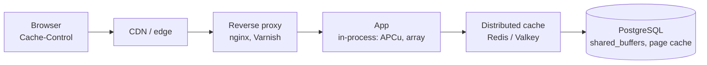

# Chapter 1. When to cache, when NOT to, and the cache layers

## 1. The problem

Trang chi tiết sản phẩm của shop sách chạy `SELECT ... FROM products WHERE id = ?` cho mỗi lượt xem. Lúc 100 req/s thì PostgreSQL không có vấn đề. Lúc có đợt khuyến mãi, 20.000 req/s cùng đọc vài trăm sản phẩm, và database trở thành bottleneck. Dữ liệu sản phẩm gần như không đổi trong vài phút, nên đọc đi đọc lại cùng một row là lãng phí.

**Cache** là lưu bản sao của kết quả đắt (query, render, gọi API ngoài) ở nơi rẻ hơn và gần hơn, để lần sau trả lời nhanh hơn. Cái giá phải trả: bản sao có thể **cũ** (stale). Mọi chương sau của cuốn này xoay quanh việc quản lý cái giá đó.

## 2. When to cache

Cache đáng giá khi đủ ba điều kiện:

1. **Đọc nhiều hơn ghi nhiều** (read/write ratio cao, ví dụ 100:1).
2. **Tính toán/truy xuất đắt** so với đọc cache (join nhiều bảng, aggregate, gọi service ngoài, render HTML).
3. **Chấp nhận được độ cũ** trong một khoảng thời gian xác định (giá sản phẩm cũ 30 giây thì ổn; số dư tài khoản cũ 30 giây thì không).

Một phép tính nhanh: nếu hit ratio là `h`, thời gian đọc cache `tc`, thời gian query gốc `tq` thì thời gian trung bình là `h*tc + (1-h)*(tc+tq)` (miss vẫn tốn một lần thử cache). Với `tq=20ms`, `tc=0.5ms`, `h=0.9` ta được khoảng 2.5ms; với `h=0.5` là 10.5ms. Hit ratio thấp thì cache gần như vô ích.

## 3. When NOT to cache

- **Dữ liệu cần strong consistency (nhất quán mạnh)**: số dư, tồn kho khi đặt hàng, quyền truy cập vừa bị thu hồi. Đọc cũ ở đây gây sai nghiệp vụ, không chỉ chậm.
- **Query chưa được tối ưu**: nếu thiếu index khiến query chậm 2 giây, hãy sửa index trước. Cache che giấu vấn đề và nó sẽ quay lại mỗi khi cache miss.
- **Dữ liệu ít được đọc lại** (long tail): mỗi key chỉ đọc một lần thì hit ratio gần 0, cache chỉ tốn RAM.
- **Dữ liệu quá riêng theo người dùng với cardinality rất cao** và không dùng lại.
- **Khi chưa đo**: không có số liệu thì không biết cache có giúp không. Đo trước, cache sau.

> Nguyên tắc: cache là một **bản sao có thời hạn của sự thật**, không phải nguồn sự thật. Hệ thống phải đúng (dù chậm hơn) khi cache trống hoặc chết. Nếu mất cache mà mất dữ liệu thì bạn đang dùng Redis như database, đó là bài toán khác (xem chương 8).

## 4. The cache layers



| Layer | Ví dụ | Latency điển hình | Chia sẻ giữa user/node | Invalidation |
|---|---|---|---|---|
| Browser | `Cache-Control: max-age`, `ETag` | 0 (không ra mạng) | Chỉ một user | Gần như không chủ động được, dựa vào TTL/versioned URL |
| CDN | CloudFront, Cloudflare | vài chục ms | Mọi user theo vùng | Purge API, `stale-while-revalidate` |
| Reverse proxy | nginx `proxy_cache`, Varnish | < 1ms đến vài ms | Mọi user, một cluster | Purge, TTL |
| In-process | `sync.Map`/otter (Go), `Map` hoặc LRU (Node), biến static | micro giây | Chỉ trong một process/node | Khó: mỗi node một bản |
| Distributed | Redis, Valkey, Memcached | khoảng 0.2 đến 1ms trong cùng datacenter | Mọi node | Chủ động xóa/cập nhật key |
| Trong DB | `shared_buffers`, OS page cache, plan cache | tự động | Trong DB | Tự động theo MVCC/WAL |

Chọn layer theo nguyên tắc: **cache càng gần người dùng càng nhanh nhưng càng khó invalidate**. Asset tĩnh có hash trong tên file (`app.3f9a.js`) cache ở browser vĩnh viễn. HTML trang công khai có thể cache ở CDN vài giây. Dữ liệu động theo nghiệp vụ thường nằm ở distributed cache. Cuốn này tập trung layer distributed cache.

Lưu ý về cache trong DB: PostgreSQL đã tự cache page trong `shared_buffers` và OS page cache. Query lặp lại thường không chạm đĩa, nhưng vẫn tốn CPU để parse, plan, execute và qua mạng. Đó là phần mà Redis tiết kiệm được, chứ không phải I/O đĩa.

### In-process and distributed: use both (L1/L2)

Với dữ liệu cực nóng (ví dụ cấu hình, danh mục), ta thêm L1 trong process (otter trong Go, `Map` có TTL trong Node) với TTL vài giây, phía sau là L2 Redis. Giảm tải Redis, nhưng chấp nhận mỗi node có thể lệch nhau tối đa bằng TTL của L1. Ví dụ chạy thật ở chương 11: 1.000 lần đọc chỉ tạo 1 lệnh `GET` tới Valkey.

## 5. The book's running example

Mọi chương dùng cùng một mô hình:

```sql
CREATE TABLE products (
  id         int PRIMARY KEY,
  name       text NOT NULL,
  price      numeric(10,2) NOT NULL,
  stock      int NOT NULL,
  updated_at timestamptz NOT NULL DEFAULT now()
);
```

- Key cache: `product:{id}` (dạng JSON), TTL ban đầu 60 giây.
- Hàm: `getProduct(int $id): ?array`, `updateProduct(int $id, array $fields): void`.
- Lab (thư mục `lab/`) chạy PostgreSQL và Valkey/Redis trong Docker, đo số query thật vào DB.

## 6. Common pitfalls

- **Cache như thuốc giảm đau**: đặt cache trước khi hiểu vì sao query chậm.
- **Quên rằng cache có thể chết**: ứng dụng phải chịu được lỗi kết nối Redis (timeout ngắn, fallback về DB, circuit breaker).
- **Cache dữ liệu theo user vào key chung** gây lộ dữ liệu giữa người dùng. Key phải chứa mọi biến ảnh hưởng đến kết quả (user, ngôn ngữ, tiền tệ).
- **TTL "vĩnh viễn" mà quên invalidate**.
- **Đặt TTL theo cảm tính** thay vì theo độ cũ chấp nhận được của nghiệp vụ.

## 7. Summary

- Cache hợp với dữ liệu đọc nhiều, tính toán đắt và chịu được độ cũ.
- Không cache khi cần strong consistency, hoặc khi chưa sửa nguyên nhân gốc (index, query).
- Có nhiều layer: càng gần người dùng càng nhanh và càng khó invalidate.
- Hệ thống phải đúng khi cache trống: cache là bản sao, không phải nguồn sự thật.
- Hit ratio quyết định lợi ích thực tế, vì vậy phải đo (chương 12).

## 8. Self-check questions

1. Nêu ba điều kiện để cache đáng giá và cho một ví dụ vi phạm điều kiện thứ ba.
2. Với `tc=1ms`, `tq=30ms`, `h=0.8`, thời gian đọc trung bình là bao nhiêu?
3. Vì sao thêm cache không phải là cách đầu tiên khi một query chậm 2 giây?
4. Tại sao cache layer càng gần người dùng thì càng khó invalidate?
5. L1 in-process kết hợp L2 Redis đánh đổi điều gì?

<details><summary>Answer</summary>

1. Đọc nhiều hơn ghi; tính toán/truy xuất đắt; chấp nhận được độ cũ. Ví dụ vi phạm điều kiện 3: cache số dư tài khoản ngân hàng, hoặc tồn kho lúc thanh toán.
2. `0.8*1 + 0.2*(1+30) = 0.8 + 6.2 = 7.0ms`.
3. Vì nguyên nhân gốc (thiếu index, query kém) vẫn còn và sẽ lộ ra mỗi lần miss, lúc stampede, hoặc khi cache chết. Sửa gốc trước, cache sau.
4. Vì bản sao nằm ở nơi bạn không điều khiển trực tiếp (máy người dùng, edge của CDN), nhiều bản sao hơn, số điểm phải xóa lớn hơn và có latency lan truyền.
5. Giảm tải và latency nhưng mỗi node có thể lệch nhau tối đa bằng TTL của L1, và tốn RAM mỗi process.

</details>
