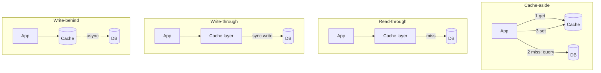

# Chương 4. Các pattern cache

## 1. Vấn đề

Cache có trước hay DB có trước? Ai chịu trách nhiệm nạp dữ liệu vào cache? Khi ghi thì ghi vào đâu trước? Năm pattern kinh điển trả lời các câu hỏi đó, mỗi pattern có đánh đổi riêng về consistency, độ phức tạp và latency.

## 2. Năm pattern



### 2.1 Cache-aside (lazy loading)

Ứng dụng tự quản lý: đọc cache, miss thì đọc DB rồi ghi vào cache. Khi ghi, cập nhật DB rồi **xóa** key (chương 5 giải thích vì sao xóa tốt hơn cập nhật).

```go
// lab/go/repo.go
func (r *ProductRepo) Find(ctx context.Context, id int) (string, error) {
	key := "product:" + strconv.Itoa(id)
	if v, ok, err := r.Cache.Get(ctx, key); err != nil {
		return "", err
	} else if ok {
		r.Hits.Add(1)
		return v, nil
	}
	r.Miss.Add(1)
	v, err, _ := r.group.Do(key, func() (any, error) {
		s, err := r.DB.Load(ctx, id, "repo")
		if err != nil {
			return "", err
		}
		return s, r.Cache.SetEX(ctx, key, s, 60*time.Second)
	})
	s, _ := v.(string)
	return s, err
}

// UpdatePrice writes the DB in a transaction, then deletes the key AFTER commit.
func (r *ProductRepo) UpdatePrice(ctx context.Context, id int, price string) error {
	err := pgx.BeginFunc(ctx, r.DB.Pool, func(tx pgx.Tx) error {
		_, err := tx.Exec(ctx, `UPDATE products SET price=$1, updated_at=now() WHERE id=$2`, price, id)
		return err
	})
	if err != nil {
		return err
	}
	return r.Cache.Del(ctx, "product:"+strconv.Itoa(id))
}
```

(Đã chạy thật: `lab/go`, lệnh `lab repo`, kết quả `hit=190 miss=10`, xem chương 6 và 11. Ở đây có thêm `singleflight` so với cache-aside thuần; TTL jitter được bỏ để số liệu lab ổn định, bạn nên cộng `rand(0..10)` giây vào TTL khi dùng thật.)

- Ưu: đơn giản, cache chết thì app vẫn chạy, chỉ cache thứ được đọc.
- Nhược: lần đọc đầu luôn chậm (miss), dễ stampede (chương 6), logic cache nằm rải rác trong app.
- Dùng khi: mặc định cho hầu hết ứng dụng web. Đây là pattern của `ProductRepo.Find` trong chương 11.

### 2.2 Read-through

Giống cache-aside nhưng **cache layer tự nạp** từ DB khi miss, app chỉ nói chuyện với cache. Redis/Valkey không có sẵn tính năng này; bạn tự viết một layer (repository) hoặc dùng thư viện/proxy. Ưu điểm là gom logic nạp vào một chỗ và dễ thêm singleflight (chương 6).

### 2.3 Write-through

Mỗi lần ghi: ghi vào cache **và** DB synchronous trong cùng một thao tác. Cache luôn mới nhưng ghi chậm hơn (hai nơi) và phải xử lý partial failure. Ghi cả những dữ liệu có thể không bao giờ được đọc. Hợp với dữ liệu đọc lại ngay sau khi ghi (profile, cài đặt).

### 2.4 Write-behind (write-back)

App ghi vào cache, một background process ghi xuống DB sau (gom batch). Ghi cực nhanh, giảm tải DB, **nhưng nếu cache mất trước khi flush thì mất dữ liệu**. Chỉ dùng cho dữ liệu chịu được mất một ít (counter lượt xem), và nên đi kèm Stream/AOF (chương 8). Không dùng cho đơn hàng và tiền.

Mẫu đơn giản cho lượt xem: `INCR views:42` mỗi request; job mỗi phút đọc giá trị, `UPDATE products SET views = views + ?` rồi trừ đi phần đã flush bằng `DECRBY` (hoặc dùng `GETDEL` rồi cộng; nếu job chết giữa chừng sẽ mất một lượng, chấp nhận được với view count).

### 2.5 Refresh-ahead

Làm mới giá trị **trước khi hết hạn** nếu key đang được đọc nhiều, để người dùng không bao giờ gặp miss. Cài đặt: khi `TTL` còn dưới ngưỡng, kích hoạt nạp lại ở nền. Stale-while-revalidate (chương 6, 11) và probabilistic early expiration (chương 6) là biến thể. Hợp với key nóng, nạp đắt; không hợp key lâu mới đọc (nạp thừa).

## 3. So sánh

| Pattern | Đọc lần đầu | Ghi | Consistency | Rủi ro mất dữ liệu | Phức tạp |
|---|---|---|---|---|---|
| Cache-aside | chậm | nhanh (DB + del) | cửa sổ cũ ngắn | không | thấp |
| Read-through | chậm | tùy | như cache-aside | không | trung bình |
| Write-through | nhanh nếu đã ghi | chậm hơn | cao | không | trung bình |
| Write-behind | nhanh | rất nhanh | DB trễ | **có** | cao |
| Refresh-ahead | luôn nhanh (key nóng) | tùy | cửa sổ cũ ngắn | không | trung bình |

## 4. Chọn thế nào

- Mặc định: **cache-aside + TTL + xóa khi ghi + chống stampede**.
- Key rất nóng: thêm refresh-ahead.
- Counter, telemetry: write-behind có kiểm soát.
- Cần đọc-sau-ghi chính xác ngay trên cùng người dùng: write-through, hoặc đọc thẳng DB cho session của người vừa ghi.

## 5. Cạm bẫy

- **Cache giá trị `null`/không tồn tại**: nếu không lưu "không có" (negative caching) thì query id không tồn tại luôn xuyên xuống DB (cache penetration). Lưu marker với TTL ngắn (ví dụ 30 giây).
- **Đặt cache trước khi commit transaction**: reader khác có thể thấy giá trị chưa commit hoặc bị rollback. Xóa cache **sau** commit.
- **Serialize gắn với kiểu của ngôn ngữ** (`gob` trong Go, `v8.serialize` trong Node) khiến key mang theo định nghĩa struct/class; đổi struct làm hỏng cache cũ. Ưu tiên JSON, có trường `v` (version schema).
- Quên bắt lỗi kết nối Redis: cache lỗi không được làm sập request.

## 6. Tóm tắt

- Cache-aside là mặc định; ghi DB trước rồi xóa key.
- Write-through đổi tốc độ ghi lấy consistency; write-behind đổi an toàn lấy tốc độ.
- Refresh-ahead tránh miss cho key nóng.
- Negative caching và xóa sau commit là hai chi tiết hay bị quên.

## 7. Câu hỏi tự kiểm tra

1. Cache-aside và read-through khác nhau ở đâu?
2. Vì sao write-behind không hợp cho đơn hàng?
3. Cache penetration là gì và cách chống?
4. Vì sao xóa cache sau commit chứ không trước?
5. Khi nào refresh-ahead lãng phí?

<details><summary>Đáp án</summary>

1. Cache-aside: app tự nạp khi miss. Read-through: cache layer tự nạp, app chỉ gọi cache.
2. Dữ liệu nằm ở cache trước, nếu cache mất trước khi flush thì mất đơn hàng.
3. Query key không tồn tại luôn xuyên xuống DB. Chống bằng negative caching TTL ngắn, hoặc Bloom filter.
4. Nếu xóa trước commit, reader khác có thể nạp lại giá trị cũ vào cache trước khi commit hoàn tất, và cache giữ giá trị cũ.
5. Với key ít khi được đọc: bạn nạp lại dữ liệu mà không ai dùng.

</details>
