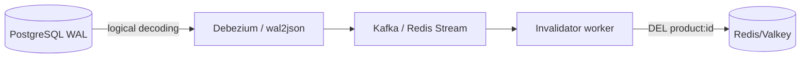

# Chapter 5. Invalidation and consistency

## 1. The problem

Câu nói nổi tiếng: có hai việc khó trong khoa học máy tính là đặt tên và cache invalidation. Khó vì có **hai nguồn dữ liệu** (DB và cache) mà không có transaction chung. Bất cứ lúc nào giữa hai thao tác "ghi DB" và "sửa cache", một client khác có thể chen vào.

## 2. Strategies

### TTL (time-based expiry)

Đơn giản nhất: mỗi key có `EX`/`PX`. Độ cũ tối đa = TTL. TTL là **lưới an toàn** nên luôn đặt, kể cả khi bạn có invalidation chủ động, vì mọi cơ chế chủ động đều có thể bị lỡ.

Chọn TTL theo nghiệp vụ: giá sản phẩm 60 giây; mô tả 1 giờ; danh mục 5 phút; kết quả tìm kiếm 10 giây.

### Delete vs update the cache on write

| | Xóa key (`DEL`) | Ghi giá trị mới (`SET`) |
|---|---|---|
| Đơn giản | cao | thấp (phải tính lại giá trị y hệt cách đọc) |
| Race giữa hai writer | lần đọc sau nạp lại từ DB, tự lành | writer chạy chậm có thể đè giá trị cũ lên mới, kẹt đến hết TTL |
| Chi phí | thêm một lần miss | không có miss |

Vì vậy mặc định là **xóa** (cache-aside invalidation). Cập nhật chỉ khi tính lại rẻ và có kiểm soát thứ tự (version).

### Typical race 1: a stale read repopulates the cache

```
Reader A: miss, đọc DB (price=10)
Writer B: UPDATE price=12, DEL cache
Reader A: SET cache price=10      <- ghi đè giá trị cũ, kẹt đến hết TTL
```

Cửa sổ này nhỏ nhưng có thật khi tải cao. Giảm thiểu: TTL ngắn; hoặc dùng version (dưới đây); hoặc "delayed double delete" (xóa lại sau vài trăm ms, chấp nhận là heuristic, không phải đảm bảo).

### Typical race 2: write ordering

Nếu ghi DB trước rồi xóa cache và thao tác xóa thất bại (mạng), cache giữ giá trị cũ đến hết TTL. Hãy retry xóa, hoặc đẩy xóa qua queue/outbox (mục CDC bên dưới). Nếu **xóa cache trước rồi mới ghi DB** thì reader chen vào giữa sẽ nạp lại giá trị cũ, nên cách này tệ hơn.

### Version in the key (bulk invalidation)

```
SET catalog:ver 7
GET product:list:v7:page1       # key chứa version
INCR catalog:ver                # "xóa" mọi trang cũ tức thì, key cũ tự hết TTL
```

Rẻ và atomic, đổi lại RAM giữ các key cũ đến hết TTL. Ý tưởng tương tự là tag/version namespace: thêm số phiên bản vào key (`product:v7:42`) rồi tăng số phiên bản để vô hiệu cả nhóm.

### Versioned values to prevent stale overwrites

Lưu kèm `updated_at`/`version` từ DB. Khi nạp lại, chỉ ghi nếu version lớn hơn bản đang có. Làm atomic bằng Lua (chương 10 có ví dụ Lua):

```lua
-- KEYS[1]=key, ARGV[1]=version mới, ARGV[2]=payload, ARGV[3]=ttl giây
local cur = redis.call('HGET', KEYS[1], 'v')
if (not cur) or tonumber(cur) < tonumber(ARGV[1]) then
  redis.call('HSET', KEYS[1], 'v', ARGV[1], 'd', ARGV[2])
  redis.call('EXPIRE', KEYS[1], ARGV[3])
  return 1
end
return 0
```

Ghi chú: chạy qua `EVAL` hoặc `FCALL`; script là atomic trên một node.

### CDC/event-based invalidation

Khi nhiều dịch vụ cùng ghi vào DB, đừng bắt mỗi nơi nhớ gọi `DEL`. Lấy **thay đổi từ chính DB** làm nguồn:



- PostgreSQL phát thay đổi qua logical replication; công cụ như Debezium đọc WAL và đẩy sự kiện.
- Worker xóa key tương ứng. Vì sự kiện đến sau commit nên không có race "xóa trước commit".
- Latency vài chục ms đến vài giây; TTL vẫn là lưới an toàn.
- Cách nhẹ hơn: **outbox pattern** (ghi sự kiện vào bảng `outbox` cùng transaction, worker đọc rồi xóa cache và đánh dấu đã xử lý), không cần hạ tầng CDC.

## 3. Practical consistency levels

Cache-aside + TTL cho bạn **eventual consistency** với độ cũ giới hạn. Nếu một chức năng cần "đọc phải thấy ghi của chính mình" (read-your-writes), hãy:
- đọc thẳng DB trong vài giây sau khi chính người đó ghi (đánh dấu bằng cookie/flag), hoặc
- ghi synchronous giá trị mới vào cache bằng write-through với version.

Nếu cần strong consistency (tồn kho khi trừ), **không đọc từ cache để quyết định**; dùng transaction/`SELECT ... FOR UPDATE` hoặc cập nhật có điều kiện trong DB.

## 4. Pitfalls

- Chỉ xóa key chính mà quên key dẫn xuất (danh sách, trang tổng hợp chứa sản phẩm đó). Hãy ghi lại sơ đồ phụ thuộc hoặc dùng version/tag.
- Dựa vào "delayed double delete" như một đảm bảo.
- TTL quá dài kèm invalidation không đáng tin.
- Xóa cache trong transaction chưa commit.
- Quên rằng replica có replication lag: xóa trên master rồi đọc replica có thể thấy giá trị cũ ngắn hạn.

## 5. Summary

- TTL luôn có; xóa key khi ghi (sau commit) là mặc định.
- Race đọc-cũ-nạp-lại tồn tại; giảm bằng TTL ngắn, version hoặc Lua so sánh version.
- Nhiều writer, nhiều dịch vụ: invalidation theo CDC hoặc outbox.
- Cần strong consistency thì quyết định trên DB, không trên cache.

## 6. Self-check questions

1. Vì sao nên `DEL` thay vì `SET` khi ghi?
2. Mô tả race "đọc cũ nạp lại" bằng ba bước.
3. Outbox pattern giải quyết điều gì?
4. Version trong key đổi lại cái gì?
5. Khi nào không được dùng cache để ra quyết định?

<details><summary>Answer</summary>

1. `DEL` tự lành vì lần đọc sau nạp lại từ DB; `SET` có thể bị ghi đè bởi writer chạy chậm với giá trị cũ.
2. Reader miss và đọc giá trị cũ; writer ghi DB và xóa cache; reader ghi giá trị cũ vào cache.
3. Đảm bảo sự kiện thay đổi và thay đổi dữ liệu cùng commit, nên invalidation không bị lỡ khi app chết giữa chừng.
4. Invalidate hàng loạt tức thì, đổi lại RAM cho các key cũ đến khi hết TTL.
5. Khi cần strong consistency (tồn kho, số dư): quyết định trong DB bằng transaction/lock.

</details>
