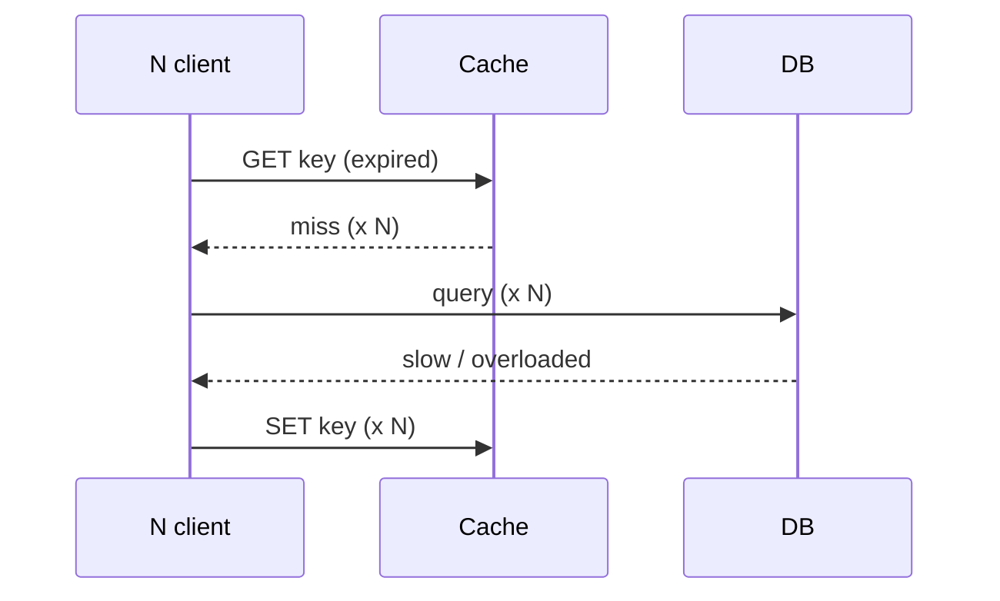

# Chương 6. Cache stampede (dogpile)

## 1. Vấn đề

Key `product:42` rất nóng (2.000 req/s) hết hạn lúc 10:00:00. Trong 30 ms nạp lại, hàng trăm request cùng thấy miss và cùng chạy query nặng xuống PostgreSQL. DB quá tải, query chậm hơn, nạp lâu hơn, càng nhiều request cùng miss: vòng lặp xấu dẫn đến sập. Hiện tượng này gọi là **cache stampede** (còn gọi dogpile, thundering herd).



## 2. Kết quả đo (lab)

Lab `lab/stampede` (xem README): 100 client đồng thời, mỗi client đọc `product:42` một lần ngay khi key vừa hết hạn; DB giả lập query nặng bằng `pg_sleep(0.2)`. Đếm số query thật đến PostgreSQL.

Môi trường: Valkey 9.1.3, PostgreSQL 18-alpine, 100 process client chạy song song (đợi một flag rồi cùng bắt đầu), mỗi lần "nạp" là một query có `pg_sleep(0.2)`; mỗi query thật được ghi vào bảng `query_log` nên số đếm đến từ phía PostgreSQL. Ba lần chạy mỗi mode:

| Mode | Lần 1 | Lần 2 | Lần 3 | Ghi chú |
|---|---|---|---|---|
| `naive` (không bảo vệ) | 26 | 51 | 83 | 100 client cùng miss, số query thật dao động theo việc client nào kịp `SET` trước |
| `lock` (`SET NX PX 5000` + kiểm lại sau khi có lock) | 1 | 2 | 1 | Lần 2 có 2 query |

Cách đọc kết quả:
- Trong mode `naive`, con số **không phải 100** vì client khởi động lệch nhau vài trăm ms trong container 128 MB; chỉ những client thấy miss **trước khi** client nạp đầu tiên ghi xong (khoảng 200 ms) mới query DB. DB thật có tải cao hơn thì cửa sổ này dài hơn và con số tiến gần số client.
- Với `lock`, số query giảm từ hàng chục xuống 1 đến 2. Ở lần 2, bước nạp của người giữ lock kéo dài quá 5 giây vì máy đang chạy nhiều container khác (tổng thời gian cả lượt chạy lên đến gần 11 giây), lock hết hạn và một client khác nạp thêm lần nữa. Đây đúng là điểm yếu "lease hết hạn khi chủ chưa xong" của chương 9, và lý do TTL của lock phải lớn hơn thời gian nạp trong trường hợp xấu.
- Không so sánh thời gian chạy giữa các mode: thời gian bị chi phối bởi việc khởi tạo 100 process `psql` trong container nhỏ, không đại diện cho một ứng dụng thật.

Chạy lại: `docker exec bookcheck-cache-client sh /lab/stampede/run.sh naive 100` rồi `... lock 100`.

### 2.1 Chạy lại bằng Go (goroutine, nhiều process)

Bản shell ở trên dùng 100 process `psql`. Bản Go (`lab/go`, `go run`/`lab run`; xem chương 11 và `lab/README.md`) dùng **100 goroutine** cùng chờ một mốc thời gian, `valkey-go` + `pgx`, cùng hàm nạp `pg_sleep(0.2)` ghi `query_log`. Mỗi cấu hình chạy 3 lần; "5 x 20" là 5 process Go, mỗi process 20 goroutine.

| Cấu hình | Process x goroutine | Query DB thật (3 lần) |
|---|---|---|
| Không bảo vệ | 1 x 100 | 100, 100, 100 |
| `singleflight` | 1 x 100 | 1, 1, 1 |
| Không bảo vệ | 5 x 20 | 100, 100, 100 |
| `singleflight` | 5 x 20 | 5, 5, 5 |
| Distributed lock (`SET NX PX`) | 5 x 20 | 1, 1, 1 |
| `singleflight` + lock | 5 x 20 | 1, 1, 1 |

Cách đọc, đặt cạnh số liệu shell:
- Không bảo vệ: shell ra 26, 51, 83 còn Go ra đúng **100**, vì goroutine khởi động cách nhau micro giây chứ không phải hàng trăm ms như 100 process `psql`; mọi client đều thấy miss trước khi người nạp đầu tiên ghi xong. Bản shell thấp hơn là do độ lệch của chính cách mô phỏng.
- `singleflight`: 100 xuống 1 trong một process, nhưng 5 process vẫn là **5**: mỗi process có `Group` riêng.
- Lock phân tán: 1 bất kể số process (shell: 1, 2, 1; lần 2 lock hết hạn do máy bận, ở Go không gặp).
- XFetch (50 goroutine đọc liên tục 20 giây, TTL logic 3 giây): 97 query so với 300 query của TTL thường; giảm nhưng không về 1 mỗi chu kỳ vì không có lock. Chi tiết ở chương 11, mục 8.
- Chỉ là vài lần chạy trên máy dùng chung, để so sánh hành vi, không phải benchmark.

Kết quả cache-aside tuần tự bằng shell (`lab/cacheaside/run.sh`, 200 lần đọc trên 10 sản phẩm, TTL 60 giây): `hit=190 miss=10`, đúng 10 query DB. Sau khi `UPDATE products SET price=99 WHERE id=3` và `DEL product:3`, lần đọc tiếp theo là một miss (query DB thứ 11) và trả về `Book 3|99.00`. Tỷ lệ hit 190/200 = 95%, khớp với công thức ở chương 1. Bản Go (`ProductRepo`, chương 11) cho đúng cùng số: `hit=190 miss=10`, 10 query, rồi 11 sau update.

## 3. Các cách chống

### 3.1 TTL jitter

Cộng ngẫu nhiên vào TTL (`60 + rand(0..10)`) để **nhiều key khác nhau** không hết hạn cùng lúc (ví dụ sau khi warm-up hàng loạt). Không giải quyết được nhiều request trên **cùng một key**, chỉ là phần bắt buộc kèm theo.

### 3.2 Lock khi nạp lại (mutex)

Chỉ một request được nạp; các request còn lại chờ hoặc phục vụ dữ liệu cũ.

```
SET lock:product:42 <token> NX PX 5000     # NX: chỉ khi chưa có; PX: tự hết hạn 5s
  OK   -> tôi nạp: query DB, SET product:42, rồi release lock (an toàn, kiểm token)
  nil  -> người khác đang nạp: ngủ 20-50 ms rồi GET lại (tối đa vài lần)
```

Release an toàn bằng Lua (chỉ xóa khi token khớp):

```lua
if redis.call('GET', KEYS[1]) == ARGV[1] then return redis.call('DEL', KEYS[1]) else return 0 end
```

Điểm cần cân nhắc: người chờ tốn thời gian; nếu người giữ lock chết, phải đợi hết `PX`; lock hết hạn trong khi vẫn đang nạp thì có hai người nạp (chấp nhận được với cache, khác với lock bảo vệ tài nguyên, xem chương 9).

### 3.3 Request coalescing / singleflight

Trong **một process** (hoặc một node), gom mọi request cùng key thành một lần nạp; các request còn lại đợi kết quả. Go có `golang.org/x/sync/singleflight`; Node tự cài bằng một `Map` các Promise đang chạy (chương 11). Singleflight chỉ có tác dụng trong process: chạy N instance thì vẫn có N lần nạp (đo ở mục 2.1), nên khi có nhiều instance cần thêm distributed lock (3.2).

Kết hợp cả hai: singleflight trong process (chỉ một goroutine mỗi process đi tranh lock) + distributed lock giữa các process.

### 3.4 Phục vụ dữ liệu cũ khi đang nạp (stale-while-revalidate)

Lưu giá trị với TTL logic ngắn nhưng TTL vật lý dài hơn. Khi quá TTL logic, người đầu tiên lấy lock để nạp lại; những người khác **trả ngay giá trị cũ**. Không ai phải chờ. Chương 11 có bản cài đặt tự viết cho Node (`lab/node/src/swr.ts`).

### 3.5 Probabilistic early expiration (XFetch)

Paper "Optimal Probabilistic Cache Stampede Prevention" (Vattani, Chierichetti, Lowenstein, VLDB 2015) đề xuất: mỗi request tự quyết **ngẫu nhiên** có nên nạp lại sớm không, xác suất tăng dần khi gần hết hạn. Không cần lock, không cần phối hợp. Công thức XFetch:

```
làm mới sớm nếu:  now - delta * beta * ln(rand()) >= expiry
```

- `delta`: thời gian nạp lần trước (giây), lưu cùng giá trị;
- `beta`: hệ số, mặc định 1.0 (lớn hơn thì làm mới sớm hơn);
- `rand()` thuộc (0,1], nên `-ln(rand())` luôn dương.

Nạp đắt (delta lớn) thì được làm mới sớm hơn. Lưu `{v, delta, expiry}` trong value, TTL vật lý dài hơn expiry logic một chút.

Cài đặt Go (nguồn `lab/go/cache.go`, đã chạy trong lab, kết quả ở mục 2.1):

```go
type xentry struct {
	V      string  `json:"v"`
	Delta  float64 `json:"delta"`  // seconds the last recompute took
	Expiry float64 `json:"expiry"` // logical expiry, unix seconds
}

func unixf(t time.Time) float64 { return float64(t.UnixNano()) / 1e9 }

// XFetch returns the value and whether this call recomputed it.
func (c *Cache) XFetch(ctx context.Context, key string, ttl time.Duration, beta float64,
	recompute func(context.Context) (string, error)) (string, bool, error) {
	if raw, ok, err := c.Get(ctx, key); err != nil {
		return "", false, err
	} else if ok {
		var e xentry
		if json.Unmarshal([]byte(raw), &e) == nil {
			r := 1 - mrand.Float64() // (0,1], so -ln(r) >= 0
			if unixf(time.Now())-e.Delta*beta*math.Log(r) < e.Expiry {
				return e.V, false, nil
			}
		}
	}
	t0 := time.Now()
	v, err := recompute(ctx)
	if err != nil {
		return "", true, err
	}
	e := xentry{V: v, Delta: time.Since(t0).Seconds(), Expiry: unixf(time.Now().Add(ttl))}
	b, _ := json.Marshal(e)
	// physical TTL a bit longer than the logical expiry
	return v, true, c.SetEX(ctx, key, string(b), ttl+5*time.Second)
}
```

`1 - Float64()` cho giá trị trong `(0,1]` nên `math.Log` âm hoặc bằng 0 và `- delta*beta*log(r)` không âm, đúng công thức. Kết quả đo ở mục 2.1: XFetch giảm số lần nạp nhưng **không về đúng 1**, vì không có lock.

### 3.6 Warm-up và hạn chế gốc

Nạp sẵn key nóng (job định kỳ) và bảo vệ DB bằng giới hạn connection/concurrency (circuit breaker, bulkhead), để lúc stampede xảy ra DB không sập.

## 4. Chọn thế nào

| Kỹ thuật | Cần lock | Người dùng có thể chờ | Dữ liệu cũ | Độ phức tạp |
|---|---|---|---|---|
| Jitter | không | n/a | không | rất thấp |
| Mutex | có | có | không (hoặc tùy chọn) | thấp |
| Singleflight (in-process) | không | có | không | thấp, chỉ process sống lâu |
| SWR | có (nhẹ) | không | **có** | trung bình |
| XFetch | không | không | không | trung bình |

Mặc định cho dịch vụ Go/Node: singleflight (Promise map) trong process + lock `SET NX PX` giữa các instance, cộng jitter; thêm SWR hoặc XFetch cho key nóng nạp đắt.

## 5. Cạm bẫy

- Lock không có TTL: người giữ chết thì key không bao giờ nạp lại.
- Người chờ lock **lặp vô hạn**: phải có giới hạn số lần/thời gian, hết thì tự query hoặc trả lỗi.
- Release lock bằng `DEL` mù: có thể xóa lock của người khác (dùng token + Lua).
- Quên rằng cache cold start (khởi động lại Redis) là stampede toàn hệ thống: warm-up và giới hạn tải.

## 6. Tóm tắt

- Stampede: nhiều request cùng miss một key nóng và cùng xuống DB.
- Jitter chống hết hạn đồng loạt giữa nhiều key; mutex/singleflight chống nhiều request một key.
- SWR và XFetch giúp người dùng không phải chờ.
- Luôn đo số query DB trước và sau khi sửa.

## 7. Câu hỏi tự kiểm tra

1. Jitter có chống được stampede trên một key không? Vì sao?
2. Vì sao singleflight in-process không đủ khi service chạy nhiều instance?
3. Viết lệnh Redis để lấy lock nạp lại có TTL 5 giây.
4. Trong XFetch, `delta` lớn thì điều gì xảy ra?
5. Vì sao phải kiểm token khi release lock?

<details><summary>Đáp án</summary>

1. Không: các request vẫn cùng thấy miss tại cùng một thời điểm; jitter chỉ trải thời điểm hết hạn của nhiều key.
2. Mỗi process có bộ gom riêng, nên N instance vẫn nạp N lần (đo được 5 query với 5 process).
3. `SET lock:product:42 <token> NX PX 5000`.
4. Làm mới sớm hơn (xác suất làm mới sớm tăng vì nạp đắt).
5. Lock có thể đã hết hạn và người khác đã lấy; `DEL` mù sẽ xóa lock của họ.

</details>
