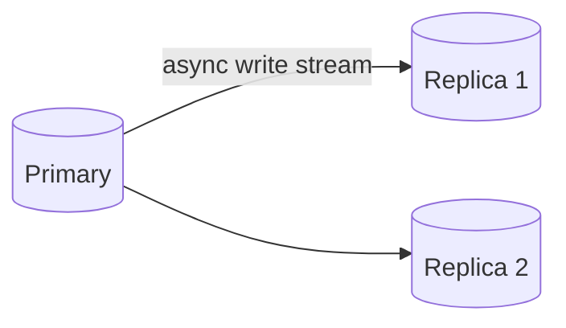

# Chapter 8. Persistence, replication, Sentinel, and Cluster

## 1. The problem

Redis/Valkey khởi động lại thì RAM trống. Một node chết thì cache biến mất. Một node không đủ RAM hoặc CPU. Chương này trả lời: lưu xuống đĩa thế nào, replication thế nào, tự failover thế nào, và chia dữ liệu ra nhiều node thế nào. Câu hỏi đầu tiên luôn là: **bạn có cần bất kỳ thứ gì trong số đó cho một cache không?**

## 2. Persistence

| | RDB (snapshot) | AOF (append-only file) |
|---|---|---|
| Cách làm | Ảnh toàn bộ dataset theo chu kỳ, qua `fork` | Ghi lại từng lệnh ghi |
| Cấu hình | `save 3600 1 300 100 60 10000` | `appendonly yes`, `appendfsync everysec` |
| Mất dữ liệu tối đa | Từ lần snapshot trước | Khoảng 1 giây (`everysec`), gần 0 (`always`, chậm) |
| Khởi động | Nhanh | Chậm hơn (replay), giảm nhờ multi-part AOF với RDB preamble |
| Kích thước | Gọn | Lớn hơn, được rewrite định kỳ |

- Có thể bật cả hai; khi khởi động nếu AOF bật thì AOF được ưu tiên để nạp.
- `fork` dùng copy-on-write: dataset lớn mà ghi nhiều thì RAM tăng đột biến. Chừa chỗ (chương 7).
- `appendfsync everysec` là điểm cân bằng thường dùng; `always` đảm bảo hơn nhưng giảm mạnh throughput.

**Chọn cho cache thuần**: có thể tắt cả hai (`save ""`, `appendonly no`) nếu DB là nguồn sự thật và bạn chịu được cold start (cần warm-up và chống stampede, chương 6). Nhiều đội vẫn giữ RDB mỗi vài giờ để khởi động lại không trống hoàn toàn. **Chọn cho dữ liệu không được mất** (session, queue, lock có ý nghĩa): AOF `everysec` + replica; và hãy cân nhắc có thật sự nên dùng Redis làm nơi lưu duy nhất không.

## 3. Replication



- Replica bắt đầu bằng full sync (RDB) rồi nhận command stream. Thiết lập: `REPLICAOF host port` (Redis và Valkey; tên cũ `SLAVEOF` đã thành bí danh/deprecated).
- **Asynchronous**: primary trả lời client trước khi replica nhận. Nếu primary chết ngay lúc đó thì mất những ghi chưa kịp replicate. `WAIT n timeout` chờ n replica xác nhận nhưng **không** biến hệ thống thành strong consistency.
- Replica có thể phục vụ đọc, nhưng đọc có thể cũ (chương 5).
- Ghi chú về tên: Valkey dùng `primary`/`replica`; tài liệu Redis cũng chuyển sang thuật ngữ này.

## 4. Sentinel (HA without sharding)

Một tập process `sentinel` (tối thiểu 3, số lẻ) monitor primary/replica, bỏ phiếu khi primary chết (`quorum`), bầu và thăng cấp một replica, rồi báo cho client biết địa chỉ primary mới. Client phải hỗ trợ Sentinel (`valkey-go`, `go-redis` và `ioredis` đều có cấu hình). Mọi dữ liệu vẫn nằm trên một primary: **không scale ghi, không scale RAM**.

Dùng khi: dữ liệu vừa trong một node, cần tự failover. Cạm bẫy: chỉ 2 sentinel (không có đa số), sentinel đặt chung máy với primary, client không cập nhật địa chỉ sau failover.

## 5. Cluster (sharding by hash slot)

Không gian key chia thành **16384 hash slot**: `slot = CRC16(key) mod 16384`. Mỗi primary giữ một dải slot, mỗi primary có các replica.

```
{user:7}:cart   {user:7}:profile    # phần trong {} quyết định slot -> cùng slot
```

- Client cluster-aware nhận phản hồi `MOVED slot host:port` và `ASK` khi slot đang di chuyển, rồi tự chuyển hướng.
- Lệnh nhiều key (`MGET`, `SUNION`, `MULTI`, Lua) chỉ hợp lệ khi các key cùng slot; nếu không có lỗi `CROSSSLOT`. Dùng hash tag khi cần.
- Mặc định cluster chỉ có database 0 trên Redis; Valkey 9.0 bổ sung multi-database trong cluster mode.
- Resharding: Redis di chuyển từng key; Valkey 9.0 có **atomic slot migration** (chuyển cả slot) giúp giảm rủi ro và latency khi di chuyển.
- Failover tự động trong cluster; cluster cần đa số primary còn sống để chấp nhận ghi.
- Tăng giới hạn thực tế: nhiều node tức nhiều RAM và nhiều thread xử lý, nhưng hot key vẫn nằm trên một node.

Tối thiểu 3 primary (thực tế 3 primary + 3 replica).

## 6. Which one to choose

| Nhu cầu | Giải pháp |
|---|---|
| Cache nhỏ, chịu được mất | Một node, không persistence, hoặc managed |
| Cần HA, dữ liệu vừa một node | Primary + replica + Sentinel (hoặc managed multi-AZ) |
| Dataset hoặc throughput vượt một node | Cluster |
| Dữ liệu không được mất | AOF + replica, và thừa nhận giới hạn của asynchronous replication |

Với cache, ưu tiên **đơn giản**: một primary + replica + failover tự động là đủ cho đa số hệ thống. Cluster làm tăng độ phức tạp của lệnh nhiều key, Lua và lock.

## 7. Pitfalls

- Bật persistence nặng trên cache rồi gặp latency spike mỗi lần `fork`.
- Tin rằng replication hoặc `WAIT` đảm bảo không mất ghi.
- Dùng Cluster mà code dùng `MGET`/Lua nhiều key không hash tag.
- Sentinel chỉ 2 node, hoặc quorum cấu hình sai.
- Quên rằng sau failover, một số ghi gần nhất có thể biến mất.

## 8. Summary

- RDB nhanh và gọn, AOF an toàn hơn; cache thuần có thể tắt cả hai.
- Asynchronous replication nên có thể mất ghi khi failover.
- Sentinel cho HA, không chia dữ liệu; Cluster chia theo 16384 slot và yêu cầu key cùng slot cho lệnh nhiều key.
- Chọn giải pháp đơn giản nhất đáp ứng nhu cầu.

## 9. Self-check questions

1. `appendfsync everysec` có thể mất tối đa bao nhiêu dữ liệu?
2. Vì sao `WAIT` không cho strong consistency?
3. Sentinel khác Cluster ở điểm nào?
4. Slot của một key được tính thế nào?
5. Khi nào có thể tắt hoàn toàn persistence?

<details><summary>Answer</summary>

1. Khoảng 1 giây ghi gần nhất (trong trường hợp xấu có thể hơn khi đĩa chậm).
2. Nó chỉ chờ replica nhận ghi, nhưng không có cơ chế bầu cử đảm bảo replica đó là người thắng khi failover và nó không rollback ghi trên primary.
3. Sentinel chỉ monitor và failover cho một primary, không chia dữ liệu; Cluster chia dữ liệu theo slot cho nhiều primary.
4. `CRC16(key) mod 16384`; nếu có `{tag}` thì chỉ tính trên phần tag.
5. Khi Redis/Valkey chỉ là cache và DB là nguồn sự thật, chấp nhận cold start.

</details>
