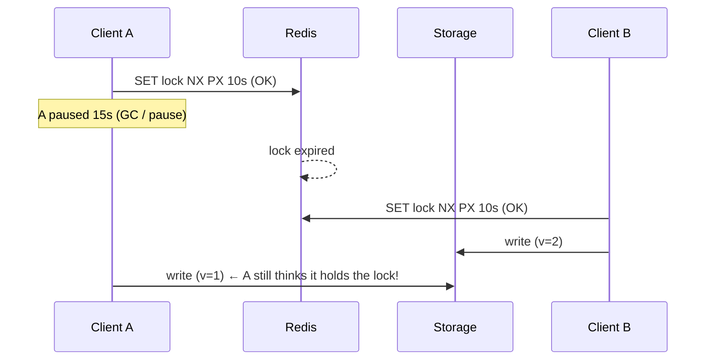

# Chapter 9. Distributed lock

## 1. The problem

Hai worker cùng nhận một job "gửi email hóa đơn đơn hàng 1001". Nếu cả hai chạy, khách nhận hai email. Cần một **lock** mà mọi worker trên nhiều máy cùng thấy. Redis/Valkey là chỗ dễ nhất để đặt lock đó. Nhưng distributed lock khó hơn lock trong một process: máy có thể chết, mạng có thể trễ, process có thể bị treo giữa chừng (GC pause), và đồng hồ có thể lệch.

## 2. A simple lock: `SET NX PX`

```
SET lock:invoice:1001 <token-ngẫu-nhiên> NX PX 30000
```

- `NX`: chỉ set khi key chưa tồn tại, atomic, nên chỉ một client thắng.
- `PX 30000`: tự hết hạn sau 30 giây, nên nếu người giữ chết thì lock không kẹt vĩnh viễn.
- `token` duy nhất cho mỗi lần lấy lock (UUID/random 16 byte).

Release **chỉ khi còn là chủ**, bằng Lua để so sánh và xóa atomic:

```lua
if redis.call('GET', KEYS[1]) == ARGV[1] then
  return redis.call('DEL', KEYS[1])
else
  return 0
end
```

```
EVAL "<script trên>" 1 lock:invoice:1001 <token>
```

Gia hạn (`extend`) tương tự: `if GET == token then PEXPIRE`. Bản Go chạy thật nằm ở `lab/go/cache.go` (`TryLock`, `Unlock`), bản Node ở `lab/node/src/lock.ts` (xem chương 11).

Ghi chú: cả Valkey 9.1.3 và Redis 8.10.3 đều có tùy chọn `SET key value IFEQ <giá-trị-hiện-tại>` (ghi nếu giá trị hiện tại bằng giá trị cho trước), nên có thể gia hạn hoặc thay giá trị lock có điều kiện mà không cần Lua. Riêng lệnh `DELIFEQ` (xóa nếu bằng) chỉ thấy trên Valkey 9.1.3 và Redis 8.10.3 báo `unknown command`. Vì vậy script Lua release ở trên vẫn là cách di động nhất.

Kết quả lab (cả hai image): `SET lk tokA NX PX 30000` trả `OK`; `SET lk tokB NX PX 30000` trả `nil` (từ chối); `SET lk tokC IFEQ tokA PX 30000` trả `OK` và `GET lk` ra `tokC`; script Lua release với token sai trả `0`, với token đúng trả `1`.

### Problems with the simple lock



TTL giải quyết "người giữ chết", nhưng tạo ra "người giữ chưa chết mà lock đã hết hạn". Lock chỉ an toàn nếu công việc luôn kết thúc **trước** khi TTL hết, điều không thể đảm bảo tuyệt đối.

## 3. Redlock and the debate

**Redlock** (antirez, tài liệu trên redis.io "Distributed Locks with Redis") nhằm chịu được lỗi một node: dùng **N=5 primary độc lập** (không replication giữa chúng). Client:
1. lấy thời gian hiện tại;
2. lần lượt `SET NX PX` trên cả 5 node với timeout ngắn;
3. thành công nếu lấy được trên **đa số (>=3)** và tổng thời gian chưa vượt TTL;
4. thời gian còn hiệu lực = TTL - thời gian đã tốn - sai số đồng hồ;
5. thất bại thì xóa lock trên tất cả node.

**Martin Kleppmann** ("How to do distributed locking", 08/02/2016) phản biện:
- Nếu lock dùng để đảm bảo **correctness** (không được hai bên cùng ghi), pause của process (GC, trang bộ nhớ, mạng) làm lock hết hạn trong khi client vẫn tin mình giữ lock.
- Redlock **giả định synchronous timing** (network latency, pause và độ lệch đồng hồ đều bị chặn), nên không an toàn khi các giả định bị phá vỡ (đồng hồ nhảy do NTP, v.v.).
- Giải pháp đúng cho correctness: **fencing token**: mỗi lần cấp lock, server cấp một số tăng dần; tài nguyên đích (DB, storage) từ chối thao tác mang token nhỏ hơn token đã thấy. Redlock không sinh số tăng dần như vậy.
- Kết luận của ông: nếu lock chỉ để **tối ưu hiệu năng** (tránh làm việc trùng, lỡ trùng cũng không hỏng), một lock Redis đơn giản là đủ, Redlock thừa; nếu cần correctness tuyệt đối, đừng dựa vào Redlock, hãy dùng consensus system (ZooKeeper, etcd) với fencing.

**antirez** trả lời ("Is Redlock safe?", 2016):
- Mọi hệ thống lock kiểu lease đều chịu pause **giữa lúc kiểm tra lock và lúc ghi**; fencing token không loại hết vấn đề nếu bản thân bước kiểm tra cũng bị trễ, và tài nguyên đích phải hỗ trợ kiểm tra token.
- Redlock có thể dùng token ngẫu nhiên duy nhất cùng cơ chế check-and-set ở đích để đạt kết quả tương tự.
- Đồng hồ nhảy lớn là giả định không thực tế nếu vận hành đúng; hệ thống thực tế cũng dựa vào đồng hồ ở nhiều chỗ.

Cả hai bài đều có thật và nên đọc nguyên văn (mục Đọc thêm). Thực tế ngành: lập luận của Kleppmann được nhiều người coi là thuyết phục cho trường hợp "correctness"; Redlock được chấp nhận ở trường hợp "tối ưu". Chúng tôi không có khả năng phân xử thay bạn; điều quan trọng là bạn **biết mình cần loại lock nào**.

## 4. Fencing tokens in practice

Cấp token bằng `INCR fence:invoice:1001` ngay khi lấy lock (lưu ý: `INCR` này không nhận được bảo đảm nếu failover mất ghi). Đích kiểm tra:

```sql
UPDATE invoices SET status='sent', fence=$token
 WHERE id=1001 AND fence < $token;     -- 0 row affected = token cũ, từ chối
```

Nếu đích là PostgreSQL, thường **không cần Redis lock**: dùng `UPDATE ... WHERE status='pending'` (compare-and-set), `SELECT ... FOR UPDATE SKIP LOCKED` cho queue, hoặc `pg_advisory_lock`/`pg_try_advisory_xact_lock`. Lock nằm đúng chỗ dữ liệu thì không có vấn đề lease.

## 5. When NOT to use Redis as a lock

- Khi hai bên cùng ghi một tài nguyên **không tự kiểm tra được** token và sai lệch gây mất tiền, mất dữ liệu: dùng constraint/transaction của chính DB đích.
- Khi cần lock chắc chắn qua failover: asynchronous replication có thể làm mất lock vừa cấp; hai client cùng giữ lock sau failover.
- Khi cần số liệu thứ tự mạnh (leader election chính xác): dùng etcd/ZooKeeper/Consul.
- Khi công việc dài không đoán trước thời gian: lease hết hạn giữa chừng.

Dùng Redis lock tốt cho: chống chạy trùng job định kỳ, chống stampede (chương 6), rate limiting nhẹ, các tác vụ **idempotent** (chạy hai lần cũng không sao).

## 6. Pitfalls

- Không có TTL, hoặc TTL quá ngắn so với công việc.
- Release bằng `DEL` mù; thiếu token.
- Dùng `SETNX` rồi `EXPIRE` ở hai lệnh (không atomic: chết giữa hai lệnh thì lock kẹt vĩnh viễn).
- Dùng lock trên replica hoặc qua proxy không đảm bảo ghi vào primary.
- Tin rằng Redlock hay bất kỳ lease nào "tuyệt đối an toàn".

## 7. Summary

- Lock cơ bản: `SET key token NX PX ttl` và release bằng Lua so token.
- Lease có thể hết hạn khi chủ còn sống; đó là gốc của tranh luận Redlock.
- Cần correctness tuyệt đối: fencing token hoặc để chính DB kiểm tra; không dựa vào Redis lock.
- Redis lock hợp cho tối ưu, job idempotent, chống stampede.

## 8. Self-check questions

1. Vì sao phải dùng `NX` và `PX` trong cùng một lệnh `SET`?
2. Viết script Lua release lock an toàn.
3. Kleppmann phản biện Redlock bằng kịch bản nào?
4. Fencing token hoạt động ra sao?
5. Nêu hai trường hợp không nên dùng Redis làm lock.

<details><summary>Answer</summary>

1. Để lấy lock và đặt hết hạn trong một thao tác atomic; hai lệnh rời có thể kẹt lock nếu chết giữa chừng.
2. `if redis.call('GET',KEYS[1])==ARGV[1] then return redis.call('DEL',KEYS[1]) else return 0 end`.
3. Client bị pause lâu (GC), lock hết hạn, client khác lấy lock; client đầu tỉnh dậy vẫn ghi vì tin mình còn lock. Cộng thêm giả định về thời gian/đồng hồ.
4. Mỗi lần cấp lock kèm số tăng dần; đích từ chối thao tác có token nhỏ hơn token đã thấy.
5. Ghi vào tài nguyên không thể kiểm tra token mà sai lệch gây hậu quả nghiêm trọng; cần leader election/đồng thuận chặt; lock phải sống sót qua failover.

</details>
