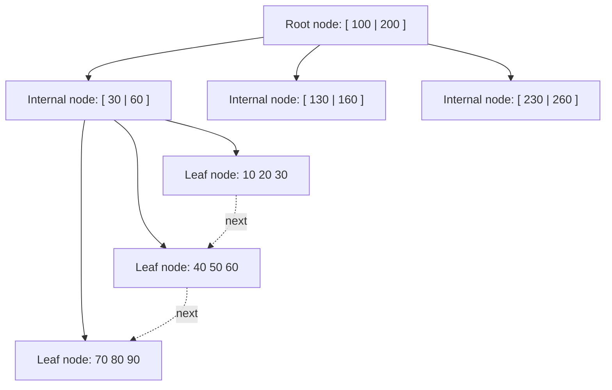

# Chương 1. Nền tảng: index là gì, B-tree hoạt động ra sao, bảng được lưu thế nào

> Môi trường chạy thử cho cả sách: PostgreSQL 18.6 và MySQL 9.7.4 (xem [README](README.md)). Mọi đoạn SQL đều ghi rõ DB.

## 1.1 Index giải quyết vấn đề gì

Một bảng 300.000 dòng, bạn cần tìm user có `email = 'user777@example.com'`. Không có index, database phải đọc từng dòng (full table scan, tức quét toàn bảng). Có index, database đi theo một cấu trúc đã sắp xếp sẵn để nhảy tới đúng vị trí, giống tra mục lục cuối sách thay vì lật từng trang.

Cấu trúc mặc định của cả PostgreSQL lẫn MySQL InnoDB là **B-tree** (về mặt triển khai, InnoDB dùng biến thể B+tree: dữ liệu thật nằm ở leaf node, các internal node chỉ để dẫn đường; PostgreSQL dùng biến thể Lehman-Yao với các leaf node nối với nhau). Bạn không cần nhớ chi tiết, chỉ cần nhớ ba tính chất:

1. **Balanced**: mọi leaf node có cùng depth, nên lookup luôn tốn số bước xấp xỉ nhau.
2. **Ordered**: key trong leaf node được sắp xếp, các leaf node nối nhau theo thứ tự. Do đó secondary indexc vụ được cả `=`, `<`, `>`, `BETWEEN`, `ORDER BY`, và prefix của chuỗi.
3. **Shallow**: mỗi node là một page (PostgreSQL mặc định 8 KB, InnoDB mặc định 16 KB) chứa hàng trăm key, nên vài trăm nghìn đến vài trăm triệu dòng chỉ cần khoảng 3 đến 5 level.



Tìm key `50`: root node cho biết đi nhánh trái, internal node cho biết đi leaf node giữa, rồi đọc leaf node. Tìm khoảng `40..80`: nhảy tới leaf node chứa `40`, rồi đi ngang qua các leaf node kế tiếp. Đây là lý do index B-tree "tra nhanh" và "quét theo một hướng" (chương 2).

## 1.2 Index không miễn phí

- **Ghi chậm hơn**: mỗi `INSERT`/`DELETE` phải sửa mọi index của bảng; `UPDATE` phải sửa các index chứa cột bị đổi (chi tiết ở 1.4 và chương 9).
- **Tốn chỗ**: index là một bản sao có sắp xếp của các cột được chọn.
- **Tốn công bảo trì**: bloat (phình do dòng chết), fragmentation, stale statistics.

Vì vậy mục tiêu không phải "index càng nhiều càng tốt" mà là "đủ index để các query quan trọng đi đúng đường".

## 1.3 Hai cách lưu bảng: heap table và clustered index

Đây là khác biệt kiến trúc quan trọng nhất giữa hai DB.

```
PostgreSQL (heap table)                 MySQL InnoDB (clustered index)
-----------------------                 -------------------------------
Heap: các dòng nằm theo thứ tự          Bảng CHÍNH LÀ B-tree theo primary key.
chèn (không sắp xếp).                   Leaf node của B-tree primary key chứa cả dòng.

Mọi index (kể cả PK) là cấu trúc        Secondary index lưu:
riêng, leaf chứa: key + TID             index key + giá trị primary key.
(số page, số dòng trong page).          Tra secondary index xong phải đi tiếp
                                        vào B-tree primary key ("bookmark lookup").
```

Hệ quả thực tế:

| Chủ đề | PostgreSQL | MySQL InnoDB |
|---|---|---|
| Tra theo PK | index PK, rồi đọc heap | đi thẳng B-tree của PK, dòng nằm ở leaf node |
| Tra theo secondary index | index, rồi đọc heap theo TID | secondary index, rồi B-tree của PK theo giá trị PK |
| Bảng không khai báo PK | vẫn có `ctid` nội bộ | InnoDB tự tạo clustered index ẩn (ưu tiên UNIQUE NOT NULL đầu tiên) |
| PK dài (ví dụ UUID dạng chuỗi) | chỉ index PK to ra | **mọi** secondary index đều to ra vì chứa giá trị PK |
| Dòng nằm gần nhau theo PK | không đảm bảo | có, vật lý theo thứ tự PK |

Trong PostgreSQL, "sắp xếp theo index một lần" là việc của lệnh `CLUSTER`. Nó khác hẳn clustered index của InnoDB: chỉ sắp xếp lại heap tại thời điểm chạy, giữ lock `ACCESS EXCLUSIVE` (chặn cả đọc lẫn ghi) trong lúc chạy, và các dòng chèn/sửa sau đó không được giữ thứ tự. Phần thực nghiệm nằm ở chương 11.

## 1.4 Ví dụ chạy thử: tra theo email

```sql
-- PostgreSQL
CREATE TABLE users (
  id         bigint GENERATED ALWAYS AS IDENTITY PRIMARY KEY,
  email      text NOT NULL,
  name       text,
  country    char(2) NOT NULL,
  status     text NOT NULL,
  deleted_at timestamptz,
  created_at timestamptz NOT NULL
);
-- (300.000 dòng được nạp bằng generate_series, xem thư mục test)
CREATE UNIQUE INDEX users_email_idx ON users(email);
EXPLAIN (ANALYZE, COSTS OFF, TIMING OFF)
SELECT * FROM users WHERE email = 'user777@example.com';
```

```
-- PostgreSQL 18.6 (rút gọn)
Index Scan using users_email_idx on users (actual rows=1.00 loops=1)
  Index Cond: (email = 'user777@example.com'::text)
  Index Searches: 1
Execution Time: 0.110 ms
```

Hai điểm mới của PostgreSQL 18 trong plan: số dòng thực tế hiển thị dạng thập phân (`rows=1.00`) và có dòng `Index Searches` cho biết số lần database đi xuống B-tree của index. Con số này sẽ rất hữu ích ở chương 2 để thấy skip scan.

```sql
-- MySQL (9.7.4)
CREATE TABLE users (
  id BIGINT UNSIGNED AUTO_INCREMENT PRIMARY KEY,
  email VARCHAR(100) NOT NULL, name VARCHAR(50),
  country CHAR(2) NOT NULL, status VARCHAR(10) NOT NULL,
  deleted_at DATETIME NULL, created_at DATETIME NOT NULL
);
CREATE UNIQUE INDEX users_email_idx ON users(email);
EXPLAIN SELECT * FROM users WHERE email = 'user777@example.com';
```

```
-- MySQL 9.7.4 (rút gọn)
-> Rows fetched before execution (cost=0..0 rows=1)
```

Đây là điểm cần lưu ý khi đọc plan MySQL hiện nay: trong bản chạy thử, `EXPLAIN` mặc định in dạng **TREE** (biến `explain_format` có giá trị `TREE`), không còn là bảng `id | select_type | ...` quen thuộc. Muốn bảng cũ, viết `EXPLAIN FORMAT=TRADITIONAL ...`. Với tra cứu unique bằng hằng số, MySQL đã giải xong ngay lúc optimization nên in "Rows fetched before execution".

### Về UPDATE và index (nói ngắn, chi tiết ở chương 9)

- PostgreSQL: mỗi `UPDATE` tạo một row version mới (MVCC). Nếu **không cột nào nằm trong index bị đổi** và page còn chỗ trống, đó là **HOT update** (Heap-Only Tuple): không phải chèn thêm entry mới vào bất kỳ index nào. Ngược lại, mọi index đều phải thêm entry mới.
- InnoDB: sửa dòng tại chỗ trong B-tree của primary key; secondary index chỉ bị đụng đến khi cột trong index đó thay đổi.

## 1.5 Chọn primary key

Primary key nên: ổn định (không đổi), ngắn, và (với InnoDB) tăng dần. Lý do với InnoDB là nó quyết định thứ tự vật lý của cả bảng và nằm trong mọi secondary index. Phần UUID (v4 so với v7) được đo thật ở chương 11.

## 1.6 Cạm bẫy thường gặp

- Tưởng rằng PostgreSQL có "clustered index" khi dùng `CLUSTER`. Không đúng: chỉ sắp xếp một lần.
- Dùng PK chuỗi dài trên InnoDB rồi ngạc nhiên khi mọi secondary index đều phình.
- Đọc plan MySQL 9.x theo cột cũ trong khi `EXPLAIN` mặc định đã là TREE.
- Cho rằng index luôn giúp query nhanh hơn. Chương 5 cho thấy nhiều trường hợp database đúng khi bỏ qua index.

## 1.7 Tóm tắt

- B-tree: balanced, ordered, shallow; phục vụ tra điểm, khoảng và sắp xếp.
- Index làm chậm ghi và tốn chỗ; chỉ tạo khi có query cần.
- PostgreSQL: heap + mọi index trỏ bằng TID. InnoDB: bảng là B-tree của primary key, secondary index trỏ bằng giá trị primary key.
- `CLUSTER` của PostgreSQL không phải clustered index của InnoDB.
- Đọc `EXPLAIN` là kỹ năng nền: PG18 có `Index Searches`; MySQL 9.7 mặc định in dạng TREE.

## 1.8 Tự kiểm tra

1. Vì sao một B-tree với hàng triệu dòng vẫn chỉ cần vài lần đọc page?
2. Với InnoDB, vì sao PK là chuỗi 36 ký tự làm tăng kích thước mọi secondary index?
3. Khác biệt cốt lõi giữa `CLUSTER` của PostgreSQL và clustered index của InnoDB?
4. Trong PostgreSQL, `UPDATE` một cột không có trong index nhưng page đã đầy thì có HOT update không?
5. Muốn MySQL 9.7 in plan dạng bảng, bạn viết gì?

<details><summary>Đáp án</summary>

1. Mỗi node là một page chứa hàng trăm key (fan-out lớn), nên height chỉ vài level.
2. Secondary index InnoDB lưu giá trị primary key ở mỗi entry để quay về dòng; primary key càng dài, mỗi entry càng to.
3. InnoDB: bảng luôn được duy trì theo thứ tự PK. PostgreSQL: `CLUSTER` sắp xếp heap một lần, lock ACCESS EXCLUSIVE khi chạy, không duy trì thứ tự về sau.
4. Không đảm bảo. HOT cần chỗ trống trong cùng page; khi page đầy, phiên bản mới nằm ở page khác và index phải thêm mục (xem thí nghiệm `fillfactor` ở chương 9).
5. `EXPLAIN FORMAT=TRADITIONAL ...`.
</details>
