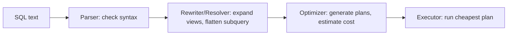

# Chương 5. Optimizer, EXPLAIN và statistics: vì sao database không dùng index của bạn (hoặc dùng sai)

## 5.1 Query lifecycle



Optimizer dựa trên **statistics** (số dòng, số giá trị khác nhau, phân bố, correlation giữa thứ tự vật lý và thứ tự cột) và các cost constant (đọc tuần tự rẻ hơn đọc ngẫu nhiên) để chọn plan rẻ nhất *theo ước lượng*. Nó có thể sai, vì statistics cũ, hoặc không biết các cột liên quan với nhau.

## 5.2 Đọc EXPLAIN: bản đúng cho cả hai DB

| | PostgreSQL | MySQL |
|---|---|---|
| Xem plan, không chạy | `EXPLAIN SELECT ...` | `EXPLAIN SELECT ...` (mặc định dạng TREE ở 9.7; `FORMAT=TRADITIONAL` cho dạng bảng) |
| Chạy thật và đo | `EXPLAIN (ANALYZE) ...` | `EXPLAIN ANALYZE ...` (có từ MySQL 8.0.18) |
| Nên dùng | `EXPLAIN (ANALYZE, BUFFERS) ...` | `EXPLAIN ANALYZE ...` |

Cả hai DB đều có `EXPLAIN` và `EXPLAIN ANALYZE`; đừng tin lời "MySQL không có EXPLAIN ANALYZE" (đó là sự thật trước 8.0.18).

**Cảnh báo quan trọng**: `EXPLAIN ANALYZE` **thực thi câu lệnh thật**. Với `SELECT` thì vô hại, với `UPDATE`/`DELETE`/`INSERT` thì dữ liệu bị đổi thật (và lock thật). Cách an toàn trên PostgreSQL:

```sql
-- PostgreSQL
BEGIN;
EXPLAIN (ANALYZE, BUFFERS, COSTS OFF, TIMING OFF) DELETE FROM orders WHERE id <= 10;
ROLLBACK;
SELECT count(*) FROM orders WHERE id <= 10;   -- 10: đã rollback
```
Plan hiện `Delete on orders -> Index Scan using orders_pkey`. Trên PostgreSQL 18, `EXPLAIN (ANALYZE)` đã tự bao gồm số liệu `Buffers` (đã thấy trong các plan thử nghiệm), nhưng viết rõ `BUFFERS` là thói quen tốt cho mọi phiên bản.

MySQL 9.7.4: với `DELETE` một bảng, `EXPLAIN ANALYZE` trả về `-> <not executable by iterator executor>` và dữ liệu không bị xóa (đã kiểm, số dòng không đổi). Với `DELETE`/`UPDATE` nhiều bảng, tài liệu MySQL cho biết `EXPLAIN ANALYZE` có hỗ trợ nên phải coi là có thực thi; trong thử nghiệm của tôi kết quả không đủ rõ để kết luận, vì vậy cứ **luôn bọc trong transaction và `ROLLBACK`**. Với MySQL, ít nhất `EXPLAIN` thường (không ANALYZE) luôn an toàn.

### Những thứ cần tìm trong plan

PostgreSQL:
- `Seq Scan`, `Index Scan`, `Index Only Scan`, `Bitmap Index Scan` + `Bitmap Heap Scan`.
- `Index Cond` (điều kiện dùng để định vị trong index) khác `Filter` (lọc sau khi đọc) và `Rows Removed by Filter` (công đọc bị bỏ phí).
- `actual rows` so với `rows` ước lượng (chênh lớn là dấu hiệu statistics tồi).
- `Index Searches` (PG 18), `Heap Fetches` (chương 6), `Sort Method`.

MySQL (TREE): `Index lookup`, `Index range scan`, `Covering index lookup`, `Table scan`, `Filter`, `Sort`, và `cost`, `rows` ước lượng; với ANALYZE có `actual time`, `rows`, `loops`.

## 5.3 Lý do 1: index không khớp query

Đã gặp ở chương 2 và 3: sai thứ tự cột, bọc cột trong function, implicit cast, `LIKE '%x'`, thiếu `text_pattern_ops` trên PG. Khi nghi ngờ, hãy tự hỏi: "điều kiện này cho B-tree điểm bắt đầu nào?".

## 5.4 Lý do 2: full table scan thực sự rẻ hơn

Index scan phải đọc index rồi nhảy sang bảng cho từng dòng; nếu phần lớn bảng khớp thì sequential scan rẻ hơn. Dữ liệu thử: 300.000 dòng `users`, `status = 'active'` chiếm 99%.

```sql
-- PostgreSQL
EXPLAIN (ANALYZE, COSTS OFF, TIMING OFF) SELECT * FROM users WHERE status = 'active';
-- Seq Scan (actual rows=297000.00)   Execution Time: ~40 ms

SET enable_seqscan = off; SET enable_bitmapscan = off;   -- chỉ để thí nghiệm!
EXPLAIN (ANALYZE, COSTS OFF, TIMING OFF) SELECT * FROM users WHERE status = 'active';
-- Index Scan using users_status_idx (actual rows=297000.00)   Execution Time: ~50 ms
RESET enable_seqscan; RESET enable_bitmapscan;
```

PostgreSQL chọn đúng. Đừng nghĩ ngưỡng là "dưới 5% thì dùng index". Con số thay đổi theo kích thước dòng, cache, và đặc biệt là **physical correlation**: cột `created_at` trong bảng này tăng cùng thứ tự chèn (correlation = 1), nên ngay cả `created_at < '2024-04-01'` (44% bảng) cũng chạy index scan trong 12 đến 30 ms, vì các dòng nằm kề nhau trong heap. Ngược lại `country` (20% bảng, correlation 0,21) dùng *bitmap scan*: gom hết vị trí dòng từ index, sắp theo vị trí page, rồi đọc heap tuần tự một lần (khoảng 10 ms ở dữ liệu này, nhanh hơn full table scan ~30 ms vì dữ liệu nằm hết trong RAM; một lần nữa, đừng suy ra ngưỡng).

Một ví dụ MySQL trong đó **optimizer sai**:

```sql
-- MySQL 9.7.4
EXPLAIN ANALYZE SELECT * FROM users WHERE status = 'active';
-- -> Index lookup on users using users_status_idx (cost=16058 rows=149274)
--    (actual time=0.307..498 rows=297000 ...)

EXPLAIN ANALYZE SELECT * FROM users IGNORE INDEX (users_status_idx) WHERE status = 'active';
-- -> Filter -> Table scan on users (cost=30232 rows=298548)
--    (actual time=0.0521..85.1 rows=300000 ...)     tổng ~124 ms
```

MySQL ước lượng 149.274 dòng (thực tế 297.000) và chọn tra index rồi nhảy vào B-tree của primary key cho từng dòng: chậm khoảng 4 lần so với table scan. Tôi đã thử thêm histogram trên cột `status` (`ANALYZE TABLE users UPDATE HISTOGRAM ON status WITH 4 BUCKETS`), ước lượng vẫn không đổi; tôi **chưa xác định chắc nguyên nhân** (nghi ngờ optimizer ưu tiên số liệu từ index cho cột đã có index). Hãy xem đây là minh họa rằng optimizer có thể sai, và rằng cách xử lý là đo thật (`EXPLAIN ANALYZE`) rồi dùng `IGNORE INDEX`/`FORCE INDEX` hoặc hint khi cần, không phải một quy luật.

## 5.5 Lý do 3: database chọn index khác

Khi có nhiều index khả dụng, optimizer chọn theo chi phí ước lượng: index nào lọc được nhiều dòng nhất, index nào tránh được bước sort, index nào covering. Ví dụ: `WHERE status = 'paid' ORDER BY created_at DESC LIMIT 10` với index `(created_at)` và index `(status, amount, id)`: PostgreSQL chọn đi ngược `orders_created_idx` và lọc `status`, vì 1/5 dòng là `paid` nên chỉ cần đọc khoảng 50 mục để đủ 10 dòng (`Rows Removed by Filter: 40`). Điều này đúng nhưng mong manh: nếu `paid` hiếm, plan đó sẽ thảm họa. Giải pháp là index `(status, created_at)`.

Công cụ kiểm soát:

| Mục đích | PostgreSQL | MySQL |
|---|---|---|
| Thử xem optimizer sẽ làm gì nếu không có index | `SET enable_indexscan/seqscan = off` (chỉ để thử, không để production) | `IGNORE INDEX`, `FORCE INDEX`, hint `/*+ NO_INDEX(...) */` |
| Thử xóa index an toàn | `BEGIN; DROP INDEX ...; EXPLAIN ...; ROLLBACK;` (DDL trong transaction, nhưng giữ lock) | `ALTER TABLE ... ALTER INDEX x INVISIBLE;` (index vẫn được cập nhật, optimizer bỏ qua) |
| Ép plan | không có hint chuẩn; tiện ích `pg_hint_plan` (extension) | optimizer hint |

Đã kiểm với MySQL: sau khi đặt `users_status_idx` thành `INVISIBLE`, `EXPLAIN` chuyển sang `Table scan`.

## 5.6 Statistics: ANALYZE và các công cụ

```sql
-- PostgreSQL
ANALYZE users;                          -- cập nhật statistics; không chặn đọc/ghi thông thường
ANALYZE (SKIP_LOCKED) orders;           -- bỏ qua bảng đang bị lock; cú pháp đúng là có ngoặc
ANALYZE (VERBOSE, SKIP_LOCKED) users;   -- in thêm chi tiết
```
`ANALYZE` lấy mẫu nên nhanh và chỉ cần lock mức nhẹ (`SHARE UPDATE EXCLUSIVE`), không chặn `SELECT`/`INSERT`/`UPDATE`/`DELETE` thông thường. Autovacuum tự chạy `ANALYZE` khi số dòng thay đổi vượt ngưỡng. Sau khi nạp dữ liệu lớn hãy chạy tay.

```sql
-- PostgreSQL: xem statistics
SELECT attname, n_distinct, correlation FROM pg_stats WHERE tablename = 'users';
-- n_distinct: số dương = số giá trị khác nhau; số âm = tỉ lệ so với số dòng (-1 là mọi giá trị khác nhau)

-- PostgreSQL: statistics mở rộng cho các cột có tương quan (country & status, ...)
CREATE STATISTICS users_cs (dependencies) ON country, status FROM users;
ANALYZE users;
```

```sql
-- MySQL
ANALYZE TABLE users;                                         -- cập nhật statistics index
ANALYZE TABLE users UPDATE HISTOGRAM ON country WITH 5 BUCKETS;   -- histogram cho cột không có index
```
Histogram của MySQL hữu ích nhất cho cột **không** nằm trong index nhưng dùng trong `WHERE`/`JOIN`.

## 5.7 Index usage statistics (để biết index nào đang được dùng)

Đã nói ở chương 9; tóm tắt: `pg_stat_all_indexes` (PostgreSQL, giữ qua clean shutdown từ PG 15) và `performance_schema` / `sys.schema_unused_indexes` (MySQL, **mất khi restart**).

## 5.8 Cạm bẫy thường gặp

- Chạy `EXPLAIN ANALYZE` trên `DELETE`/`UPDATE` ở production mà không bọc transaction.
- Chỉ xem `EXPLAIN` không `ANALYZE`, rồi tin con số ước lượng.
- Để nguyên `enable_seqscan = off` trong cấu hình để "ép" index.
- Quên `ANALYZE` sau khi nạp dữ liệu hàng loạt hoặc sau khi tạo expression index (PostgreSQL thu thập statistics cho expression khi `ANALYZE`).
- Kết luận từ bảng quá nhỏ: với vài trăm dòng, `Seq Scan` luôn đúng.

## 5.9 Tóm tắt

- Optimizer chọn plan rẻ nhất theo ước lượng; statistics sai thì plan sai.
- `EXPLAIN` chỉ ước lượng, `EXPLAIN ANALYZE` chạy thật (nguy hiểm với DML); trên PG nên dùng `(ANALYZE, BUFFERS)`, trên MySQL có từ 8.0.18.
- Full table scan đôi khi đúng; kết quả phụ thuộc cả physical correlation, không chỉ phần trăm dòng khớp.
- `ANALYZE (SKIP_LOCKED) t` là cú pháp PostgreSQL đúng; `ANALYZE` không chặn đọc/ghi thông thường.
- Khi optimizer sai, đo thật rồi mới can thiệp (INVISIBLE index, hint, statistics mở rộng).

## 5.10 Tự kiểm tra

1. Khác nhau giữa `EXPLAIN` và `EXPLAIN ANALYZE`, và rủi ro khi dùng cái thứ hai trên `DELETE`?
2. `Index Cond` khác `Filter` thế nào trong plan PostgreSQL?
3. Vì sao `created_at < '2024-04-01'` (44% bảng) vẫn dùng index scan hiệu quả trong thí nghiệm?
4. Cách thử "nếu bỏ index này thì sao" an toàn trên MySQL?
5. Viết đúng cú pháp ANALYZE bỏ qua bảng bị lock trên PostgreSQL.

<details><summary>Đáp án</summary>

1. `EXPLAIN` chỉ hiển thị plan ước lượng; `EXPLAIN ANALYZE` thực thi thật nên `DELETE` xóa dữ liệu thật. Bọc trong transaction và `ROLLBACK`.
2. `Index Cond` là điều kiện dùng để định vị trong index; `Filter` là điều kiện lọc sau khi đã đọc dòng, kèm `Rows Removed by Filter` là công vô ích.
3. Vì cột có physical correlation cao (các dòng gần nhau trong heap), nên đọc heap theo thứ tự index gần như tuần tự.
4. `ALTER TABLE ... ALTER INDEX tên INVISIBLE;`.
5. `ANALYZE (SKIP_LOCKED) tên_bảng;`
</details>
