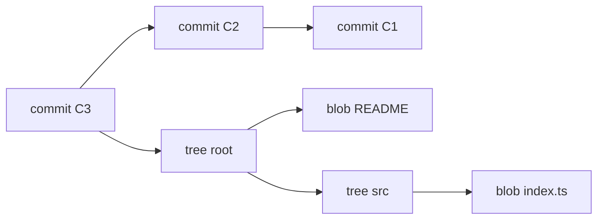
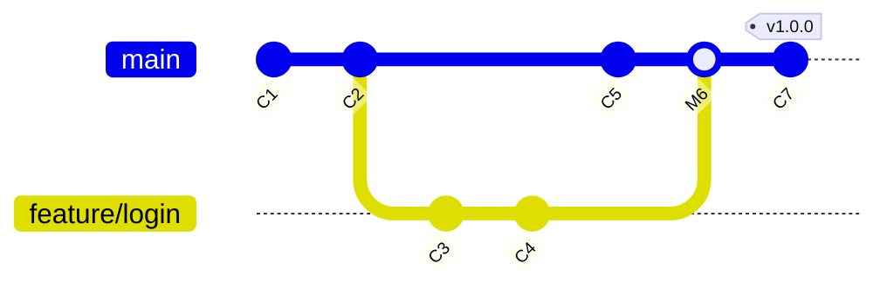

# Chương 1. Mô hình dữ liệu của git ở mức đủ dùng

## Vấn đề

Bạn đã `commit`, `push`, `pull` hằng ngày, nhưng khi team có 10 người và 30 branch, những câu hỏi sau xuất hiện: "branch này tách từ đâu ra?", "vì sao `pull` tạo ra một merge commit lạ?", "force push có làm mất commit của đồng nghiệp không?". Tất cả đều dễ trả lời nếu bạn nhớ một điều: **git là một đồ thị các commit bất biến, còn branch chỉ là cái nhãn trỏ vào một commit**.

## Bốn loại object

Git lưu mọi thứ trong `.git/objects` dưới dạng object có tên là hash của nội dung (SHA-1 mặc định ở Git 2.56, xem phần cuối chương):

| Object | Chứa gì |
|---|---|
| blob | nội dung một file (không có tên file) |
| tree | danh sách (tên, mode, hash) trỏ tới blob hoặc tree con, tức một thư mục |
| commit | trỏ tới một tree gốc, 0 hoặc nhiều parent, author, committer, message |
| tag (annotated) | trỏ tới một object (thường là commit), kèm tagger, message, có thể có chữ ký |

Vì hash phụ thuộc vào nội dung và hash của parent, **commit không thể sửa**. Cái gọi là "sửa commit" (`--amend`, `rebase`) thực chất là tạo commit mới rồi dời nhãn sang.



## Ref: branch, tag, HEAD, remote-tracking

Ref là một file nhỏ (hoặc entry trong packed-refs / reftable) chứa hash của commit.

- **Branch** (`refs/heads/main`): ref di động. Khi bạn commit lúc đang đứng trên branch, ref này tự dời tới commit mới.
- **Tag** (`refs/tags/v1.2.0`): ref cố định, không tự dời. Lightweight tag chỉ là ref; annotated tag là một tag object riêng.
- **HEAD**: ref đặc biệt, thường là symbolic ref trỏ tới branch hiện tại (`ref: refs/heads/main`). Khi checkout một commit hoặc tag, HEAD trỏ thẳng vào commit: trạng thái **detached HEAD**.
- **Remote-tracking branch** (`refs/remotes/origin/main`): bản ghi nhớ "lần cuối `fetch` thì `main` trên `origin` ở đâu". Bạn không commit lên nó trực tiếp; `git fetch` cập nhật nó.



Trong sơ đồ trên, `main` và `feature/login` chỉ là hai nhãn. Xóa branch `feature/login` sau khi merge không làm mất C3, C4, vì chúng vẫn đi tới được từ `main` qua M6.

## Thực hành quan sát

```sh
git log --graph --oneline --all --decorate   # nhìn đồ thị cùng các nhãn
git cat-file -p HEAD                         # xem commit object
git cat-file -p HEAD^{tree}                  # xem tree gốc
git rev-parse main origin/main               # hash của hai ref
cat .git/HEAD                                # ref: refs/heads/main
```

`pull` = `fetch` + (`merge` hoặc `rebase`). `push` = gửi các object còn thiếu rồi yêu cầu remote dời ref của nó. Remote chỉ chấp nhận nếu dời tới được commit mới là con cháu của commit cũ (fast-forward), trừ khi bạn force.

## Reachability và garbage collection

Một commit "còn sống" khi có ref nào đó (branch, tag, remote-tracking, stash) đi tới được nó. Commit không còn ref nào trỏ tới sẽ bị `git gc` dọn, nhưng chỉ sau khi hết hạn (mặc định reflog giữ 90 ngày cho entry reachable và 30 ngày cho entry unreachable). Đây là lý do `reflog` cứu được dữ liệu (Chương 11).

## Hash: SHA-1 và SHA-256

Tính đến 11/2026, mới nhất là **Git 2.56.0** (28/09/2026); **Git 3.0 chưa phát hành** và chưa có ngày chính thức. Theo tài liệu `BreakingChanges` của git, Git 3.0 dự kiến: `git init` mặc định dùng `main`, object format mặc định `sha256`, ref storage mặc định `reftable`, Rust bắt buộc khi build, `safe.bareRepository` mặc định `explicit`, và bỏ một số lệnh cũ (`git whatchanged`, `git pack-redundant`, grafts...). `git checkout` không bị bỏ. Hiện tại bạn có thể thử bằng `git init --object-format=sha256`, nhưng GitHub chưa hỗ trợ repo SHA-256 theo các nguồn tôi tra được (chưa xác minh trên docs GitHub), nên team chưa nên chuyển.

Hiện nay để chủ động dùng `main`: `git config --global init.defaultBranch main`.

## Trade-off và cạm bẫy

- Hiểu "branch = pointer" giúp bạn không sợ tạo branch: nó rẻ (41 byte file). Branch dài hạn đắt vì chi phí merge, không phải chi phí lưu trữ.
- Cạm bẫy: tưởng `origin/main` luôn mới. Nó chỉ mới sau `git fetch`.
- Cạm bẫy: commit khi đang detached HEAD rồi checkout đi chỗ khác; commit trở thành unreachable. Cứu bằng `git switch -c rescue <hash>` hoặc reflog.
- Cạm bẫy: tag lightweight không có metadata; dùng annotated tag cho release (Chương 9).

## Tóm tắt

- Git lưu blob, tree, commit, tag; commit bất biến và trỏ về parent.
- Branch, tag, HEAD, remote-tracking là các ref (con trỏ); chỉ branch tự dời khi commit.
- `fetch` cập nhật remote-tracking branch; `pull` là fetch cộng integrate.
- Git mới nhất 2.56.0; Git 3.0 chưa phát hành, dự kiến đổi default branch `main`, SHA-256, reftable.

## Câu hỏi tự kiểm tra

1. Branch `feature/x` bị xóa sau khi merge. Các commit trên nó có mất không?
2. Khác biệt giữa `origin/main` và `main`?
3. Vì sao `git commit --amend` không thực sự sửa commit?
4. Detached HEAD là gì, và làm sao giữ lại commit tạo ra ở trạng thái đó?

<details><summary>Đáp án</summary>

1. Không, nếu chúng còn reachable từ ref khác (ví dụ `main` qua merge commit). Chỉ cái nhãn bị xóa.
2. `main` là branch local, bạn commit lên nó. `origin/main` là remote-tracking branch, ghi vị trí `main` trên remote ở lần fetch cuối.
3. Hash phụ thuộc nội dung; đổi nội dung thì ra commit mới. Amend tạo commit mới và dời branch sang đó, commit cũ vẫn còn trong reflog.
4. HEAD trỏ thẳng vào commit thay vì branch. Tạo branch bằng `git switch -c <name>` trước khi rời đi (hoặc tìm lại qua `git reflog`).

</details>
