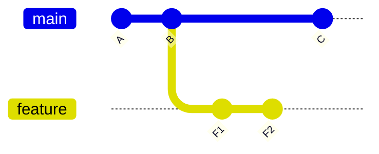
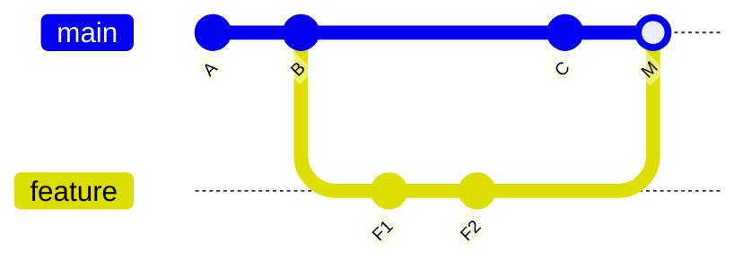
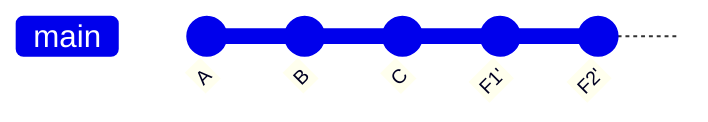
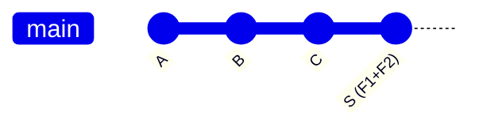

# Chương 2. Merge, rebase, squash

## Vấn đề

Cùng một nhánh feature có ba cách đưa vào `main`, cho ra ba lịch sử khác nhau. Chọn sai, bạn sẽ gặp một trong ba thứ: lịch sử rối như dây điện, mất ngữ cảnh của feature, hoặc ghi đè commit của đồng nghiệp. Chương này giải thích bản chất để chọn có lý do.

## Ba cách integrate

Giả sử `main` có A-B, và `feature` tách từ B với hai commit F1, F2, trong khi `main` đã có thêm C.



**1. Merge commit** (`git merge --no-ff feature`): tạo commit M có hai parent. Lịch sử giữ nguyên hình dạng thật, commit cũ không đổi hash.



**2. Rebase** (`git rebase main` trên feature, rồi fast-forward): replay F1, F2 lên đầu C, tạo F1' và F2' (hash mới). Lịch sử thẳng một đường, không có merge commit.



**3. Squash** (`git merge --squash feature`, hoặc nút "Squash and merge"): gộp toàn bộ thay đổi của feature thành MỘT commit mới trên main, không có parent là nhánh feature.



## Fast-forward

Nếu `main` chưa có commit mới nào kể từ lúc feature tách ra, merge chỉ cần dời nhãn `main` tới đầu feature: **fast-forward**, không tạo commit. `--ff-only` từ chối merge nếu không thể fast-forward (hữu ích trong CI và `pull.ff = only`). `--no-ff` ép tạo merge commit kể cả khi có thể fast-forward, để giữ dấu vết "feature này từng tồn tại".

## Khi nào dùng cái nào

| Cách | Lịch sử | Ưu | Nhược | Hợp với |
|---|---|---|---|---|
| Merge commit | giữ nguyên hình dạng | an toàn, không viết lại gì, revert cả feature bằng một lệnh (Chương 11) | graph phức tạp, nhiều merge commit "Merge branch main into..." | branch dài, nhiều người cùng làm trên một branch, Git Flow |
| Rebase and merge | thẳng, giữ từng commit | `git log` dễ đọc, `bisect` chính xác | viết lại hash, mỗi commit phải tự pass test | PR gồm vài commit atomic, đã được dọn sạch |
| Squash | thẳng, một PR = một commit | commit "WIP/fix typo" biến mất, revert một PR = revert một commit | mất chi tiết từng bước, tác giả phụ bị gộp | trunk-based, PR nhỏ, team không kỷ luật commit message |

Quy tắc thực tế: **chọn một cách làm mặc định cho cả repo** (cấu hình ở GitHub: cho phép merge method nào) và để mọi người theo. Với web service deploy liên tục, squash là mặc định hợp lý; với PR có vài commit atomic rõ ràng, rebase and merge giữ được độ chi tiết.

## Quy tắc vàng: không rebase nhánh đã chia sẻ

Rebase tạo commit mới với hash mới. Nếu đồng nghiệp đã dựa việc của họ trên các commit cũ, sau khi bạn force push, họ có lịch sử trùng lặp: commit cũ (của họ) và commit mới (của bạn) cùng nội dung. Quy tắc:

- Rebase thoải mái trên nhánh **chỉ mình bạn dùng** (feature branch cá nhân, chưa ai khác checkout).
- Không bao giờ rebase `main`, `develop`, release branch hay nhánh có người khác đang làm cùng.
- Nếu buộc phải force push nhánh của mình, dùng `--force-with-lease`.

## `--force-with-lease`

`git push --force` ghi đè remote bất kể trạng thái. `git push --force-with-lease` chỉ ghi đè nếu remote ref vẫn đúng như remote-tracking branch local của bạn đang ghi nhớ; nếu ai đó đã push thêm, lệnh bị từ chối.

```sh
git push --force-with-lease origin feature/login
git push --force-with-lease --force-if-includes origin feature/login
```

`--force-if-includes` (từ Git 2.30) bổ sung kiểm tra: remote-tracking ref phải đã được tích hợp vào local. Điều này chặn trường hợp IDE chạy `git fetch` ngầm khiến lease tưởng bạn đã thấy commit mới. Cạm bẫy: nếu bạn `fetch` rồi không xem commit mới và force push, lease vẫn qua. Lease giảm rủi ro, không loại bỏ.

## Cấu hình khuyến nghị

```sh
git config --global pull.rebase true        # hoặc pull.ff only để chặn merge ngầm
git config --global rebase.autoStash true
git config --global rerere.enabled true     # Chương 11
```

## Lab (c): cùng một lịch sử, ba kết quả

Script `lab/scripts/c-merge-rebase-squash.sh` dựng đúng tình huống trên rồi tích hợp bằng ba cách. Output thật (container `node:lts`, git 2.47.3):

```
--- merge
*   8f319ad (HEAD -> main) M: merge feature
|\
| * c32983a (feature) F2: feature part 2
| * e065f65 F1: feature part 1
* | ba51473 C: main moves on
|/
* 187a3a2 B: second
* ccac456 A: initial
--- rebase then fast-forward
* 797f2d3 (HEAD -> main, feature) F2: feature part 2
* adff17b F1: feature part 1
* ba51473 C: main moves on
* 187a3a2 B: second
* ccac456 A: initial
--- squash
* c32983a (feature) F2: feature part 2
* e065f65 F1: feature part 1
| * 1a8c307 (HEAD -> main) S: feature (F1+F2 squashed)
| * ba51473 C: main moves on
|/
* 187a3a2 B: second
* ccac456 A: initial
```

Nhận xét: sau rebase, F1 và F2 có hash mới (`adff17b`, `797f2d3` thay vì `e065f65`, `c32983a`). Sau squash, nhánh `feature` vẫn còn nguyên và **không** nằm trong lịch sử của `main`: đây là lý do phải xóa nhánh sau khi squash.

## Cạm bẫy

- `git pull` mặc định (không cấu hình) có thể sinh merge commit "Merge branch 'main' of origin" vô nghĩa; đặt `pull.rebase` hoặc `pull.ff`.
- Squash merge rồi tiếp tục làm trên nhánh cũ: git không biết nhánh cũ đã vào main (commit squash khác hash), nên lần sau bạn sẽ gặp conflict "ma". Xóa nhánh sau khi squash.
- Rebase một nhánh có merge commit: mặc định bị làm phẳng. Dùng `--rebase-merges` nếu cần giữ.
- Resolve conflict khi rebase xảy ra ở từng commit, có thể lặp lại cùng conflict nhiều lần; `rerere` giúp (lab d).

## Tóm tắt

- Merge giữ hình dạng thật; rebase viết lại thành đường thẳng; squash gộp thành một commit.
- Fast-forward chỉ dời nhãn; dùng `--ff-only` để chặn merge ngầm.
- Không rebase nhánh đã chia sẻ; nếu force push, dùng `--force-with-lease`.
- Chọn một merge method mặc định cho cả repo.

## Câu hỏi tự kiểm tra

1. Vì sao rebase làm đổi hash của mọi commit được replay?
2. PR có 12 commit "wip", "fix", "fix 2". Nên dùng merge method nào?
3. `--force-with-lease` bảo vệ khỏi tình huống nào, và không bảo vệ khỏi tình huống nào?
4. Khi nào `git merge` chỉ là fast-forward?

<details><summary>Đáp án</summary>

1. Hash gồm parent hash; parent đổi (base mới) kéo theo hash đổi, dù nội dung diff giống.
2. Squash, để lịch sử chỉ còn một commit có message tốt (hoặc dọn bằng interactive rebase trước, Chương 7).
3. Chặn ghi đè commit mà bạn chưa fetch về. Không chặn nếu bạn đã fetch (kể cả IDE fetch ngầm) mà chưa xem.
4. Khi commit hiện tại của nhánh đích là tổ tiên của đầu nhánh nguồn (nhánh đích chưa có commit mới).

</details>
