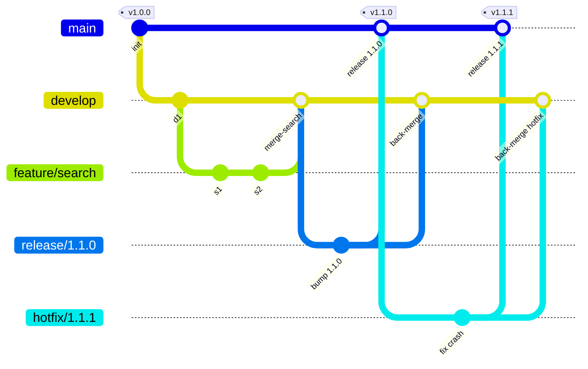

# Chương 3. Git Flow

## Vấn đề

Bạn thấy nhiều repo có `develop`, `release/1.4`, `hotfix/...` và tự hỏi: có nên bắt chước không? Git Flow là mô hình nổi tiếng nhất, cũng là mô hình bị áp dụng sai nhiều nhất. Cần hiểu nó giải quyết bài toán gì để biết khi nào nó đáng giá.

## Nguồn gốc và trạng thái hiện tại

Git Flow do Vincent Driessen đề xuất trong bài "A successful Git branching model" (05/01/2010). Ngày 05/03/2020 ông thêm ghi chú đầu bài, đại ý: nếu team làm continuous delivery cho phần mềm, ông khuyên dùng workflow đơn giản hơn nhiều (như GitHub Flow). Web app thường được deliver liên tục, không rollback theo version và không cần chạy nhiều version cùng lúc; Git Flow được thiết kế cho bối cảnh khác. Ông cũng nhấn mạnh không nên coi bất kỳ mô hình nào là luật chung (đọc bài gốc để thấy nguyên văn).

Tình trạng công cụ (tra 11/2026):

| Tool | Trạng thái |
|---|---|
| `nvie/gitflow` (bản gốc) | không còn phát triển (chưa xác minh chi tiết ngày cuối) |
| `petervanderdoes/gitflow-avh` | repo đã **archived**, lần push cuối 08/2023, release cuối 1.12.3 (05/2019) |
| `gittower/git-flow-next` | còn phát triển, viết lại bằng Go, tương thích lệnh `git flow`; release mới tra được là v2.1.0 (08/09/2026) |

Kết luận: nếu thật sự dùng Git Flow, đừng cài git-flow-avh mới; hoặc dùng git-flow-next, hoặc tự gõ lệnh git thuần (chỉ vài lệnh, xem lab). Tên `git-flow-next` ở `gitflow-next/gitflow-next` trả 404; repo đúng là `gittower/git-flow-next`.

## Các nhánh

| Nhánh | Sống bao lâu | Tách từ | Merge vào |
|---|---|---|---|
| `main` | mãi mãi | | chỉ chứa code đã release, mỗi commit trên đó có tag |
| `develop` | mãi mãi | `main` | nhánh tích hợp cho release kế tiếp |
| `feature/*` | ngày đến tuần | `develop` | `develop` |
| `release/*` | ngày đến tuần | `develop` | `main` và `develop` |
| `hotfix/*` | vài giờ | `main` | `main` và `develop` |

## Luồng release và hotfix



Các bước bằng git thuần:

```sh
# feature
git switch -c feature/search develop
# ... commit ...
git switch develop && git merge --no-ff feature/search

# release
git switch -c release/1.1.0 develop
# chỉ bump version, sửa bug cuối, KHÔNG thêm feature
git switch main && git merge --no-ff release/1.1.0
git tag -a v1.1.0 -m "Release 1.1.0"
git switch develop && git merge --no-ff release/1.1.0

# hotfix
git switch -c hotfix/1.1.1 main
# ... fix ...
git switch main && git merge --no-ff hotfix/1.1.1
git tag -a v1.1.1 -m "Hotfix 1.1.1"
git switch develop && git merge --no-ff hotfix/1.1.1
```

Lab (a) `lab/scripts/a-git-flow.sh` chạy đúng chuỗi này. Output thật (git 2.47.3 trong `node:lts`):

```
*   7c58ebc (HEAD -> develop) Merge hotfix/1.1.1 back into develop
|\
* \   603d0e1 Merge release/1.1.0 back into develop
|\ \
| | | *   ce72439 (tag: v1.1.1, main) Merge hotfix/1.1.1 into main
| | | |\
| | | |/
| | |/|
| | * | 24f16dc fix(orders): handle empty order
| | |/
| | *   88b496c (tag: v1.1.0) Merge release/1.1.0 into main
| | |\
| | |/
| |/|
| * | e664fa5 chore(release): bump version to 1.1.0
|/ /
* |   bbd4231 Merge feature/search into develop
|\ \
| |/
|/|
| * a297cd2 feat(search): search by date
| * 3565c78 feat(search): search by id
|/
* 8898a10 (tag: v1.0.0) feat: initial orders module
--- tags
v1.0.0          Release 1.0.0
v1.1.0          Release 1.1.0
v1.1.1          Hotfix 1.1.1
```

Đồ thị thật rối hơn sơ đồ Mermaid: chỉ một vòng release và hotfix đã có 5 merge commit. Đó chính là "chi phí nghi thức" của Git Flow. Lưu ý: quên merge ngược về `develop` là lỗi kinh điển, bản fix sẽ "biến mất" ở release sau.

## Ưu và nhược

Ưu:
- Có chỗ rõ ràng cho từng loại công việc; `main` luôn khớp bản đã phát hành.
- Cho phép chuẩn bị release (ổn định, QA) trong khi `develop` tiếp tục nhận feature.
- Hỗ trợ tự nhiên việc sửa lỗi cho bản đã phát hành.

Nhược:
- Hai nhánh sống lâu (`main`, `develop`) lệch nhau, conflict dồn về cuối.
- Feature branch sống lâu, tích hợp muộn: lùi xa khỏi continuous integration.
- Nhiều lần merge, dễ quên back-merge; nhiều ceremony cho team nhỏ.
- Không có nghĩa "code trên `develop` đã được deploy" nên feedback chậm; khó làm continuous delivery.
- DORA (Chương 5) cho thấy các team hiệu quả cao tích hợp thường xuyên và nhánh ngắn.

## Khi nào vẫn hợp lý

- Phần mềm phát hành theo version rõ ràng: thư viện, SDK, CLI, framework mà người dùng chọn lúc nâng cấp.
- **Nhiều version phải hỗ trợ song song** (1.x vẫn nhận security fix trong khi 2.x phát triển). Khi đó bạn cần `release/1.x` và `support` branch, và Git Flow gần với nhu cầu thật.
- Mobile app: release qua store có thời gian review, không thể "deploy 20 lần mỗi ngày", cần nhánh release để ổn định bản đang chờ duyệt, và hotfix cho bản đang chạy trên máy người dùng.
- Phần mềm on-premise cài ở khách hàng, có chu kỳ release và QA tách biệt.

Khi KHÔNG nên: web service hoặc API deploy liên tục, một version duy nhất ở production. Ở đó `develop` chỉ là buffer thừa; dùng GitHub Flow hoặc trunk-based (Chương 4, 5).

## Biến thể rút gọn

Nhiều team giữ phần hữu ích và bỏ phần thừa: bỏ `develop`, dùng `main` làm nơi tích hợp, chỉ tạo `release/x.y` khi cần ổn định hoặc hỗ trợ version cũ (đây gần với GitLab Flow, Chương 4).

## Cạm bẫy

- Merge release vào `main` nhưng quên merge vào `develop` (mất bản fix).
- Thêm feature mới vào nhánh `release/*`.
- Dùng `--ff` khi merge feature khiến mất dấu vết nhóm commit (nên `--no-ff` trong Git Flow).
- Chạy CI chỉ trên PR vào `main`, bỏ qua `develop`.
- Cài git-flow-avh (đã archived) mà không biết.

## Tóm tắt

- Git Flow: `main` + `develop` + `feature` + `release` + `hotfix`, merge `--no-ff`, tag trên `main`.
- Tác giả khuyên dùng workflow đơn giản hơn cho continuous delivery (ghi chú 03/2020).
- git-flow-avh đã archived; git-flow-next còn phát triển.
- Hợp lý cho thư viện, mobile, nhiều version song song; không hợp cho web service deploy liên tục.

## Câu hỏi tự kiểm tra

1. Hotfix phải được merge vào những nhánh nào, vì sao?
2. Vì sao Git Flow khó đi cùng continuous delivery?
3. Kể 3 loại sản phẩm mà Git Flow còn phù hợp.
4. Nên dùng tool nào nếu muốn lệnh `git flow` hiện nay?

<details><summary>Đáp án</summary>

1. `main` (để phát hành bản vá) và `develop` (hoặc release branch đang mở), nếu không bản vá sẽ mất ở lần release sau.
2. Code nằm lâu trên `develop` và feature branch trước khi tới production; tích hợp muộn, release theo đợt, hai nhánh dài hạn dễ lệch.
3. Thư viện/SDK, mobile app, phần mềm on-premise hoặc sản phẩm có nhiều version cần hỗ trợ song song.
4. `git-flow-next` (gittower); git-flow-avh đã archived.

</details>
