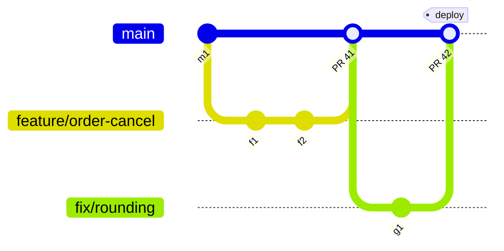
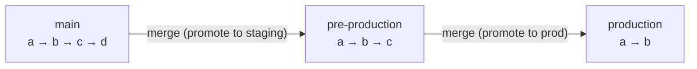

# Chapter 4. GitHub Flow and GitLab Flow

## The problem

Git Flow quá nặng cho web service, nhưng "ai muốn push thẳng lên main thì push" cũng không ổn. GitHub Flow và GitLab Flow là hai mô hình nhẹ, nằm ở giữa.

## GitHub Flow

Một quy tắc nền: **`main` luôn có thể deploy được**. Sáu bước:

1. Tạo branch từ `main` với tên mô tả (`feature/order-cancel`).
2. Commit trên branch, push thường xuyên.
3. Mở pull request (PR); có thể mở sớm dạng draft để xin ý kiến.
4. Review và CI chạy; sửa theo góp ý.
5. Merge vào `main` khi pass (thường squash).
6. Deploy từ `main` (tự động hoặc bằng một nút bấm); xóa branch.

Điểm mạnh: ít khái niệm, một nhánh dài hạn duy nhất, hợp với continuous delivery. Điểm yếu: mặc định giả định chỉ có một version ở production và deploy nhanh; không có chỗ cho release stabilization hay hỗ trợ version cũ. Nếu PR sống nhiều ngày, nó thoái hóa thành feature branch dài kiểu Git Flow.

## GitLab Flow

GitLab Flow (tài liệu của GitLab) thêm hai thứ vào GitHub Flow, tùy ràng buộc triển khai:

**Environment branches** (nhánh môi trường): khi bạn không thể deploy mỗi lần merge (ví dụ cần staging rồi mới production), dùng các nhánh `main` → `pre-production` → `production`. Code chỉ đi theo một chiều, qua merge (hoặc cherry-pick có chủ đích), từ trên xuống.

Mỗi nhánh môi trường "đi sau" nhánh phía trên nó. Ở ví dụ trên, commit `d` mới ở `main`, `c` đã lên staging nhưng chưa lên production. Vì các nhánh môi trường không có commit riêng, mỗi lần promote thường là một fast-forward (hoặc merge commit nếu team dùng `--no-ff`).

**Release branches**: khi bạn phát hành theo version và cần sửa nhiều version song song, tách `release/2.3` từ `main` khi release. Quy tắc "upstream first": mọi bản fix vào `main` trước, rồi cherry-pick xuống release branch cần thiết. Cách này tránh được lỗi "fix ở release nhưng quên main" của Git Flow.

Với hạ tầng hiện đại, environment branches ít được ưa chuộng: nhiều team thay bằng cùng một artifact (image) được promote qua các môi trường, với cấu hình môi trường nằm ở repo riêng (GitOps) hoặc trong pipeline. Environment branch dễ lệch nhau và biến thành "Git Flow chậm". Chỉ dùng khi quy trình compliance buộc cần.

## Merge trains and merge queues

Khi nhiều PR cùng chờ vào `main`, CI của từng PR đã pass trên base cũ, nhưng kết hợp lại có thể hỏng.

- **GitLab merge train**: mỗi merge request được test trên kết quả gộp của nó cộng các MR đứng trước trong hàng. Cần bật merged results pipelines và dùng pipeline kiểu merge request; có ở tier Premium và Ultimate.
- **GitHub merge queue**: tương đương, xem Chương 8. Workflow Actions phải lắng nghe event `merge_group` thì check bắt buộc mới được báo cáo.

## Quick comparison

| | GitHub Flow | GitLab Flow (environment) | GitLab Flow (release) |
|---|---|---|---|
| Long-lived branch | `main` | `main` + environment branches | `main` + `release/*` |
| Deploy từ | `main` | environment branch | tag trên release branch |
| Hợp với | web, deploy liên tục | quy trình staging bắt buộc | nhiều version |
| Rủi ro | PR sống lâu | các nhánh lệch nhau | cherry-pick bị quên |

## Pitfalls

- Gọi là GitHub Flow nhưng PR sống 2 tuần: về bản chất là feature branch dài.
- Nhánh `production` bị sửa trực tiếp (hotfix thẳng) rồi `main` không có.
- Không bảo vệ `main` (chưa bật required checks), "luôn deploy được" chỉ là lời hứa.
- Bật merge queue/train mà workflow thiếu `merge_group`, PR kẹt vì check không bao giờ chạy.

## Summary

- GitHub Flow: một nhánh dài hạn `main`, PR ngắn, merge xong deploy.
- GitLab Flow thêm environment branches hoặc release branches khi có ràng buộc triển khai hoặc nhiều version.
- Release branch dùng quy tắc upstream first: fix ở `main` rồi cherry-pick.
- Merge queue/train kiểm tra kết quả gộp, tránh `main` hỏng do race giữa các PR.

## Self-check questions

1. Quy tắc nền của GitHub Flow là gì?
2. Environment branches có nhược điểm gì?
3. "Upstream first" nghĩa là gì?
4. Merge train giải quyết vấn đề gì mà CI trên từng PR không giải quyết được?

Answer

1. `main` luôn deploy được.
2. Các nhánh lệch nhau, thêm ceremony merge, dễ có thay đổi chỉ tồn tại ở một môi trường.
3. Bản fix đi vào `main` trước, sau đó mới cherry-pick sang release branch.
4. Hai PR đều pass riêng lẻ nhưng kết hợp lại hỏng; queue test trên kết quả gộp.

