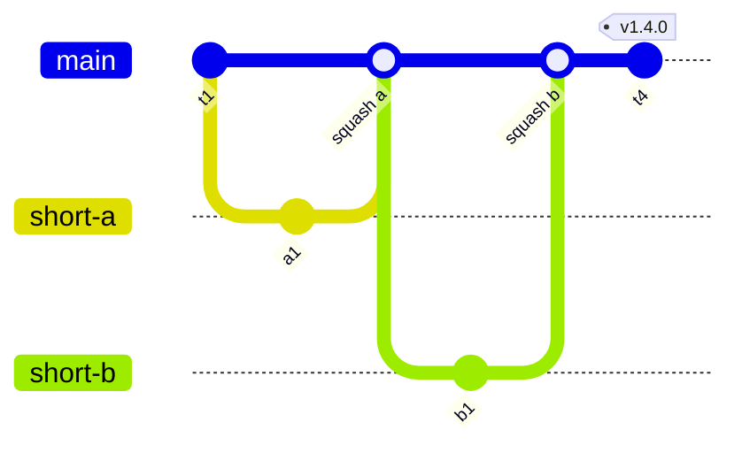

# Chapter 5. Trunk-Based Development

## The problem

Team ship chậm, mỗi lần release đều có "ngày merge địa ngục". Nguyên nhân thường không phải code khó mà là **tích hợp muộn**. Trunk-based development (TBD) đảo ngược: tích hợp liên tục vào một nhánh chung (trunk, tức `main`) với thay đổi nhỏ.

## Core rules

- Một trunk. Developer commit thẳng vào trunk (team nhỏ) hoặc qua **short-lived branch** sống tối đa vài giờ đến 1-2 ngày, merge vào trunk (team lớn hơn, qua PR).
- Trunk luôn xanh: CI nhanh, chạy trên mọi thay đổi, hỏng thì sửa hoặc revert ngay.
- Không có `develop`, không có feature branch dài hạn. Feature chưa xong vẫn merge được, nhưng bị **tắt** bằng feature flag.
- Release từ trunk (tag) hoặc từ release branch cắt tại một commit trên trunk khi cần.



## Supporting techniques

**Feature flag** (cờ tính năng): code mới nằm sau một điều kiện chạy lúc runtime, mặc định tắt. Cho phép merge sớm, deploy trước, bật dần cho một nhóm người dùng, tắt ngay khi có sự cố mà không cần rollback. Cách thiết kế flag, vòng đời và dọn flag xem cuốn "Triển khai an toàn" trong bộ sách này.

```ts
// TS: flag đọc từ config, mặc định tắt
if (flags.isEnabled("order-cancel-v2", { userId })) {
  return cancelOrderV2(order);
}
return cancelOrderV1(order);
```

```go
// Go: cùng ý tưởng
if flags.IsEnabled("order-cancel-v2", userID) {
    return cancelOrderV2(order)
}
return cancelOrderV1(order)
```

**Branch by abstraction**: thay một thành phần lớn (đổi thư viện, đổi DB layer) mà không cần nhánh dài. Các bước: (1) đặt một interface trước implementation cũ, (2) viết implementation mới sau interface đó, nằm cạnh cái cũ, (3) chuyển từng caller dần dần (có thể dùng flag), (4) xóa implementation cũ. Mỗi bước là một commit nhỏ vào trunk.

**Release from trunk**: tag một commit trên trunk để release. Nếu cần hotfix cho bản đã phát hành: cắt `release/1.4` từ tag đó, cherry-pick fix từ trunk (fix trunk trước), tag `v1.4.1` trên release branch. Release branch ở TBD là nhánh cắt muộn, ngắn hạn, không nhận feature.

**Squash merge**: mỗi PR một commit trên trunk; bisect và revert đơn giản.

## DORA metrics

Chương trình nghiên cứu DORA (sách *Accelerate* của Forsgren, Humble, Kim, và báo cáo State of DevOps hằng năm) đo hiệu quả delivery bằng bốn chỉ số: deployment frequency, lead time for changes, change failure rate, và time to restore service (các báo cáo gần đây gọi chỉ số này là failed deployment recovery time; chưa xác minh bản báo cáo cụ thể). Nghiên cứu liên kết trunk-based development, nhánh sống ngắn và CI với hiệu suất cao hơn. Đây là tương quan được báo cáo, không phải bảo đảm cho mọi team. Dùng các chỉ số này như đồng hồ để tự đo, đừng biến thành KPI so sánh cá nhân.

Cách đo từ git: lead time ≈ từ commit đầu của PR đến lúc deploy; PR size và tuổi của PR là chỉ số dẫn trước (leading indicator) dễ đo nhất.

## Conditions for TBD to work

| Điều kiện | Vì sao |
|---|---|
| CI nhanh (dưới ~10 phút) | commit nhỏ liên tục mà CI chậm thì hàng đợi tắc |
| Test tự động đủ tin cậy | không có `develop` làm vùng đệm |
| Feature flag hoặc kỹ thuật che code chưa xong | merge sớm nhưng không lộ |
| Review nhanh (PR nhỏ, SLA vài giờ) | nhánh sống ngắn |
| Văn hóa: trunk hỏng thì ưu tiên sửa | giữ trunk luôn release được |

## When it doesn't fit

- Team chưa có test và CI đáng tin; TBD sẽ làm `main` hỏng liên tục. Hãy xây CI trước.
- Sản phẩm phát hành theo version với nhiều bản hỗ trợ song song: vẫn dùng TBD cho nhánh chính và release branch cho bản cũ, nhưng cần quy trình cherry-pick (Chương 9).
- Open source nhận PR từ người lạ qua fork: nhánh của contributor không thể "ngắn hạn" theo ý bạn, nhưng workflow phía maintainer vẫn có thể là TBD.

## Lab (b)

`lab/scripts/b-trunk-based.sh`: nhiều short-lived branch, squash merge vào `main`, tag release từ trunk, in graph thật. Mỗi branch có hai commit "wip" nhưng trên trunk chỉ còn một commit:

```
* ef7483a (HEAD -> main) fix(orders): trim whitespace
* adeaf5b (tag: v1.3.0) feat(export): add export support
* f837399 feat(refund): add refund support
* 21cacf0 feat(cancel): add cancel support
* 3d468ff feat: initial orders module
--- tags
v1.3.0          Release 1.3.0 from trunk
```

So với Git Flow ở Chương 3, đồ thị là một đường thẳng; mỗi dòng là một đơn vị có thể revert hoặc bisect.

## Pitfalls

- Gọi là TBD nhưng nhánh sống một tuần.
- Feature flag không bao giờ bị xóa, tích tụ thành nợ.
- Merge code chưa xong mà không có flag, làm lộ tính năng dở.
- Không có quy tắc revert nhanh; trunk hỏng nhiều giờ.

## Summary

- TBD = tích hợp thường xuyên vào một trunk với thay đổi nhỏ, nhánh sống ngắn.
- Feature flag và branch by abstraction cho phép merge công việc chưa xong.
- Release bằng tag trên trunk; release branch chỉ cắt muộn khi cần hotfix.
- DORA gắn TBD với deployment frequency và lead time tốt hơn; cần CI nhanh và test tin cậy.

## Self-check questions

1. Short-lived branch là bao lâu?
2. Feature flag giúp gì khi merge code chưa hoàn thành?
3. Bốn chỉ số DORA là gì?
4. Branch by abstraction gồm những bước nào?

<details><summary>Answer</summary>

1. Vài giờ đến tối đa 1-2 ngày.
2. Code vào trunk nhưng bị tắt lúc runtime, nên chưa ảnh hưởng người dùng; bật dần hoặc tắt nhanh khi có sự cố.
3. Deployment frequency, lead time for changes, change failure rate, time to restore service.
4. Thêm abstraction, viết implementation mới cạnh cũ, chuyển caller dần, xóa implementation cũ.

</details>
