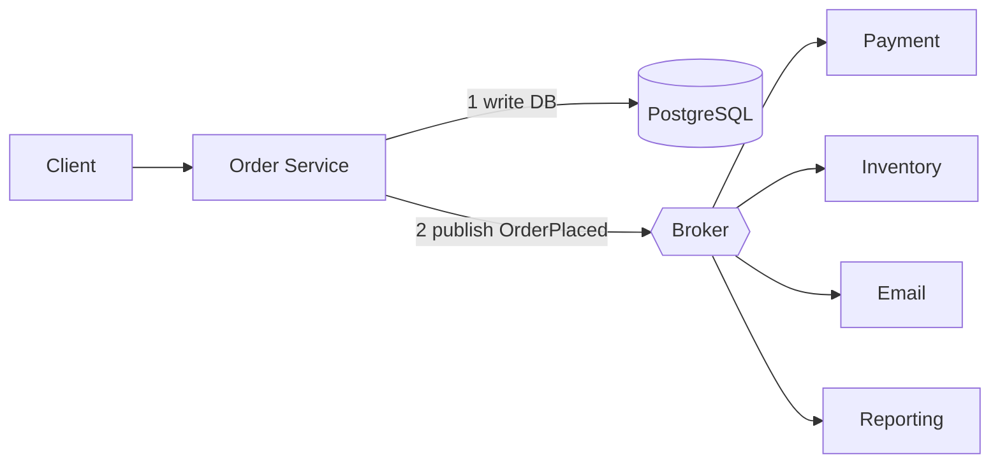

# Chương 1. Vì sao cần async: queue, log và pub/sub

## 1. Tình huống

Hệ thống đặt hàng (ví dụ xuyên suốt của cuốn này). Khi khách bấm "Đặt hàng", `POST /orders` phải làm: lưu đơn, trừ kho, tạo thanh toán, gửi email xác nhận, cập nhật báo cáo, báo cho đối tác vận chuyển. Nếu làm hết trong một request sync:

- Request chậm bằng **tổng** thời gian các bước; một service phụ (email) chết thì cả đơn hàng lỗi.
- Coupling: service Order phải biết và gọi trực tiếp 5 service khác. Thêm consumer thứ 6 nghĩa là sửa code Order.
- Load spike (flash sale) đổ thẳng vào các service phía sau, không có buffer.

Giải pháp: Order chỉ làm phần **bắt buộc** (lưu đơn), rồi phát một message (thông điệp) "đơn #123 đã tạo". Các bên quan tâm xử lý sau, theo tốc độ của họ.



## 2. Ba mô hình cần phân biệt

Nhiều người gọi tất cả là "message queue". Thực ra có ba mô hình khác nhau về bản chất:

| Mô hình | Message sau khi consume | Ai nhận | Ví dụ |
|---|---|---|---|
| **Queue** (work queue) | Bị **xóa** (ack xong là mất) | Mỗi message đến **một** consumer trong nhóm competing consumers | RabbitMQ classic/quorum queue, SQS, Kafka share group |
| **Pub/Sub** (publish/subscribe) | Fan-out: mỗi subscriber có **bản sao riêng** | Tất cả subscriber | SNS, RabbitMQ fanout/topic exchange, NATS subject, Redis Pub/Sub |
| **Log / stream** | **Giữ lại** theo retention, không xóa khi đọc | Mỗi consumer group tự giữ **offset** | Kafka, RabbitMQ Stream, Redis/Valkey Streams, NATS JetStream (retention limits) |

Khác biệt quan trọng nhất: với queue, broker nhớ "message nào đã xử lý" và xóa nó. Với log, broker chỉ ghi append-only; **consumer** nhớ vị trí đọc. Hệ quả của log:

- **Replay**: đọc lại từ offset cũ (sửa bug rồi chạy lại, dựng read model mới).
- Nhiều consumer group độc lập đọc cùng dữ liệu mà không ảnh hưởng nhau.
- Ordering được đảm bảo trong một partition.
- Đổi lại: không có "ack từng message" mặc định, khó làm retry/delay theo từng message, và parallelism bị giới hạn bởi số partition (xem chương 4). Đây chính là lý do Kafka thêm **share groups** (chương 2).

```
Queue:   [m1][m2][m3] --> consumer A takes m1 (deleted), B takes m2 (deleted) ...
Log:     [m1][m2][m3][m4]...   group X offset=3, group Y offset=1 (m1..m4 vẫn còn)
Pub/Sub: publish m1 --> copy goes to queue of A, queue of B, queue of C
```

Thực tế các sản phẩm lai nhau: SNS fan-out sang nhiều SQS queue (pub/sub + queue); RabbitMQ exchange (pub/sub) định tuyến vào queue.

## 3. Message, command, event

- **Command**: "hãy làm X" (`ReserveStock`). Gửi đến **một** nơi nhận cụ thể, người gửi mong có kết quả. Thường qua queue.
- **Event**: "X đã xảy ra" (`OrderPlaced`). Quá khứ, immutable, người gửi không biết ai nghe. Thường qua pub/sub hoặc log.

Chọn sai loại là nguồn gốc của nhiều thiết kế rối: một "event" tên `SendEmailEvent` thực chất là command ngụy trang.

## 4. Sync vs async: trade-off

Khi nào nên dùng messaging:
- Thao tác phụ không cần có kết quả ngay (email, báo cáo, sync search index).
- Cần load leveling hoặc fault isolation giữa các service.
- Nhiều bên cần phản ứng với cùng một event.

Khi nào KHÔNG:
- Cần phản hồi tức thì có kết quả (kiểm tra mã giảm giá để hiển thị) — gọi sync đơn giản hơn.
- Ứng dụng monolith nhỏ, một DB: một bảng `jobs` hoặc một thư viện job queue trong process (ví dụ pg-boss, River) đã đủ. Đừng dựng Kafka cho 50 request/phút.
- Đội chưa sẵn sàng vận hành: broker là một distributed system cần monitoring, và bạn đổi consistency tức thì lấy **eventual consistency** (nhất quán sau cùng).

Cái giá không thể tránh: delivery có thể **duplicate**, **out-of-order**, **chậm**. Phần còn lại của cuốn sách là cách sống chung với ba điều đó.

## 5. Cạm bẫy

- Coi broker như RPC: gửi message rồi `sleep` chờ kết quả. Nếu cần request/reply, dùng HTTP/gRPC.
- Ghi DB rồi publish ở hai bước riêng: crash giữa chừng thì mất event (chương 7 giải quyết).
- Tưởng "đã gửi lên broker" là "đã xử lý xong".
- Dùng một broker cho mọi thứ mà không hỏi: cần replay hay cần ack từng task?

## Tóm tắt

1. Messaging tách thời gian và coupling giữa các service, đổi lại bằng eventual consistency.
2. Queue xóa message sau ack; pub/sub fan-out; log giữ lại và consumer tự giữ offset.
3. Command gửi đến một nơi; event thông báo điều đã xảy ra.
4. Đừng dùng broker khi gọi sync hoặc một bảng jobs là đủ.

## Câu hỏi tự kiểm tra

1. Khác biệt cơ bản giữa queue và log về việc ai nhớ "đã đọc đến đâu"?
2. Vì sao log cho phép replay còn queue thì không?
3. `SendWelcomeEmail` nên là command hay event? Vì sao?
4. Nêu hai tình huống không nên dùng messaging.

<details><summary>Đáp án</summary>

1. Queue: broker nhớ và xóa message sau ack. Log: broker giữ dữ liệu theo retention; mỗi consumer group giữ offset của mình.
2. Log không xóa khi đọc nên chỉ cần đặt lại offset. Queue đã xóa message sau ack.
3. Command: nó yêu cầu một hành động cụ thể với một bên nhận. Event tương ứng là `UserRegistered`; service Email subscribe và tự quyết gửi mail.
4. Cần kết quả tức thì cho người dùng; ứng dụng nhỏ một DB nơi bảng jobs/queue của framework đã đủ.
</details>
