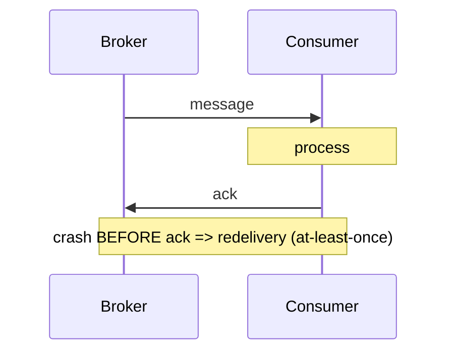

# Chapter 3. Delivery semantics: at-most-once, at-least-once, "exactly-once"

## 1. Scenario

Consumer nhận `OrderPlaced`, trừ kho, rồi crash trước khi gửi ack. Broker không biết đã trừ kho chưa. Nó chỉ có hai lựa chọn: redeliver (có thể trừ kho hai lần) hoặc bỏ qua (có thể không bao giờ trừ kho). Đó là toàn bộ vấn đề delivery semantics. Nguyên nhân gốc là network và process có thể hỏng ở bất kỳ điểm nào, và không thể phân biệt "chậm" với "chết" (bài toán Two Generals).

## 2. Three levels



| Mức | Cách làm | Hậu quả khi lỗi |
|---|---|---|
| **At-most-once** | ack/commit offset **trước** khi xử lý | Có thể **mất** message, không bao giờ **duplicate** |
| **At-least-once** | ack **sau** khi xử lý xong | Không mất, có thể **duplicate** |
| **Exactly-once** | at-least-once + dedup / transaction | Effect chỉ xảy ra một lần (trong phạm vi hẹp) |

Với Kafka consumer: `enable.auto.commit=true` có thể commit trước khi xử lý xong, hành vi khó đoán; thực hành an toàn là `enable.auto.commit=false` và `commitSync()` sau khi xử lý. Phía producer: lỗi mạng khiến producer gửi lại, có thể ghi duplicate — trừ khi bật idempotent producer.

## 3. What "exactly-once" really means

Không có exactly-once **delivery** trong distributed system. Cái tồn tại là exactly-once **processing/effect** trong một phạm vi xác định.

### Kafka
- **Idempotent producer** (`enable.idempotence=true`; mặc định bật từ Kafka 3.0): broker gán producer ID + sequence number theo partition, loại duplicate record do retry. Chỉ phạm vi một producer session và một partition.
- **Transactions** (`transactional.id`): atomic write nhiều partition/topic, kèm `sendOffsetsToTransaction` để commit input offset cùng transaction. Pattern **consume → process → produce** trong Kafka được exactly-once; consumer downstream đặt `isolation.level=read_committed`.
- **Giới hạn**: chỉ đúng khi *cả input và output đều là Kafka*. Ngay khi consumer gọi API thanh toán, ghi MySQL hoặc gửi email, bảo đảm này không còn. Kafka Streams có `processing.guarantee=exactly_once_v2` dựa trên cơ chế này.

### SQS FIFO
- `MessageDeduplicationId` (hoặc content-based dedup): trong **5 phút**, gửi lại cùng ID thì SQS không tạo message mới. Người ta gọi là "exactly-once processing" nhưng nó chỉ bảo vệ phía **gửi** trong cửa sổ 5 phút. Phía nhận vẫn at-least-once: nếu visibility timeout hết trước khi xóa message, message được redeliver.

### Practical conclusion
Effect ngoài hệ thống (DB riêng, email, tiền) cần **consumer idempotent** (chương 6). Công thức: **at-least-once delivery + idempotent processing = effectively-once**.

## 4. Code example (Go and TypeScript)

Consumer an toàn at-least-once: tắt auto-commit, commit offset **sau** khi xử lý (chương 6 sẽ thay phần xử lý bằng bản idempotent). Các đoạn dưới trích nguyên văn từ code đã chạy trong lab.

**Go** (`franz-go`, trích từ `lab/go/main.go`; chương 6 có toàn bộ phần xử lý):

```go
cl, err := kgo.NewClient(
	kgo.SeedBrokers(env("KAFKA_BROKERS", "bookcheck-msg-kafka:9092")),
	kgo.ConsumerGroup(env("GROUP", "g-go")),
	kgo.ConsumeTopics("orders"),
	kgo.ConsumeResetOffset(kgo.NewOffset().AtStart()),
	kgo.DisableAutoCommit(),
	kgo.RequiredAcks(kgo.AllISRAcks()), // idempotent producer là mặc định của franz-go
)
```

```go
// commit offset SAU khi xử lý (đảo thứ tự này = at-most-once)
if err := cl.CommitRecords(ctx, r); err != nil {
	log.Fatalf("commit: %v", err)
}
```

**TypeScript** (`@confluentinc/kafka-javascript`, trích từ `lab/ts/src/consumer.ts`; chỉ đã chạy `tsc --noEmit`, chưa chạy với broker):

```ts
const consumer = kafka.consumer({
  kafkaJS: { groupId: "g-ts", fromBeginning: true, autoCommit: false },
});
await consumer.connect();
await consumer.subscribe({ topics: ["orders"] });
await consumer.run({
  eachMessage: async ({ topic, partition, message }) => {
    const e = JSON.parse(message.value!.toString()) as Envelope;
    await handleOrderPlaced(e); // có thể chạy lại, nhờ inbox nên an toàn
    // commit offset SAU khi xử lý (đảo thứ tự = at-most-once)
    await consumer.commitOffsets([
      { topic, partition, offset: String(Number(message.offset) + 1) },
    ]);
  },
});
```

Đảo thứ tự xử lý và commit là at-most-once. Lưu ý về thư viện (kiểm tra 11/2026): KafkaJS không còn được maintain (bản 2.2.4, không hỗ trợ KIP-848), nên lab dùng client của Confluent dựa trên librdkafka, API tương thích KafkaJS. Bản Go dùng `franz-go`, thuần Go, không cần cgo.

## 5. Trade-offs
- At-most-once chấp nhận được cho metric/log không quan trọng.
- At-least-once là mặc định hợp lý cho nghiệp vụ, cần idempotency.
- Transaction của Kafka tốn throughput và độ phức tạp; chỉ dùng khi pipeline Kafka-to-Kafka (stream processing). Đừng dùng nó để "giải quyết" việc ghi DB.

## 6. Pitfalls
- Tin nhãn "exactly-once" trên tài liệu sản phẩm mà không đọc phạm vi.
- Commit offset trong thread khác/batch trước khi xử lý xong.
- Xử lý lâu hơn visibility timeout (SQS) / `max.poll.interval.ms` (Kafka) → bị coi là chết, redeliver và rebalance.
- Consumer xử lý xong nhưng ack thất bại → duplicate; luôn thiết kế cho trường hợp này.

## Summary
1. Ack trước xử lý = at-most-once; ack sau = at-least-once.
2. Exactly-once delivery không tồn tại; chỉ có exactly-once effect trong phạm vi hẹp.
3. Kafka EOS chỉ đúng khi input và output đều là Kafka; SQS FIFO chỉ dedup phía gửi trong 5 phút.
4. Thực tế: at-least-once + consumer idempotent.

## Self-check questions
1. Commit offset trước hay sau khi xử lý để tránh mất message?
2. Idempotent producer của Kafka chống loại duplicate nào, và không chống loại nào?
3. Vì sao Kafka transaction không cứu được việc gọi API thanh toán hai lần?
4. SQS FIFO dedup có bảo vệ khi consumer xử lý chậm quá visibility timeout không?

<details><summary>Answer</summary>

1. Sau (at-least-once); chấp nhận duplicate.
2. Chống duplicate do producer retry trong một session/partition; không chống duplicate do consumer xử lý lại hoặc do hai producer khác nhau gửi cùng nội dung.
3. Transaction chỉ bao phủ ghi vào Kafka và offset; API ngoài không tham gia transaction.
4. Không; dedup chỉ ở phía gửi. Message hiện lại sau visibility timeout và bị xử lý lần nữa.
</details>
