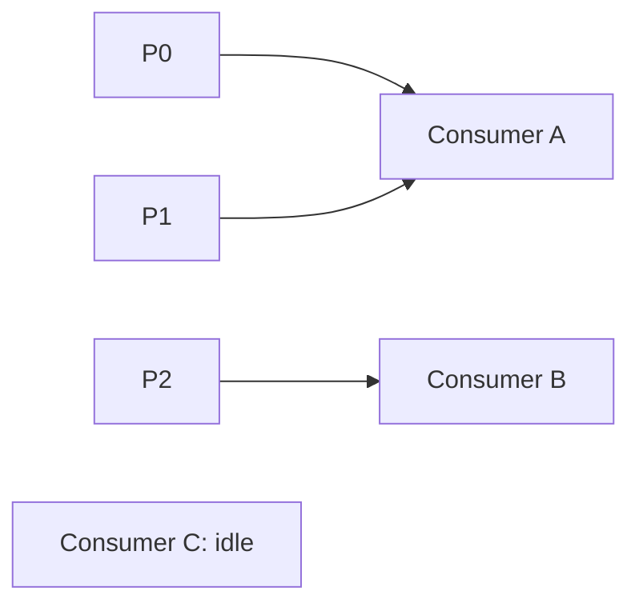

# Chương 4. Ordering, partition, consumer group và rebalancing

## 1. Tình huống

Đơn #123 phát ba event: `OrderPlaced`, `OrderPaid`, `OrderCancelled`. Nếu consumer xử lý `OrderCancelled` trước `OrderPlaced` thì read model sai. Cần ordering, nhưng ordering toàn cục (global order) không scale. Giải pháp thực tế là **ordering theo key**: mọi event của cùng một đơn hàng đi theo cùng một đường.

## 2. Partition và key (Kafka)

Topic chia thành N **partition**, mỗi partition là một ordered log. Producer chọn partition bằng `hash(key) % N` (partitioner mặc định, murmur2). Cùng key → cùng partition → ordering được giữ.

```
topic orders (3 partition)
 P0: [o-7 placed][o-7 paid]...
 P1: [o-123 placed][o-123 paid][o-123 cancelled]
 P2: [o-9 placed]...
```

Chọn key:
- Key = **aggregate id** (`order_id`): giữ ordering cho từng đơn, phân bố tốt nếu có nhiều đơn.
- Key = `customer_id` khi cần ordering giữa các đơn của một khách; coi chừng **hot key** (một khách chiếm 40% traffic → một partition quá tải).
- Không key: round-robin, không có ordering, phân bố đều.
- **Đổi số partition** làm đổi `hash % N`, key cũ chuyển partition, mất ordering trong giai đoạn chuyển. Hãy chọn dư partition từ đầu (số partition chỉ tăng được, không giảm).

Ordering phía producer: cần `enable.idempotence=true` để retry không xáo trộn ordering (với `max.in.flight.requests.per.connection <= 5`).

## 3. Consumer group

Các consumer cùng `group.id` chia partition: mỗi partition thuộc **tối đa một** consumer trong group tại một thời điểm.



- Trần parallelism = số partition. Thêm consumer thứ 4 vào topic 3 partition thì nó ngồi chơi.
- Group khác nhau đọc độc lập, mỗi group có offset riêng (pub/sub trên log).
- Ordering chỉ được đảm bảo **trong partition**, không giữa các partition.
- Offset được lưu trong topic nội bộ `__consumer_offsets`.

Kafka 4.0 đã đưa **rebalance protocol mới (KIP-848)** làm mặc định phía broker cho consumer group: coordinator tính assignment, rebalance tăng dần, không còn "stop-the-world" toàn group như protocol cũ. Client cần hỗ trợ (`group.protocol=consumer` ở Java client).

## 4. Rebalancing

Khi consumer vào/ra (deploy, crash, scale), partition được phân lại. Với protocol cũ (eager), toàn bộ consumer dừng, trả partition rồi nhận lại. Hệ quả: dừng xử lý, và message đang xử lý dở có thể bị xử lý lại bởi consumer mới (đây là lý do cần idempotent).

Giảm đau:
- Giữ `session.timeout.ms` và `max.poll.interval.ms` phù hợp với thời gian xử lý thật; xử lý một batch lâu hơn `max.poll.interval.ms` thì bị đá khỏi group.
- `group.instance.id` (static membership): consumer restart nhanh không gây rebalance.
- Cooperative assignor / protocol mới KIP-848.
- Xử lý nhanh, đẩy việc nặng sang thread/queue khác nhưng đừng commit offset trước khi xong.

## 5. So sánh với queue

- **RabbitMQ**: ordering theo queue chỉ giữ khi **một** consumer; nhiều consumer + redelivery làm lệch ordering. Muốn ordering theo key dùng *Single Active Consumer* hoặc **consistent-hash exchange** (plugin), hoặc Stream/super stream.
- **SQS FIFO**: `MessageGroupId` tương đương key; các group chạy parallel, trong group tuần tự.
- **Kafka share group**: bỏ giới hạn partition, đổi lại không còn ordering.

## 6. Trade-off và cạm bẫy

- Cần ordering nghiêm ngặt theo key và parallelism cao: nhiều partition + key tốt. Cần parallelism cao hơn số partition và không cần ordering: share group hoặc queue.
- Cạm bẫy: key null "vô tình"; key có phân bố lệch; tăng partition giữa chừng; xử lý parallel trong consumer bằng thread pool làm hỏng ordering mà không hay; producer retry không bật idempotence làm đảo ordering.
- Event "không phụ thuộc ordering" nên được thiết kế để chịu được out-of-order (version number, `updated_at`, bỏ qua event cũ hơn trạng thái hiện có).

## Tóm tắt
1. Ordering chỉ có theo partition; dùng key (thường là aggregate id) để giữ ordering theo entity.
2. Một partition tối đa một consumer trong group; số partition là trần parallelism.
3. Rebalance gây dừng và xử lý lại; KIP-848 (mặc định từ Kafka 4.0) giảm tác động.
4. Hot key và đổi số partition là hai nguồn failure phổ biến.

## Câu hỏi tự kiểm tra
1. Topic 6 partition, group 10 consumer: bao nhiêu consumer thực sự làm việc?
2. Vì sao chọn `customer_id` làm key có thể nguy hiểm?
3. Tăng partition từ 6 lên 12 ảnh hưởng gì đến ordering?
4. Static membership giải quyết vấn đề gì?

<details><summary>Đáp án</summary>

1. 6; 4 consumer còn lại nhàn rỗi.
2. Khách lớn tạo hot key: một partition bị quá tải trong khi các partition khác rảnh.
3. `hash(key) % N` đổi, key cũ có thể sang partition khác: event mới và cũ của cùng key nằm ở hai partition, mất ordering tạm thời.
4. Restart consumer nhanh không kích hoạt rebalance vì member identity được giữ.
</details>
