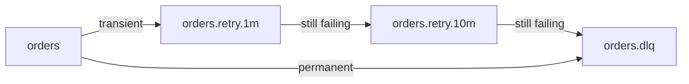

# Chapter 5. Retry, backoff, DLQ, poison messages, and backpressure

## 1. Scenario

Consumer xử lý `OrderPlaced` bằng cách gọi API kho. API kho trả 503 trong 2 phút. Consumer retry ngay lập tức hàng nghìn lần/giây, làm API kho chết hẳn. Hoặc: một message có JSON hỏng, consumer ném exception, nhận lại ngay, ném lại... mãi mãi, chặn cả partition phía sau. Hai vấn đề này (transient error và permanent error) cần hai cách xử lý khác nhau.

## 2. Classifying failures

| Loại | Ví dụ | Cách xử lý |
|---|---|---|
| **Transient** | timeout, 503, deadlock DB | Retry có backoff |
| **Permanent** | JSON sai schema, thiếu field, vi phạm nghiệp vụ | Không retry; đưa vào DLQ |
| **Poison message** | message luôn làm consumer crash/ném lỗi | Giới hạn số lần, rồi DLQ |

Việc đầu tiên của mọi consumer: phân loại exception thành retryable hay không.

## 3. Backoff

Retry cố định gây "thundering herd". Dùng **exponential backoff + jitter** (ngẫu nhiên hóa):

```
delay = min(cap, base * 2^attempt) * random(0.5 .. 1.0)
vd base=1s, cap=60s: ~1s, 2s, 4s, 8s, ... 60s
```

Giới hạn số lần (ví dụ 5) hoặc tổng thời gian. Quá giới hạn → DLQ.

## 4. Dead-letter queue (DLQ)

DLQ là nơi đặt message không xử lý được, kèm metadata để điều tra: lỗi gì, lần thử thứ mấy, topic/partition/offset gốc, thời điểm. Nó không phải thùng rác: cần **alert khi DLQ có message** và quy trình xử lý (sửa bug rồi **redrive**: đẩy lại về queue gốc).

Cách thực hiện theo sản phẩm:
- **RabbitMQ**: `x-dead-letter-exchange` trên queue; quorum queue hỗ trợ `x-delivery-limit` (số lần redeliver tối đa trước khi dead-letter). Delayed retry thường dùng queue chờ với TTL rồi dead-letter ngược lại.
- **SQS**: `RedrivePolicy` với `maxReceiveCount`; có redrive từ DLQ về source queue (console/API).
- **Kafka consumer group**: không có sẵn cho từng message; **tự làm** bằng topic `orders.retry` và `orders.dlq`, hoặc dùng framework (Spring Kafka có `DeadLetterPublishingRecoverer`; Kafka Connect có `errors.deadletterqueue.topic.name`). Với **share group**, broker đếm delivery attempts và có `REJECT`/`RELEASE` từng record, giảm bớt việc tự làm.
- **Job queue trong ứng dụng**: cấu hình số lần thử (max attempts), backoff và bảng failed jobs có sẵn ở hầu hết thư viện (ví dụ BullMQ cho Node.js, River cho Go).

Mẫu retry topic trên Kafka (không chặn partition chính):



Lưu ý: chuyển sang retry topic làm **mất ordering** so với các message sau của cùng key. Nếu ordering quan trọng, chặn partition-key đó (block and retry) hoặc để consumer idempotent chịu được out-of-order.

## 5. Backpressure

Consumer chậm hơn producer thì backlog tăng. Cách xử lý:
- **Pull model** (Kafka, SQS, JetStream pull): consumer tự quyết lấy bao nhiêu (`max.poll.records`, `prefetch`). Backpressure tự nhiên.
- **Push model** (RabbitMQ): đặt `prefetch` (QoS) hợp lý, ví dụ 10–50, để broker không đẩy quá nhiều message chưa ack vào một consumer.
- Rate limit khi gọi service phụ thuộc; dùng **circuit breaker**: khi API kho lỗi liên tục, tạm dừng consumer (`pause()` trong Kafka) thay vì đốt retry.
- Autoscale consumer theo **lag** (chương 11), trong giới hạn số partition.
- Phía producer: broker đầy thì `max.block.ms`/lỗi; RabbitMQ có flow control và memory/disk alarm.

## 6. Lab example

Lab (chương 12) mô phỏng: đơn có `total_cents` âm bị consumer coi là permanent error → chuyển sang topic `orders.dlq` kèm lý do; đơn của khách "flaky" lỗi transient 2 lần rồi retry với backoff 1s, 2s. Xem output thật ở `lab/RESULTS.md`.

## 7. Trade-offs and pitfalls
- Retry nhiều layer (client HTTP retry 3 lần × consumer retry 5 lần × broker redelivery) nhân lên thành retry storm. Chỉ retry ở **một** layer.
- DLQ không ai nhìn là mất dữ liệu có hệ thống.
- Retry vô hạn không backoff chặn partition (head-of-line blocking).
- Sửa schema làm hàng loạt message "poison": DLQ đầy → sửa code → redrive.
- Retry cần idempotent: lần thử trước có thể đã thành công một phần.

## Summary
1. Phân loại lỗi: transient → retry có backoff + jitter; permanent → DLQ ngay.
2. Giới hạn số lần retry; poison message phải rời queue chính.
3. DLQ cần alert và quy trình redrive.
4. Backpressure: pull + prefetch + circuit breaker + autoscale theo lag.

## Self-check questions
1. Vì sao cần jitter?
2. Dùng retry topic trong Kafka có ảnh hưởng gì đến ordering?
3. `x-delivery-limit` của quorum queue để làm gì?
4. Nêu hai cách tạo backpressure cho consumer RabbitMQ/Kafka.

<details><summary>Answer</summary>

1. Tránh nhiều consumer retry cùng một thời điểm (thundering herd).
2. Message chuyển sang retry topic bị xử lý sau các message sau của cùng key: mất ordering.
3. Giới hạn số lần redeliver một message trước khi dead-letter, chặn poison message.
4. RabbitMQ `prefetch`; Kafka `max.poll.records`/`pause()`; hoặc circuit breaker, autoscale theo lag.
</details>
