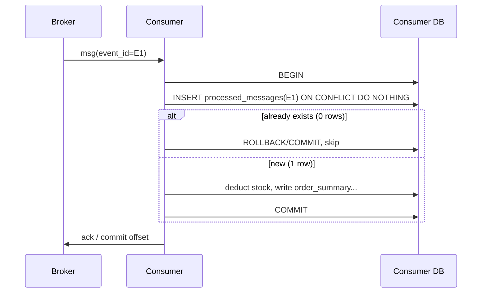

# Chương 6. Idempotent consumer và inbox pattern

## 1. Tình huống

Chương 3 kết luận: at-least-once nghĩa là duplicate sẽ xảy ra. Duplicate khi nào? Consumer crash trước ack; rebalance; publisher outbox gửi lại (chương 7); bạn tự redrive từ DLQ; replay có chủ đích. Nếu `OrderPlaced #123` trừ kho hai lần thì khách mất hàng. Consumer phải **idempotent**: xử lý N lần cho cùng kết quả như một lần.

## 2. Hai hướng

**Idempotent tự nhiên** (ưu tiên nếu có thể): thao tác tự an toàn khi lặp.
- `UPDATE orders SET status='PAID' WHERE id=? ` (gán, không cộng dồn).
- `INSERT ... ON CONFLICT DO NOTHING` / `UPSERT`.
- Ngược lại: `UPDATE stock SET qty = qty - 1` **không** idempotent.
- Dùng version/sequence: chỉ áp dụng nếu `event.version > row.version`.

**Inbox pattern** (khi thao tác không tự idempotent): ghi lại ID message đã xử lý trong **cùng transaction DB** với business effect.

```sql
CREATE TABLE processed_messages (
  message_id   text PRIMARY KEY,      -- event_id duy nhất do producer sinh
  consumer     text NOT NULL,         -- tên consumer, vì mỗi consumer có inbox riêng
  processed_at timestamptz NOT NULL DEFAULT now()
);
```



Điểm mấu chốt: dòng inbox và business effect **cùng một transaction**. Nếu tách, crash giữa hai bước tái tạo đúng lỗi cần tránh. Crash sau COMMIT nhưng trước ack: message được redeliver, `INSERT` thấy duplicate primary key, bỏ qua, ack lại. Đúng.

Cách viết trong PostgreSQL (dùng trong lab):

```sql
BEGIN;
WITH ins AS (
  INSERT INTO processed_messages(message_id, consumer)
  VALUES ('E1', 'inventory') ON CONFLICT DO NOTHING RETURNING 1
)
UPDATE stock SET qty = qty - 1
WHERE sku = 'SKU-1' AND EXISTS (SELECT 1 FROM ins);
COMMIT;
```

Primary key trên `message_id` biến race condition giữa hai consumer xử lý duplicate cùng lúc thành an toàn: một bên INSERT thành công, bên kia đợi rồi gặp conflict.

## 3. Message ID lấy ở đâu

- Producer sinh **event_id** (UUID) lúc tạo event và lưu trong outbox. Đây là ID ổn định qua mọi lần gửi lại.
- **Không** dùng `topic-partition-offset` làm ID nếu có thể publish lại cùng event (publisher gửi duplicate sẽ có offset mới). Offset chỉ ổn định cho replay trên cùng log.
- Với message từ bên thứ ba, dùng ID của họ hoặc hash nội dung (khi thật cần).

Trong Go, bảng `processed_messages` + transaction của `pgx` + `ON CONFLICT DO NOTHING`. Trích nguyên văn từ `lab/go/main.go` (đã chạy thật, xem `lab/RESULTS.md`):

```go
// reserve ghi inbox và ledger trong CÙNG một transaction. Trả về true nếu là message mới.
func reserve(ctx context.Context, conn *pgx.Conn, e envelope) (bool, error) {
	tx, err := conn.Begin(ctx)
	if err != nil {
		return false, err
	}
	defer tx.Rollback(ctx) // no-op sau Commit

	tag, err := tx.Exec(ctx,
		`INSERT INTO processed_messages(message_id, consumer) VALUES ($1, 'inventory')
		 ON CONFLICT DO NOTHING`, e.EventID)
	if err != nil {
		return false, err
	}
	if tag.RowsAffected() == 0 { // duplicate: inbox đã có
		return false, tx.Commit(ctx)
	}
	if _, err = tx.Exec(ctx,
		`INSERT INTO ledger(order_id, reserved_cents) VALUES ($1, $2)`,
		e.Payload.OrderID, e.Payload.TotalCents); err != nil {
		return false, err
	}
	return true, tx.Commit(ctx)
}
```

Trong TypeScript với `pg` (trích từ `lab/ts/src/consumer.ts`; chỉ đã chạy `tsc --noEmit`):

```ts
export async function handleOrderPlaced(e: Envelope): Promise<boolean> {
  const client = await pool.connect();
  try {
    await client.query("BEGIN");
    const ins = await client.query(
      "INSERT INTO processed_messages(message_id, consumer) VALUES ($1,'inventory') ON CONFLICT DO NOTHING",
      [e.event_id],
    );
    if (ins.rowCount === 0) { // duplicate
      await client.query("COMMIT");
      return false;
    }
    await client.query("INSERT INTO ledger(order_id, reserved_cents) VALUES ($1,$2)", [
      e.payload.order_id, e.payload.total_cents,
    ]);
    await client.query("COMMIT");
    return true;
  } catch (err) {
    await client.query("ROLLBACK");
    throw err;
  } finally {
    client.release();
  }
}
```

## 4. Dọn dẹp và hiệu năng

Bảng inbox lớn dần. Cách xử lý: xóa record cũ hơn duplicate window tối đa có thể (retention của broker + thời gian redrive, ví dụ 14 ngày), hoặc partition bảng theo thời gian. Lưu ý: xóa quá sớm → bản duplicate đến muộn được xử lý lần nữa.

## 5. Trade-off và cạm bẫy
- Inbox chỉ bảo vệ effect **trong cùng DB**. Gọi API ngoài (thanh toán) thì truyền **idempotency key** (ví dụ `Idempotency-Key` của Stripe) trong request.
- Dedup bằng cache Redis `SETNX` tách khỏi transaction DB: có khe hở (set xong, crash trước khi ghi DB → message bị coi là đã xử lý nhưng chưa).
- Idempotent không đồng nghĩa đúng ordering: `OrderCancelled` đến trước `OrderPlaced` vẫn cần xử lý riêng.
- ID inbox phải theo từng consumer: nếu hai consumer dùng chung một bảng và chung `message_id`, consumer thứ hai sẽ bị chặn sai (trong lab dùng primary key theo từng DB riêng của consumer; khi dùng chung DB, đặt primary key `(consumer, message_id)`).

## Tóm tắt
1. At-least-once bắt buộc consumer idempotent.
2. Ưu tiên thao tác idempotent tự nhiên (gán, upsert); không được thì dùng inbox.
3. Inbox: INSERT message_id và business effect trong cùng transaction.
4. Event ID do producer sinh, ổn định qua các lần gửi lại; dọn inbox theo retention window.

## Câu hỏi tự kiểm tra
1. `UPDATE stock SET qty = qty - 1` có idempotent không? Làm sao sửa?
2. Vì sao dòng inbox và thay đổi nghiệp vụ phải cùng transaction?
3. Vì sao offset không phải ID dedup tốt khi có outbox publisher gửi lại?
4. Làm sao đảm bảo idempotent khi consumer gọi API thanh toán ngoài?

<details><summary>Đáp án</summary>

1. Không. Dùng inbox, hoặc đặt state tuyệt đối/kiểm tra version.
2. Nếu tách, crash giữa hai bước dẫn đến bị bỏ sót hoặc làm hai lần.
3. Gửi lại tạo record mới với offset mới dù là cùng event; event_id do producer sinh thì giữ nguyên.
4. Truyền idempotency key ổn định (ví dụ event_id) cho API đó.
</details>
