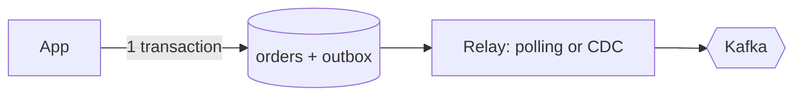
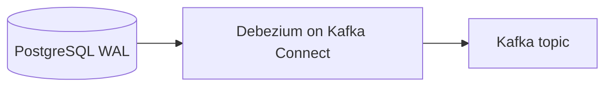

# Chapter 7. Transactional outbox: polling publisher and CDC

## 1. Scenario: dual write

```ts
// TS, trích từ lab/ts/src/outbox.ts (placeOrderDualWrite)
const { rows } = await pool.query(
  "INSERT INTO orders(customer_id,total_cents) VALUES ($1,$2) RETURNING id",
  [customerId, totalCents],
); // 1. write DB
await publish("orders", String(rows[0].id), {
  order_id: rows[0].id, customer_id: customerId, total_cents: totalCents,
}); // 2. publish
```

Crash giữa 1 và 2: đơn có trong DB nhưng không ai biết. Đảo thứ tự: publish xong, DB rollback thì event nói về đơn không tồn tại. Không thể bao hai hệ thống (DB và broker) trong một transaction tử tế (2PC hiếm khi khả thi). Đây là **dual-write problem**.

## 2. Outbox

Ghi event vào **bảng `outbox` trong cùng DB và cùng transaction** với dữ liệu nghiệp vụ. Một process khác (relay) đọc outbox và đẩy lên broker.



Bảng dùng xuyên suốt (khớp với lab):

```sql
CREATE TABLE orders (
  id          bigserial PRIMARY KEY,
  customer_id text NOT NULL,
  total_cents bigint NOT NULL,
  status      text NOT NULL DEFAULT 'PLACED',
  created_at  timestamptz NOT NULL DEFAULT now()
);
CREATE TABLE outbox (
  id           bigserial PRIMARY KEY,
  event_id     uuid NOT NULL DEFAULT gen_random_uuid(),
  aggregate_id text NOT NULL,            -- dùng làm Kafka key
  event_type   text NOT NULL,            -- 'OrderPlaced'
  payload      jsonb NOT NULL,
  created_at   timestamptz NOT NULL DEFAULT now(),
  published_at timestamptz               -- NULL = chưa gửi
);
CREATE INDEX outbox_unpublished ON outbox (id) WHERE published_at IS NULL;
```

Ghi:

```sql
BEGIN;
INSERT INTO orders(customer_id,total_cents) VALUES ('c1', 25000) RETURNING id; -- giả sử 1
INSERT INTO outbox(aggregate_id,event_type,payload)
VALUES ('1','OrderPlaced','{"order_id":1,"customer_id":"c1","total_cents":25000}');
COMMIT;
```

Hoặc cả hai cùng lúc rollback. Event tồn tại **khi và chỉ khi** đơn tồn tại.

Cùng thao tác đó trong ứng dụng Go (trích nguyên văn từ `lab/go/outbox.go`, đã chạy thật, xem `lab/RESULTS.md`):

```go
func placeOrderWithOutbox(ctx context.Context, conn *pgx.Conn, customerID string, totalCents int64) (int64, error) {
	tx, err := conn.Begin(ctx)
	if err != nil {
		return 0, err
	}
	defer tx.Rollback(ctx) // no-op sau Commit

	var id int64
	err = tx.QueryRow(ctx,
		`INSERT INTO orders(customer_id, total_cents) VALUES ($1, $2) RETURNING id`,
		customerID, totalCents).Scan(&id)
	if err != nil {
		return 0, err
	}
	_, err = tx.Exec(ctx,
		`INSERT INTO outbox(aggregate_id, event_type, payload)
		 VALUES ($1, 'OrderPlaced',
		         jsonb_build_object('order_id', $2::bigint, 'customer_id', $3::text, 'total_cents', $4::bigint))`,
		strconv.FormatInt(id, 10), id, customerID, totalCents)
	if err != nil {
		return 0, err
	}
	return id, tx.Commit(ctx)
}
```

Và bằng TypeScript với `pg` (trích từ `lab/ts/src/outbox.ts`; chỉ đã chạy `tsc --noEmit`):

```ts
const client = await pool.connect();
try {
  await client.query("BEGIN");
  const { rows } = await client.query(
    "INSERT INTO orders(customer_id,total_cents) VALUES ($1,$2) RETURNING id",
    [customerId, totalCents],
  );
  const id: number = rows[0].id;
  await client.query(
    "INSERT INTO outbox(aggregate_id,event_type,payload) VALUES ($1,'OrderPlaced',$2)",
    [String(id), JSON.stringify({ order_id: id, customer_id: customerId, total_cents: totalCents })],
  );
  await client.query("COMMIT");
  return id;
} catch (e) {
  await client.query("ROLLBACK");
  throw e;
} finally {
  client.release();
}
```

## 3. Relay type 1: polling publisher

Vòng lặp: chọn các dòng chưa gửi theo thứ tự `id`, publish, đánh dấu đã gửi.

```sql
SELECT id, event_id, aggregate_id, event_type, payload
FROM outbox WHERE published_at IS NULL
ORDER BY id LIMIT 100
FOR UPDATE SKIP LOCKED;
```

`FOR UPDATE SKIP LOCKED` cho phép chạy nhiều relay parallel mà không giẫm nhau (MySQL 8+ cũng hỗ trợ). Sau khi broker xác nhận, `UPDATE outbox SET published_at=now() WHERE id = ANY(...)`.

**Vì sao vẫn là at-least-once**: nếu relay publish xong mà crash trước `UPDATE`, lần chạy sau gửi lại. Vì vậy consumer phải idempotent (chương 6), dùng `event_id` làm khóa dedup.

Lưu ý ordering: `bigserial` cấp ID khi INSERT, không phải khi COMMIT. Transaction A (id=5) commit sau transaction B (id=6) thì relay có thể thấy 6 trước 5 và, nếu đánh dấu theo "id lớn nhất đã gửi", bỏ sót 5. Cách an toàn: chọn theo flag `published_at IS NULL`, không theo cursor id lớn nhất. Ordering giữa các aggregate khác nhau không đảm bảo (nhưng cùng aggregate thì thường đủ nếu ghi tuần tự).

Ưu: đơn giản, chỉ cần SQL và một script. Nhược: latency bằng polling interval, read load lên DB, bảng cần dọn (xóa dòng đã gửi cũ).

## 4. Relay type 2: CDC with Debezium

**CDC (change data capture)**: đọc transaction log của DB (WAL của PostgreSQL qua logical replication slot, binlog của MySQL) và biến thay đổi thành event, không cần query bảng.



Debezium có **Outbox Event Router** (SMT): đọc dòng INSERT vào bảng outbox, lấy `aggregate_id` làm key, `payload` làm value, route theo `aggregate type` vào topic tương ứng. Sau đó có thể xóa dòng ngay (Debezium chỉ cần thấy INSERT trong log).

Ưu: latency thấp (mili-giây), không polling, ordering theo commit order trong WAL, không cần cột `published_at`. Nhược: thêm hạ tầng (Kafka Connect, replication slot); slot không được tiêu thụ làm **WAL phình đầy disk**; cấu hình DB (`wal_level=logical`); cũng at-least-once (Debezium gửi lại sau restart). Chi tiết cấu hình: xem docs của Debezium (chưa chạy trong lab này).

## 5. Comparison

| | Polling publisher | CDC (Debezium) |
|---|---|---|
| Hạ tầng thêm | 1 script/service | Connect + Debezium + cấu hình DB |
| Latency | Polling interval | Rất thấp |
| DB load | Query định kỳ | Đọc WAL |
| Ordering | Theo id/flag; có khe hở như trên | Theo commit order |
| Rủi ro | Bảng phình, trễ | WAL đầy nếu connector chết |
| Nên dùng khi | Quy mô vừa, ít hạ tầng | Volume lớn, đã có Kafka Connect |

Khởi đầu bằng polling; chuyển CDC khi latency hoặc load thành vấn đề thực sự.

## 6. When you do NOT need an outbox
- Event chỉ để log/metric, mất vài cái chấp nhận được.
- Chỉ publish, không ghi DB (không có dual write).
- Event Sourcing: event store chính là nguồn (chương 10), vẫn cần cơ chế publish nhưng không cần bảng outbox riêng.

## 7. Pitfalls
- Publish trong `afterCommit` hook rồi coi là xong: vẫn mất event khi crash giữa commit và publish.
- Quên idempotent ở consumer.
- Không dọn outbox: bảng hàng trăm triệu dòng, polling chậm dần.
- Payload outbox chứa dữ liệu nhạy cảm sống lâu trong bảng.
- Một relay duy nhất làm bottleneck: dùng `SKIP LOCKED` hoặc partition theo aggregate nếu cần scale, nhưng chú ý ordering.

## Summary
1. Dual write không thể atomic; outbox đưa event vào cùng transaction DB.
2. Relay đẩy event sang broker: polling (đơn giản) hoặc CDC (latency thấp, nhiều hạ tầng).
3. Cả hai đều at-least-once → consumer idempotent bắt buộc.
4. `FOR UPDATE SKIP LOCKED` cho nhiều relay; coi chừng thứ tự ID khác commit order.

## Self-check questions
1. Tại sao ghi DB rồi publish không an toàn dù đặt trong try/catch?
2. Vì sao outbox vẫn có thể gửi duplicate?
3. Nhược điểm vận hành lớn nhất của Debezium với PostgreSQL là gì?
4. Vì sao không nên theo dõi "id lớn nhất đã gửi" khi polling?

<details><summary>Answer</summary>

1. Process có thể chết giữa hai bước; try/catch không chạy.
2. Relay publish xong rồi crash trước khi đánh dấu published_at.
3. Replication slot không được tiêu thụ khiến WAL tích lũy đầy disk.
4. ID cấp lúc INSERT, không phải lúc COMMIT; transaction commit muộn có ID nhỏ hơn bị bỏ sót.
</details>
