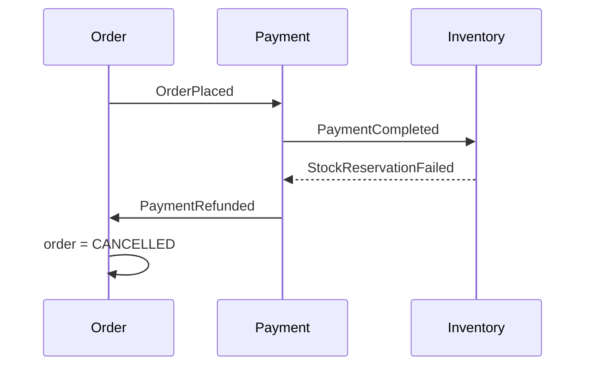
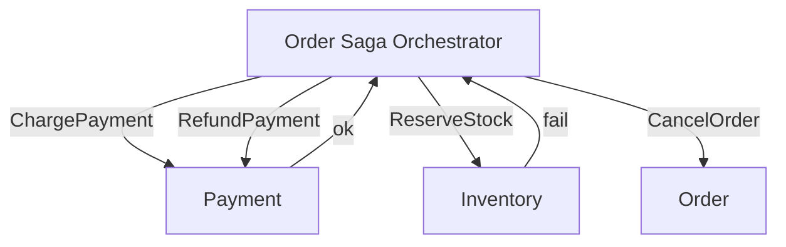

# Chapter 8. Saga: choreography, orchestration, compensation

## 1. Scenario

Đặt hàng cần ba bước ở ba service có DB riêng: Order tạo đơn, Payment trừ tiền, Inventory giữ hàng. Không có transaction ACID xuyên service (2PC không phù hợp distributed system hiện đại: lock kéo dài, coordinator là single point of failure). Nếu Payment thành công mà Inventory hết hàng thì sao? Phải **hoàn tiền**. Đó là **saga**: một chuỗi **local transaction**, mỗi bước có **compensating transaction** (giao dịch bù) để hoàn tác về mặt nghiệp vụ khi bước sau thất bại.

## 2. Two styles

### Choreography
Không có người điều phối; mỗi service lắng nghe event và phát event tiếp theo.



Ưu: đơn giản với 2–3 bước, không có điểm trung tâm, loose coupling. Nhược: luồng nghiệp vụ nằm rải rác, khó thấy toàn cảnh, khó debug, dễ có circular dependency giữa service khi quy trình phức tạp.

### Orchestration
Một **orchestrator** (service hoặc workflow engine) gửi command cho từng service và quyết định bước tiếp theo, kể cả bù.



Ưu: luồng nằm một chỗ, dễ đọc, test và theo dõi state, xử lý timeout tập trung. Nhược: orchestrator có logic, cần durable (lưu state), có nguy cơ thành "god service".

Quy tắc chọn: ≤3 bước, ít nhánh → choreography; quy trình dài, nhiều nhánh/timeout/bù → orchestration.

## 3. Compensation: principles

- Bù **không phải rollback**: dữ liệu trung gian đã bị người khác nhìn thấy (đơn đã báo "đã thanh toán" một lúc). Saga thiếu tính **isolation** (chữ I của ACID). Bù bằng business transaction mới (hoàn tiền, không xóa record thanh toán).
- Thiết kế bước theo thứ tự: bước **khó bù hoặc không thể bù** (gửi email, giao hàng, trừ tiền thật) đặt **sau cùng**; bước dễ bù (giữ chỗ, "pending") đặt trước. Dùng semantic state: `PENDING` → `CONFIRMED`/`CANCELLED` thay vì ghi kết quả cuối ngay.
- Bù phải **idempotent** và **luôn có thể thực hiện lại** (retry đến khi thành công); các message của saga là at-least-once nên forward step cũng idempotent (chương 6).
- Mỗi bước vừa cập nhật DB vừa phát event/command phải dùng **outbox** (chương 7); nếu không saga đứng giữa chừng.
- Cần **correlation id** (saga id) xuyên suốt và timeout: bước im lặng quá hạn → bù.
- Lỗi nghiệp vụ (hết hàng) kích hoạt bù; lỗi kỹ thuật (503) thì retry (chương 5). Đừng bù vì transient error.

Counter-measures chống thiếu isolation: semantic lock (flag `PENDING`), commutative update, đọc lại giá trị trước khi quyết định, đặt bước rủi ro ở cuối.

## 4. Workflow engines (overview)

Tự viết orchestrator nghĩa là tự viết bảng state, timer, retry, log, dashboard. **Workflow engine** làm sẵn điều đó. Ví dụ **Temporal** (open source): bạn viết workflow như code thường (Go/Java/TypeScript/Python SDK...), engine **lưu event history** và có thể **replay** để restore state sau crash; mỗi bước gọi ra ngoài là một *activity* với retry/timeout cấu hình. Sleep dài ngày, chờ signal từ bên ngoài, bù khi lỗi đều là cú pháp ngôn ngữ thường (`try/catch` + danh sách compensation). Các lựa chọn khác: Camunda/Zeebe (BPMN), AWS Step Functions, Netflix Conductor. Giá phải trả: thêm hạ tầng cốt lõi cần vận hành, ràng buộc workflow phải deterministic (không gọi ngẫu nhiên/thời gian trực tiếp trong code workflow). Chưa chạy thử trong lab này; xem docs Temporal để biết chi tiết hiện hành.

```
// pseudocode kiểu Temporal
placeOrder(order):
  compensations = []
  try:
    charge(order);      compensations.push(refund)
    reserveStock(order); compensations.push(releaseStock)
    ship(order)
  catch e:
    for c in reverse(compensations): c(order)   // activity có retry
    cancel(order)
```

## 5. When NOT to use a saga
- Mọi dữ liệu nằm trong một DB: dùng transaction thường. Gộp service lại tốt hơn saga nếu hai service luôn đổi cùng nhau.
- Khi cần strong consistency tức thì (số dư chuyển giữa hai tài khoản trong cùng ngân hàng core).

## 6. Pitfalls
- Quên bù cho một nhánh lỗi, hoặc bù không idempotent (hoàn tiền hai lần).
- Saga không có timeout: treo mãi ở `PENDING`.
- Choreography scale đến 8 service: không ai hiểu luồng.
- Orchestrator giữ state trong memory.
- Nhầm saga với transaction ACID: người dùng thấy state trung gian, UI phải xử lý.

## Summary
1. Saga = chuỗi local transaction + bù; không có isolation.
2. Choreography cho quy trình ngắn; orchestration cho dài, nhiều nhánh.
3. Bước khó bù đặt cuối; mọi bước và bù đều idempotent và dùng outbox.
4. Workflow engine (Temporal...) lo state, retry, timer, đổi lại thêm hạ tầng.

## Self-check questions
1. Vì sao compensation khác rollback?
2. Nên đặt bước "gửi email xác nhận" ở đầu hay cuối saga?
3. Khi nào chọn orchestration thay vì choreography?
4. Vì sao saga vẫn cần outbox?

<details><summary>Answer</summary>

1. Local transaction đã commit và người khác có thể đã thấy; bù là business transaction mới (hoàn tiền), không xóa quá khứ.
2. Cuối, vì khó hoàn tác.
3. Nhiều bước, nhiều nhánh, timeout, cần nhìn toàn cảnh và theo dõi state.
4. Mỗi bước phải cập nhật DB và phát event atomically; nếu không saga đứng giữa chừng khi crash.
</details>
