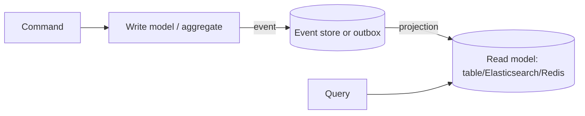

# Chương 10. Event sourcing và CQRS: khi nào dùng, khi nào KHÔNG

## 1. Tình huống

Một hệ thống tài chính cần biết số dư tại **bất kỳ thời điểm nào trong quá khứ** và vì sao nó thay đổi. Bảng `accounts.balance` chỉ giữ state hiện tại; mọi lịch sử là cột `updated_at` và log rời rạc. Event sourcing đảo ngược: lịch sử là source of truth, state hiện tại là thứ **suy ra**.

Đừng nhầm: **dùng event để giao tiếp** (cả cuốn này) khác hẳn **event sourcing** (lưu event làm source of truth). Bạn có thể có event-driven mà không event sourcing, và đa số hệ thống nên như vậy.

## 2. Event sourcing (ES)

Thay vì UPDATE row, append các event của aggregate vào **event store**:

```
stream "account-77":
 v1 AccountOpened{owner:"An"}
 v2 MoneyDeposited{amount:500}
 v3 MoneyWithdrawn{amount:120}
 => state: balance = 380 (fold/replay các event)
```

```sql
CREATE TABLE events (
  stream_id text NOT NULL,
  version   int  NOT NULL,
  type      text NOT NULL,
  data      jsonb NOT NULL,
  occurred_at timestamptz NOT NULL DEFAULT now(),
  PRIMARY KEY (stream_id, version)      -- optimistic concurrency
);
```

Primary key `(stream_id, version)` cho **optimistic concurrency**: hai lệnh đồng thời cùng ghi version 4 thì một bên thất bại và phải thử lại. Tải aggregate = đọc mọi event của stream và áp dụng tuần tự. Với stream dài dùng **snapshot** (lưu state định kỳ, replay từ snapshot).

Lợi ích: audit đầy đủ, "time travel", dựng được read model mới bằng cách replay, ghi đơn giản (chỉ append), khớp tự nhiên với DDD aggregate và domain event.

Cái giá (thường bị đánh giá thấp):
- **Event là vĩnh viễn**: sai schema thì sống chung nhiều năm; cần upcasting (chương 9).
- Query cần read model riêng (thực tế bắt buộc đi cùng CQRS).
- Eventual consistency giữa ghi và read model.
- Sửa dữ liệu sai = ghi compensating event, không UPDATE; xóa dữ liệu cá nhân (GDPR) rất khó.
- Đường cong học tập và công cụ ít hơn CRUD; debug khó hơn với người mới.

## 3. CQRS

**Command Query Responsibility Segregation**: tách **write model** (command) khỏi **read model** (query). Mức nhẹ nhất chỉ là hai tập class/endpoint khác nhau trên cùng một DB; mức nặng là DB đọc riêng, cập nhật async từ event.



**Projection** là consumer biến event thành read model (idempotent theo chương 6; lưu version đã áp dụng). Muốn đổi read model: xóa, replay từ đầu.

Lợi ích: read model tối ưu cho từng màn hình, scale đọc độc lập. Cái giá: hai mô hình, latency cập nhật (người dùng ghi xong, trang danh sách chưa thấy: "read-your-writes" cần xử lý), nhiều component.

## 4. Khi nào dùng, khi nào KHÔNG

Nên cân nhắc ES khi:
- Lịch sử/audit là yêu cầu nghiệp vụ cốt lõi (tài chính, kế toán, tuân thủ), không chỉ "ghi log".
- Domain vốn dạng chuỗi event, cần query "state tại thời điểm T".
- Cần dựng nhiều view khác nhau từ cùng dữ liệu, hoặc phân tích hành vi.

Nên cân nhắc CQRS (không ES) khi:
- Read/write load chênh lệch rất lớn, hoặc read model phức tạp (báo cáo, search) làm méo write model.

**KHÔNG dùng khi:**
- CRUD đơn giản, quản trị, form-over-data (đa số ứng dụng CRUD thông thường).
- Đội chưa quen với eventual consistency và vận hành broker.
- Bạn chỉ muốn "có event để các service khác nghe": dùng **outbox** (chương 7), không cần ES.
- Cần read-after-write consistency trên mọi màn hình.
- Áp dụng ES/CQRS cho toàn hệ thống: chỉ áp dụng cho **bounded context** thật sự được lợi (core domain), phần còn lại CRUD.

Lối đi tăng dần: CRUD + outbox → thêm read model riêng cho vài màn hình nặng (CQRS nhẹ) → ES chỉ cho aggregate cần lịch sử.

## 5. Cạm bẫy
- Dùng event store như message broker (và ngược lại: dùng Kafka làm event store chính; được nhưng cần retention vô hạn, compaction không phù hợp, kiểm soát concurrency khó). Kafka phù hợp để *phân phối* event; event store cần conditional write theo version (PostgreSQL hoặc EventStoreDB/KurrentDB...).
- Event mang tên CRUD (`CustomerUpdated`) làm mất giá trị lịch sử có nghĩa.
- Replay chậm vì không có snapshot; replay gây side effect (gửi email lại) vì projection không tách khỏi hành động.
- Bắt đầu với ES "cho đẹp".

## Tóm tắt
1. ES lưu event làm source of truth, state là kết quả replay; CQRS tách write model/read model.
2. Hai cái độc lập: dùng CQRS không bắt buộc ES; ES thực tế cần read model.
3. Cái giá: event vĩnh viễn, eventual consistency, khó xóa/sửa, tăng độ phức tạp.
4. Mặc định dùng CRUD + outbox; ES/CQRS chỉ cho phần domain thật sự cần.

## Câu hỏi tự kiểm tra
1. Event-driven và event sourcing khác nhau thế nào?
2. Primary key `(stream_id, version)` giải quyết điều gì?
3. Nêu ba tình huống không nên dùng ES.
4. Vì sao projection phải idempotent và replay được?

<details><summary>Đáp án</summary>

1. Event-driven: dùng event để giao tiếp. Event sourcing: lưu event làm source of truth.
2. Optimistic concurrency: ghi đồng thời cùng version thì một bên thất bại.
3. CRUD đơn giản; đội chưa sẵn sàng với eventual consistency; chỉ cần phát event cho service khác (dùng outbox).
4. Event có thể redeliver (at-least-once) và read model có thể được dựng lại từ đầu khi đổi cấu trúc.
</details>
