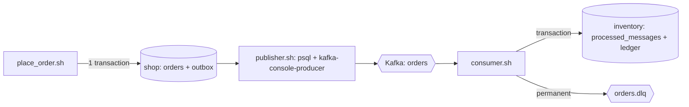

# Chương 12. Lab: outbox, duplicate publish, inbox, retry và DLQ

Chương này đi qua lab trong thư mục `lab/` và dẫn ra output thật đã chạy (Kafka 4.3.1 KRaft, PostgreSQL 18, 08/11/2026). Log đầy đủ nằm ở `lab/RESULTS.md`.

## 1. Vấn đề

Ghép các chương 3 đến 7: order và event phải atomic write (outbox); publisher có thể gửi duplicate (at-least-once); consumer phải dedup (inbox); transient error thì retry, permanent error thì DLQ.

## 2. Kiến trúc lab



- Hai container: `bookcheck-msg-kafka` (`apache/kafka`, KRaft, `mem_limit 1g`) và `bookcheck-msg-pg`; network `bookcheck-msg-net`; không map port.
- Phần chính không cài thư viện nào: publisher và consumer là shell script dùng `psql` và CLI của Kafka qua `docker exec`, nhờ vậy nhìn rõ cơ chế mà không bị framework che. Phần cuối chương thêm consumer Go (`lab/go/`) và code TypeScript (`lab/ts/`), chạy trong container, không cài gì lên host.
- Schema (`lab/sql/init.sql`) khớp chương 6 và 7: `orders`, `outbox` ở DB `shop`; `processed_messages`, `ledger`, `ledger_naive` ở DB `inventory`.

## 3. Chạy lại

```bash
cd lab
docker compose up -d
sh scripts/setup.sh                       # tạo topic orders, orders.dlq (3 partition)
sh scripts/place_order.sh c1 25000
sh scripts/place_order.sh c2 4000
sh scripts/place_order.sh flaky 9900      # consumer sẽ gặp transient error 2 lần
sh scripts/place_order.sh c3 -500         # permanent error -> DLQ
CRASH_BEFORE_MARK=1 sh scripts/publisher.sh   # publish rồi "crash" trước khi đánh dấu
sh scripts/publisher.sh                   # chạy lại: gửi duplicate cả 4 event, lần này đánh dấu
sh scripts/consumer.sh naive g-naive 8    # không dedup
sh scripts/consumer.sh inbox g-inbox 8    # có inbox
docker compose down -v                    # dọn dẹp
```

Trên Windows dùng Git Bash (script đã đặt `MSYS_NO_PATHCONV=1`). Mọi lệnh `docker exec` trong script đều bọc `timeout`, consumer luôn có `--max-messages` và `--timeout-ms`. Lưu ý: topic cần tạo trước khi chạy publisher, `setup.sh` làm việc đó. Nếu `sh` không thực thi được script, dùng `bash scripts/<tên>.sh`.

## 4. Kết quả thật

**Outbox và duplicate publish.** Publisher lần 1 publish id 1,2,3,4 rồi "crash"; lần 2 publish lại đúng 4 event rồi đánh dấu; lần 3 báo không còn gì. Offset cuối của topic `orders` là 2 + 2 + 4 = 8 message cho 4 event.

**Naive và inbox** trên cùng 8 message:

```
   t   | order_id | count
-------+----------+-------
 inbox |        1 |     1
 inbox |        2 |     1
 inbox |        3 |     1
 naive |        1 |     2
 naive |        2 |     2
 naive |        3 |     2
```

Consumer naive ghi mỗi đơn hai lần (nếu đây là trừ kho, khách mất gấp đôi). Consumer inbox in `TRÙNG, bỏ qua` cho bản gửi lại; `processed_messages` có đúng 3 dòng.

**Consumer idempotent bằng Go.** `lab/go/main.go` (franz-go + pgx) làm đúng việc của `consumer.sh inbox`: đọc topic từ đầu bằng group mới, manual commit sau khi xử lý, inbox + ledger trong cùng transaction, retry với backoff cho khách `flaky`, permanent error sang `orders.dlq`. Chạy sau khi `TRUNCATE ledger, processed_messages`, container `golang:latest` nằm trong `bookcheck-msg-net`:

```
[75d5cf7d-...] order=1 xử lý MỚI (lần thử 1)
[75d5cf7d-...] order=1 TRÙNG, bỏ qua (inbox đã có)
...
[f6f9cb4e-...] order=3 xử lý MỚI (lần thử 3)
[f6f9cb4e-...] order=3 TRÙNG, bỏ qua (inbox đã có)
đã đọc 8 message
```

`ledger` có đúng 1 dòng cho mỗi order 1, 2, 3 và `processed_messages` = 3, y hệt bản shell. `lab/go/outbox.go` ghi order và outbox trong một transaction (đã chạy thật, xem `lab/RESULTS.md`). Code TypeScript trong `lab/ts/` chỉ qua `tsc --noEmit`, chưa chạy với broker.

Cách chạy bản Go (từ thư mục `lab/`, sau khi `docker compose up -d` và `setup.sh`; thêm `MSYS_NO_PATHCONV=1` trên Git Bash):

```bash
docker run --rm --network bookcheck-msg-net -v "$PWD/go:/app" golang:latest sh /app/run.sh
```

**Retry.** Đơn của khách `flaky` lỗi 2 lần: `lần 1: lỗi tạm thời (503), chờ 1s`, `lần 2 ... chờ 2s`, thành công ở lần thử 3.

**DLQ.** Đơn có `total_cents=-500` vào `orders.dlq` kèm lý do và message gốc.

## 5. Điều lab dạy thêm (từ lỗi thật)

1. Vòng `while read` mà bên trong gọi `docker exec -i` sẽ **nuốt stdin** của vòng lặp: mất message mà không có lỗi. Đã sửa bằng `</dev/null`.
2. Bản gửi duplicate của message poison cũng vào DLQ hai lần: DLQ cũng cần dedup theo `event_id`.
3. Client chạy ngoài container Kafka (Go, TS) cần `KAFKA_ADVERTISED_LISTENERS` trỏ theo tên container, nếu không broker trả metadata `localhost:9092` và client không kết nối lại được.
4. Naive chỉ minh họa việc ghi ledger bị nhân đôi; trong thực tế mọi side effect đều bị nhân đôi.

## 6. Giới hạn của lab
- Một publisher, không `FOR UPDATE SKIP LOCKED`; một node Kafka (không kiểm tra replication/failover).
- Retry chạy ngay trong vòng consumer (blocking) với backoff không jitter, không dùng retry topic.
- Debezium, RabbitMQ, share group: chưa chạy thử.
- Parse JSON bằng `sed`: chỉ đủ cho lab.

## Tóm tắt
1. Outbox ghi order và event trong một transaction; publisher gửi lại sau crash nên có duplicate.
2. Inbox (`processed_messages` + business effect cùng transaction) chặn duplicate; naive thì không.
3. Retry cho transient error, DLQ cho permanent error, đều thấy rõ trong output.

## Câu hỏi tự kiểm tra
1. Vì sao tổng offset là 8 chứ không phải 4?
2. Nếu bỏ `ON CONFLICT DO NOTHING`, điều gì xảy ra với bản duplicate?
3. Vì sao phải alert khi `orders.dlq` có message?

<details><summary>Đáp án</summary>

1. Publisher "crash" trước khi đánh dấu nên lần chạy sau gửi lại cả 4 event.
2. INSERT vi phạm primary key, transaction lỗi: message không ack được và bị redeliver mãi (thành poison). Cần bắt lỗi duplicate key hoặc dùng `ON CONFLICT`.
3. DLQ có message nghĩa là có dữ liệu chưa xử lý; không ai nhìn thì mất dữ liệu âm thầm.
</details>
