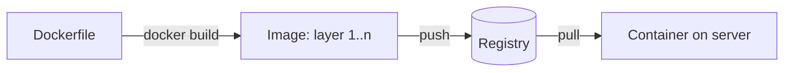

# Chapter 1. Container Basics for Developers

## 1. The problem

"Chạy được trên máy tôi" là câu quen thuộc. Server production có runtime khác phiên bản (Go, Node.js), thiếu thư viện hệ thống, khác cấu hình. Container giải quyết bằng cách đóng gói ứng dụng cùng môi trường chạy thành một **image** (khuôn bất biến), rồi chạy image đó ở mọi nơi. Nhưng một image viết ẩu cũng gây hại: nặng cả trăm MB không cần thiết, chạy bằng root, chứa secret, build chậm. Chương này nói về cách viết image đúng.

## 2. Concepts

- **Image**: tập các **layer** (lớp) chỉ đọc, xếp chồng. Mỗi lệnh `RUN`, `COPY`, `ADD` trong Dockerfile tạo một layer.
- **Container**: một process chạy từ image, thêm một writable layer mỏng bên trên.
- **Registry**: nơi lưu image (Docker Hub, GHCR, ECR...).
- **Tag** (như `8.5-cli-alpine3.23`) là nhãn có thể bị trỏ sang image khác. **Digest** (`sha256:...`) là hash nội dung, không đổi.



### Build cache

Docker dùng lại layer nếu lệnh và nội dung đầu vào không đổi. Nếu một layer thay đổi, mọi layer sau nó phải build lại. Do đó **đặt thứ ít đổi lên trước**: copy `go.mod`/`go.sum` hoặc `package.json`/`package-lock.json` và cài dependency trước, copy mã nguồn sau.

```dockerfile
COPY package.json package-lock.json ./
RUN npm ci --omit=dev
COPY . .          # mã nguồn đổi thường xuyên, nằm sau
```

### Multi-stage build

Dùng nhiều `FROM` trong một Dockerfile. Stage đầu có công cụ build (Go toolchain, `tsc`), stage cuối chỉ chép kết quả cần thiết. Công cụ build không nằm trong image cuối.

### Non-root user

Mặc định process trong container chạy bằng root. Nếu kẻ tấn công thoát được khỏi ứng dụng, họ có quyền root trong container (và nếu cấu hình sai thì rộng hơn). Tạo user riêng với UID cố định và dùng `USER`. UID số (như `65532` hoặc `1000`) giúp Kubernetes kiểm tra `runAsNonRoot`.

### Minimal images, pinned versions

- Dùng biến thể `-alpine` hoặc `-slim`. Lưu ý Alpine dùng musl libc, vài package native (Node) hoặc binary dùng cgo (Go) có thể khác hành vi so với Debian (glibc).
- Không dùng `latest`. Pin theo tag cụ thể (`golang:1.27-alpine`, `node:26-slim`), và với production nghiêm túc, pin cả digest: `FROM node:26-slim@sha256:...`. Đổi lại bạn phải có bot (Renovate, Dependabot) cập nhật digest.

### `.dockerignore`

File này loại bỏ thứ không được gửi vào build context: `.git`, `.env`, `vendor`, `node_modules`, log. Lợi ích: build nhanh hơn, cache ổn định hơn, và quan trọng là **không vô tình chép `.env` chứa secret vào image**.

### Healthcheck

`HEALTHCHECK` cho Docker biết ứng dụng còn sống thật không, không chỉ là process còn chạy. Trạng thái: `starting`, `healthy`, `unhealthy`. Docker Compose có thể dùng `depends_on: condition: service_healthy`. Kubernetes bỏ qua `HEALTHCHECK` của Docker và dùng probe riêng (chương 8).

## 3. Lab run

Hai ứng dụng nhỏ có endpoint `/healthz` và graceful shutdown: một service Go trong `lab/go-app/` và một service Node.js/TypeScript trong `lab/node-app/` (chi tiết ở chương 2). Dockerfile multi-stage cho Go (`lab/go-app/Dockerfile`):

```dockerfile
FROM golang:1.27-alpine AS build
WORKDIR /src
ARG APP_VERSION=dev
COPY go.mod ./
RUN --mount=type=cache,target=/go/pkg/mod go mod download
COPY . .
RUN --mount=type=cache,target=/go/pkg/mod \
    --mount=type=cache,target=/root/.cache/go-build \
    CGO_ENABLED=0 go build -trimpath -ldflags "-s -w -X main.version=${APP_VERSION}" -o /out/app .

FROM gcr.io/distroless/static-debian13:nonroot AS runtime
COPY --from=build /out/app /app
USER 65532:65532
EXPOSE 8080
HEALTHCHECK --interval=10s --timeout=3s --start-period=5s --retries=3 \
  CMD ["/app", "-healthcheck"]
ENTRYPOINT ["/app"]
```

Kết quả thật (Docker 29.8.1, Go 1.27.3, Node.js 26.13.0, hadolint 2.15.1):

| Kiểm tra | Kết quả |
|---|---|
| `hadolint` hai Dockerfile (Go và Node) | pass, exit 0 (Node lần đầu có DL3066 vì `USER node`, đã sửa sang `USER 1000:1000`) |
| Image Go multi-stage (`distroless/static`) | **17 MB** |
| Image Node multi-stage (`node:26-slim`) | **353 MB** |
| Image "ngây thơ" Go (`FROM golang:1.27`, build trong image) | **1,44 GB** |
| Image "ngây thơ" Node (`FROM node:26`, `npm install`, `npm start`) | **1,85 GB** |
| Trạng thái sau ~20 giây | `healthy` cả hai |
| User trong container | Go uid 65532, Node uid 1000 |
| `GET /healthz` (Go) | `{"go":"go1.27.3","status":"ok","uid":65532,"version":"1.0"}` |
| `GET /healthz` (Node) | `{"status":"ok","version":"1.0","node":"v26.13.0","uid":1000}` |

Với Go, phần tiết kiệm đến từ việc bỏ toàn bộ toolchain (compiler, module cache) và dùng base distroless; image cuối chỉ còn binary tĩnh cộng vài MB base. Với Node, runtime vẫn phải có mặt nên chênh lệch nhỏ hơn: multi-stage bỏ `typescript`, `@types/*` và source, còn phần lớn 353 MB là chính `node:26-slim`.

Dockerfile cố tình tệ (`lab/bad/Dockerfile` cho Go, `lab/bad/Dockerfile.node` cho Node) bị hadolint bắt: `DL3007` (dùng `latest`), `DL3008` (không pin apt), `DL3009`, `DL3015` (apt không dọn, không `--no-install-recommends`), `DL3003` (dùng `cd` thay vì `WORKDIR`); bản Node còn thêm `DL3025` (`CMD` dạng shell).

Chạy lại:

```bash
docker run --rm -i hadolint/hadolint:latest-alpine < lab/go-app/Dockerfile
docker build -t bookcheck-deploygo-go:1.0 --build-arg APP_VERSION=1.0 lab/go-app
docker build -t bookcheck-deploygo-node:1.0 --build-arg APP_VERSION=1.0 lab/node-app
```

## 4. Trade-offs

- Alpine nhỏ nhưng musl có thể gây lỗi lạ (ví dụ package native của Node, `iconv`, DNS). Nếu gặp, thử `-slim` (Debian).
- Distroless/scratch nhỏ hơn và ít attack surface, nhưng không có shell để debug. Rất hợp với Go (binary tĩnh); với Node có distroless nodejs nhưng phổ biến ít hơn `-slim`.
- Pin digest an toàn và reproducible, nhưng bạn không tự nhận security patch nếu không có tự động cập nhật.

## 5. Pitfalls

1. `COPY . .` rồi mới cài dependency: mỗi lần sửa một dòng code là cài lại toàn bộ.
2. Ghi secret bằng `ENV` hoặc `ARG`: nằm vĩnh viễn trong lịch sử layer (`docker history`). Xóa ở layer sau không xóa được khỏi layer trước.
3. Quên `.dockerignore`, nên `.env` hoặc `.git` lọt vào image.
4. Chạy bằng root vì "cho nhanh". Ghi vào thư mục không có quyền thì dùng `--chown` hoặc volume, đừng đổi lại sang root.
5. Healthcheck quá nhẹ (chỉ kiểm tra port mở) hoặc quá nặng (gọi DB, làm sập app khi DB chậm).

## 6. Summary

- Image là các layer immutable; thứ ít đổi đặt trước để tận dụng cache.
- Multi-stage loại công cụ build khỏi image chạy.
- Chạy bằng user không phải root (UID số), pin phiên bản, có `.dockerignore`.
- `HEALTHCHECK` kiểm tra ứng dụng sống thật; Kubernetes dùng probe riêng.

## 7. Self-check

1. Vì sao nên copy `go.mod` hoặc `package-lock.json` trước khi copy toàn bộ mã nguồn?
2. Xóa file secret ở layer sau có làm secret biến mất khỏi image không?
3. Khác nhau giữa tag và digest?
4. Vì sao nên dùng UID số trong `USER`?

<details><summary>Answer</summary>

1. Layer cài dependency chỉ bị invalidate khi `go.mod` hoặc `package-lock.json` đổi, nên sửa code không buộc cài lại.
2. Không. Layer cũ vẫn chứa file; ai có image đều trích ra được.
3. Tag là nhãn có thể trỏ lại sang nội dung khác; digest là hash nội dung, cố định.
4. Kubernetes `runAsNonRoot` không thể verify user tên chữ ánh xạ về UID nào nếu image chưa đặt UID số; UID số cũng nhất quán khi mount volume.

</details>
