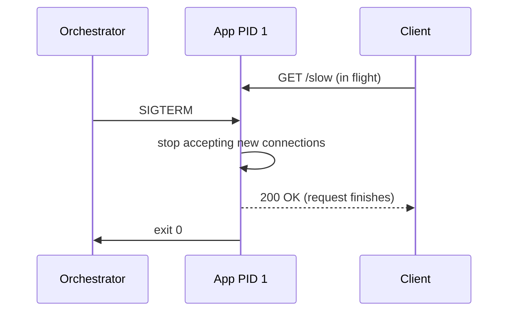

# Chapter 2. Production Dockerfiles for Go and Node.js, Configuration and Secrets

## 1. The problem

Ở chương 1 ta đã có nguyên tắc: multi-stage, user non-root, pin tag, healthcheck. Production còn đòi hỏi thêm ba thứ:

1. Image **nhỏ và ít attack surface**: không mang compiler, package manager hay shell nếu không cần.
2. **Tắt đúng cách**: khi deploy, orchestrator gửi `SIGTERM`; process phải ngừng nhận request mới, làm nốt request đang chạy rồi thoát. Nếu không, mỗi lần deploy là một đợt request bị cắt ngang.
3. Cấu hình và secret đến lúc chạy, không nằm trong image.

Phiên bản tại thời điểm viết (11/2026), đã chạy thật trong lab: Go 1.27.3, Node.js 26.13.0 (LTS; `node:lts-slim` trỏ tới bản này), TypeScript 7.0.2 (`tsc` vẫn là lệnh build).

## 2. Concepts

### Dockerfile for Go

Go biên dịch ra một binary tĩnh, nên image cuối gần như chỉ cần binary. File thật: `lab/go-app/Dockerfile`.

```dockerfile
# syntax=docker/dockerfile:1
FROM golang:1.27-alpine AS build
WORKDIR /src
ARG APP_VERSION=dev
COPY go.mod ./
RUN --mount=type=cache,target=/go/pkg/mod go mod download
COPY . .
RUN --mount=type=cache,target=/go/pkg/mod \
    --mount=type=cache,target=/root/.cache/go-build \
    CGO_ENABLED=0 go build -trimpath -ldflags "-s -w -X main.version=${APP_VERSION}" -o /out/app .

FROM gcr.io/distroless/static-debian13:nonroot AS runtime
COPY --from=build /out/app /app
USER 65532:65532
EXPOSE 8080
HEALTHCHECK --interval=10s --timeout=3s --start-period=5s --retries=3 \
  CMD ["/app", "-healthcheck"]
ENTRYPOINT ["/app"]
```

Từng lựa chọn:

- `CGO_ENABLED=0`: binary không phụ thuộc libc, chạy được trên `static`/`scratch`. Nếu bật cgo (ví dụ driver cần C), binary link động với glibc và image `static` sẽ không chạy.
- `-trimpath`: bỏ đường dẫn tuyệt đối của máy build khỏi binary (build tái lập được, không lộ đường dẫn).
- `-ldflags "-s -w"`: bỏ symbol table và DWARF debug info, binary nhỏ hơn. Đổi lại stack trace vẫn đọc được nhưng không debug được bằng debugger. `-X main.version=...` gắn phiên bản lúc build.
- `--mount=type=cache`: BuildKit giữ module cache (`/go/pkg/mod`) và build cache (`/root/.cache/go-build`) giữa các lần build mà không đưa vào layer của image. Trên CI, cache này chỉ tồn tại trên cùng builder; xem chương 4.
- `HEALTHCHECK`: image không có shell hay `curl`, nên binary tự có cờ `-healthcheck` (xem `lab/go-app/main.go`). Kubernetes không dùng `HEALTHCHECK` của Docker mà dùng probe trong manifest (chương 8).

**`distroless/static` hay `scratch`?**

| | `gcr.io/distroless/static:nonroot` | `scratch` |
|---|---|---|
| CA certificate | Có (gọi HTTPS ra ngoài được) | Không; phải `COPY` từ stage build |
| tzdata | Có | Không; cần `COPY` hoặc `import _ "time/tzdata"` |
| `/etc/passwd`, user nonroot (65532) | Có | Không; phải tự tạo hoặc chỉ dùng `USER 65532` |
| Shell để debug | Không | Không |
| Kích thước | vài MB | 0 |
| Metadata để scanner nhận diện OS | Có | Không (scan ít thông tin hơn) |

Với cả hai, `docker exec -it ... sh` không dùng được. Cách debug: `kubectl debug` với ephemeral container (chương 8), hoặc dùng tag `:debug` của distroless (có busybox) ở môi trường không phải production. Mặc định nên chọn `distroless/static`; `scratch` chỉ khi bạn chắc không cần CA, tzdata hay user.

### Dockerfile for Node.js (TypeScript)

Node cần runtime lúc chạy (không biên dịch ra binary), nên image cuối vẫn chứa Node. File thật: `lab/node-app/Dockerfile`.

```dockerfile
# syntax=docker/dockerfile:1
FROM node:26-slim AS build
WORKDIR /app
COPY package.json package-lock.json ./
RUN --mount=type=cache,target=/root/.npm npm ci
COPY tsconfig.json ./
COPY src ./src
RUN npx tsc && rm dist/*.test.js

FROM node:26-slim AS deps
WORKDIR /app
COPY package.json package-lock.json ./
# The lab has no runtime dependency, so npm creates no node_modules: mkdir keeps the COPY below valid
RUN --mount=type=cache,target=/root/.npm npm ci --omit=dev && mkdir -p node_modules

FROM node:26-slim AS runtime
ARG APP_VERSION=dev
ENV NODE_ENV=production APP_VERSION=${APP_VERSION}
WORKDIR /app
COPY --from=deps --chown=node:node /app/node_modules ./node_modules
COPY --from=build --chown=node:node /app/dist ./dist
COPY --chown=node:node package.json ./
USER 1000:1000
EXPOSE 8080
HEALTHCHECK --interval=10s --timeout=3s --start-period=5s --retries=3 \
  CMD ["node", "dist/server.js", "--healthcheck"]
# exec form: node is PID 1 and receives SIGTERM directly (see chapter 2)
CMD ["node", "dist/server.js"]
```

- `npm ci`: cài đúng theo `package-lock.json`, fail nếu lock lệch `package.json` (khác `npm install`, có thể sửa lock). `--omit=dev` bỏ `typescript` và `@types/*`, chỉ giữ dependency chạy thật. Hai stage riêng (`build` có devDependencies, `deps` chỉ có production) giúp `node_modules` cuối không chứa compiler.
- `NODE_ENV=production`: nhiều thư viện (Express và các package khác) đổi hành vi khi biến này có mặt (tắt debug, bật cache). Đặt trong image runtime.
- `node:26-slim`: base Debian cắt gọn, có `glibc` nên package native chạy ổn. Alpine nhỏ hơn nhưng dùng musl; vài package native gây lỗi. Distroless Node (`gcr.io/distroless/nodejs<major>-debian13`) nhỏ hơn nữa và không có shell/npm, nhưng cuốn này **chưa build thử**; hãy kiểm tra tag của major bạn cần có tồn tại.
- `USER 1000:1000` thay vì `USER node`: user `node` của image chính thức có uid 1000. Dùng số để Kubernetes `runAsNonRoot: true` kiểm tra được (kubelet không thể chứng minh một tên user là non-root) và hadolint không báo DL3066.
- Image `dist/*.test.js` bị xóa trước khi sang runtime; test không cần ở production.

### Signals and PID 1

Trong container, process đầu tiên là **PID 1**. Kernel đối xử PID 1 đặc biệt: signal không có handler thì **bị bỏ qua** (thay vì giết process như bình thường), trừ khi chính process đó đăng ký handler. Hệ quả:

- **Dùng dạng exec** (`CMD ["node", "dist/server.js"]`), không dùng shell form (`CMD node dist/server.js`). Shell form chạy `/bin/sh -c ...`; `sh` là PID 1 và thường không chuyển tiếp `SIGTERM` cho con. Hadolint bắt lỗi này (DL3025).
- **Không dùng `npm start` làm entrypoint.** `npm` là một process Node nữa đứng giữa, rồi chạy `sh -c "node dist/server.js"`. Tín hiệu phải đi qua hai lớp trung gian mới tới app; lab bên dưới cho thấy với `CMD ["npm", "start"]`, request đang chạy bị cắt (`UND_ERR_SOCKET`), log của app **không hề in** dòng "SIGTERM received" và container thoát với exit code 1. Gọi thẳng `node` để app nhận `SIGTERM` trực tiếp. Cũng đỡ tốn thêm vài chục MB RAM cho `npm`.
- **App phải tự xử lý `SIGTERM`.** Go: `signal.NotifyContext` rồi `srv.Shutdown(ctx)`. Node: `process.on("SIGTERM", ...)` rồi `server.close()`. Đặt hạn chót (25 s trong lab) thấp hơn `terminationGracePeriodSeconds` (chương 8).
- **`--init` hoặc `tini`:** init process nhỏ làm PID 1, chuyển tiếp signal và thu dọn (reap) zombie process. Docker có cờ `docker run --init` (dùng `tini` đi kèm Docker) và Compose có `init: true`. Kubernetes **không có** cờ tương đương; nếu app của bạn sinh process con (ví dụ gọi `child_process`), thêm `tini` vào image và đặt làm `ENTRYPOINT ["/usr/bin/tini", "--", "node", "dist/server.js"]`. Khuyến nghị của tài liệu Docker và nhóm Node.js (docker-node best practices) là dùng `--init`/`tini` khi cần; nếu app đã có handler `SIGTERM` và không sinh process con thì chạy trực tiếp cũng đúng (Go binary và lab Node bên dưới đều chạy ổn không cần init, và ổn khi thêm `--init`).

### Graceful shutdown



Trong Kubernetes còn một chi tiết: endpoint bị gỡ khỏi Service và `SIGTERM` gửi **song song**, nên vẫn có vài request mới tới sau signal. Cách chữa là `preStop` sleep vài giây (chương 8). Code thật của lab nằm trong `lab/go-app/main.go` và `lab/node-app/src/server.ts`.

### Configuration via environment variables (12-factor)

Nguyên tắc: **một image, nhiều môi trường**. Image không chứa file `.env`. Cấu hình (DB host, `APP_ENV`, log format) đưa vào lúc chạy qua environment variable.

- Log ra `stdout`/`stderr` để Docker/Kubernetes thu, đừng ghi file trong container. Go: `log/slog`; Node: `console.log` hoặc logger JSON.
- Đọc config **một lần lúc khởi động**, validate và fail nhanh nếu thiếu biến bắt buộc (Go: `os.LookupEnv`; Node: `process.env` qua một module config có kiểm tra), thay vì rải `os.Getenv` khắp code.
- Biến cần ổn định giữa các bản (khóa ký JWT, khóa mã hóa) phải lấy từ secret, không sinh ngẫu nhiên mỗi lần khởi động; nếu không, mỗi deploy sẽ vô hiệu session cũ.

### Secrets

| Cách | Ưu | Nhược |
|---|---|---|
| Environment variable từ Kubernetes Secret | Đơn giản | Lộ qua `docker inspect`, `/proc`, dump lỗi |
| Secret mount thành file (`/run/secrets/...`) | Không nằm trong env, ít lộ hơn | App phải đọc file |
| Secret manager (Vault, AWS Secrets Manager, cloud KMS) + operator (External Secrets) | Rotation, audit | Thêm infrastructure |
| Build-time `--secret` (BuildKit) | Dùng token tải package private mà không lưu vào layer | Chỉ cho build |

Ví dụ mount token registry npm riêng lúc build (không để lại trong layer):

```dockerfile
RUN --mount=type=secret,id=npmrc,target=/root/.npmrc \
    npm ci
```

```bash
docker build --secret id=npmrc,src=$HOME/.npmrc node-app
```

Với Go, module private dùng cùng cơ chế: mount `~/.netrc` hoặc đặt `GOPRIVATE` và credential qua secret mount.

Secret **không bao giờ** đưa vào `ARG`, `ENV`, hay commit vào git (kể cả `.env.example` chứa giá trị thật).

## 3. Lab

Build, chạy và kiểm tra từ thư mục `lab/` (container, network, image mang tiền tố `bookcheck-deploygo-`; lệnh đầy đủ trong README).

**Kích thước image** (từ `docker images`):

| Image | Kích thước |
|---|---|
| Go, `distroless/static` (multi-stage) | **17 MB** |
| Go ngây thơ (`FROM golang:1.27`, build trong image) | 1,44 GB |
| Node, `node:26-slim` (3 stage) | **353 MB** |
| Node ngây thơ (`FROM node:26`, `npm install`, `npm start`) | 1,85 GB |

**Healthcheck và user** (container chạy 20 s): `docker inspect` cho `health=healthy` ở cả hai; Go chạy uid 65532 (`"uid":65532`), Node chạy uid 1000. `GET /healthz`:

```
go   {"go":"go1.27.3","status":"ok","uid":65532,"version":"1.0"}
node {"status":"ok","version":"1.0","node":"v26.13.0","uid":1000}
```

**Test trước khi build** (trong container `golang:1.27-alpine` và `node:26-slim`): `go vet ./...` và `go test ./...` cho `ok bookcheck/deploy-demo`; `npm ci`, `npx tsc`, `node --test dist/` cho `pass 1, fail 0`.

**Graceful shutdown.** Script `lab/shutdown-test.sh` khởi động container, gửi request `GET /slow?ms=6000` (chạy 6 s), rồi sau ~4 s chạy `docker stop` (gửi `SIGTERM`) trong lúc request còn đang chạy:

```
# Go (distroless)
client: status 200 body "done after 6s\n" after 6364 ms
docker stop took 6467 ms; exit code 0
2026/11/08 08:31:25 INFO SIGTERM received, draining
2026/11/08 08:31:30 INFO shutdown complete

# Node (CMD ["node", "dist/server.js"])
client: status 200 body "{\"done\":\"after 6000ms\"}" after 6280 ms
docker stop took 5364 ms; exit code 0
SIGTERM received, draining
shutdown complete
```

Cả hai trả `200` cho request đang chạy, rồi thoát với exit code 0 (Node cũng cho kết quả giống hệt khi thêm `--init`). Đối chứng với image ngây thơ dùng `CMD ["npm", "start"]`:

```
client: FAILED UND_ERR_SOCKET after 3769 ms
docker stop took 2389 ms; exit code 1
npm error signal SIGTERM
npm error command sh -c node dist/server.js
```

Request bị cắt ngang, app không in dòng "draining" (handler không chạy).

**Biến môi trường lúc chạy:** `docker run --rm -e APP_VERSION=2.0-rc bookcheck-deploygo-node:1.0 node -e 'console.log(process.env.APP_VERSION)'` in `2.0-rc`: biến `-e` ghi đè `ENV` trong image, đó là cơ chế "một image nhiều môi trường". 

## 4. Trade-offs

- **`distroless/static` vs `scratch`:** `scratch` nhỏ hơn vài MB nhưng bạn tự gánh CA, tzdata, user. Lợi ích kích thước hiếm khi đáng kể so với rủi ro "HTTPS gọi ra ngoài lỗi chứng chỉ".
- **Không có shell:** an toàn hơn (kẻ tấn công khó làm gì sau khi chiếm process) nhưng khó debug tại chỗ. Cần quy trình `kubectl debug` sẵn.
- **Node slim vs distroless:** slim dễ dùng và có shell; distroless ít package hơn nên ít CVE hơn (xem chương 10: image Node có 48 vulnerability HIGH ở package Debian, image Go có 0).
- **Cache mount:** build nhanh hơn rõ nhưng cache nằm ngoài image; trên CI phải cấu hình lưu cache (chương 4).
- Mount file `.env` vào container: tiện nhưng khó audit và dễ lộ; ưu tiên env hoặc secret manager.

## 5. Pitfalls

1. `CMD npm start` hoặc shell form: SIGTERM không tới app, deploy cắt request; sau `terminationGracePeriodSeconds` bị `SIGKILL`.
2. Quên xử lý `SIGTERM`: Go mặc định kết thúc ngay khi nhận SIGTERM, bỏ mọi request đang chạy; Node chạy với PID 1 và không có handler thì bỏ qua signal, đợi tới lúc bị SIGKILL.
3. `CGO_ENABLED` mặc định trên một số môi trường là 1: binary link động, chạy trên `static`/`scratch` báo `exec /app: no such file or directory` (thiếu loader của libc). Luôn đặt `CGO_ENABLED=0` tường minh.
4. `scratch` thiếu CA certificate: gọi HTTPS lỗi `x509: certificate signed by unknown authority`.
5. `COPY . .` trước `npm ci` hoặc `go mod download`: mất cache layer ở mỗi lần đổi code.
6. Chạy migration trong entrypoint của mọi replica: nhiều Pod chạy song song. Hãy chạy một lần như một bước release (chương 5, 7).
7. Ghi file vào filesystem container: với `readOnlyRootFilesystem` (chương 8) sẽ lỗi; mount `emptyDir` vào thư mục cần ghi, hoặc dùng object storage.
8. Đặt hạn chót shutdown trong app lớn hơn `terminationGracePeriodSeconds`: Kubernetes `SIGKILL` trước khi app kịp thoát.

## 6. Summary

- Một image, nhiều môi trường: cấu hình và secret đến lúc chạy, không nằm trong image.
- Go: `CGO_ENABLED=0`, `-trimpath -ldflags "-s -w"`, `distroless/static:nonroot` (17 MB trong lab).
- Node: `npm ci --omit=dev`, `node:26-slim`, user số, `NODE_ENV=production`, `CMD ["node", ...]` (353 MB trong lab).
- Gọi thẳng binary hoặc `node` (exec form), không `npm start`; app tự xử lý `SIGTERM`; `--init`/`tini` khi có process con.
- Lab chứng minh: SIGTERM giữa lúc có request, request vẫn hoàn tất với 200.

## 7. Self-check

1. Vì sao `CMD ["npm", "start"]` làm mất request khi deploy?
2. `distroless/static` khác `scratch` ở những điểm nào?
3. `ARG` có phù hợp để truyền token npm riêng tư không? Cách nào đúng hơn?
4. Vì sao dùng `USER 1000:1000` thay vì `USER node` khi chạy trên Kubernetes với `runAsNonRoot`?

<details><summary>Answer</summary>

1. SIGTERM đi qua `npm` và `sh` trước khi tới app; app không nhận được hoặc bị giết trước khi drain, nên request đang chạy bị cắt (lab: `UND_ERR_SOCKET`).
2. `distroless/static` có CA certificate, tzdata và user nonroot; `scratch` rỗng hoàn toàn. Cả hai không có shell.
3. Không, `ARG` nằm trong lịch sử layer. Dùng `RUN --mount=type=secret`.
4. Kubelet không xác minh được tên user là non-root; uid số thì kiểm tra được.

</details>
