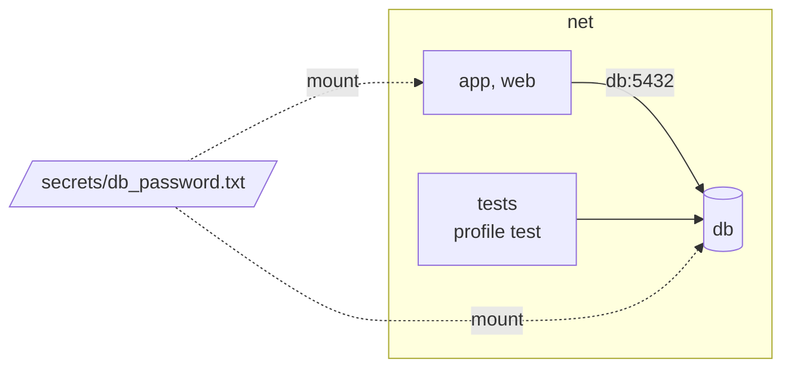

# Chapter 3. Docker Compose for Dev and Test Environments

## 1. The problem

Ứng dụng của bạn cần PostgreSQL, Redis, queue worker. Cài tất cả lên máy từng developer dẫn đến "máy tôi khác máy bạn". **Docker Compose** mô tả cả bộ service trong một file `compose.yaml` và khởi động bằng một lệnh. Cùng file đó (hoặc biến thể) chạy được trong CI để test tích hợp.

## 2. Concepts

- File tên chuẩn hiện nay là `compose.yaml` (vẫn đọc được `docker-compose.yml`). Lệnh là `docker compose` (plugin v2), không phải `docker-compose` (v1 đã ngừng).
- Trường `version:` ở đầu file không còn cần; Compose Specification bỏ qua nó.
- **service**: một container (hoặc nhóm replica). **network**: mặc định mọi service trong một project nằm chung một network và gọi nhau theo tên service (`db`, `redis`). **volume**: persistent data.
- `depends_on` với `condition: service_healthy` chờ `healthcheck` của service phụ thuộc, tốt hơn việc chỉ chờ container bật lên.
- **profiles**: nhóm service chỉ chạy khi gọi rõ (`--profile test`), dùng cho tác vụ chạy một lần như test, migration.
- **secrets**: mount file vào `/run/secrets/<tên>`. Image `postgres` hỗ trợ biến `POSTGRES_PASSWORD_FILE`.



## 3. Lab run

File `lab/compose.yaml` (rút gọn):

```yaml
name: bookcheck-deploygo
services:
  app:                       # service Go
    build: { context: ./go-app, args: { APP_VERSION: dev } }
    image: bookcheck-deploygo-go:dev
    environment:
      DB_HOST: db
      DB_PASSWORD_FILE: /run/secrets/db_password
    secrets: [db_password]
    depends_on:
      db: { condition: service_healthy }
  web:                       # service Node.js/TypeScript
    build: { context: ./node-app, args: { APP_VERSION: dev } }
    image: bookcheck-deploygo-node:dev
    init: true               # tini as PID 1
    depends_on:
      db: { condition: service_healthy }
  db:
    image: postgres:18
    environment:
      POSTGRES_DB: app
      POSTGRES_USER: app
      POSTGRES_PASSWORD_FILE: /run/secrets/db_password
    secrets: [db_password]
    healthcheck:
      test: ["CMD-SHELL", "pg_isready -U app -d app"]
      interval: 5s
      retries: 10
    volumes: [dbdata:/var/lib/postgresql]
  tests:
    profiles: ["test"]
    image: golang:1.27-alpine
    working_dir: /src
    volumes: ["./go-app:/src"]
    command: ["go", "test", "./..."]
    depends_on:
      db: { condition: service_healthy }
secrets:
  db_password: { file: ./secrets/db_password.txt }
volumes: { dbdata: {} }
```

Ba điểm đáng chú ý:

1. **Không có `ports:`**. Trên máy dev bạn thường map port ra host để mở trình duyệt, nhưng trong lab ta gọi service từ một container khác cùng network (`docker run --network ...`); image Go distroless không có shell nên `docker compose exec` vào `app` không dùng được. Map port cũng làm hai project dễ đụng nhau.
2. Với PostgreSQL 18 trở lên, image chính thức đổi thư mục dữ liệu mặc định sang `/var/lib/postgresql/<major>/docker`, vì vậy volume nên mount vào `/var/lib/postgresql` (không phải `/var/lib/postgresql/data` như bản cũ). Mount sai chỗ có thể khiến dữ liệu không được giữ.
3. Service `tests` có profile, nên `docker compose up` bình thường không chạy nó.

Kết quả đã chạy: `docker compose config -q` hợp lệ; `up -d --build` cho `db` thành `healthy` trước khi `app` (Go) và `web` (Node) khởi động (đúng thứ tự `service_healthy`), cả ba `healthy` sau ~40 giây; `docker compose --profile test run --rm tests` chạy `go test ./...` và in `ok  bookcheck/deploy-demo`; `down -v` xóa sạch container, network và volume.

```bash
cd lab
docker compose up -d --build
docker compose ps
docker compose --profile test run --rm tests
docker compose --profile test down -v
```

## 4. Dev, test and production differ

| | Dev | Test (CI) | Production |
|---|---|---|---|
| Mã nguồn | bind mount (`./:/app`) để sửa là thấy | COPY vào image | COPY vào image |
| Dữ liệu | volume giữ lại | tmpfs hoặc volume bị xóa mỗi lần | managed DB service |
| Công cụ | debugger (Delve, `node --inspect`), hot reload (`air`, `node --watch`) | chỉ test runner | không |

Cách tách: file `compose.yaml` làm nền, `compose.override.yaml` (tự động nạp) cho dev, hoặc `-f compose.yaml -f compose.ci.yaml` cho CI. Compose cũng có `docker compose watch` để sync file khi dev (tính năng `develop.watch`).

Compose **không phải** công cụ production cho hệ thống nhiều node: nó không tự rolling update, không tự self-healing trên nhiều máy. Một server đơn nhỏ vẫn có thể dùng, chấp nhận downtime ngắn hoặc dùng thêm reverse proxy (xem chương 5).

## 5. Pitfalls

1. Bind mount `node_modules/` từ host đè lên thư mục trong image, gây lỗi khác kiến trúc OS.
2. Quyền file khi bind mount: container chạy UID 65532 (Go) hoặc 1000 (Node) không ghi được vào thư mục thuộc UID khác.
3. Tin rằng `depends_on` (không có `condition`) đảm bảo DB đã sẵn sàng: nó chỉ chờ container khởi động.
4. Commit file secret thật vào git. Thư mục `secrets/` trong lab có `.gitignore`; mật khẩu lab chỉ dùng cho lab.
5. Dùng tag `postgres:latest` trong compose của test, rồi một sáng CI đỏ vì major version đổi.

## 6. Summary

- `compose.yaml` mô tả cả hệ thống dev/test; các service gọi nhau bằng tên.
- Dùng `healthcheck` + `depends_on: service_healthy` thay vì `sleep`.
- Profiles cho tác vụ chạy một lần như test.
- PostgreSQL 18: mount volume tại `/var/lib/postgresql`.
- Compose tốt cho dev và CI, không thay thế orchestration nhiều node.

## 7. Self-check

1. `depends_on` mặc định chờ gì?
2. Vì sao dùng `down -v` trong CI?
3. Làm thế nào để service `tests` không khởi động cùng `docker compose up`?

<details><summary>Answer</summary>

1. Chỉ chờ container được khởi động, không chờ ứng dụng sẵn sàng; dùng `condition: service_healthy`.
2. Để xóa volume dữ liệu, mỗi lần chạy test bắt đầu từ trạng thái sạch và không resource leak.
3. Gán `profiles: ["test"]` và chỉ chạy với `--profile test`.

</details>
