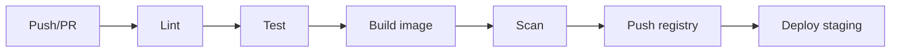

# Chương 4. CI: pipeline và GitHub Actions

## 1. Vấn đề

Không có CI, "deploy" nghĩa là ai đó chạy lệnh trên máy cá nhân, kết quả phụ thuộc vào máy đó. **CI (Continuous Integration)** chạy cùng một chuỗi bước trên mỗi thay đổi: phát hiện lỗi sớm và tạo ra artifact (image) đã được kiểm tra. Sách *Continuous Delivery* gọi đây là "deployment pipeline": mỗi commit đi qua cùng một chuỗi gate kiểm tra trước khi được phép lên production.

## 2. Pipeline điển hình



- **Lint**: `go vet` (Go), `tsc` (TypeScript, kiểm tra kiểu), hadolint cho Dockerfile, actionlint cho workflow, kubeconform cho manifest.
- **Test**: unit + integration (dùng service container hoặc compose với PostgreSQL thật, đừng mock DB cho test migration).
- **Build**: đúng một lần, gắn tag theo commit SHA. Nguyên tắc **build once, deploy many**: artifact test ở staging chính là artifact lên production, không build lại.
- **Scan, SBOM, signing**: chương 10.
- **Cache**: cache module Go và npm (`actions/setup-go`, `actions/setup-node` với `cache: npm` đã làm sẵn), cache layer Docker (`cache-from`/`cache-to` kiểu `gha` hoặc registry).
- **Artifact**: dữ liệu chuyển giữa các job (báo cáo test, file build); image thì đẩy lên registry.

## 3. GitHub Actions: cú pháp hiện tại

Workflow là file YAML trong `.github/workflows/`. Thành phần: `on` (sự kiện), `jobs`, `steps`, `uses` (action dùng lại), `run` (lệnh shell). Tại thời điểm viết `actions/checkout` ở v7.0.1 (đã tra release; các action phổ biến đều đã nhảy nhiều major, nên luôn kiểm tra trang release trước khi chép tag từ bài viết này).

Workflow mẫu của lab (`lab/.github/workflows/ci.yml`, **actionlint pass**):

```yaml
name: ci
on:
  pull_request:
  push:
    branches: [main]

permissions:
  contents: read

concurrency:
  group: ci-${{ github.ref }}
  cancel-in-progress: true

jobs:
  go:
    runs-on: ubuntu-24.04
    timeout-minutes: 15
    defaults:
      run:
        working-directory: go-app
    steps:
      # Thuc te: pin theo SHA 40 ky tu day du, kem comment ve phien ban
      - uses: actions/checkout@3d3c42e5aac5ba805825da76410c181273ba90b1 # v7.0.1
        with:
          persist-credentials: false
      - uses: actions/setup-go@b7ad1dad31e06c5925ef5d2fc7ad053ef454303e # v7.0.0
        with:
          go-version-file: go-app/go.mod
          cache-dependency-path: go-app/go.mod
      - run: go vet ./...
      - run: go test ./...
      - run: CGO_ENABLED=0 go build -trimpath -ldflags "-s -w" -o /tmp/app .

  node:
    runs-on: ubuntu-24.04
    timeout-minutes: 15
    defaults:
      run:
        working-directory: node-app
    steps:
      - uses: actions/checkout@3d3c42e5aac5ba805825da76410c181273ba90b1 # v7.0.1
        with:
          persist-credentials: false
      - uses: actions/setup-node@949feb2413d6458794dcd2491c4babbbce0c15c1 # v7.1.0
        with:
          node-version: 26
          cache: npm
          cache-dependency-path: node-app/package-lock.json
      - run: npm ci
      - run: npx tsc
      - run: node --test dist/

  image:
    needs: [go, node]
    runs-on: ubuntu-24.04
    steps:
      - uses: actions/checkout@3d3c42e5aac5ba805825da76410c181273ba90b1 # v7.0.1
        with:
          persist-credentials: false
      - name: Lint Dockerfiles
        run: |
          docker run --rm -i hadolint/hadolint < go-app/Dockerfile
          docker run --rm -i hadolint/hadolint < node-app/Dockerfile
      - name: Build images
        run: |
          docker build -t demo-go:${{ github.sha }} go-app
          docker build -t demo-node:${{ github.sha }} node-app

  push:
    needs: image
    if: github.ref == 'refs/heads/main'
    runs-on: ubuntu-24.04
    permissions:
      contents: read
      packages: write
      id-token: write   # cho OIDC va cosign keyless
    steps:
      - uses: actions/checkout@3d3c42e5aac5ba805825da76410c181273ba90b1 # v7.0.1
        with:
          persist-credentials: false
      - name: Dang nhap registry
        env:
          TOKEN: ${{ secrets.GITHUB_TOKEN }}
          ACTOR: ${{ github.actor }}
        run: echo "$TOKEN" | docker login ghcr.io -u "$ACTOR" --password-stdin
```

### Hardening: bốn thói quen

1. **Pin action theo SHA commit đầy đủ (40 ký tự)**, ghi tag trong comment. Tag như `@v7` có thể bị chủ repo (hoặc kẻ chiếm tài khoản) trỏ sang mã độc; SHA thì không đổi. SHA này lấy bằng `git ls-remote --tags https://github.com/actions/checkout`. Dùng Dependabot hoặc Renovate để cập nhật SHA.
2. **`permissions:` tối thiểu** ở cấp workflow (`contents: read`) và mở thêm theo từng job. `GITHUB_TOKEN` mặc định có thể quyền rộng tùy cấu hình repo/org.
3. **Không nhúng untrusted input vào `run:`**. Tiêu đề PR, tên nhánh, nội dung issue có thể chứa lệnh. Đưa qua environment variable (như `TOKEN`, `ACTOR` ở trên). actionlint bắt lỗi này: với `lab/.github/workflows/bad.yml` nó báo `"github.event.pull_request.title" is potentially untrusted` và lỗi cú pháp biểu thức.
4. **Cẩn trọng với `pull_request_target`** và `workflow_run`: chúng chạy với secret và quyền ghi trong ngữ cảnh repo gốc; đừng checkout và chạy mã của PR fork trong đó.

Ngoài ra: `persist-credentials: false` để token không nằm lại trong `.git/config`; đặt `timeout-minutes`; ưu tiên runner do GitHub cung cấp, với self-hosted runner thì không dùng cho repo công khai.

### OIDC tới cloud thay cho secret dài hạn

Thay vì lưu `AWS_ACCESS_KEY_ID` lâu dài trong Secrets, workflow xin một **token OIDC** ngắn hạn từ GitHub (cần `permissions: id-token: write`) và cloud (AWS, GCP, Azure) đổi nó lấy credential tạm thời, có điều kiện theo repo, nhánh hoặc environment. Bạn cấu hình phía cloud một "trust policy" nói rõ: chỉ workflow của repo X, nhánh `main` mới được assume role Y. Hết job là credential hết hạn, không có gì để lộ lâu dài. Chi tiết từng cloud xem tài liệu "Configuring OpenID Connect" của GitHub; sách bảo mật đi kèm sẽ đi sâu hơn.

### Environments và approval

`environment: production` cho phép đặt required reviewers, giới hạn nhánh được deploy, và secret riêng theo môi trường. Đây là chỗ gắn approval gate thủ công trước production.

## 4. Lab đã chạy

```bash
docker run --rm -v "$PWD/lab/.github/workflows:/w:ro" rhysd/actionlint:latest -color=false /w/ci.yml
docker run --rm -v "$PWD/lab/.github/workflows:/w:ro" rhysd/actionlint:latest -color=false /w/bad.yml
```

actionlint 1.7.12 (chạy lại sau khi đổi sang Go và Node): `ci.yml` exit 0 (sạch); `bad.yml` exit 1 với hai lỗi nêu ở trên. Workflow mới có ba job song song `go` (`go vet`, `go test`, build tĩnh với `CGO_ENABLED=0`), `node` (`npm ci`, `tsc`, `node --test`) và `image` (hadolint, build hai image). Hai action `setup-go` v7.0.0 và `setup-node` v7.1.0 cũng pin theo SHA (lấy bằng `git ls-remote`). Các lệnh `go test` và `npm ci`/`tsc`/test đã chạy thật trong Docker, không chạy trên runner GitHub thật. Chạy một linter trong CI thật rẻ: nó bắt lỗi trước khi bạn đẩy lên GitHub.

## 5. Trade-off

- Pin SHA an toàn hơn nhưng khó đọc và cần bot cập nhật. Với action của chính tổ chức bạn hoặc nhà phát hành rất đáng tin có thể chấp nhận tag; nhưng quy tắc an toàn là pin tất cả.
- Cache tăng tốc nhưng có thể che lỗi (cache cũ). Định kỳ chạy build không cache.
- Chạy mọi thứ trên mỗi PR đắt; chia theo `paths:` và chạy job nặng trên `main` hoặc khi gắn nhãn.

## 6. Cạm bẫy

1. `permissions` bị bỏ trống nên token có quyền ghi rộng.
2. `echo ${{ secrets.X }}` hoặc in environment variable ra log; GitHub che secret đã biết nhưng không che biến dạng (base64, cắt chuỗi).
3. Dùng `@main` hoặc `@v1` cho action bên thứ ba.
4. Build lại image ở bước deploy thay vì dùng artifact đã test.
5. Secret cho PR từ fork: mặc định không có (đúng), nhưng đừng "sửa" bằng `pull_request_target` một cách vội vàng.

## 7. Tóm tắt

- Một pipeline: lint, test, build một lần, scan, push, deploy.
- Pin action theo SHA, `permissions` tối thiểu, không nhúng untrusted input vào `run`.
- OIDC thay cho long-lived key của cloud.
- actionlint và hadolint chạy trong Docker, rẻ và bắt lỗi sớm.

## 8. Tự kiểm tra

1. Vì sao pin SHA tốt hơn pin tag?
2. `id-token: write` dùng để làm gì?
3. Vì sao không viết `run: echo "${{ github.event.pull_request.title }}"`?
4. "Build once, deploy many" nghĩa là gì?

<details><summary>Đáp án</summary>

1. Tag có thể bị trỏ lại sang commit khác; SHA immutable.
2. Cho phép job xin token OIDC để đổi lấy credential cloud ngắn hạn.
3. Tiêu đề do người ngoài kiểm soát, có thể chèn lệnh shell (script injection); phải truyền qua environment variable.
4. Image được build một lần ở CI, cùng artifact đó đi qua các môi trường; không build lại cho mỗi môi trường.

</details>
