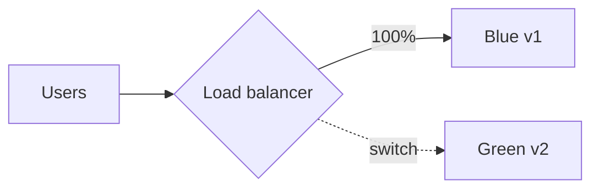

# Chapter 5. Release Strategies: Rolling, Blue-Green, Canary, Shadow

## 1. The problem

Bạn có image mới đã qua CI. Làm sao đưa nó đến người dùng mà không làm họ gián đoạn, và nếu hỏng thì quay lại nhanh thế nào? Báo cáo *Accelerate* (Forsgren, Humble, Kim) dùng bốn metric DORA: deployment frequency, lead time for changes, change failure rate, time to restore service. Chiến lược release tốt cải thiện đồng thời cả bốn: deploy thường xuyên *và* an toàn.

## 2. Deploy versus release

- **Deploy**: đưa phiên bản mới của code lên infrastructure production.
- **Release**: cho người dùng thật thấy tính năng mới.

Hai việc này có thể tách rời. Deploy code với tính năng đang tắt sau feature flag (chương 6), rồi bật dần: release không cần deploy mới, và rollback tính năng chỉ là tắt flag.

## 3. The strategies

### Recreate
Tắt bản cũ, bật bản mới. Đơn giản nhất, có downtime. Chấp nhận được cho hệ thống nội bộ hoặc ngoài giờ.

### Rolling update
Thay dần từng instance. Kubernetes mặc định dùng cách này (chương 8). Tại mỗi thời điểm **cả hai phiên bản cùng phục vụ**, nên code và schema DB phải tương thích hai chiều (chương 7).

```
v1 v1 v1 v1  ->  v2 v1 v1 v1  ->  v2 v2 v1 v1  ->  v2 v2 v2 v2
```

Ưu: ít resource thêm. Nhược: rollback cũng là một rolling update ngược; trong lúc đó vẫn có người dùng gặp bản lỗi.

### Blue-green
Hai môi trường song song: **blue** (đang phục vụ) và **green** (bản mới). Kiểm tra green xong thì chuyển traffic một lần (đổi load balancer, Service selector, hoặc DNS). Rollback = chuyển lại, gần như tức thì.



Ưu: chuyển và rollback nhanh, có thể smoke test trên green trước khi nhận khách. Nhược: tốn gấp đôi resource trong lúc chuyển; **DB dùng chung** nên vẫn phải tương thích hai chiều; session cần lưu ngoài instance.

### Canary
Đưa bản mới cho một phần nhỏ traffic (1%, 5%, 25%, 100%), theo dõi metric (error rate 5xx, latency p99, business metric), tự dừng hoặc rollback nếu xấu. Có thể chia theo phần trăm request hoặc theo nhóm người dùng. Công cụ: Argo Rollouts, Flagger, hoặc weighted routing của Gateway API/service mesh/load balancer cloud.

Ưu: giới hạn blast radius của lỗi. Nhược: cần observability (metrics) đủ tốt và đủ traffic để tín hiệu có ý nghĩa; chạy hai phiên bản lâu hơn.

### Shadow (mirroring)
Mirror traffic thật sang bản mới, bỏ qua phản hồi của nó. Người dùng không bị ảnh hưởng. Hợp với performance testing hoặc so sánh kết quả của logic mới. Cẩn trọng: bản shadow **không được có side effect thật** (gửi email, trừ tiền, ghi vào DB production).

## 4. Quick comparison

| Chiến lược | Downtime | Extra resource | Tốc độ rollback | Độ phức tạp |
|---|---|---|---|---|
| Recreate | Có | Không | Chậm | Thấp |
| Rolling | Không | Ít | Trung bình | Thấp |
| Blue-green | Không | Gấp đôi (tạm thời) | Rất nhanh | Trung bình |
| Canary | Không | Ít đến vừa | Nhanh (giảm weight) | Cao (cần metrics) |
| Shadow | Không | Gấp đôi phần được sao chép | Không áp dụng | Cao |

## 5. Rollback

Quy tắc thực tế:

1. **Rollback code phải rẻ và đã được tập dượt.** Với Kubernetes: `kubectl rollout undo deployment/app`; với GitOps: `git revert` rồi để controller sync.
2. **Rollback code không rollback dữ liệu.** Nếu bản mới đã ghi dữ liệu theo định dạng mới, bản cũ đọc được không? Đây là lý do chương 7 nhấn mạnh expand/contract: schema luôn tương thích với cả bản cũ lẫn bản mới, nên "tiến" an toàn và "lùi" cũng an toàn.
3. **Có tiêu chí tự động**: ví dụ canary tự lùi nếu 5xx > 1% trong 5 phút.
4. **Roll forward** (sửa nhanh rồi deploy bản mới) đôi khi tốt hơn rollback, nhất là khi migration đã không thể đảo. Quyết định trước: chiến lược nào cho từng loại thay đổi.
5. Giữ image cũ trong registry đủ lâu và đừng dùng retention policy xóa nó.

## 6. Mini lab: manual blue-green with Docker (idea)

Hai container `bookcheck-deploygo-blue` (v1) và `bookcheck-deploygo-green` (v2) từ `lab/go-app` với `APP_VERSION` khác nhau, một proxy đổi `upstream`. Do giới hạn thời gian, lab này **chưa được chạy**; phần chạy thật của cuốn sách là image và migration. Việc chuyển traffic ở Kubernetes xem chương 8 (đổi `selector` của Service hoặc dùng `HTTPRoute` có `weight`).

Ví dụ canary 10% bằng Gateway API (đoạn rút gọn này chưa chạy riêng qua kubeconform; hai Service `app-stable`, `app-canary` là minh họa):

```yaml
rules:
  - backendRefs:
      - { name: app-stable, port: 80, weight: 90 }
      - { name: app-canary, port: 80, weight: 10 }
```

## 7. Trade-offs: what to choose when

- Đội nhỏ, ứng dụng CRUD: **rolling** + health check tốt + migration an toàn là đủ.
- Cần quay lại tức thì và có ngân sách resource: **blue-green**.
- Traffic lớn, thay đổi rủi ro (thuật toán, thanh toán): **canary** + feature flag.
- Viết lại một thành phần quan trọng: **shadow** trước, canary sau.

## 8. Pitfalls

1. Blue-green nhưng quên rằng DB chung: migration phá vỡ làm cả hai màu hỏng.
2. Canary không có metric tự động: "xem bằng mắt" không bền.
3. Session hoặc cache lưu trong instance: người dùng mất session khi chuyển.
4. Shadow gửi email thật hai lần.
5. Background job (queue worker) chạy cả hai phiên bản trên cùng queue với payload khác định dạng.

## 9. Summary

- Deploy khác release; feature flag tách chúng.
- Rolling mặc định, blue-green cho rollback tức thì, canary giới hạn thiệt hại, shadow để thử không rủi ro.
- Mọi chiến lược đều chạy hai phiên bản cùng lúc, nên DB phải tương thích hai chiều.
- Rollback phải được tập dượt; dữ liệu mới là phần khó.

## 10. Self-check

1. Khác nhau giữa deploy và release?
2. Vì sao blue-green không tự giải quyết vấn đề migration DB?
3. Khi nào chọn roll forward thay vì rollback?
4. Điều kiện để canary có ý nghĩa?

<details><summary>Answer</summary>

1. Deploy đặt code lên infrastructure; release cho người dùng thấy tính năng. Có thể deploy mà chưa release.
2. Cả hai màu dùng chung một DB; migration không tương thích làm hỏng cả hai.
3. Khi migration đã không đảo ngược được hoặc lỗi nhỏ sửa nhanh hơn việc quay lại.
4. Có metric đáng tin (lỗi, latency, nghiệp vụ), đủ traffic, và threshold tự động quyết định lùi hay tiến.

</details>
