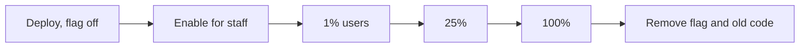

# Chương 6. Feature flag, dark launch, kill switch

## 1. Vấn đề

Bạn viết tính năng "thanh toán mới" trong hai tuần. Nếu gộp vào `main` chỉ khi hoàn tất, bạn có nhánh sống lâu, xung đột lớn, release rủi ro cao. **Feature flag** (cờ tính năng) cho phép gộp code sớm nhưng giữ tính năng tắt, rồi bật có kiểm soát. Đây là công cụ chính để tách deploy khỏi release (chương 5).

## 2. Khái niệm

Feature flag là một điều kiện đọc cấu hình lúc chạy:

```go
if flags.Enabled(ctx, "new-checkout", user) {
	return newCheckout(ctx, order)
}
return legacyCheckout(ctx, order)
```

Phân loại theo mục đích và vòng đời (cách chia phổ biến):

| Loại | Mục đích | Sống bao lâu |
|---|---|---|
| Release flag | Ẩn tính năng chưa xong, bật dần | Ngắn, xóa sau khi bật 100% |
| Experiment flag | A/B test | Ngắn, theo thí nghiệm |
| Ops flag / **kill switch** | Tắt nhanh tính năng nặng hoặc phụ thuộc bên ngoài khi incident | Dài |
| Permission flag | Tính năng theo gói/khách hàng | Dài |

**Dark launch**: chạy code mới trên traffic thật nhưng chưa hiển thị cho người dùng (ví dụ ghi song song, so sánh kết quả, hoặc tính điểm bằng thuật toán mới rồi bỏ đi). Gần với shadow ở chương 5 nhưng ở mức tính năng.

**Kill switch**: ops flag mặc định bật, dùng để tắt khi cần (ví dụ tắt gợi ý sản phẩm khi service gợi ý chậm). Nó cho phép mitigate incident trong vài giây mà không cần deploy.

### OpenFeature

**OpenFeature** là đặc tả mở (dự án CNCF) cho API đánh giá flag, độc lập nhà cung cấp. Bạn viết code với API chuẩn, rồi cắm *provider* (LaunchDarkly, Unleash, flagd, GrowthBook, tự viết...). Đổi nhà cung cấp không phải sửa mọi chỗ gọi. Có SDK cho Go (module `github.com/open-feature/go-sdk`), Node.js (`@openfeature/server-sdk`) và nhiều ngôn ngữ khác. Chưa xác minh phiên bản SDK cụ thể trong cuốn này và hai đoạn code dưới đây chưa chạy; kiểm tra trên trang openfeature.dev trước khi dùng.

Ý tưởng API (rút gọn, đúng tinh thần đặc tả; tên hàm chính xác xem docs SDK Go và Node.js):

```go
// Go, github.com/open-feature/go-sdk
client := openfeature.NewClient("checkout")
evalCtx := openfeature.NewEvaluationContext(user.ID, map[string]any{"plan": user.Plan})
enabled, _ := client.BooleanValue(ctx, "new-checkout", false, evalCtx) // false = giá trị mặc định
```

```ts
// TypeScript, @openfeature/server-sdk
const client = OpenFeature.getClient("checkout");
const enabled = await client.getBooleanValue("new-checkout", false, {
  targetingKey: user.id,
  plan: user.plan,
}); // false = giá trị mặc định
```

Hai điểm thiết kế quan trọng: luôn có **giá trị mặc định** an toàn khi provider lỗi, và truyền **evaluation context** (user, nhóm, môi trường) để nhắm mục tiêu.

Với ứng dụng nhỏ, một flag đọc từ environment variable hoặc file cấu hình (`os.Getenv`, `process.env`) là đủ; OpenFeature có lợi khi cần nhiều service và nhiều ngôn ngữ dùng chung một hệ thống flag.

## 3. Rollout dần



Chia phần trăm nên dựa trên **stable hash** của user id, để một người luôn thuộc cùng nhóm, không nhấp nháy giữa bản cũ và mới.

## 4. Dọn flag (nợ kỹ thuật)

Flag không xóa thì thành nhánh `if` chết, mỗi flag nhân đôi số state cần test. Quy tắc:

1. Mỗi flag có **chủ sở hữu** và **ngày hết hạn** ngay khi tạo.
2. Khi bật 100% ổn định, mở ticket xóa flag; xóa cả đường code cũ và test của nó.
3. Có kiểm tra tự động hoặc báo cáo liệt kê flag quá hạn.
4. Phân biệt flag ngắn hạn (phải xóa) với flag vận hành dài hạn (kill switch, được giữ có chủ đích).

## 5. Trade-off

- Flag thêm độ phức tạp và kết hợp nhiều flag tạo ra tổ hợp khó kiểm. Giới hạn số flag sống cùng lúc.
- Đọc flag từ service ngoài thêm latency và điểm lỗi: local cache, đặt giá trị mặc định.
- Không dùng flag cho thay đổi schema DB: flag không làm schema tương thích; dùng expand/contract (chương 7).
- Flag bảo mật/quyền không nên chỉ nằm ở UI; phải kiểm tra phía server.

## 6. Cạm bẫy

1. Flag tồn tại hàng năm vì không ai dám xóa.
2. Tắt flag nhưng dữ liệu tạo bởi đường code mới vẫn còn, đường cũ không hiểu được.
3. Flag provider sập kéo cả ứng dụng sập vì không có default hoặc timeout.
4. Mỗi đội đặt tên flag một kiểu, không có quy ước.
5. Quên test cả hai giá trị của flag trong CI.

## 7. Tóm tắt

- Feature flag tách deploy khỏi release và làm rollback tính năng chỉ còn là tắt flag.
- Kill switch là ops flag để mitigate incident; dark launch chạy thử code mới trên traffic thật không lộ ra ngoài.
- OpenFeature chuẩn hóa API; luôn có giá trị mặc định và evaluation context.
- Mỗi flag ngắn hạn cần chủ sở hữu và ngày xóa.

## 8. Tự kiểm tra

1. Khác nhau giữa release flag và kill switch về vòng đời?
2. Vì sao chia phần trăm theo stable hash của user id?
3. Giá trị mặc định trong lời gọi OpenFeature dùng khi nào?
4. Vì sao flag không thay thế expand/contract?

<details><summary>Đáp án</summary>

1. Release flag ngắn hạn và phải xóa; kill switch tồn tại dài hạn có chủ đích.
2. Để cùng một người luôn thấy cùng một phiên bản, tránh nhấp nháy.
3. Khi provider lỗi hoặc không có flag đó: trả giá trị an toàn đã chọn.
4. Flag chỉ chọn nhánh code; schema DB vẫn dùng chung cho mọi nhánh nên phải tương thích với cả hai.

</details>
