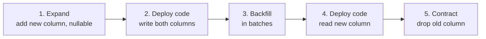

# Chapter 7. Zero-Downtime DB Migrations

## 1. The problem

Khi rolling update, **code cũ và code mới chạy cùng lúc trên cùng một DB**. Migration kiểu "đổi tên column, deploy code mới" làm bản cũ lỗi ngay khi migration chạy. Tệ hơn: một câu `ALTER TABLE` tưởng vô hại có thể giữ lock `ACCESS EXCLUSIVE` và chặn mọi đọc/ghi vào table, kéo sập cả hệ thống dù không có dòng code nào sai.

## 2. Concepts

### Expand / contract (parallel change)

Chia một thay đổi phá vỡ thành các bước, mỗi bước tương thích với cả bản code trước và sau:



Ví dụ: đổi `orders.total` (int, đơn vị đồng) sang `total_cents bigint`. Không `ALTER COLUMN TYPE` mà thêm column mới, ghi hai nơi, backfill, đổi đường đọc, cuối cùng xóa column cũ ở một lần deploy sau (khi không còn code cũ nào chạy). Mỗi bước là một deploy riêng và có thể dừng hoặc lùi lại.

### Locks in PostgreSQL

Mỗi câu DDL xin một **table lock mode**. Hai điều cần nhớ:

- `ACCESS EXCLUSIVE` (ALTER TABLE hầu hết dạng, DROP, TRUNCATE...) xung đột với *mọi* chế độ khác, kể cả `SELECT`.
- Lock **xếp hàng** (queue): nếu `ALTER` phải chờ một transaction dài đang đọc, thì mọi query đến *sau* ALTER cũng xếp hàng sau nó. Một ALTER "nhanh" nhưng bị kẹt sau một transaction dài có thể làm đứng cả table. Cách phòng: `SET lock_timeout = '2s'` cho DDL và thử lại.

Chế độ `ShareLock` (do `CREATE INDEX` thường xin) chặn `INSERT/UPDATE/DELETE` (vốn xin `RowExclusiveLock`) nhưng cho đọc. `CREATE INDEX CONCURRENTLY` xin `ShareUpdateExclusiveLock`, không xung đột với ghi, đổi lại: chậm hơn (scan table nhiều lần), không chạy trong transaction block, và nếu lỗi thì để lại một index **INVALID** cần xóa rồi tạo lại.

## 3. Lab run (PostgreSQL 18.6)

Script `lab/migration/run.sh`: table `orders` 2.000.000 row. Một session "writer" INSERT liên tục (mỗi lệnh commit riêng, nghỉ 5 ms) trong 12 giây, ghi lại latency lớn nhất của một INSERT. Giữa chừng chạy DDL ở session khác và chụp `pg_locks`.

```bash
bash lab/migration/run.sh                 # đầy đủ, vài phút, tự xóa container
ROWS=300000 ONLY=EFG bash lab/migration/run.sh   # chỉ phần E-G, nhẹ hơn
```

Kết quả thật (máy dùng chung nhiều process khác nên số tuyệt đối chỉ để so sánh tương đối):

| Kịch bản | INSERT hoàn tất trong 12 s | Latency lớn nhất 1 INSERT | Lock quan sát được trên `orders` |
|---|---|---|---|
| A. Baseline (không DDL) | 899 | 44 ms | không |
| B. `CREATE INDEX` thường | 487 | **5220 ms** | `ShareLock` granted; INSERT của writer ở `RowExclusiveLock` **granted = f** (đang chờ) |
| C. `CREATE INDEX CONCURRENTLY` | 758 | 167 ms | `ShareUpdateExclusiveLock`; writer giữ `RowExclusiveLock` **granted = t** |
| D. `ALTER COLUMN total TYPE bigint` | 182 | **20134 ms** | `AccessExclusiveLock`; writer `RowExclusiveLock` **granted = f** |

Diễn giải:

- **B** chứng minh `CREATE INDEX` thường chặn ghi trong suốt thời gian build index (~5 giây trên 2 triệu row).
- **C** chứng minh `CONCURRENTLY` không chặn ghi: writer không bao giờ phải chờ lock (column `granted = t`); latency lớn nhất 167 ms chỉ phản ánh resource contention (CPU, I/O), không phải chờ lock. Index kết thúc với `indisvalid = true`.
- **D** chứng minh một `ALTER` nguy hiểm: đổi kiểu `int` sang `bigint` rewrite cả table dưới `ACCESS EXCLUSIVE`, có một INSERT đứng chờ ~20 giây. Trên table production hàng trăm triệu row, thời gian này tính bằng phút đến giờ.

Truy vấn dùng để quan sát:

```sql
SELECT l.mode, l.granted, left(a.query, 58) AS query
FROM pg_locks l JOIN pg_stat_activity a USING (pid)
WHERE l.relation = 'orders'::regclass AND a.pid <> pg_backend_pid()
ORDER BY l.granted DESC, l.mode;
```

(Row có `granted = f` là query đang bị chặn. Mỗi DDL xuất hiện hai row cùng câu lệnh; nhiều khả năng là process leader và worker song song khi build index, chưa kiểm chứng riêng. Ta chỉ quan tâm lock *mode*.)

### Parts E-G (300,000 rows, run)

- **E. Expand + backfill theo batch**: `ALTER TABLE orders ADD COLUMN total_cents bigint` (column nullable, không default) là thay đổi chỉ metadata, tức thì. Backfill bằng vòng lặp update 50.000 row mỗi lần và `COMMIT` sau mỗi batch (thủ tục `DO` có COMMIT, chạy được từ PostgreSQL 11 khi không nằm trong transaction block). Trong lúc backfill, writer vẫn chạy: 807 INSERT trong 12 s, latency lớn nhất 337 ms. Backfill xong sau khoảng 12,5 s.
- **F. `CHECK ... NOT VALID` rồi `VALIDATE CONSTRAINT`**: thêm constraint `NOT VALID` chỉ cần lock ngắn và không scan table; `VALIDATE` scan table với lock nhẹ hơn (`SHARE UPDATE EXCLUSIVE`), không chặn ghi. Kết quả: `chk_cents validated=true`.
- **G. `lock_timeout`**: một transaction đang đọc table (giữ `ACCESS SHARE`), rồi `ALTER TABLE` với `lock_timeout='1s'` bị hủy với `ERROR: canceling statement due to lock timeout` thay vì xếp hàng chặn mọi người sau nó. Đây là hành vi mong muốn: thử lại khi vắng giờ cao điểm.

```sql
-- mẫu migration an toàn (PostgreSQL)
SET lock_timeout = '2s';
ALTER TABLE orders ADD COLUMN total_cents bigint;          -- expand
-- backfill theo batch, commit từng batch...
ALTER TABLE orders ADD CONSTRAINT chk_cents CHECK (total_cents IS NOT NULL) NOT VALID;
ALTER TABLE orders VALIDATE CONSTRAINT chk_cents;
-- bước contract ở lần deploy sau, khi không còn code cũ:
-- ALTER TABLE orders DROP COLUMN total;
```

## 4. PostgreSQL and MySQL

| Thao tác | PostgreSQL | MySQL (InnoDB 8.x) |
|---|---|---|
| Add index không chặn ghi | `CREATE INDEX CONCURRENTLY` | `ALTER TABLE ... ADD INDEX ..., ALGORITHM=INPLACE, LOCK=NONE` (online DDL) |
| Add column | Tức thì nếu nullable hoặc default hằng số (từ PG 11) | `ALGORITHM=INSTANT` cho nhiều trường hợp ở 8.0+ |
| Đổi kiểu column | Rewrite table, `ACCESS EXCLUSIVE` | Thường `ALGORITHM=COPY` (chặn ghi); xem bảng "Online DDL Operations" của MySQL |
| Constraint không scan ngay | `NOT VALID` + `VALIDATE` | Không có tương đương trực tiếp |

Trong MySQL, hãy chỉ định rõ `ALGORITHM` và `LOCK` để câu lệnh **thất bại ngay** nếu không thể chạy online, thay vì âm thầm chọn `COPY`: ví dụ `ALTER TABLE orders ADD INDEX idx_c (customer_id), ALGORITHM=INPLACE, LOCK=NONE;`. Với table rất lớn hoặc thay đổi mà online DDL không hỗ trợ, các công cụ ngoài như gh-ost hoặc pt-online-schema-change copy table ngầm rồi swap; chưa chạy trong lab này. Lab MySQL chưa được thực hiện, các cú pháp trên lấy từ tài liệu chính thức, bạn hãy thử trên replica trước.

## 5. Batched backfill: principles

- Batch nhỏ (vài nghìn đến vài chục nghìn row), commit từng batch để giữ transaction ngắn và không phình WAL/replication lag.
- Đi theo primary key, có điểm dừng và có thể chạy lại (idempotent).
- Nghỉ giữa các batch khi tải cao hoặc replica bị lag.
- Trong ứng dụng Go hoặc Node: chạy backfill như một job riêng (Kubernetes `Job`, hoặc binary/script `cmd/backfill` chạy một lần), không đặt trong bước migration chạy lúc deploy; migration schema nhanh, backfill dữ liệu tách ra.

## 6. Running old and new code side by side

- Thứ tự bắt buộc: **migration expand trước, code sau**; **code ngừng dùng column cũ trước, contract sau**.
- Code mới phải chịu được dữ liệu chưa backfill (column mới còn NULL).
- Đổi tên column không bao giờ trực tiếp: thêm column mới, sync, chuyển, xóa cũ. Công cụ như `strong_migrations` (Ruby/Rails) liệt kê chính xác các thao tác nguy hiểm kể trên; với Go và Node tôi chưa kiểm tra công cụ tương đương nào đủ phổ biến, nên hãy lập checklist trong review (có thể thêm linter SQL như `squawk` cho PostgreSQL, chưa chạy trong lab này).

## 7. Trade-offs

- Expand/contract kéo một thay đổi thành 3-5 deploy. Với table nhỏ và có maintenance window, một `ALTER` đơn có thể hợp lý.
- `CONCURRENTLY` chậm hơn và có thể để lại index INVALID khi lỗi.
- Giữ column cũ lâu tốn dung lượng và gây nhầm lẫn; đặt hạn xóa.

## 8. Pitfalls

1. `ALTER` bị kẹt sau transaction dài, lock queue làm đứng table. Luôn đặt `lock_timeout`.
2. `CREATE INDEX` thường trên table đang ghi.
3. `ADD COLUMN ... NOT NULL DEFAULT` trên PostgreSQL cũ (trước 11) rewrite table; từ 11 trở lên default hằng số là tức thì, nhưng default không ổn định (như `random()`) vẫn có thể rewrite.
4. `ADD FOREIGN KEY` hoặc `ADD CHECK` không `NOT VALID` scan cả table dưới lock mạnh.
5. Chạy lệnh migrate (golang-migrate, Prisma, Knex...) đồng thời trên nhiều Pod.
6. Backfill trong một transaction khổng lồ.

## 9. Summary

- Rolling update nghĩa là schema phải tương thích cả code cũ lẫn mới: dùng expand/contract.
- `CREATE INDEX` thường chặn ghi; `CONCURRENTLY` không (đã đo trên PostgreSQL 18.6). `ALTER COLUMN TYPE` rewrite table và chặn cả đọc lẫn ghi.
- Luôn `lock_timeout` cho DDL; `NOT VALID` + `VALIDATE` cho constraint.
- Backfill theo batch, commit từng batch, tách khỏi migration schema.

## 10. Self-check

1. Vì sao `ALTER TABLE` ngắn vẫn có thể làm đứng cả table?
2. Column `granted = f` trong `pg_locks` cho biết điều gì?
3. Liệt kê các bước đổi tên column an toàn.
4. `CREATE INDEX CONCURRENTLY` đánh đổi những gì?

<details><summary>Answer</summary>

1. Nó xin `ACCESS EXCLUSIVE`, phải chờ transaction dài; mọi query đến sau xếp hàng sau nó.
2. Query đó đang chờ lock, chưa được cấp.
3. Thêm column mới; code ghi cả hai; backfill; code đọc column mới; xóa column cũ ở lần deploy sau.
4. Chậm hơn, không chạy trong transaction, có thể để lại index INVALID khi lỗi.

</details>
