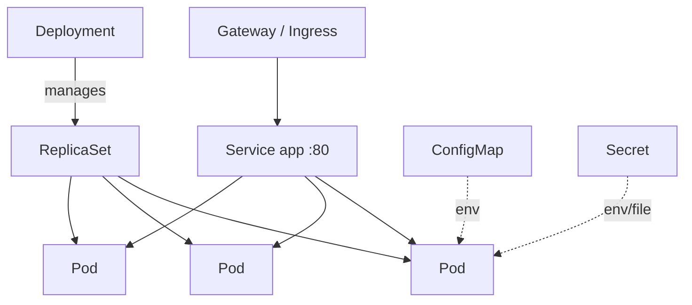
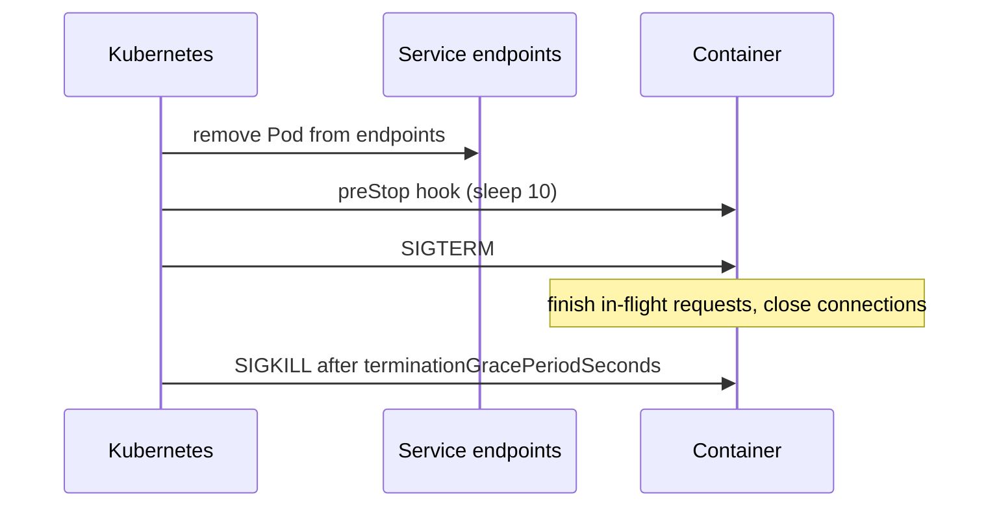

# Chương 8. Kubernetes căn bản cho developer

## 1. Vấn đề

Một server chạy Docker Compose không tự thay container hỏng trên máy khác, không rolling update có kiểm soát, không autoscale theo tải. **Kubernetes (K8s)** là hệ container orchestration: bạn khai báo *desired state* ("3 replica của image này, mỗi replica tối đa 256 MiB RAM") và K8s liên tục điều chỉnh thực tế cho khớp.

Phiên bản tại thời điểm viết: Kubernetes **1.37** là bản mới nhất (1.37.1 ngày 15/09/2026; 1.34 hết hỗ trợ 27/10/2026), theo trang kubernetes.io/releases. Manifest trong lab được validate theo schema 1.37.0.

## 2. Các đối tượng cơ bản



- **Pod**: đơn vị nhỏ nhất, gồm một hay vài container chia sẻ network. Pod là ephemeral, bạn hiếm khi tạo trực tiếp.
- **Deployment**: khai báo "N replica Pod theo mẫu này" và cách cập nhật. Quản lý các **ReplicaSet** (mỗi phiên bản một ReplicaSet), nhờ đó rollback là chuyển lại ReplicaSet cũ.
- **Service**: tên và IP ổn định, load balancing đến các Pod chọn bằng `selector`. Chỉ Pod đang **Ready** nhận traffic.
- **ConfigMap / Secret**: cấu hình và dữ liệu nhạy cảm tách khỏi image. **Lưu ý: Secret mặc định chỉ được encode base64, không phải encryption thật.** Bật encryption at rest cho etcd và giới hạn RBAC; hoặc dùng External Secrets.
- **Ingress / Gateway API**: đưa traffic từ ngoài vào Service.

### Ingress hay Gateway API (trạng thái 11/2026)

API `Ingress` vẫn tồn tại, chưa có kế hoạch bỏ. Nhưng **controller `ingress-nginx` đã ngừng bảo trì**: cộng đồng Kubernetes thông báo retire tháng 11/2025, không còn release hay security patch sau tháng 3/2026. **Gateway API** (`HTTPRoute`, `Gateway`) là hướng đi mới, biểu đạt tốt hơn (chia vai trò infrastructure và ứng dụng, weighted routing cho canary). Các lựa chọn controller gồm Envoy Gateway, Cilium, Istio, Traefik, kgateway... Trước khi chọn hãy kiểm tra trang chính thức của Gateway API để biết phiên bản và mức hỗ trợ; nguồn tôi tra có mâu thuẫn về số phiên bản mới nhất (v1.6.x hay v1.7.0), nên cuốn này không khẳng định.

Manifest lab dùng `HTTPRoute` (`gateway.networking.k8s.io/v1`), validate bằng schema từ catalog CRD cộng đồng.

## 3. Probe: ba loại, ba mục đích

| Probe | Câu hỏi | Nếu thất bại |
|---|---|---|
| **startupProbe** | Ứng dụng đã khởi động xong chưa? | Kubelet giết container (sau `failureThreshold`); tắt liveness/readiness cho tới khi qua |
| **readinessProbe** | Sẵn sàng nhận traffic chưa? | Pod bị **rút khỏi Service**, không bị giết |
| **livenessProbe** | Có bị treo không? | Container bị **restart** |

Sai lầm kinh điển: liveness gọi cả DB. DB chậm, liveness thất bại, mọi Pod restart đồng loạt, hệ thống sập hẳn. Liveness chỉ nên kiểm tra *bản thân process*. Readiness có thể kiểm tra phụ thuộc quan trọng, thận trọng với kiểu "mọi Pod cùng không ready".

```yaml
startupProbe:
  httpGet: { path: /healthz, port: http }
  periodSeconds: 2
  failureThreshold: 30       # tối đa ~60 s để khởi động
readinessProbe:
  httpGet: { path: /healthz, port: http }
  periodSeconds: 5
  failureThreshold: 2
livenessProbe:
  httpGet: { path: /healthz, port: http }
  periodSeconds: 10
  failureThreshold: 3
```

## 4. Resource request / limit, HPA

- `requests`: lượng resource scheduler **reserve**; cũng là cơ sở tính phần trăm cho HPA.
- `limits`: trần. Vượt **memory limit** thì container bị OOMKilled; vượt **CPU limit** thì bị bóp (throttle). Nhiều đội đặt `limits.memory` mà bỏ `limits.cpu` để tránh throttle; đó là lựa chọn có tranh luận, tùy workload.
- **HPA (HorizontalPodAutoscaler)** tăng giảm số Pod theo metric (CPU, memory, custom metric). Cần Metrics Server và phải có `requests.cpu` để tính phần trăm. Manifest lab: `minReplicas: 3`, `maxReplicas: 10`, mục tiêu CPU 70%. Khi dùng HPA, **đừng cố định `spec.replicas`** trong Git (GitOps sẽ giành quyền với HPA).

## 5. Rolling update, PDB, graceful shutdown

```yaml
strategy:
  type: RollingUpdate
  rollingUpdate:
    maxSurge: 1          # tạo thêm tối đa 1 Pod mới
    maxUnavailable: 0    # không bao giờ giảm dưới số mong muốn
```

Với `maxUnavailable: 0`, K8s tạo Pod mới, chờ nó **Ready**, rồi mới tắt Pod cũ. Readiness probe chính xác vì thế quyết định tính zero-downtime.

**PodDisruptionBudget (PDB)**: giới hạn số Pod bị gián đoạn **tự nguyện** (drain node, nâng cấp cluster): `minAvailable: 2` nghĩa là không cho drain nếu còn dưới 2 Pod. PDB không bảo vệ khỏi involuntary disruption (node chết).

### Graceful shutdown: chuỗi sự kiện khi Pod bị xóa



Việc rút Pod khỏi endpoints và việc gửi SIGTERM xảy ra **gần như song song**, nên proxy vẫn có thể chuyển vài request đến Pod sắp tắt. Giải pháp phổ biến: `preStop: sleep 10` để chờ endpoints lan truyền, sau đó ứng dụng nhận SIGTERM, ngừng nhận kết nối mới, xử lý nốt và thoát. `terminationGracePeriodSeconds` (lab đặt 40) phải lớn hơn `preStop` cộng thời gian xử lý request dài nhất. Sau đó K8s gửi SIGKILL.

Lưu ý ứng dụng: process PID 1 phải nhận được SIGTERM (dùng dạng exec `CMD ["node", ...]` hoặc `ENTRYPOINT ["/app"]`, không dùng shell form, không dùng `npm start`; chương 2) và tự xử lý nó: Go `signal.NotifyContext` + `srv.Shutdown`, Node `server.close()`. Lab chương 2 đã chứng minh request đang chạy vẫn hoàn tất khi nhận SIGTERM. Với worker xử lý job nền, đặt grace period đủ cho job dài nhất và dừng nhận job mới khi nhận SIGTERM. Image distroless **không có lệnh `sleep`**, nên `preStop` trong `app.yaml` dùng hook `sleep: { seconds: 10 }` có sẵn của Kubernetes thay cho `exec: ["sleep", "10"]`.

## 6. Lab đã chạy: validate manifest bằng kubeconform

Cluster thật (k3s) **không chạy** ở lab này (để giữ RAM thấp cho máy dùng chung). Manifest **chỉ được validate**, chưa được apply lên cluster nên các hành vi mô tả (rolling update, preStop...) chưa được kiểm chứng thực tế trong cuốn này.

```bash
docker run --rm -v "$PWD/lab/k8s:/k:ro" ghcr.io/yannh/kubeconform:latest \
  -strict -summary -kubernetes-version 1.37.0 \
  -schema-location default \
  -schema-location 'https://raw.githubusercontent.com/datreeio/CRDs-catalog/main/{{.Group}}/{{.ResourceKind}}_{{.ResourceAPIVersion}}.json' \
  /k/app.yaml
```

kubeconform v0.8.0, schema 1.37.0 (chạy lại sau khi đổi sang image Go: user 65532, `preStop.sleep`, bỏ `LOG_CHANNEL`): `app.yaml` có **7 resource, Valid: 7** (Namespace, ConfigMap, Deployment, Service, HPA, PDB, HTTPRoute). `broken.yaml` (`replicas: "three"`, `containerPort: "80"`) bị bắt: `got string, want null or integer`, exit 1.

kubeconform chỉ kiểm schema, **không** bắt lỗi logic (selector không khớp label, image không tồn tại, Secret `app-secret` chưa tạo). Manifest mẫu dùng image Go; với service Node chỉ đổi image và `runAsUser: 1000`. Hãy kết hợp `kubectl apply --dry-run=server` trên cluster thật và các công cụ policy.

## 7. Trade-off

- K8s mạnh nhưng phức tạp về vận hành. Với 1-3 service và đội nhỏ, một service PaaS/container managed (hoặc Compose trên một máy) có thể rẻ hơn nhiều.
- Dùng managed cluster (EKS, GKE, AKS...) thay vì tự dựng, trừ khi có lý do.
- `maxSurge` cao làm rollout nhanh nhưng tốn resource tạm thời.

## 8. Cạm bẫy

1. Thiếu readiness probe: Pod mới nhận traffic khi chưa sẵn sàng.
2. Liveness phụ thuộc DB.
3. Không đặt `requests`: HPA không hoạt động và scheduler dồn Pod bừa.
4. Không xử lý SIGTERM nên request đang chạy bị cắt.
5. Dùng tag `latest` hoặc tag có thể đổi, nên rollback không reproducible; dùng digest (lab dùng `@sha256:...` giả để minh họa).
6. `readOnlyRootFilesystem: true` nhưng quên mount `emptyDir` cho `storage/`, `/tmp`, `bootstrap/cache`.
7. PDB `minAvailable` bằng đúng số replica sẽ chặn mãi việc drain node.

## 9. Tóm tắt

- Deployment quản lý ReplicaSet và Pod; Service load balancing tới Pod Ready.
- Startup, readiness, liveness phục vụ ba mục đích khác nhau; liveness không kiểm tra phụ thuộc ngoài.
- `maxUnavailable: 0` + readiness chuẩn + preStop + xử lý SIGTERM = rolling update không mất request.
- Gateway API là hướng mới; `ingress-nginx` đã retire.
- Manifest lab mới được validate bằng kubeconform, chưa chạy trên cluster.

## 10. Tự kiểm tra

1. Readiness thất bại khác liveness thất bại thế nào?
2. Vì sao cần `preStop: sleep` dù đã có SIGTERM?
3. HPA cần điều kiện gì ở Pod?
4. PDB có bảo vệ khi node chết không?

<details><summary>Đáp án</summary>

1. Readiness rút Pod khỏi Service (không giết); liveness restart container.
2. Rút endpoints và gửi SIGTERM gần như song song, proxy có thể còn gửi request đến Pod đang tắt; sleep cho endpoints kịp cập nhật.
3. Có metrics server và `resources.requests` cho metric cần tính (CPU).
4. Không, PDB chỉ áp dụng cho gián đoạn tự nguyện như drain.

</details>
