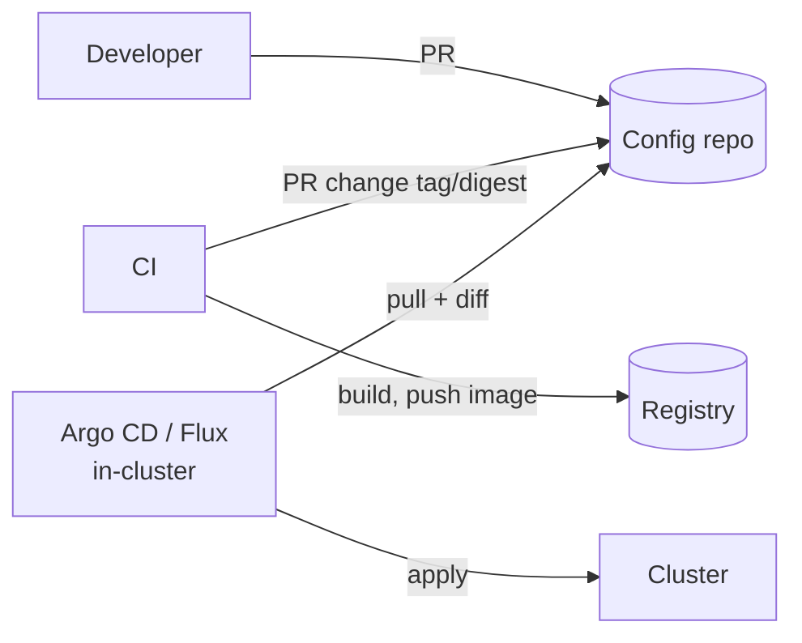

# Chương 9. GitOps, Helm và Kustomize

## 1. Vấn đề

Pipeline kiểu "CI chạy `kubectl apply`" có ba nhược điểm: CI cần quyền cao vào cluster; không ai biết actual state của cluster có khớp Git không (có người `kubectl edit` tay); rollback là chạy lại pipeline. **GitOps** đảo mô hình: Git là single source of truth; một controller *trong cluster* liên tục pull cấu hình từ Git và đưa cluster về đúng trạng thái đó.



Bốn nguyên tắc (theo OpenGitOps): declarative; versioned and immutable; pulled automatically; continuously reconciled.

## 2. Argo CD và Flux

Cả hai đều là graduated project của CNCF. Phiên bản mới nhất tôi tra được: Argo CD v3.6.1 (04/11/2026), Flux v2.10.0 (26/10/2026).

| | Argo CD | Flux |
|---|---|---|
| Khái niệm | `Application` trỏ repo, đường dẫn, cluster đích | `GitRepository` + `Kustomization`/`HelmRelease` |
| Giao diện | UI web phong phú | Chủ yếu CLI/CRD (có UI bên thứ ba) |
| Mô hình | Một control plane có thể quản nhiều cluster | Chạy trong từng cluster, chia thành controller nhỏ |
| Automated image update | Qua Argo CD Image Updater (thành phần riêng) | Image automation controllers |

Ví dụ `Application` của Argo CD (cấu trúc theo tài liệu; chưa chạy trong lab):

```yaml
apiVersion: argoproj.io/v1alpha1
kind: Application
metadata:
  name: app
  namespace: argocd
spec:
  project: default
  source:
    repoURL: https://github.com/example/deploy-config
    targetRevision: main
    path: overlays/production
  destination:
    server: https://kubernetes.default.svc
    namespace: deploy-demo
  syncPolicy:
    automated: { prune: true, selfHeal: true }
```

`selfHeal: true` ép cluster quay về Git nếu có ai sửa tay; `prune: true` xóa resource đã bị gỡ khỏi Git.

**Rollback trong GitOps = `git revert`** commit đổi phiên bản, rồi controller sync. Có lịch sử, review và audit miễn phí.

Hai repo hay một? Thường tách **source repo** và **config repo** để commit cấu hình không kích hoạt build và để áp access control khác nhau.

Secrets trong GitOps: không đẩy Secret thô lên Git. Dùng Sealed Secrets, SOPS hoặc External Secrets Operator.

## 3. Helm

**Helm** là package manager cho Kubernetes: một **chart** là thư mục template (Go template) cộng `values.yaml`. `helm install` render template ra manifest và lưu một **release** có phiên bản, nên `helm rollback` được. Phiên bản Helm mới nhất tôi tra được là 4.x (v4.3.1).

```bash
helm template app ./chart -f values-prod.yaml   # chỉ render, không cài
helm upgrade --install app ./chart -f values-prod.yaml
helm rollback app 1
```

Ưu: packaging, parameterization, hệ sinh thái chart sẵn có cho phần mềm bên thứ ba. Nhược: template Go trên YAML khó đọc và khó debug; quản lý hook và thứ tự CRD phức tạp.

## 4. Kustomize

**Kustomize** (tích hợp trong `kubectl kustomize` / `kubectl apply -k`) không dùng template: bạn có một **base** YAML thuần và các **overlay** patch lên theo môi trường.

```
base/               overlays/production/
  deployment.yaml     kustomization.yaml   # resources: [../../base]
  service.yaml                             # images: [{name: app, digest: sha256:...}]
  kustomization.yaml                       # patches: replicas, resources
```

```yaml
# overlays/production/kustomization.yaml
resources: [../../base]
images:
  - name: ghcr.io/example/deploy-demo
    newTag: "1.4.2"
patches:
  - path: replicas-patch.yaml
```

Ưu: YAML thuần, dễ đọc, dễ diff. Nhược: ít biểu đạt hơn Helm khi cần logic điều kiện phức tạp.

## 5. Chọn gì

- Triển khai phần mềm bên thứ ba (Postgres operator, cert-manager): dùng Helm chart có sẵn.
- Ứng dụng của bạn với vài môi trường: Kustomize thường đủ và dễ review.
- Dùng cả hai: Argo CD/Flux hỗ trợ cả Helm lẫn Kustomize; một số đội render Helm rồi vá bằng Kustomize.
- Cluster đơn nhỏ, một đội: GitOps có chi phí học và vận hành, nhưng ngay cả khi chưa dùng controller, giữ manifest trong Git và validate trong CI (kubeconform) đã là bước tiến lớn.

## 6. Cạm bẫy

1. Controller sync liên tục xung đột với HPA (cùng sửa `replicas`): bỏ trường `replicas` khỏi manifest hoặc cấu hình ignore difference.
2. Secret thô trong Git.
3. `automated.prune` bật mà không kiểm: xóa nhầm resource khi đổi đường dẫn.
4. Tag `latest` trong manifest: Git không đổi nên controller không thấy gì thay đổi.
5. Cập nhật tag image bằng tay sai chỗ; hãy tự động hóa qua PR từ CI.
6. Một repo cho tất cả môi trường mà nhánh `main` đồng nghĩa production, không có approval gate.

## 7. Tóm tắt

- GitOps: Git là source of truth, controller trong cluster pull và reconcile liên tục.
- Rollback là `git revert`; có audit trail sẵn.
- Argo CD (UI, nhiều cluster) và Flux (module nhỏ, thuần CRD) đều trưởng thành.
- Helm cho gói bên thứ ba và parameterization; Kustomize cho overlay YAML thuần.

## 8. Tự kiểm tra

1. GitOps khác "CI chạy kubectl apply" ở điểm nào về permission và reconciliation?
2. `selfHeal` làm gì?
3. Khi nào Kustomize thích hợp hơn Helm?
4. Vì sao không nên dùng `latest` trong GitOps?

<details><summary>Đáp án</summary>

1. Controller trong cluster kéo cấu hình nên CI không cần quyền vào cluster, và nó liên tục reconcile, phát hiện drift.
2. Tự đưa resource về state trong Git khi bị sửa tay.
3. Khi chỉ cần vá khác biệt nhỏ giữa môi trường trên YAML thuần của chính bạn.
4. Manifest trong Git không đổi khi image đổi, controller không thấy thay đổi và rollback không reproducible.

</details>
