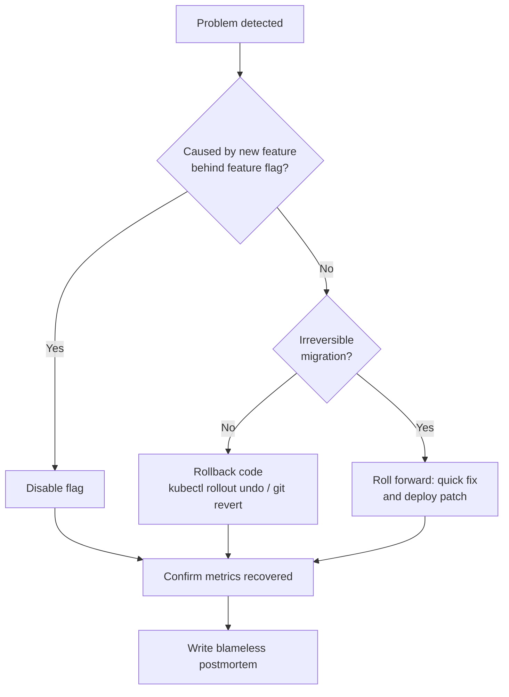

# Chương 11. Checklist trước khi deploy và quy trình rollback

## 1. Vấn đề

Phần lớn incident deploy không đến từ lỗi khó, mà từ thứ bị quên: migration chưa chạy, environment variable thiếu, không biết cách quay lại. Checklist ngắn, cụ thể, và tốt nhất là **tự động hóa được** thành gate trong pipeline. Sách *Continuous Delivery* nhấn mạnh: nếu việc nào đau thì làm thường xuyên hơn và tự động hóa nó, đến khi nó hết đau.

## 2. Checklist trước deploy

**Mã và artifact**
- [ ] CI xanh trên đúng commit sắp deploy (lint, test, hadolint, actionlint, kubeconform).
- [ ] Image được build một lần, tag theo SHA, deploy theo **digest**.
- [ ] Vulnerability scan không có mục HIGH/CRITICAL chưa xử lý (chương 10).
- [ ] Ghi chú release: thay đổi gì, ai chịu trách nhiệm, rollback bằng cách nào.

**Dữ liệu**
- [ ] Migration tương thích ngược (expand-only): bản code **hiện tại** vẫn chạy được sau migration (chương 7).
- [ ] Migration đã thử trên bản copy dữ liệu có kích thước thật; ước lượng thời gian và lock.
- [ ] DDL có `lock_timeout`; index tạo `CONCURRENTLY` (hoặc `ALGORITHM=INPLACE, LOCK=NONE` ở MySQL).
- [ ] Backfill tách khỏi migration, chạy theo batch.
- [ ] Có backup gần nhất và đã **thử restore** ít nhất một lần.

**Cấu hình**
- [ ] Environment variable và secret mới đã có ở môi trường đích *trước* khi deploy code cần chúng.
- [ ] Feature flag của tính năng mới đang tắt; kill switch đã biết cách bật tắt.

**Infrastructure**
- [ ] Probe (startup/readiness/liveness), resource request/limit, PDB, `maxUnavailable: 0` đã đặt.
- [ ] `terminationGracePeriodSeconds` lớn hơn thời gian preStop + request dài nhất.
- [ ] Dashboard và alert (5xx, latency, queue, lỗi DB) mở sẵn.

**Con người**
- [ ] Không deploy chiều thứ Sáu, hay trước khi người chịu trách nhiệm vắng mặt (hãy tự quyết quy tắc của đội).
- [ ] Có người trực và kênh liên lạc rõ ràng.

## 3. Trong và sau deploy

1. Deploy theo chiến lược đã chọn (rolling, canary...).
2. Theo dõi các metric trong ít nhất vài phút đến khi ổn định; kiểm tra log lỗi mới.
3. Chạy smoke test: một vài request/luồng nghiệp vụ chính.
4. Bật feature flag dần (nếu có), theo dõi sau mỗi bước.
5. Giữ cửa sổ rollback mở cho đến khi tin rằng ổn.
6. Ghi lại: thời điểm, phiên bản, kết quả.

## 4. Quy trình rollback



Thứ tự ưu tiên "rẻ nhất trước": **tắt flag** (giây) rồi **rollback code** (phút) rồi **roll forward** rồi **restore dữ liệu** (đắt nhất, hiếm khi cần nếu migration tuân thủ expand/contract).

Lệnh Kubernetes thường dùng (kubectl không chạy trong lab này; xem tài liệu Kubernetes):

```bash
kubectl -n deploy-demo rollout status deployment/app
kubectl -n deploy-demo rollout history deployment/app
kubectl -n deploy-demo rollout undo deployment/app            # về bản liền trước
kubectl -n deploy-demo rollout undo deployment/app --to-revision=3
```

Với GitOps: `git revert <commit>` và để controller sync. Không dùng `kubectl rollout undo` trên resource do Argo CD/Flux quản lý nếu `selfHeal` bật, vì controller sẽ đưa nó lại về state Git.

**Tập dượt rollback**: chọn một lần trong staging mỗi quý, thử rollback có chủ đích. Rollback chưa từng chạy thử thì chưa phải rollback.

## 5. Post-mortem

Mục tiêu là học, không phải tìm người đổ lỗi: timeline, root cause, vì sao hệ thống/quy trình cho phép lỗi lọt qua, action item có người chịu trách nhiệm và hạn. Đưa thành quả vào checklist.

## 6. Cạm bẫy

1. Checklist dài đến mức không ai đọc; giữ ngắn và tự động hóa.
2. Rollback code nhưng migration đã làm column cũ biến mất.
3. Quên rằng queue worker và cron cũng cần rollback.
4. Quyết định rollback chậm vì "thử sửa thêm chút nữa"; đặt threshold thời gian trước.
5. Không ghi lại gì nên không học được.

## 7. Tóm tắt

- Checklist ngắn chia theo mã, dữ liệu, cấu hình, infrastructure, con người; tự động hóa tối đa.
- Theo dõi và smoke test sau deploy, giữ cửa sổ rollback.
- Rollback rẻ nhất trước: tắt flag, rollback code, roll forward.
- Tập dượt rollback; migration expand/contract làm rollback an toàn.

## 8. Tự kiểm tra

1. Vì sao migration phải tương thích với code đang chạy?
2. Thứ tự các cách khắc phục từ rẻ đến đắt?
3. Vì sao không nên dùng `kubectl rollout undo` trên resource do GitOps quản lý (selfHeal)?
4. Vì sao cần thử restore backup?

<details><summary>Đáp án</summary>

1. Trong lúc rolling, bản cũ vẫn chạy trên DB đã migrate; migration phá vỡ làm bản cũ lỗi, và rollback cũng không còn an toàn.
2. Tắt flag, rollback code, roll forward, restore dữ liệu.
3. Controller sẽ đưa resource về state trong Git, hủy thao tác; phải revert trong Git.
4. Backup chưa từng được restore thì chưa biết nó dùng được hay không.

</details>
