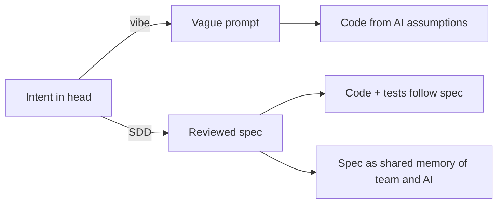

# Chapter 1. Vibe coding, and why the spec is back at the center

## 1. Scenario

Một team 4 người làm RoomBook, hệ thống đặt phòng họp nội bộ (dự án xuyên suốt của sách này). Ngày đầu, một bạn mở Claude Code và gõ: "làm cho tôi chức năng đặt phòng họp". Sau 20 phút có màn hình đặt phòng chạy được. Cả team vui. Tuần sau, QA phát hiện:

- Hai người đặt 10:00 đến 11:00 và 11:00 đến 12:00 bị báo "trùng giờ" (AI dùng `<=` thay vì `<`).
- Không ai nhớ giới hạn tối đa mấy giờ mỗi lượt, vì chưa ai hỏi chị Hà (business owner). AI tự chọn một con số và code nó vào ba nơi khác nhau.
- Người thứ hai nhờ AI "sửa thêm cho hủy phòng" thì AI viết lại luôn cả logic đặt phòng theo cách khác.

Không có lỗi nào trong số này là "AI dốt". Cả ba đều là thiếu thông tin: thứ AI cần biết nằm trong đầu con người, chưa bao giờ được viết ra.

## 2. Concepts

### 2.1. Vibe coding in its original sense

Thuật ngữ **vibe coding** do Andrej Karpathy đặt ra trong một bài đăng trên X ngày 02/02/2025. Ý gốc: một kiểu lập trình mà bạn "buông theo cảm giác" (give in to the vibes), nói với model bằng ngôn ngữ tự nhiên, nhận mọi thay đổi nó đề xuất mà không đọc kỹ diff, gặp lỗi thì dán error message lại cho model, và gần như quên là code tồn tại. Karpathy mô tả nó phù hợp với dự án cuối tuần, dự án thử chơi, "throwaway".

Điều này quan trọng vì hai cách hiểu sai phổ biến:

| Hiểu sai | Thực tế |
|---|---|
| Vibe coding = mọi hình thức dùng AI để code | Ý gốc hẹp hơn: **không review, chấp nhận hết, lặp bằng cách dán lỗi** |
| Vibe coding là xấu | Với prototype vứt đi hoặc công cụ cá nhân thì nó hợp lý và rẻ |

Nguồn: bài đăng gốc của Karpathy trên X (02/02/2025). Tôi dẫn qua các bản trích thứ cấp vì không mở được bài gốc trực tiếp; nội dung "give in to the vibes ... forget that the code even exists" được nhiều nguồn trích giống nhau. Nếu cần trích chính xác từng chữ, hãy mở bài gốc.

Từ cuối 2025, nhiều người dùng "vibe coding" theo nghĩa rộng cho mọi lập trình với AI. Trong sách này, ta dùng nghĩa gốc (hẹp) và gọi cách làm có kiểm soát là **AI-assisted engineering**.

### 2.2. Spec-Driven Development (SDD)

**SDD** là cách làm trong đó *spec (đặc tả) được viết, review và lưu trữ trước hoặc cùng lúc với code*, và là đầu vào chính cho AI. Con người sở hữu "cái gì và vì sao"; AI hỗ trợ "như thế nào"; test chứng minh code khớp spec.

Hai điểm cần tỉnh táo:

1. SDD không phải một chuẩn hay một sản phẩm. Nó là một họ thực hành, được hiện thực bằng nhiều tool (chương 6): GitHub Spec Kit, OpenSpec, Kiro, AIUP và cách tự làm bằng Markdown.
2. Các tool khác nhau về mức độ: có tool coi spec chỉ là bước khởi động rồi code thành source of truth, có tool muốn spec sống lâu như code. Ta sẽ gọi tên sự khác biệt này ở chương 6.

### 2.3. Why the spec is back

Lập trình viên luôn có spec, chỉ là nó nằm trong đầu, chat, hoặc ticket ba dòng. Khi con người tự code, ta bù những chỗ thiếu bằng trực giác và hỏi đồng nghiệp ngay lúc cần. AI thì:

- Không hỏi lại trừ khi được yêu cầu, mà điền chỗ trống bằng giả định hợp lý nhất theo training data.
- Sinh code rất nhanh, nên một giả định sai lan ra nhiều file trước khi bạn kịp nhận ra.
- Không nhớ gì giữa các session trừ khi thông tin nằm trong file (CLAUDE.md, spec). Chương 5 nói về việc này.



### 2.4. Vibe coding and SDD side by side

| Tiêu chí | Vibe coding | SDD |
|---|---|---|
| Đầu vào cho AI | Prompt ngắn, mỗi lần một khác | Spec lưu trong repo |
| Review | Thường bỏ qua | Review spec, rồi review code theo spec |
| Kiểm chứng | Chạy thử bằng mắt | Test map về acceptance criteria |
| Chi phí ban đầu | Rất thấp | Cao hơn (viết và review spec) |
| Chi phí khi đổi, khi mở rộng | Tăng nhanh | Thấp hơn nếu spec sống |
| Hợp với | Prototype, công cụ cá nhân | Sản phẩm có người dùng thật, nhiều người cùng làm |

### 2.5. SDD is not waterfall

Waterfall viết toàn bộ tài liệu trước, chia phase cứng, đổi requirement rất đắt. SDD hiện đại làm khác ở ba điểm: spec **theo từng slice nhỏ** (một use case một lần), feedback loop ngắn (spec → code → feedback → sửa spec), và spec nằm cùng repo, đổi bằng pull request như code. Nếu team bạn viết 80 trang spec rồi mới code thì đó là waterfall, không phải SDD.

## 3. Example: the same requirement, two ways

Vibe:

```text
làm chức năng đặt phòng họp, không cho trùng giờ
```

SDD (trích UC-001 của dự án mẫu, xem `lab/roombook/specs/use-cases/UC-001-create-booking.md`):

```text
AC-001-7  Given R1 đã có booking 09:00-10:00
          When  M2 đặt 10:00-11:00
          Then  tạo Booking CONFIRMED
```

Một dòng này loại bỏ hẳn lỗi `<=` ở tình huống đầu chương, vì "liền nhau" đã được viết ra thành một ví dụ kiểm thử được.

## 4. Trade-offs: when to use it, when not to

- Dùng vibe coding: spike 1 giờ để thử một ý tưởng, script cá nhân, demo bỏ đi. Quy tắc: **đã quyết định vứt thì mới vibe**.
- Dùng SDD: có người dùng thật, có business rule, nhiều người hoặc nhiều session AI cùng đụng vào, hoặc cần audit.
- Chuyển từ vibe sang SDD khi prototype "bỗng dưng sống sót". Lúc đó đừng vá, hãy reverse-engineer spec từ hành vi hiện có (chương 8) rồi mới mở rộng.

## 5. Pitfalls

- Gọi mọi thứ dùng AI là "vibe coding" rồi bác bỏ cả hai. Phân biệt rõ nghĩa gốc.
- Viết spec dài nhưng không kiểm thử được ("hệ thống phải thân thiện"). Spec phải có ví dụ cụ thể.
- Tin rằng có spec là không cần review code. Spec giảm sai lệch, không loại bỏ nó.
- Tool hóa quá sớm: cài tool trước khi team thống nhất cần viết gì. Chương 6 giúp chọn.

## 6. Summary

1. Vibe coding (Karpathy, 02/2025) nghĩa gốc là không review, chấp nhận hết, dán lỗi để lặp; hợp với thứ vứt đi.
2. Lỗi của AI phần lớn là lỗi thiếu thông tin; spec là nơi lưu thông tin đó.
3. SDD = spec được review và lưu trong repo, test chứng minh code khớp spec.
4. SDD làm theo slice nhỏ và lặp, không phải waterfall.
5. SDD là họ thực hành, có nhiều tool khác nhau.

## 7. Self-check

1. Ý gốc của "vibe coding" gồm những hành vi nào? Vì sao nó không đồng nghĩa với "dùng AI để code"?
2. Nêu ba điểm khiến SDD khác waterfall.
3. Tại sao AI "điền chỗ trống" là vấn đề lớn hơn với người code?
4. Bạn có prototype đã chạy tốt 2 tháng và sắp có 50 người dùng. Nên làm gì trước?

<details><summary>Answer</summary>

1. Buông theo cảm giác, nhận mọi đề xuất không đọc diff kỹ, dán lỗi để lặp, quên code. Dùng AI nhưng vẫn review, có test, có architecture thì không phải nghĩa gốc.
2. Spec theo slice nhỏ; feedback loop ngắn; spec nằm trong repo và đổi bằng PR.
3. AI không hỏi lại, sinh nhanh và nhiều, nên giả định sai lan rộng trước khi bị phát hiện; người code thường hỏi đồng nghiệp lúc nghi ngờ.
4. Reverse-engineer spec từ hành vi hiện có (entity, use case, characterization test), rồi mới mở rộng theo spec (chương 8).
</details>
