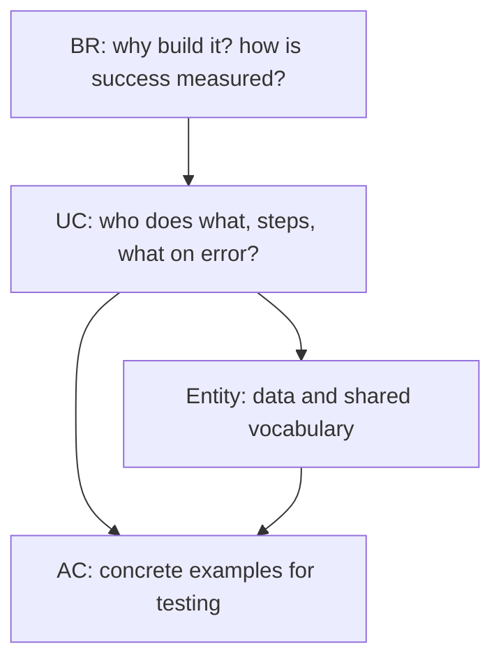

# Chương 2. Bốn tầng của requirement: BR, Use Case, Entity, Acceptance Criteria

## 1. Tình huống

Ticket: "Cho phép nhân viên đặt phòng họp." Dev A hiểu là chọn giờ bất kỳ. Dev B hiểu là chỉ trong giờ làm việc. QA không biết test gì. Chị Hà không nhớ mình đã nói "tối đa 4 tiếng" ở buổi họp nào. Một câu ticket ba dòng không đủ để bốn người cùng hiểu một thứ.

Giải pháp: tách requirement thành bốn tầng, mỗi tầng trả lời một câu hỏi khác nhau, và mỗi tầng trỏ về tầng trên.

## 2. Khái niệm

| Tầng | Câu hỏi | Người chủ yếu | Ví dụ trong RoomBook |
|---|---|---|---|
| Business Requirement (BR) | Vì sao, đo bằng gì, out of scope là gì | PO, BA, business owner | `BR-001-self-service-room-booking.md` |
| Use Case (UC) | Ai làm gì với hệ thống, main flow, alternative flow, exception | BA, tech lead | `UC-001-create-booking.md` |
| Entity Model | Có những khái niệm nào, field nào, quan hệ gì | Tech lead, dev | `specs/entities.md` |
| Acceptance Criteria (AC) | Ví dụ cụ thể nào chứng minh xong | BA, QA, dev | bảng AC trong từng UC |

Mã `BR-001`, `UC-001`, `AC-001-1` là **quy ước đặt tên của dự án này**, không phải tính năng của một tool nào. Một số tool (AIUP chẳng hạn) cũng dùng tiền tố `UC-` hay `BP-`, nhưng bạn tự chọn quy ước và giữ nhất quán. Spec Kit và OpenSpec thì đặt tên theo thư mục riêng của chúng (xem chương 6).

### 2.1. Tầng 1: Business Requirement

Gồm: context, goal, **success metric đo được**, in scope và out of scope, constraint, open question. Phần "out of scope" quan trọng ngang phần "in scope", vì nó là hàng rào chống AI (và dev) làm thêm.

Ví dụ metric của BR-001: số vụ trùng phòng mỗi tuần từ khoảng 6 xuống 0. Metric cho biết khi nào dừng.

### 2.2. Tầng 2: Use Case

Một UC mô tả một mục tiêu mà một actor đạt được. Thành phần: Actor, Trigger, Preconditions, Main Flow, Alternative Flows, Exceptions, Postconditions. Với AI, phần quý nhất là **bảng Exceptions với error code**: mỗi dòng là một nhánh code và một test.

Một UC "sống được" khi: nhỏ (review được trong 10 đến 15 phút), có error code cụ thể, không dùng từ mơ hồ ("nhanh", "thân thiện"), và trỏ về BR.

### 2.3. Tầng 3: Entity Model

Là từ vựng chung: tên khái niệm, field, kiểu, ràng buộc, quan hệ. Mục đích lớn nhất là **một từ chỉ một nghĩa**. Nếu spec gọi "Booking", code gọi `Reservation`, DB gọi `rsv`, AI sẽ tạo ba khái niệm. Dự án mẫu có `specs/glossary.md` cho việc này.

Entity Model trong spec là conceptual model, chưa phải schema database. Chương 3 phân biệt entity, value object và aggregate.

### 2.4. Tầng 4: Acceptance Criteria

Dạng Given/When/Then, **có số liệu cụ thể**. Ví dụ tốt: "R1 đã có booking 09:00 đến 11:00; M2 đặt 10:00 đến 12:00; lỗi `BOOKING_OVERLAP`". Ví dụ tệ: "hệ thống không cho đặt trùng".

Quy tắc chọn AC: mỗi dòng Exceptions có ít nhất một AC; ngoài ra thêm AC cho **boundary** (ví dụ AC-001-7: hai booking liền nhau là hợp lệ). Boundary là nơi lỗi hay nằm nhất.

### 2.5. Spec hiện tại và spec thay đổi

Spec có hai trạng thái: *hiện trạng* (hệ thống đang làm gì) và *đề xuất thay đổi* (sẽ đổi gì). Có hai cách tổ chức:

- Sửa thẳng UC trong một PR riêng, lịch sử nằm trong git và mục "Lịch sử" của UC (cách của lab này).
- Tách thành "delta": thư mục thay đổi riêng, gộp vào spec chính khi xong. OpenSpec làm theo cách này với `specs/` và `changes/` (chương 6).

## 3. Ví dụ: đọc lab

Mở `lab/roombook/specs/`. Đi theo chuỗi:

1. `BR-001` ràng buộc "tối đa 240 phút", "tối đa 3 lượt sắp tới", "hủy trước 120 phút là miễn phí".
2. `UC-001` biến chúng thành các dòng Exceptions: `DURATION_TOO_LONG`, `QUOTA_EXCEEDED`.
3. `UC-002` dùng 120 phút để phân biệt `late_cancel`.
4. `entities.md` định nghĩa `Booking.late_cancel`, `TimeSlot`.
5. AC-001-4 (08:00 đến 12:30 = 270 phút, lỗi) và AC-002-1 (còn đúng 120 phút, miễn phí) kiểm tra hai con số đó, **kể cả ở boundary**.
6. `tests/acceptance/uc001-create-booking.test.ts`, test `test_ac_001_4_rejects_duration_over_240_minutes` là test tương ứng.

Số liệu cộng đúng: UC-001 có 8 AC, UC-002 có 5 AC, tổng 13 AC và 13 test, ghi trong `specs/traceability.md`.

## 4. Trade-off

- Không phải việc nào cũng cần đủ 4 tầng. Sửa lỗi nhỏ chỉ cần một AC mới. Tính năng mới có business rule mới cần UC + AC. Sản phẩm mới cần cả BR.
- Quá nhiều tầng cho team 2 người có thể thành gánh nặng: gộp BR vào đầu UC đầu tiên cũng chấp nhận được, miễn là còn success metric và out of scope.
- Khi ràng buộc đổi liên tục (product discovery), đừng khóa AC quá sớm; giữ ở mức BR và UC phác thảo.

## 5. Cạm bẫy

- Trộn tầng: nhét tên bảng database vào BR, hoặc nhét "vì sao" vào AC.
- AC không số liệu, hoặc số liệu không cộng đúng (ví dụ nói 3 giờ nhưng ví dụ ghi 08:00 đến 12:30).
- Đổi tên field giữa các tài liệu (`start_at` ở chỗ này, `from_time` ở chỗ kia). Dùng `glossary.md` và để AI kiểm tra.
- Viết AC sau khi code xong rồi "khớp" vào code, mất tác dụng độc lập.

## 6. Tóm tắt

1. Bốn tầng: BR (vì sao), UC (ai làm gì), Entity (từ vựng), AC (ví dụ kiểm thử).
2. Mỗi tầng trỏ về tầng trên; AC map tới tên test.
3. Bảng Exceptions của UC và AC ở boundary là phần có giá trị nhất với AI.
4. Mã `BR-`, `UC-`, `AC-` là quy ước của team, không phải tính năng tool.
5. Dùng số tầng vừa đủ với cỡ thay đổi.

## 7. Tự kiểm tra

1. Mỗi tầng trả lời câu hỏi nào?
2. Vì sao phải có phần "out of scope" trong BR?
3. AC nào ở lab kiểm tra boundary 120 phút và 240 phút?
4. "UC-004" có phải thứ Spec Kit hay OpenSpec tự sinh không?

Đáp án

1. BR: vì sao và đo gì; UC: ai làm gì; Entity: khái niệm và field; AC: ví dụ kiểm thử được.
2. Để chặn việc làm thêm ngoài ý định, nhất là khi AI tự "làm cho đủ".
3. AC-002-1 (đúng 120 phút còn lại, miễn phí) và AC-001-4 (270 phút bị từ chối). Boundary 240 phút có thể bổ sung AC thứ 9 là bài tập.
4. Không. Đó là quy ước đặt tên của team (hoặc của AIUP). Spec Kit đánh số feature theo thư mục riêng của nó; OpenSpec đặt theo tên change.

