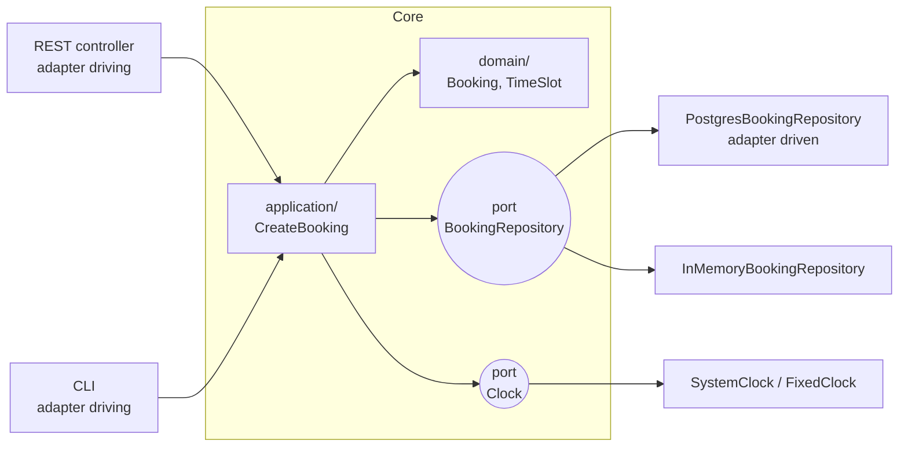

# Chương 3. DDD và Hexagonal Architecture trong thời AI

## 1. Tình huống

Bạn bảo AI "thêm kiểm tra trùng phòng". Nó sửa trong controller. Tuần sau bạn bảo "thêm API khác để đặt phòng từ Slack", nó sao chép luôn đoạn kiểm tra sang handler Slack, thiếu mất một điều kiện. Business rule nằm rải rác vì không có "chỗ ở" rõ ràng cho nó. AI làm theo khuôn mẫu nó thấy trong code; nếu code đã lộn xộn, nó nhân bản sự lộn xộn.

DDD (Domain-Driven Design) và Hexagonal Architecture cho AI (và cho bạn) một bản đồ: business rule ở đâu, infrastructure ở đâu, dependency đi hướng nào.

## 2. Khái niệm

### 2.1. Các khối xây dựng của DDD (phần cần cho SDD)

| Khái niệm | Định nghĩa ngắn | Ví dụ RoomBook |
|---|---|---|
| **Entity** | Đối tượng có **identity**; hai đối tượng cùng dữ liệu nhưng khác id là khác nhau | `Booking` (`booking_id`), `Room` (`room_id`), `Member` (`member_id`) |
| **Value object** | **Không có identity**, so sánh theo giá trị, immutable | `TimeSlot(start_at, end_at)` |
| **Aggregate** | Cụm đối tượng được sửa cùng nhau, bảo vệ một invariant | Cụm `Booking` |
| **Aggregate root** | Đối tượng duy nhất bên ngoài được phép truy cập để sửa cụm | `Booking` là root của chính nó |
| **Domain service / use case** | Logic không thuộc riêng một entity | `CreateBooking` kiểm tra trùng phòng qua nhiều booking |

Hai nhầm lẫn hay gặp, và dự án mẫu minh họa cách tránh:

1. **Không phải entity nào cũng là aggregate root.** Trong một hệ thống có `Order` chứa nhiều `OrderLine`, `OrderLine` là entity (có id dòng) nhưng chỉ truy cập qua `Order`, nên không phải root. Ở RoomBook, `Booking` và `Room` đều là root vì ta sửa chúng độc lập; `Booking` chỉ giữ `room_id`, `member_id`, không giữ nguyên object `Room`.
2. **Value object khác entity.** `TimeSlot` không có id; hai `TimeSlot` có cùng `start_at` và `end_at` là một. Nó immutable (các field `readonly` và `Object.freeze(this)`) và tự kiểm tra (`end_at` phải sau `start_at`). Xem `src/domain/time-slot.ts`.

Về invariant: business rule "không trùng phòng" liên quan *nhiều* `Booking`, nên một `Booking` đơn lẻ không tự bảo vệ nó được. Ở lab ta để use case `CreateBooking` kiểm tra bằng cách hỏi repository. Với tải cao, bạn cần thêm constraint ở database hoặc lock; đó là chủ đề architecture, ngoài phạm vi sách này.

### 2.2. Ubiquitous language

Ubiquitous language (ngôn ngữ chung) nghĩa là cùng một từ ở spec, code, test, DB. `specs/glossary.md` ghi sẵn "Booking" và cấm "reservation". Khi AI được đưa glossary, nó đặt tên nhất quán hơn; khi review, một tên lạ là tín hiệu sai.

### 2.3. Hexagonal Architecture (Ports and Adapters)

Alistair Cockburn đề xuất (khoảng 2005): đặt logic ứng dụng ở giữa, mọi tương tác với thế giới bên ngoài đi qua **port** và **adapter**.

- **Port** là *interface* do ứng dụng định nghĩa: nó nói "tôi cần khả năng này". Ví dụ `BookingRepository`, `Clock` (`src/ports/`).
- **Adapter** là *implementation* của port: nối port với công nghệ cụ thể. `InMemoryBookingRepository`, `FixedClock` (`src/adapters/in-memory.ts`). Thêm sau: `PostgresBookingRepository`, `SmtpNotifier`.
- Một tích hợp bên ngoài cụ thể (Outlook, Slack, SMTP, Stripe) là **adapter**, không phải port. Port là abstract contract, ví dụ `Notifier.send(member, message)`.
- Có hai phía: adapter driving (REST controller, CLI gọi vào ứng dụng) và adapter driven (database, email mà ứng dụng gọi ra).



Dependency rule: `domain/` và `application/` **không import** `adapters/`. Có thể kiểm tra tự động bằng `grep` hoặc công cụ architecture check; ví dụ đơn giản:

```bash
# lỗi nếu có dòng nào, chạy trong container có sh
grep -rn "adapters" src/domain src/application && echo VI PHAM || echo OK
```

### 2.4. Vì sao hợp với AI

- AI cần **boundary rõ** để biết sửa ở đâu. "Thêm business rule" nghĩa là sửa `domain/` hoặc `application/`, không đụng `adapters/`.
- Port nhỏ, rõ nên AI viết adapter mới (database khác) mà không cần hiểu cả hệ thống.
- Test acceptance dùng fake adapter (in-memory, `FixedClock`), nên chạy nhanh và AI tự kiểm tra được ngay. Xem `tests/acceptance/fixture.ts`.

SDD và Hexagonal khớp nhau: UC trở thành layer `application/`, entity thành `domain/`, "Dependencies" trong UC chỉ ra port nào cần.

### 2.5. Nối spec với cấu trúc code

| Spec | Code |
|---|---|
| `specs/entities.md` | `src/domain/` |
| `specs/use-cases/UC-001-...` | `src/application/create-booking.ts` |
| "Dependencies" của UC (repository, clock) | `src/ports/` |
| `specs/decisions/ADR-001-...` | quyết định dùng ports/adapters |
| AC | `tests/acceptance/uc001-create-booking.test.ts` |

## 3. Ví dụ

Đọc `application/create-booking.ts`: bảy business rule nằm trong một use case, mỗi rule ném `DomainError` với error code khớp bảng Exceptions của UC-001. Thử thêm một business rule "phòng đóng cửa vào thứ Bảy": bạn (hoặc AI) sửa spec trước (một dòng Exceptions mới `ROOM_CLOSED`, một AC), rồi một test, rồi code, và không cần đụng adapter nào.

## 4. Trade-off

- Hexagonal đầy đủ có chi phí: nhiều file, nhiều khái niệm. Với script, CRUD đơn giản, prototype vứt đi thì thừa.
- Dấu hiệu nên dùng: có business rule thật, nhiều kênh vào (REST, Slack, batch), cần test không phụ thuộc infrastructure.
- DDD đầy đủ (bounded context, event) chỉ đáng khi domain phức tạp và nhiều team. RoomBook không cần; ta chỉ mượn entity, value object và ubiquitous language.

## 5. Cạm bẫy

- Gọi mọi class có dữ liệu là entity; quên value object nên mọi thứ mutable.
- Biến mọi entity thành aggregate root và cho repository riêng cho từng cái.
- Port là một class cụ thể (`class SmtpMailer`) thay vì interface; hoặc đặt port trong thư mục adapters.
- Để adapter (ORM model) lọt vào `domain/`, khiến AI trộn business logic với database.
- Đặt tên "port" cho Slack hay Outlook. Đó là adapter của một port `Notifier` hoặc `CalendarGateway`.

## 6. Tóm tắt

1. Entity có identity; value object không có, immutable; không phải entity nào cũng là aggregate root.
2. Port là interface của ứng dụng; adapter là implementation; tích hợp ngoài cụ thể là adapter.
3. Dependency đi vào trong: `domain/` và `application/` không biết `adapters/`.
4. Cấu trúc này cho AI biết sửa business rule ở đâu, và cho phép test acceptance chạy với fake adapter.
5. Chỉ dùng mức DDD/Hexagonal vừa đủ cho độ phức tạp thật.

## 7. Tự kiểm tra

1. `TimeSlot` là entity hay value object? Vì sao?
2. `OrderLine` trong hệ thống có `Order` có phải aggregate root không?
3. Outlook calendar sync là port hay adapter? Port tương ứng có thể tên gì?
4. Thêm database thật cần sửa những thư mục nào trong lab?

<details><summary>Đáp án</summary>

1. Value object: không có id, so sánh theo giá trị, immutable.
2. Thường không: nó là entity con, truy cập qua `Order` (root).
3. Adapter (implementation cụ thể). Port ví dụ `CalendarGateway`.
4. Chỉ thêm adapter mới trong `src/adapters/` (và chỗ wiring lúc startup); `domain/`, `application/`, spec không đổi. Cần chạy lại test acceptance với adapter mới.
</details>
