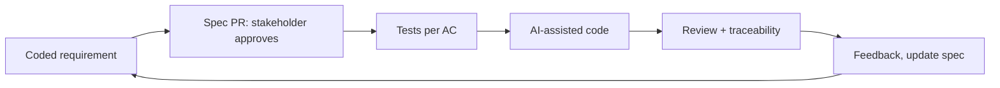

# Chapter 4. Six principles of working spec-first

## 1. A note on origins

Sách gốc trình bày sáu nguyên tắc (Requirements-Driven, AI-Assisted, Iterative Improvement, Test-Protected, Stakeholder-Centric, Traceable) như thể chúng thuộc về AIUP (AI Unified Process). Tôi đã kiểm tra README của marketplace AIUP và trang `aiup-core`: **không thấy danh sách sáu nguyên tắc với những cái tên này**. Những gì tài liệu AIUP nói gần nhất là: requirement có ID ổn định đi trước implementation; artifact là file văn bản review được, nằm cùng source code; mọi kết quả trace được về requirement hoặc use case; quy trình theo phase, điều chỉnh từ Rational Unified Process (README ghi nguồn phương pháp là Simon Martinelli cùng contributors).

Vì vậy trong cuốn này, sáu nguyên tắc là **khung tổng hợp** (không gán cho AIUP, trạng thái "chưa xác minh là của ai"). Chúng hữu ích như một danh sách kiểm tra, không phải chuẩn.

## 2. The six principles, reinterpreted with RoomBook

### 2.1. Requirements-Driven: requirements come first

Mọi thay đổi bắt đầu từ một requirement có ID (BR, UC, AC), không bắt đầu từ "dev thấy nên làm".

- Tình huống: dev muốn thêm "giữ chỗ tạm 10 phút". Không có BR hay UC nào nói tới.
- Cách làm: hỏi "requirement nào đòi cái này?". Nếu chưa có, đề xuất UC mới (kèm AC) qua PR spec, chị Hà duyệt, rồi mới code.
- Kiểm tra: commit và PR nào cũng link một UC (phụ lục B).

### 2.2. AI-Assisted: AI assists, humans decide

AI viết nháp spec, đề xuất AC, sinh code và test; con người quyết "làm gì" và duyệt. Câu hỏi rà soát: "Ở chỗ này AI quyết hay mình quyết?"

- Ví dụ: AI đề xuất `MAX_DURATION_MINUTES = 180`. Con số này là business decision, phải được ghi trong BR (240) do business owner đưa ra, không do AI chọn.
- Dùng AI để *tìm lỗ hổng spec*: "đọc UC-001, liệt kê tình huống chưa có AC". Đó là việc AI làm tốt và rẻ. Skill `spec-review` trong lab làm đúng việc này (chương 5).

### 2.3. Iterative Improvement: iterate in small slices

Không viết hết spec rồi mới code. Mỗi vòng: một UC, một PR spec, một PR code, feedback, sửa spec.

- RoomBook: vòng 1 là UC-001, vòng 2 là UC-002. Giới hạn 3 lượt sắp tới (`QUOTA_EXCEEDED`) có thể thêm sau khi thấy hành vi thật.
- Spec thay đổi thì ghi vào mục "Lịch sử" và git. Spec lỗi thời nguy hiểm hơn không có spec.

### 2.4. Test-Protected: tests protect the spec

Test không chỉ để tìm lỗi; nó là cách để spec còn đúng sau khi AI sửa code. Quy ước: mỗi AC có ít nhất một test, tên chứa mã AC.

- Lab: `test_ac_001_7_allows_back_to_back_bookings` ↔ AC-001-7.
- Script `lab/roombook/scripts/check-ac-coverage.sh` báo AC nào chưa có test. Chạy trong container: kết quả "13 AC đều có test".
- Cẩn thận: AI có thể sửa test cho khớp code sai. Quy tắc team: PR sửa test mà không sửa AC phải được giải thích.

### 2.5. Stakeholder-Centric: the right authority approves at the right point

Ai cần duyệt gì: business owner duyệt BR và AC (ví dụ "hủy trước 120 phút miễn phí"), tech lead duyệt entity và architecture, QA duyệt AC coverage. Viết spec bằng ngôn ngữ người duyệt hiểu được: bảng Given/When/Then thay vì pseudo-code.

- Mẹo: gửi cho chị Hà *chỉ bảng AC* và hỏi "đúng không?", không gửi cả file code.

### 2.6. Traceable: two-way traceability

Từ BR xuống UC, AC, test, code, và ngược lại. Lab có `specs/traceability.md` với 13 dòng AC. Traceability rẻ nhất là *quy ước tên + grep*: `git log --grep="UC-001"` tìm mọi commit liên quan UC-001 (đã chạy thử, chương 8 và phụ lục B).

Không phải mọi thứ đều cần traceability matrix thủ công. Nếu tên test chứa mã AC và PR chứa mã UC, script nhỏ là đủ. Đừng đưa vào annotation hay thư viện chỉ để làm traceability nếu team không cần.

## 3. How to use the six principles

Biến chúng thành một checklist PR (phụ lục B): có UC? AI quyết hay người quyết, đã ghi chưa? PR nhỏ? AC có test? Đúng người duyệt? Traceability cập nhật?

## 4. Trade-offs

- Sáu nguyên tắc có thể thành nghi thức nếu áp mọi việc. Với sửa lỗi nhỏ, chỉ cần AC và test.
- Test-Protected tốn công khi UI thay đổi liên tục; ưu tiên test acceptance ở use case layer thay vì UI layer.
- Stakeholder-Centric cần stakeholder có thời gian. Nếu không có, hãy ghi giả định và gắn nhãn "chưa được duyệt".

## 5. Pitfalls

- Gán nguyên tắc cho một tổ chức mà không kiểm chứng (lỗi của chính sách gốc, ghi nhận ở trên).
- Dùng "AI-Assisted" để biện minh cho việc duyệt PR mà không đọc.
- Traceability một chiều (có link xuống nhưng không bao giờ cập nhật).
- Nhân bản traceability matrix thủ công hàng trăm dòng rồi để lỗi thời.

## 6. Summary

1. Sáu nguyên tắc là khung tổng hợp; chưa xác minh được là của AIUP.
2. Requirement có ID đi trước; người quyết định business, AI hỗ trợ.
3. Lặp theo slice nhỏ; test bảo vệ spec; đúng người duyệt đúng thứ.
4. Traceability rẻ nhất bằng quy ước tên và script.
5. Biến nguyên tắc thành checklist PR, không thành nghi thức.

## 7. Self-check

1. Vì sao cuốn này không nói sáu nguyên tắc là của AIUP?
2. Con số "240 phút" nên do ai quyết, ghi ở đâu?
3. Cách rẻ nhất để trace từ UC tới commit là gì?
4. AI sửa test cho khớp code. Quy tắc nào ngăn việc này?

Answer

1. Tài liệu AIUP không có danh sách sáu nguyên tắc với các tên đó; chỉ có các ý gần đúng (requirements first, artifact review được, traceability, phased process).
2. Business owner quyết, ghi trong BR (constraint), rồi UC và AC phản ánh.
3. Mã UC trong message commit và PR, tìm bằng `git log --grep`.
4. PR sửa test mà không sửa AC phải được giải thích và review; kèm kiểm tra tên test ↔ AC.

