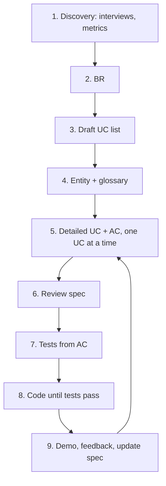

# Chapter 7. Greenfield: building RoomBook from scratch

## 1. Scenario

Bạn bắt đầu một sản phẩm mới, chưa có dòng code nào. Đây là lúc SDD rẻ nhất để làm đúng: không có di sản, và những quyết định đầu tiên (từ vựng, boundary, cấu trúc thư mục) sẽ theo sản phẩm suốt đời. Chương này đi qua một vòng làm RoomBook với đúng cấu trúc của `lab/roombook/`.

## 2. The fixed project structure

```text
roombook/
├── CLAUDE.md
├── specs/
│   ├── business-requirements/BR-001-self-service-room-booking.md
│   ├── use-cases/UC-001-create-booking.md, UC-002-cancel-booking.md
│   ├── entities.md   glossary.md   traceability.md
│   └── decisions/ADR-001-ports-and-adapters.md
├── src/{domain,application,ports,adapters}/
├── tests/acceptance/uc001-create-booking.test.ts, uc002-cancel-booking.test.ts
└── scripts/check-ac-coverage.sh
```

Từ đây đến hết sách, cấu trúc này không đổi.

## 3. The process, in order



### Steps 1 and 2: discovery and BR

Gặp chị Hà, hỏi về nỗi đau và số đo (khoảng 6 vụ trùng phòng mỗi tuần; lễ tân mất khoảng 60 phút mỗi ngày). Viết BR với **success metric** và **out of scope**. Dùng AI để phỏng vấn ngược: nhờ nó liệt kê mười câu hỏi chưa được trả lời, bạn đem đi hỏi. Xem `BR-001`.

Mẹo: ghi các câu hỏi chưa chốt vào mục Open Questions (ví dụ Outlook sync) thay vì để AI tự giả định.

### Steps 3 and 4: Draft UC and Entity

Liệt kê UC bằng tiêu đề: tạo đặt phòng, hủy, xem lịch phòng, quản lý phòng. Chọn slice đầu: tạo và hủy (UC-001, UC-002). Rồi viết `entities.md` và `glossary.md`: `Booking`, `Room`, `Member`, `TimeSlot` (value object). Chốt tên field một lần: `start_at`, `end_at`, `attendee_count`, `late_cancel`.

### Step 5: Detailed UC and AC

Với mỗi dòng Exceptions, hỏi: "Ví dụ số cụ thể nào chứng minh?". Ở UC-001 có 7 error code, nhưng 8 AC vì thêm AC-001-1 (thành công) và AC-001-7 (boundary liền nhau), trừ đi `ROOM_NOT_FOUND` mà ta chưa viết AC (gợi ý: thêm AC-001-9 làm bài tập; `spec-review` sẽ báo thiếu đúng chỗ này).

### Step 6: Spec review

Tách PR spec riêng. Gửi chị Hà bảng AC. Chạy `/spec-review UC-001` (skill trong lab) hoặc nhờ subagent `spec-reviewer` (chương 5).

### Steps 7 and 8: tests, then code

Viết test từ AC trước. Ví dụ AC-001-2 thành:

```ts
// tests/acceptance/uc001-create-booking.test.ts
test("test_ac_001_2_rejects_overlapping_slot", () => {
  const env = makeEnv();
  env.create.execute(env.cmd(at(9, 9), at(9, 11)));
  assert.throws(
    () => env.create.execute(env.cmd(at(9, 10), at(9, 12), { member: "M2" })),
    code("BOOKING_OVERLAP"),
  );
});
```

Rồi bảo AI: "Viết `CreateBooking` để các test acceptance của UC-001 pass; chỉ dùng port trong `ports/`; không sửa test." Tên test khớp AC nên traceability tự nhiên.

Đã kiểm chứng trong Docker (xem README): 13 test acceptance của UC-001 và UC-002 đều đạt, và script `check-ac-coverage.sh` báo 13/13 AC có test.

### Step 9: Feedback and iteration

Demo cho vài người dùng. Giả sử họ than: "đặt 3 lượt là chưa đủ cho trưởng nhóm". Đó là thay đổi business rule: sửa BR (3 thành 5), UC-001 (`QUOTA_EXCEEDED`), AC-001-5, test, rồi code. Thứ tự này giữ spec luôn đúng.

## 4. Which tool to use?

Cùng vòng này có thể chạy bằng các tool ở chương 6. Ánh xạ gợi ý (cú pháp theo tài liệu đã đọc, chưa chạy trên máy tôi vì cần cài tool):

- **Tự làm:** cấu trúc ở trên, CLAUDE.md, `/spec-review`.
- **Spec Kit:** `specify init roombook --integration claude`; trong Claude Code: `/speckit-constitution` (nguyên tắc: "domain không import adapters; mọi AC có test"), `/speckit-specify` (mô tả đặt phòng, tập trung cái gì và vì sao), `/speckit-clarify`, `/speckit-plan` (nhập **mô tả tech stack**, ví dụ "TypeScript 5.9 trên Node.js, hexagonal architecture, repository in-memory trước"; không nhập mã UC), `/speckit-tasks`, `/speckit-analyze`, `/speckit-implement`, `/speckit-converge`. Mã `UC-001` bạn tự ghi trong nội dung spec nếu muốn giữ quy ước của team.
- **OpenSpec:** `openspec init`, rồi `/opsx:propose` cho từng thay đổi, `/opsx:apply`, `/opsx:archive`. Các UC của bạn trở thành requirement và scenario trong `openspec/specs/booking/spec.md`.
- **AIUP:** `/plugin marketplace add ai-unified-process/marketplace`, `/plugin install aiup-core`, rồi `/requirements`, `/entity-model`, `/use-case-spec UC-001`, `/test-case`. Đầu ra nằm ở `docs/` của AIUP chứ không phải `specs/`.

Dù dùng tool nào, hãy giữ **một** cấu trúc và một bộ tên field.

## 5. Trade-offs

- Greenfield làm SDD đầy đủ dễ nhất nhưng cũng dễ over-spec: viết 40 UC trước khi có người dùng nào. Chỉ viết chi tiết cho slice tiếp theo.
- Khi chưa chắc sản phẩm có đáng làm, dừng ở BR và vài UC phác thảo, dựng prototype vứt đi (vibe coding hợp lệ ở đây) rồi mới viết spec thật.
- Hexagonal ngay từ đầu tốn thêm vài file nhưng rẻ hơn tách sau.

## 6. Pitfalls

- Bỏ qua "out of scope", để AI thêm đặt phòng lặp lại "cho tiện".
- Viết spec toàn bộ rồi mới code (waterfall).
- AI tự điền con số business (240 phút, 120 phút) mà không có BR.
- Đổi tên field giữa BR, UC, entity và code. Dùng glossary và `spec-review`.
- Không chạy test thật sự: "thành công" phải là kết quả chạy, không phải lời của AI.

## 7. Checklist before you start

- [ ] BR có metric đo được và out of scope
- [ ] Glossary và entity chốt trước UC đầu tiên
- [ ] Mỗi dòng Exceptions có AC; có AC cho boundary
- [ ] CLAUDE.md ghi cấu trúc và quy tắc "sửa spec trước"
- [ ] Có cách chạy test không cần cài trên máy (Docker)

## 8. Summary

1. Greenfield là lúc rẻ nhất để chốt từ vựng và cấu trúc.
2. Thứ tự: BR, draft UC, entity, UC + AC, review, test, code, feedback.
3. Mỗi lần một slice nhỏ; đổi business rule thì sửa spec trước.
4. Test đặt tên theo AC để có traceability, chạy được và kiểm chứng.
5. Tool nào cũng chạy được vòng này; chọn một cấu trúc và giữ nhất quán.

## 9. Self-check

1. Vì sao đưa success metric vào BR?
2. UC-001 có mấy AC? Error code nào còn thiếu AC?
3. Khi quota đổi từ 3 sang 5, sửa theo thứ tự nào?
4. Nhập "UC-001" vào `/speckit-plan` có hợp lý không?

<details><summary>Answer</summary>

1. Để biết khi nào xong và đo hiệu quả; AI cũng có tiêu chí dừng.
2. 8 AC. `ROOM_NOT_FOUND` chưa có AC.
3. BR, UC-001 (Exceptions), AC-001-5, test, code; cập nhật Lịch sử và traceability.
4. Không. `plan` nhận mô tả tech stack, không nhận mã UC.
</details>
